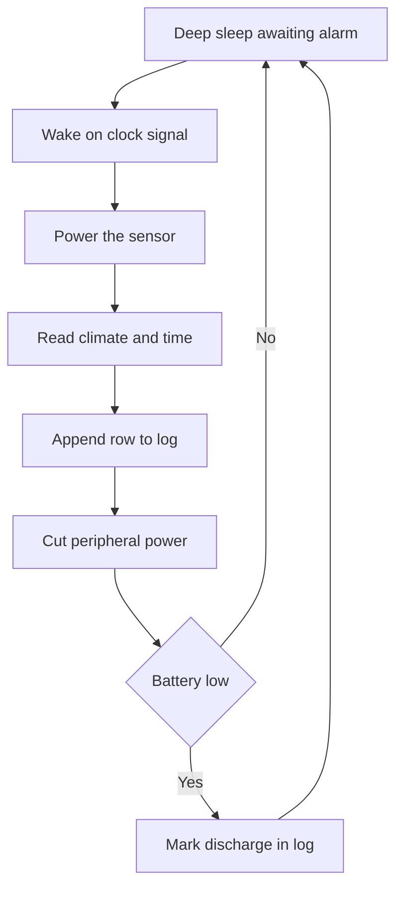

# Weather Station - Sensors and Display

![[assets/img/arduino-meteo-scheme.png|600]]
*Fig. Weather station: sensors outside, board inside, display with pressure, temperature, humidity.*

> [!tip] Purpose
> Build station from sensors to display with data and history.

## 1. Goal

Measure temperature, humidity, pressure; show on display; save to SD.

## 2. Sensors

| Sensor | Parameter | Interface |
| --- | --- | --- |
| DHT22 | Temp, humidity | Digital |
| BMP280 | Pressure, temp | I2C |

## 3. Display

LCD or OLED shows current and trends.

## 4. Sketch fragment

```cpp
#include <Wire.h>
void setup() {}
void loop() {}
```

## 5. Sensor details

| Sensor | Measurement range | Accuracy | Notes |
| --- | --- | --- | --- |
| DHT22 | -40 to 80 C, 0-100% | +/- 0.5 C, +/- 2% | Slow response |
| BMP280 | -40 to 85 C, 300-1100 hPa | +/- 1 hPa | I2C address 0x76 or 0x77 |

Calibration allows offset correction for individual units.

Prefer BME280 for combined humidity, pressure, and temperature in one package.
Mount climate sensor on short flex away from regulator heat; board warmth biases readings.
Poll every ten seconds; faster polling self-heats DHT22 and drifts humidity.

## 5.1 Real-time clock stamp

DS3231 gives date and time per log row; battery keeps it through outages.
Read time once per measurement; attach `YYYY-MM-DD HH:MM:SS` prefix to CSV.
Sync clock at build time from computer; drift stays seconds per month.
Alarm output wakes controller from deep sleep on schedule.

## 5.2 SD card over fast bus

SD library writes CSV lines; open, append, close per row for crash safety.
Keep bus short with solid ground; long wires corrupt blocks.
Name daily file `LOG-YYYY-MM-DD.CSV`; new file per day keeps tables openable.
Buffer ten rows and flush as batch on battery nodes to save energy.
Mirror each row to USB serial for live view during bench tests.

## 6. Display formats

| Mode | Content | Update rate |
| --- | --- | --- |
| Current | Numbers and icons | Every second |
| History | Last 24 hours | Every minute |
| Alarm | Threshold alert | Immediate |

## 6.1 Log format: CSV row

`timestamp,temp,humidity,pressure,battery` one line per measurement.
Example: `2026-10-09 12:00:00,23.5,48,1013.2,4.1` parses in any sheet.
No header repeats; single header at file top keeps imports clean.
Mark low-battery rows with flag column for filter views.

## 6.2 Sleep between measurements

Deep sleep between reads stretches battery to months on cells.
Power sensor from pin: on before read, off before sleep.
Wake by clock alarm every ten minutes; log, then sleep again.
Measure sleep current with meter; over 1 mA means peripheral still fed.

## 7. Power and enclosure

Use 5 V power supply with stable voltage; enclosure protects from rain and dust; antenna outside if IoT.

Sensor breathes through vent hole; board stays in dry compartment.
Separate breathing slot from electronics with foam wall.
Desiccant pack inside electronics bay absorbs condensation swings.

## 7.1 Node sketch: measure write sleep

Wake, power sensor, read climate and time, append CSV row, cut power, sleep.
Close file after each write; lost power loses at most one row.
Retry sensor read twice before logging error code row.
Blink LED once per successful cycle for field confidence.

## Mermaid: node life cycle



## 8. Common issues

| # | Issue | Fix |
| --- | --- | --- |
| 1 | Wrong reading | Check wiring and calibration |
| 2 | No display | Verify library and pin connections |
| 3 | No data save | Check storage format and capacity |
| 4 | Warm-biased sensor | Move sensor on flex away from heat |
| 5 | Lost rows on outage | Close file after each write |
| 6 | Dead battery in days | Deep sleep between reads |

## 8.1 Enclosure breathing check

Hold hand near vent; airflow must reach sensor slot directly.
Condensation on lid means vents too small or electronics too warm.
Test with shower steam at distance; readings must recover in minutes.
Log pre- and post-enclosure offsets to prove ventilation works.

## 9. Official sources

- [DHT22 docs](https://www.dht22.com/)
- [BMP280 datasheet](https://www.bosch-sensortec.com/)
- [Arduino sensors guide](https://docs.arduino.cc/learn/electronics/sensors/)

## See also

- [[Home.en]]
- [[EN/11-Vivid/01-LCD1602.en|Character screen]]
