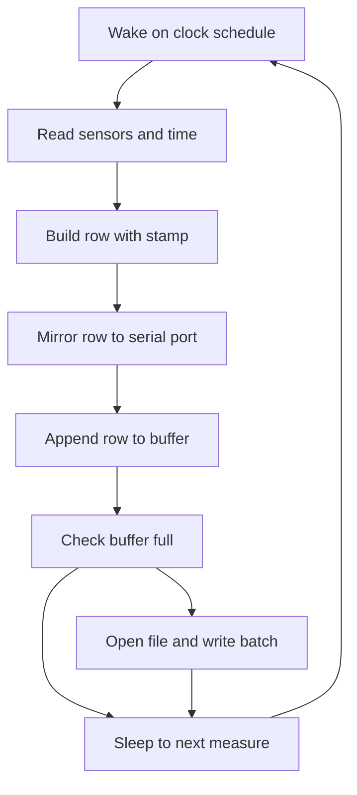

# SD Logger - Data Logging to Card

![[assets/img/arduino-logger-scheme.png|600]]
*Fig. Logger: board, SD module, sensors, file with time and values.*

> [!tip] Purpose
> Save sensor data over time to SD with timestamp.

## 1. Goal

Read sensors; write to file; format CSV.

## 2. Components

| Component | Function | Note |
| --- | --- | --- |
| SD module | Storage | SPI with level shift |
| Sensor | Data source | Any analog or digital |
| RTC DS3231 | Timestamps | Battery backup |
| Display | Live view | Optional OLED |

## 2.1 Logger kit: what to buy

SD module with level matching on board; bare 5 V carriers kill cards early.
RTC with coin cell; `millis()` resets on reboot and confuses the archive.
Sensor set per task: climate, voltage, or counter inputs with wiring.
Spare cards FAT32 formatted; test each card with full write before field.
USB cable with data lines for live mirror view during commissioning.

## 3. Sketch fragment

```cpp
#include <SD.h>
void setup() {}
void loop() {}
```

Full logger sketch: buffer, batch, daily file with clock stamps.
Read sensors and time, build CSV row, mirror to serial, buffer row.
Flush batch of ten rows per file open; close after each batch.
Wake by schedule, log, sleep; live view streams same rows over USB.

## 3.1 Card over fast bus: SD library

Open, append, close per batch; per-row open wears card and eats current.
Keep bus under ten centimeters with common ground to module.
`SD.begin(CS)` must succeed before header check; failure means wiring.
Verify card type and volume size in setup log for field proof.

## 3.2 Time clock: stamp of each row

RTC gives `YYYY-MM-DD HH:MM:SS` per row independent of reboots.
Read clock once per batch; drift stays seconds per month on DS3231.
Set clock at build from computer; log set time as first row.
Alarm output wakes logger on schedule for battery nodes.

## 4. File format

CSV with time, value, unit.

Example: `2026-10-09 12:00:00,23.5,C` plus humidity and pressure columns.
Single header at file top; repeated headers break imports.
Flag error rows with `ERR` code instead of skipping silently.

## 4.1 Buffer and batch write: card lives longer

Ten-row RAM buffer collects lines; full buffer triggers one file open and write.
Batch write cuts open cycles tenfold and saves transmit current.
Power loss loses at most one batch; per-batch close bounds the damage.
Size buffer to RAM: ten short rows fit even 2 KB AVR.

## 5. Common issues

| # | Issue | Fix |
| --- | --- | --- |
| 1 | No write | Check CS pin |
| 2 | Corrupt file | Format FAT32 |
| 3 | Per-row open wear | Buffer ten rows and batch write |
| 4 | Millis stamps reset | RTC with battery for every mark |
| 5 | Batch lost on outage | Close file after each batch |
| 6 | Long bus corrupts | Short bus and common ground |
| 7 | Card overheats | Module with level matching |
| 8 | Year file unopenable | New file daily with date in name |

## 6. File naming

Use date prefix: 2026-10-09.csv.

`LOG-YYYY-MM-DD.CSV` sorts chronologically in any file manager.
Rollover at midnight by clock, not by row count, keeps days comparable.
Keep events in `EVENTS.CSV` separate from series data.

## 6.1 Mermaid: row path to archive



## 7. Storage capacity

4 GB card holds months of data at 1 minute interval.

Ten-row batches of 40-byte rows give 5760 rows per day at 15 s period.
Estimate months as card size divided by daily bytes with twofold margin.
Rotate cards quarterly; oldest card archives to PC before reuse.

## 7.1 Live view over USB: data alive

Mirror every row to serial at 115200 for bench plotting.
Plotter graphs values live while card stores the archive.
Tag live rows with `LIVE` prefix to separate from file replays.
Disconnect mirror in product to save current; keep card path.

## 8. Data export

Copy file to PC; open in spreadsheet.

Import CSV with comma delimiter and `YYYY-MM-DD HH:MM:SS` time column.
Chart temperature and humidity dual-axis; filter `ERR` rows first.
Archive exported files by month folder; keep card copy until verified.

## 8.1 Reliability: log survives crashes

Batch close bounds loss; header check on boot detects truncation.
Brownout during flush corrupts last batch only; prior batches stay valid.
Test pull-plug recovery: ten cycles must lose at most one batch each.
Keep firmware version in header comment for later decode.

## Official sources

- [Language reference on arduino.cc](https://www.arduino.cc/reference/en/) - files, serial port, string and memory work.
- [SD guide on docs.arduino.cc](https://docs.arduino.cc/learn/programming/sd-guide/) - file open, batch append and card limits.
- [RTClib clock library](https://github.com/adafruit/RTClib) - date reading, alarms and timestamp examples.

## See also

- [[Home.en]]
