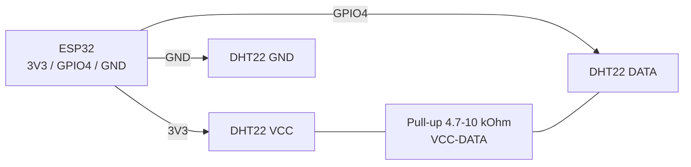

# DHT11 / DHT22 - temperature and humidity sensor

## Purpose

DHT11 and DHT22 (AM2302) - cheap digital temperature and relative humidity sensors with a proprietary single-wire protocol (not to be confused with Dallas 1-Wire). Used for home weather stations, greenhouses, indoor climate control, and IoT nodes with deep-sleep.

> Timing-critical protocol: requires precise measurement of 20-80 us pulses. On ESP32 under FreeRTOS read failures are possible - retries and timeouts are needed. Interface - proprietary 1-Wire protocol (not Dallas!), power 3.3-5V, polling period - from 1-2 s. DHT22 is more accurate (+-2% RH) and better than DHT11; neither is for outdoor use without protection. More accurate alternatives - SHT31/BME280 (see the matching notes).

## Specifications

| Parameter | DHT11 | DHT22 (AM2302) |
| --- | --- | --- |
| Temperature range | 0...+50 C | -40...+80 C |
| Temperature accuracy | +-2 C | +-0.5 C |
| Humidity range | 20...80%RH | 0...100%RH |
| Humidity accuracy | +-5%RH | +-2%RH |
| Resolution | 1 C / 1% | 0.1 C / 0.1% |
| Supply voltage | 3.3-5.5 V | 3.3-5.5 V |
| Current (measuring / sleep) | 0.3 mA / 100 uA | 1.5 mA / 50 uA |
| Min polling period | 1 s (1 Hz) | 2 s (0.5 Hz) |
| Protocol | Proprietary 1-Wire, 40 bit | Proprietary 1-Wire, 40 bit |
| Price (approx) | ~$1 | ~$3-4 |

## Pinout

| Module pin | Purpose | Note |
| --- | --- | --- |
| VCC (+) | 3.3 V power | from ESP32 3V3; 5 V is also possible, but DATA level will be 5 V - a divider or level-shifter is needed |
| DATA (S/OUT) | Data line | GPIO via 5-10 kOhm pull-up to VCC |
| NC | Not connected | missing on 4-pin modules |
| GND (-) | Ground | Common GND with ESP32 |

> 3-pin modules already have a built-in 10 kOhm pull-up. Bare 4-pin sensors need an external pull-up.

## Wiring diagram

| ESP32 | DHT module | Note |
| --- | --- | --- |
| 3V3 | VCC | 3.3 V power, low current |
| GPIO4 | DATA | Any free GPIO; avoid strapping pins for stability |
| GND | GND | Common ground |
| - | VCC-DATA | 5-10 kOhm pull-up (if missing on the module) |

Line length: up to 5 m - plain wire; up to 20 m - shielded twisted pair + 4.7 kOhm pull-up + 100 nF capacitor between VCC and GND near the sensor.

### ASCII diagram

```text
ESP32 DevKit            DHT22 / AM2302 (module)
------------            -----------------------
3V3 ──────────────────► VCC (+)
GND ──────────────────► GND (−)
GPIO4 ────────────────► DATA (S/OUT)
                        VCC ◄──[4.7–10 кОм]──► DATA (якщо нема на модулі)
                        VCC ◄──[100 нФ]──► GND (при лінії > 5 м)
Провід: до 5 м — звичайний; до 20 м — вита пара в екрані
Увага: не живити DATA від 5 В без дільника — ESP32 не 5V-tolerant!
```

### Mermaid



![[assets/img/dht22-scheme.png|500]]
*Fig. DHT22 - 3V3 power, DATA on GPIO4 with pull-up, capacitor on long lines. Photo placeholder - see [[assets/README]].*

## ESP-IDF code

```c
#include "dht.h"  // компонент esp-dht (esp-idf-lib)
#include "freertos/FreeRTOS.h"
#include "freertos/task.h"
#include "esp_log.h"

#define DHT_GPIO GPIO_NUM_4
static const char *TAG = "dht";

void app_main(void)
{
    dht_sensor_type_t type = DHT_TYPE_AM2301; // DHT22
    // для DHT11: DHT_TYPE_DHT11
    for (;;) {
        int16_t temp = 0, hum = 0;
        if (dht_read_data(type, DHT_GPIO, &hum, &temp) == ESP_OK) {
            ESP_LOGI(TAG, "T=%.1f C  H=%.1f %%", temp / 10.0f, hum / 10.0f);
        } else {
            ESP_LOGW(TAG, "Помилка читання, повтор...");
        }
        vTaskDelay(pdMS_TO_TICKS(2000)); // DHT22: не частіше 2 с!
    }
}
```

## Arduino code

```cpp
#include <DHT.h>
#define DHT_PIN 4
#define DHT_TYPE DHT22   // або DHT11

DHT dht(DHT_PIN, DHT_TYPE);

void setup() {
  Serial.begin(115200);
  dht.begin();
}

void loop() {
  delay(2000); // DHT22 — мінімум 2 с між опитуваннями
  float h = dht.readHumidity();
  float t = dht.readTemperature();
  if (isnan(h) || isnan(t)) {
    Serial.println("Помилка читання DHT!");
    return;
  }
  float hic = dht.computeHeatIndex(t, h, false);
  Serial.printf("T=%.1f C  H=%.1f %%  HI=%.1f C\n", t, h, hic);
}
```

## MicroPython code

```python
import dht
from machine import Pin
import time

sensor = dht.DHT22(Pin(4))  # або dht.DHT11(Pin(4))

while True:
    try:
        time.sleep_ms(2000)
        sensor.measure()
        print("T={:.1f} C  H={:.1f} %".format(sensor.temperature(), sensor.humidity()))
    except OSError as e:
        print("Помилка DHT, повтор:", e)
```

## Common issues

1. **Polling faster than 1-2 s** -> sensor returns stale data or checksum error. Keep pauses: DHT11 at least 1 s, DHT22 at least 2 s.
2. **No pull-up resistor** -> `Failed to read`, NaN. Place 5-10 kOhm between DATA and VCC.
3. **5 V power + DATA directly to GPIO** -> 5 V level on the ESP32 input (not 5V-tolerant!). Power from 3V3 or add a divider / level-shifter.
4. **Long wires without a capacitor** -> CRC failures. Add 100 nF between VCC and GND near the sensor, reduce pull-up to 4.7 kOhm.
5. **Reading from ISR or under Wi-Fi load** -> timing violations. Read in a separate task, with 3-5 retries.
6. **DHT11 vs DHT22 mix-up in code** -> wrong values (10 times larger or smaller). Check `DHT_TYPE` / driver class.
7. **Condensation on the sensor** -> humidity stuck at 99-100%. Dry it, do not place in direct vapor zone.

## Official sources

- [DHT22 Datasheet - ASAIR (PDF, via Adafruit)](https://www.adafruit.com/datasheets/DHT22.pdf) - 1-Wire protocol, timings, +-2-5% accuracy.
- [DHT11 Datasheet - ASAIR (PDF, via Adafruit)](https://www.adafruit.com/datasheets/DHT11-chinese-datasheet.pdf) - timings, 1 s polling period.
- [DHT22 - live photo (Adafruit)](https://www.adafruit.com/product/385) - product page with photo and docs.
- [DHT11 - live photo (Adafruit)](https://www.adafruit.com/product/386) - product page with photo and docs.
- [DHT11/DHT22 + ESP32 tutorial with code (RNT)](https://randomnerdtutorials.com/esp32-dht11-dht22-temperature-humidity-sensor-arduino-ide/) - wiring, DHT library, example.
- [DHT11/DHT22 protocol breakdown with code (LME)](https://lastminuteengineers.com/dht11-dht22-arduino-tutorial/) - timings, pull-up, examples.

## See also

- [[EN/03-GPIO/01-GPIO-Overview.en]]
- [[EN/04-Interfaces/03-I2C.en|I2C]]
- [[EN/06-Analog/01-ADC.en|ADC]]
- [[EN/03-GPIO/04-Interrupts-PWM.en]]
- [[EN/10-Sensors/02-DS18B20.en]]
- [[EN/10-Sensors/03-BME280-BMP280-SHT31.en]]
- [[EN/10-Sensors/06-INA219-HX711-BH1750.en]]

## Quality verification
- `check_style`: 0 violations expected; image + mermaid + common-issues + sources present.
- `check_links`: 0 broken; links to `01-Hardware/01-ESP32-Classic.en` / `02-Power-Supply/01-Power-Rails.en` / `Home.en` verified; unknown targets link UA-original with alias.
- `check_home`: 0 errors; `Home.en` links to this file via `11-Vivid/` or `10-Sensors/` section.
