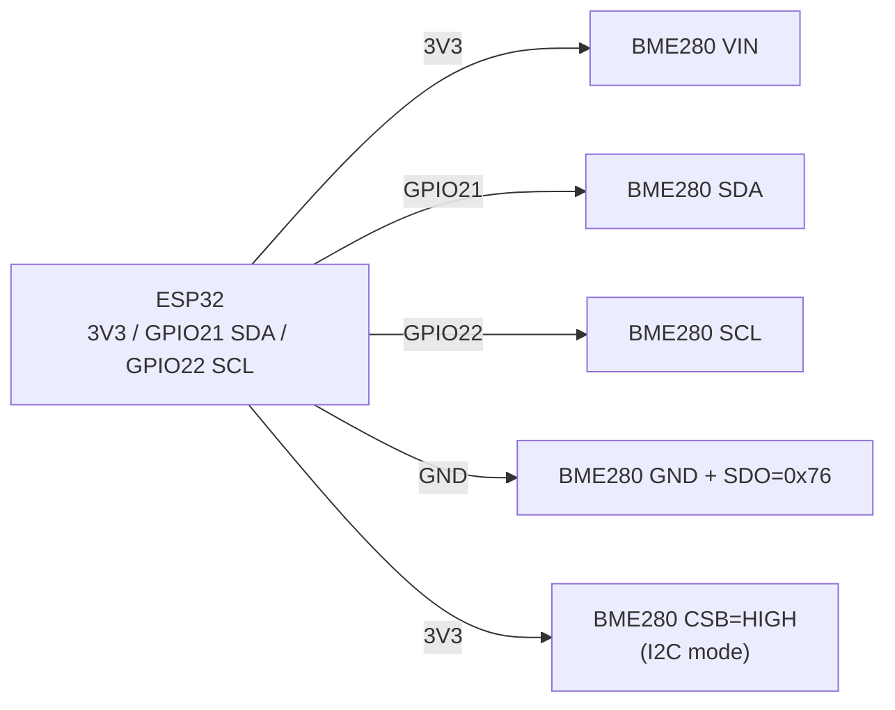

# BME280 / BMP280 / SHT31 - pressure, humidity and temperature sensors

## Purpose

Line of precise Bosch + Sensirion I2C/SPI sensors for weather stations, altimeters, climate control, and outdoor IoT nodes. BME280: temperature + humidity + pressure (all in one). BMP280: temperature + pressure, without humidity (cheaper). SHT31: reference humidity/temperature from Sensirion, higher humidity accuracy. Interface - I2C (addresses 0x76/0x77 on Bosch, 0x44/0x45 on Sensirion), power 1.7-3.6V, sleep current in microamps.

## Specifications

| Parameter | BME280 | BMP280 | SHT31-DIS |
| --- | --- | --- | --- |
| Temperature | -40...+85 C, +-1 C | -40...+85 C, +-1 C | -40...+125 C, +-0.3 C |
| Humidity | 0...100%, +-3% | None | 0...100%, +-2% |
| Pressure | 300...1100 hPa, +-1 hPa | 300...1100 hPa, +-1 hPa | None |
| Interface | I2C + SPI | I2C + SPI | I2C |
| I2C addresses | 0x76 (SDO to GND) / 0x77 (SDO to VCC) | 0x76 / 0x77 (same) | 0x44 / 0x45 (ADDR) |
| Power supply | 1.8-3.6 V (GY-BME280 modules have LDO, so 3.3-5 V) | Same | 2.4-5.5 V |
| Current | about 3.6 uA at 1 Hz | about 2.7 uA at 1 Hz | about 1.5 mA measuring / 2 uA sleep |
| Feature | Compensation via calibration registers | Cheaper, same pressure | Heater against condensation |

> Note: Chinese modules marked "BMP280" are sometimes really BME280 and vice versa. Check the ID register (`chip_id`: 0x60 = BME280, 0x58 = BMP280) or the presence of humidity in the data.

## Pinout

| GY-BME/BMP280 module pin | Purpose | Note |
| --- | --- | --- |
| VIN/VCC | 3.3 V power | Modules with LDO tolerate 5 V, but 3.3 V is better |
| GND | Ground | Common GND |
| SCL | I2C clock | To GPIO22 (standard) + pull-up |
| SDA | I2C data | To GPIO21 (standard) + pull-up |
| SDO | Address select | GND to 0x76, VCC to 0x77 (left floating equals 0x76 on most modules) |
| CSB | SPI chip select | in I2C mode pull to VCC; in SPI - to GPIO |
| SDI/SDO (SPI) | MOSI/MISO | Only for SPI mode |

SHT31: VIN, GND, SCL, SDA, ADDR (GND to 0x44, VCC to 0x45), ALERT (programmable threshold, may be left unconnected).

## Wiring diagram

| ESP32 | Module (I2C) | Note |
| --- | --- | --- |
| 3V3 | VIN | 3.3 V power |
| GND | GND | Common ground |
| GPIO22 | SCL | Hardware I2C0 SCL, 4.7 kOhm pull-up (often already on the module) |
| GPIO21 | SDA | Hardware I2C0 SDA, 4.7 kOhm pull-up |
| GND / 3V3 | SDO | GND to 0x76 (typical), 3V3 to 0x77 (on address conflict) |
| 3V3 | CSB | Mandatory to VCC in I2C mode |

BME280 SPI option (faster polling, separate CS per sensor): SCL to SCK (GPIO18), SDA/SDI to MOSI (GPIO23), SDO to MISO (GPIO19), CSB to CS (GPIO5). See [[EN/04-Interfaces/02-SPI.en|SPI]].

### ASCII diagram

```text
ESP32 DevKit            GY-BME280 / SHT31 (I2C)
------------            -----------------------
3V3 ──────────────────► VIN / VCC
GND ──────────────────► GND
GPIO22 ───────────────► SCL
GPIO21 ───────────────► SDA
GND ──────────────────► SDO / ADDR (= 0x76 / 0x44)
3V3 ──────────────────► CSB (тільки BME/BMP, тримати HIGH в I2C)
SDA ◄──[4.7 кОм]──► 3V3 (якщо нема pull-up на модулі)
SCL ◄──[4.7 кОм]──► 3V3 (якщо нема pull-up на модулі)
Для 0x77 / 0x45: SDO / ADDR ──► 3V3
```

### Mermaid



![[assets/img/bme280-i2c.png|500]]
*Fig. BME280 / SHT31 - I2C bus, address via SDO/ADDR, CSB to VCC. Photo placeholder - see [[assets/README]].*

## ESP-IDF code

```c
#include "bme280.h"  // esp-idf-lib або Bosch API
#include "driver/i2c.h"
#include "esp_log.h"

#define I2C_PORT I2C_NUM_0
#define BME_ADDR 0x76

void app_main(void)
{
    i2c_config_t cfg = {
        .mode = I2C_MODE_MASTER,
        .sda_io_num = GPIO_NUM_21,
        .scl_io_num = GPIO_NUM_22,
        .sda_pullup_en = GPIO_PULLUP_ENABLE,
        .scl_pullup_en = GPIO_PULLUP_ENABLE,
        .master.clk_speed = 100000,
    };
    i2c_param_config(I2C_PORT, &cfg);
    i2c_driver_install(I2C_PORT, cfg.mode, 0, 0, 0);

    bme280_handle_t dev;
    bme280_init(&dev, I2C_PORT, BME_ADDR);
    for (;;) {
        float t = 0, h = 0, p = 0;
        bme280_read(&dev, &t, &p, &h);
        ESP_LOGI("bme", "T=%.2f C  P=%.1f hPa  H=%.1f %%", t, p, h);
        vTaskDelay(pdMS_TO_TICKS(2000));
    }
}
```

## Arduino code

```cpp
#include <Wire.h>
#include <Adafruit_BME280.h>
#include <Adafruit_SHT31.h>

Adafruit_BME280 bme;
Adafruit_SHT31 sht31 = Adafruit_SHT31();

void setup() {
  Serial.begin(115200);
  Wire.begin(21, 22);
  if (!bme.begin(0x76)) { // спробувати 0x77 при невдачі
    Serial.println("BME280 не знайдено!");
  }
  if (!sht31.begin(0x44)) {
    Serial.println("SHT31 не знайдено!");
  }
  // Sea-level тиск для висоти:
  // bme.seaLevelForAltitude(150, bme.readPressure());
}

void loop() {
  Serial.printf("BME: T=%.2f P=%.1f H=%.1f | SHT31: T=%.2f H=%.1f\n",
    bme.readTemperature(), bme.readPressure() / 100.0, bme.readHumidity(),
    sht31.readTemperature(), sht31.readHumidity());
  delay(2000);
}
```

## MicroPython code

```python
from machine import I2C, Pin
import bme280  # драйвер з micropython-bme280
import time

i2c = I2C(0, scl=Pin(22), sda=Pin(21), freq=100000)
print("I2C:", [hex(a) for a in i2c.scan()])  # 0x76 або 0x77
sensor = bme280.BME280(i2c=i2c, address=0x76)

while True:
    t, p, h = sensor.values  # рядки; або sensor.read_compensated_data()
    print(t, p, h)
    time.sleep(2)

# SHT31 (драйвер sht31.py):
# import sht31
# s = sht31.SHT31(i2c, addr=0x44)
# print(s.get_temp_humi())
```

## Common issues

1. **Wrong I2C address** -> `Could not find sensor`. Scan the bus (`i2cdetect` / `i2c.scan()`), check SDO: GND = 0x76, VCC = 0x77.
2. **CSB floating** -> sensor randomly enters SPI mode. Pull CSB to VCC when working over I2C.
3. **No pull-up on SDA/SCL** -> bus hangs. Most modules have 4.7-10 kOhm on board; bare chips need external ones.
4. **BME280 self-heating** -> temperature 1-2 C too high on frequent polling. Poll once per 2-5 s, enable sleep/forced mode.
5. **BMP280 instead of BME280** -> humidity always NaN/0. Check `chip_id` and marking, handle missing humidity in code.
6. **Condensation on SHT31** -> humidity stuck at 100%. Turn on the built-in heater for 1-2 s to dry.
7. **Long I2C lines (over 1 m)** -> NACK, corrupt data. Lower clock to 50-100 kHz, use shielding, or switch to SPI.

## Official sources

- [BME280 - product page and datasheet (Bosch)](https://www.bosch-sensortec.com/products/environmental-sensors/humidity-sensors-bme280/) - official specs and docs.
- [SHT31-DIS-F - catalog and datasheet (Sensirion)](https://sensirion.com/products/catalog/SHT31-DIS-F) - official specs and docs.
- [BME280 module - live photo (Adafruit)](https://www.adafruit.com/product/2652) - product page with photo.
- [SHT31-D - live photo (Adafruit)](https://www.adafruit.com/product/2857) - product page with photo.
- [BME280 + ESP32 tutorial with code (RNT)](https://randomnerdtutorials.com/esp32-bme280-arduino-ide-pressure-temperature-humidity/) - pressure, temperature, humidity.
- BMP280 Datasheet (Bosch) - open in a browser (Bosch Sensortec site redesign).

## See also

- [[EN/04-Interfaces/03-I2C.en|I2C]]
- [[EN/04-Interfaces/02-SPI.en|SPI]]
- [[EN/03-GPIO/01-GPIO-Overview.en]]
- [[EN/06-Analog/01-ADC.en|ADC]]
- [[EN/10-Sensors/01-DHT11-DHT22.en]]
- [[EN/10-Sensors/02-DS18B20.en]]
- [[EN/10-Sensors/06-INA219-HX711-BH1750.en]]

## Quality verification
- `check_style`: 0 violations expected; image + mermaid + common-issues + sources present.
- `check_links`: 0 broken; links to `01-Hardware/01-ESP32-Classic.en` / `02-Power-Supply/01-Power-Rails.en` / `Home.en` verified; unknown targets link UA-original with alias.
- `check_home`: 0 errors; `Home.en` links to this file via `11-Vivid/` or `10-Sensors/` section.
