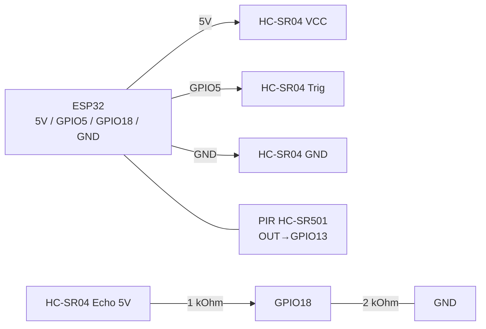

# HC-SR04 (ultrasound) and PIR HC-SR501 (motion)

## Purpose

HC-SR04 - ultrasonic rangefinder (2-400 cm) for distance measurement, liquid level, parking sensors, and obstacle-avoiding robots. PIR HC-SR501 - passive IR human motion detector (up to about 7 m, angle about 110 deg) for lighting, alarms, and energy saving (wake-up from deep-sleep). HC-SR04 is powered from 5V (Echo - through a divider!), PIR - 5-12V with a 3.3V output.

## Specifications

| Parameter | HC-SR04 | PIR HC-SR501 |
| --- | --- | --- |
| Principle | Echo 40 kHz, time of flight | Pyroelectric element + Fresnel lens |
| Range | 2-400 cm (accurate 2-200) | up to 7 m, angle <110 deg |
| Accuracy | +-3 mm (ideal), typically +-1 cm | Binary: motion yes/no |
| Power supply | 5 V (Trig logic 5 V, Echo 5 V!) | 5-12 V (output 3.3 V, compatible with ESP32) |
| Current | 15 mA | 65 uA (idle) |
| Output | Trig (input), Echo (pulse 150 us-25 ms) | OUT 3.3 V, H/L hold jumper |
| Adjustment | - | Sx: sensitivity; Tx: hold time 0.3-300 s |

> HC-SR04 is powered from 5 V, but Echo outputs 5 V - ESP32 is not 5V-tolerant! A 1 kOhm / 2 kOhm divider is mandatory. PIR HC-SR501 has an on-board 3.3 V regulator and a 3.3 V output - connects directly.

## Pinout

| HC-SR04 | Purpose |
| --- | --- |
| VCC | 5 V (from VIN/VU or external 5 V) |
| Trig | trigger (10 us HIGH), 5 V input - ESP32 3.3 V is enough |
| Echo | Pulse with width proportional to distance, 5 V -> through divider to GPIO |
| GND | Common ground |

| HC-SR501 | Purpose |
| --- | --- |
| VCC | 5 V (4.5-12 V), on-board regulator |
| OUT | 3.3 V logic -> directly to GPIO |
| GND | Common ground |
| Sx / Tx | Sensitivity / time potentiometers |
| Jumper H/L | H - retriggerable, L - single trigger |

## Wiring diagram

| ESP32 | HC-SR04 | Note |
| --- | --- | --- |
| 5V (VIN/VU) | VCC | 5 V mandatory (from 3.3 V it fails or reads wrong) |
| GPIO5 | Trig | ESP32 3.3 V output -> Trig triggers (threshold about 2 V) |
| GPIO18 | Echo via divider | Echo -> 1 kOhm -> GPIO; GPIO -> 2 kOhm -> GND (on GPIO about 3.3 V) |
| GND | GND | Common ground |

| ESP32 | HC-SR501 | Note |
| --- | --- | --- |
| 5V (VIN/VU) | VCC | 5 V for stable timer operation |
| GPIO13 | OUT | Direct, 3.3 V compatible; for wake-up - RTC-GPIO |
| GND | GND | Common ground |

Distance formula: `distance_cm = echo_us / 58.0` (or `echo_us * 0.0343 / 2`). Explanation: sound is about 343 m/s -> 29.1 us per mm one way, 58.2 us per cm round trip.

### ASCII diagram

```text
ESP32 DevKit            HC-SR04 (5 В!) + дільник Echo
------------            -----------------------------
5V (VIN/VU) ──────────► VCC (5 В обов'язково!)
GND ──────────────────► GND
GPIO5 ────────────────► Trig (3.3 В вистачає, поріг ~2 В)
Echo (5 В) ──[1 кОм]──► GPIO18 ──[2 кОм]──► GND (на GPIO ~3.3 В)
PIR HC-SR501: 5V ──► VCC, GND ──► GND, OUT (3.3 В) ──► GPIO13
PIR для пробудження — тільки RTC-GPIO (напр. GPIO13/15)
Без дільника Echo безпосередньо в GPIO — ЗАБОРОНЕНО!
```

### Mermaid



![[assets/img/hcsr04-divider.png|500]]
*Fig. HC-SR04 - 5 V power, Echo via 1k/2k divider, PIR directly on GPIO13. Photo placeholder - see [[assets/README]].*

## ESP-IDF code

```c
#include "driver/gpio.h"
#include "esp_timer.h"
#include "freertos/FreeRTOS.h"
#include "freertos/task.h"
#include "esp_log.h"

#define TRIG GPIO_NUM_5
#define ECHO GPIO_NUM_18
#define PIR  GPIO_NUM_13
static const char *TAG = "range";

static float hc_sr04_read_cm(void)
{
    gpio_set_level(TRIG, 0);
    esp_rom_delay_us(5);
    gpio_set_level(TRIG, 1);
    esp_rom_delay_us(10);
    gpio_set_level(TRIG, 0);
    // чекати rising
    int64_t t0 = esp_timer_get_time();
    while (!gpio_get_level(ECHO)) {
        if (esp_timer_get_time() - t0 > 30000) return -1;
    }
    int64_t start = esp_timer_get_time();
    while (gpio_get_level(ECHO)) {
        if (esp_timer_get_time() - start > 30000) return -1; // ~5 м макс
    }
    int64_t us = esp_timer_get_time() - start;
    return us / 58.0f;
}

void app_main(void)
{
    gpio_set_direction(TRIG, GPIO_MODE_OUTPUT);
    gpio_set_direction(ECHO, GPIO_MODE_INPUT);
    gpio_set_direction(PIR, GPIO_MODE_INPUT);
    for (;;) {
        float d = hc_sr04_read_cm();
        int motion = gpio_get_level(PIR);
        ESP_LOGI(TAG, "dist=%.1f cm  pir=%d", d, motion);
        vTaskDelay(pdMS_TO_TICKS(200));
    }
}
```

## Arduino code

```cpp
#define TRIG 5
#define ECHO 18
#define PIR  13

void setup() {
  Serial.begin(115200);
  pinMode(TRIG, OUTPUT);
  pinMode(ECHO, INPUT);
  pinMode(PIR, INPUT);
}

float readCm() {
  digitalWrite(TRIG, LOW); delayMicroseconds(5);
  digitalWrite(TRIG, HIGH); delayMicroseconds(10);
  digitalWrite(TRIG, LOW);
  unsigned long us = pulseIn(ECHO, HIGH, 30000); // таймаут 30 мс
  if (us == 0) return -1;
  return us / 58.0;
}

void loop() {
  Serial.printf("dist=%.1f cm  pir=%d\n", readCm(), digitalRead(PIR));
  delay(200);
}
```

## MicroPython code

```python
from machine import Pin
import time

trig = Pin(5, Pin.OUT)
echo = Pin(18, Pin.IN)
pir = Pin(13, Pin.IN)

def read_cm():
    trig.value(0); time.sleep_us(5)
    trig.value(1); time.sleep_us(10)
    trig.value(0)
    t0 = time.ticks_us()
    while not echo.value():
        if time.ticks_diff(time.ticks_us(), t0) > 30000:
            return -1
    start = time.ticks_us()
    while echo.value():
        if time.ticks_diff(time.ticks_us(), start) > 30000:
            return -1
    us = time.ticks_diff(time.ticks_us(), start)
    return us / 58.0

while True:
    print("dist={:.1f} cm  pir={}".format(read_cm(), pir.value()))
    time.sleep_ms(200)
```

## Common issues

1. **Echo 5 V directly to GPIO** -> degradation or burnout of the ESP32 input. A 1 kOhm/2 kOhm divider is mandatory.
2. **HC-SR04 powered from 3.3 V** -> low or zero readings. Only 5 V.
3. **No timeout on `pulseIn` / wait loop** -> hang when echo is missing (open sky). Always use a 25-30 ms timeout.
4. **Soft or tilted surfaces** -> echo is lost (fabric, carpet, angle above 15 deg). For such targets use a VL53L0X ToF laser.
5. **PIR false triggers** -> drafts, heaters, sun spots. Reduce Sx, point the lens down, warm up 30-60 s after power-on.
6. **PIR does not see through glass** -> IR does not pass through glass. Line of sight only.
7. **Several HC-SR04 at once** -> cross-talk echoes. Poll in turn with a pause of at least 60 ms.

## Official sources

- [HC-SR04 + ESP32 tutorial with code (RNT)](https://randomnerdtutorials.com/esp32-hc-sr04-ultrasonic-arduino/) - distance measurement, example.
- [How HC-SR04 works with code (LME)](https://lastminuteengineers.com/arduino-sr04-ultrasonic-sensor-tutorial/) - principle, timings, examples.
- [PIR + ESP32 tutorial with code (RNT)](https://randomnerdtutorials.com/esp32-pir-motion-sensor-interrupts-timers/) - interrupts and timers.
- [How HC-SR501 PIR works with code (LME)](https://lastminuteengineers.com/pir-sensor-arduino-tutorial/) - sensitivity and delay setup.

## See also

- [[03-GPIO/01-GPIO-Overview.en | GPIO overview]]
- [[03-GPIO/04-Interrupts-PWM.en | Interrupts and PWM]]
- [[EN/06-Analog/01-ADC.en|ADC]]
- [[04-Interfaces/03-I2C.en | I2C]]
- [[04-Interfaces/02-SPI.en | SPI]]
- [[EN/11-Vivid/04-L298N-TB6612-A4988-Buzzer.en|Motors / Buzzer]]

## ESP-IDF code (PIR wake-up)

```c

// Пробудження with deep-sleep per PIR on RTC-GPIO:
// esp_sleep_enable_ext0_wakeup(GPIO_NUM_13, 1);
// esp_deep_sleep_start();

```
