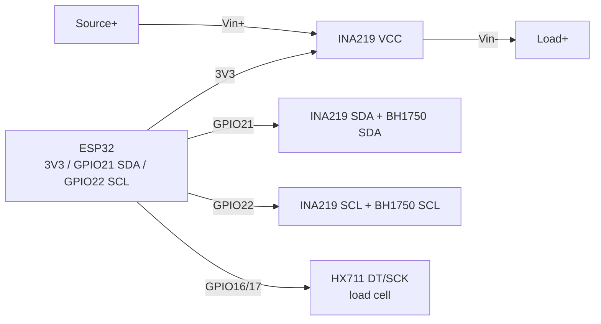

# INA219, HX711, BH1750, soil moisture, MQ-2

## Purpose

Set of measurement sensors for specific physical values: INA219 - current/voltage/power on the power rail (battery and solar panel monitoring); HX711 - 24-bit ADC for load cells (scales 1-50 kg); BH1750 - digital lux meter; capacitive soil moisture sensor - watering; MQ-2 - gas/smoke detector (qualitative, not measuring!).

## Specifications

| Parameter | INA219 | HX711 | BH1750 |
| --- | --- | --- | --- |
| Measures | Vbus 0-26 V, current via shunt, power | Load-cell bridge, +-20/+-80 mV | Light 1-65535 lx |
| Interface | I2C, 4 addresses (A0/A1: 0x40-0x43) | DT/SCK (proprietary serial) | I2C 0x23 (ADDR low) / 0x5C (high) |
| Accuracy | 12 bit, 0.1 Ohm shunt (+-3.2 A max) | 24 bit, gain 32/64/128 | +-20%, H/M/L modes |
| Power supply | 3-5.5 V | 2.6-5.5 V (analog) | 2.4-3.6 V |
| Current | about 0.7 mA | about 1.5 mA | about 120 uA |
| Calibration | PGA range select /32 V, /16 V | Tare + scale by reference weight | None (factory) |

Additionally:

| Sensor | Signal | Warning |
| --- | --- | --- |
| Capacitive soil moisture sensor (v1.2/v2.0) | Analog about 1.2-3.0 V to [[EN/06-Analog/01-ADC.en|ADC]] | Power via GPIO (on only for measurement!) - else electrocorrosion in weeks |
| MQ-2 (gas/smoke: LPG, methane, CO, smoke) | Analog + digital (comparator) | Heater 5 V / about 150 mA, 24-48 h warm-up for stability; not quantitative without calibration by reference gas |

## Pinout

| INA219 (CJMCU module) | Purpose |
| --- | --- |
| VCC / GND | 3.3 V / logic ground |
| SCL / SDA | I2C to GPIO22/21 |
| Vin- / Vin+ | Power rail break: source to Vin+, load to Vin- (current flows + to -) |
| A0/A1 | Address jumpers |

| HX711 (module) | Purpose |
| --- | --- |
| VCC / GND | 3.3-5 V; analog part is better on 5 V |
| DT | Data to GPIO |
| SCK | Clock to GPIO |
| E+/E-, A+/A- | Bridge excitation and load-cell differential input (red/black/white/green) |

| BH1750 | Purpose |
| --- | --- |
| VCC/GND | 3.3 V |
| SCL/SDA | I2C |
| ADDR | GND to 0x23, VCC to 0x5C |

## Wiring diagram

| ESP32 | INA219 | Note |
| --- | --- | --- |
| 3V3 | VCC | 3.3 V logic |
| GND | GND | Common ground with the measured rail! |
| GPIO22 | SCL | I2C |
| GPIO21 | SDA | I2C |
| Source + | Vin+ | E.g. battery/PSU + |
| Load + | Vin- | E.g. load input |
| Source GND | GND ESP32 | Common minus is mandatory |

| ESP32 | HX711 | Note |
| --- | --- | --- |
| 3V3 (or 5V) | VCC | 5 V gives better SNR, but is DT 5 V? In practice DT is about 4.2 V - better to power 3.3 V or use a divider |
| GND | GND | Common ground |
| GPIO16 | DT | Data input |
| GPIO17 | SCK | Clock output |

| ESP32 | BH1750 | Note |
| --- | --- | --- |
| 3V3 | VCC | Only 3.3 V (max 3.6 V!) |
| GND | GND | Ground |
| GPIO22 | SCL | I2C |
| GPIO21 | SDA | I2C |
| GND | ADDR | Address 0x23 |

Soil: sensor VCC to GPIO25 (power only for measurement), AOUT to GPIO34 ([[EN/06-Analog/01-ADC.en|ADC]]), GND to GND. MQ-2: VCC to 5 V, GND to GND, AOUT to GPIO34, DOUT to GPIO35 (threshold by potentiometer).

### ASCII diagram

```text
ESP32 DevKit            INA219 (I2C) + HX711 + BH1750
------------            -------------------------------
3V3 ──────────────────► INA219 VCC / HX711 VCC / BH1750 VCC
GND ──────────────────► GND усіх модулів (= мінус вимірюваної шини!)
GPIO22 ───────────────► SCL (INA219 + BH1750 паралельно)
GPIO21 ───────────────► SDA (INA219 + BH1750 паралельно)
Джерело+ ─────────────► INA219 Vin+ ──[шунт 0.1 Ом]──► Vin− ──► навантаження+
GPIO16 ───────────────► HX711 DT
GPIO17 ───────────────► HX711 SCK
E+/E−, A+/A− ─────────► load cell (черв/чорн, біл/зел)
ADDR BH1750 ──────────► GND (= 0x23)
```

### Mermaid



![[assets/img/ina219-hx711.png|500]]
*Fig. INA219 - high-side break via Vin+/Vin- with common GND, HX711 on GPIO16/17, BH1750 on the same I2C. Photo placeholder - see [[assets/README]].*

## ESP-IDF code

```c
// INA219 (esp-idf-lib ina219) + BH1750 (esp-idf-lib bh1750)
#include "ina219.h"
#include "bh1750.h"
#include "driver/i2c.h"
#include "esp_log.h"

void app_main(void)
{
    i2c_config_t cfg = {
        .mode = I2C_MODE_MASTER,
        .sda_io_num = GPIO_NUM_21, .scl_io_num = GPIO_NUM_22,
        .sda_pullup_en = GPIO_PULLUP_ENABLE,
        .scl_pullup_en = GPIO_PULLUP_ENABLE,
        .master.clk_speed = 100000,
    };
    i2c_param_config(I2C_NUM_0, &cfg);
    i2c_driver_install(I2C_NUM_0, cfg.mode, 0, 0, 0);

    ina219_handle_t ina;
    ina219_init(&ina, I2C_NUM_0, INA219_ADDR_GND_GND); // 0x40
    ina219_configure(&ina, INA219_BUS_RANGE_16V, INA219_GAIN_320MV,
                     INA219_RES_12BIT, INA219_RES_12BIT, INA219_MODE_CONT);

    bh1750_handle_t lux;
    bh1750_init(&lux, I2C_NUM_0, BH1750_ADDR_LO);      // 0x23
    bh1750_set_mode(&lux, BH1750_MODE_CONT_HIGH_RES);

    for (;;) {
        float v = 0, i = 0, p = 0;
        ina219_get_bus_voltage(&ina, &v);
        ina219_get_current(&ina, &i);
        ina219_get_power(&ina, &p);
        float l = 0; bh1750_read(&lux, &l);
        ESP_LOGI("m", "V=%.2f I=%.1f mA P=%.1f mW lux=%.0f", v, i * 1000, p * 1000, l);
        vTaskDelay(pdMS_TO_TICKS(1000));
    }
}
```

## Arduino code

```cpp
#include <Wire.h>
#include <Adafruit_INA219.h>
#include <BH1750.h>
#include "HX711.h"

Adafruit_INA219 ina(0x40);
BH1750 lux;
HX711 scale;
#define SOIL_PWR 25
#define SOIL_PIN 34

void setup() {
  Serial.begin(115200);
  Wire.begin(21, 22);
  ina.begin();
  lux.begin(BH1750::CONTINUOUS_HIGH_RES_MODE, 0x23);
  scale.begin(16, 17);
  scale.set_scale(2280.0); // калібрувати еталонною вагою!
  scale.tare();
  pinMode(SOIL_PWR, OUTPUT);
  digitalWrite(SOIL_PWR, LOW);
}

void loop() {
  Serial.printf("INA: %.2f V %.1f mA | lux: %.0f | W: %.1f g\n",
    ina.getBusVoltage_V(), ina.getCurrent_mA(),
    lux.readLightLevel(), scale.get_units(5));
  // Ґрунт: живлення тільки на вимір
  digitalWrite(SOIL_PWR, HIGH); delay(50);
  int soil = analogRead(SOIL_PIN);
  digitalWrite(SOIL_PWR, LOW);
  Serial.printf("soil raw: %d\n", soil);
  delay(2000);
}
```

## MicroPython code

```python
from machine import I2C, Pin, ADC
import time

i2c = I2C(0, scl=Pin(22), sda=Pin(21))
# INA219 / BH1750 — драйвери: ada_ina219.py, bh1750.py
from ina219 import INA219
from bh1750 import BH1750

ina = INA219(i2c, addr=0x40)
ina.configure()  # default 32V/2A
lux = BH1750(i2c, addr=0x23)

soil_pwr = Pin(25, Pin.OUT, value=0)
soil_adc = ADC(Pin(34)); soil_adc.atten(ADC.ATTN_11DB)

while True:
    print("V={:.2f} I={:.1f}mA lux={:.0f}".format(
        ina.bus_voltage, ina.current, lux.luminance(BH1750.CONT_HIRES_1)))
    soil_pwr.value(1); time.sleep_ms(50)
    print("soil:", soil_adc.read())
    soil_pwr.value(0)
    time.sleep(2)
```

### INA3221 - three channels instead of one INA219

| Parameter | INA219 | INA3221 |
| --- | --- | --- |
| Channels | 1 (bus + shunt) | 3 independent channels |
| Ranges | Bus 0-26 V, shunt +-320 mV | Bus 0-26 V each, shunt +-163.8 mV |
| ADC | 12 bit | 12-13 bit programmable |
| I2C address | 0x40-0x4F (A0/A1) | 0x40-0x43 (A0) |
| When to take | Single channel | Solar station: panel + battery + load at once |

```text
Шунти 0.1 Ом/2W у розрив КОЖНОЇ лінії (PV+, BAT+, LOAD+), INA3221 поруч із шунтами
(доріжки sense короткі, витою парою). Увага: спільна земля обов'язкова — канали не ізольовані!
```

> INA3221 vs 3x INA219: one package, one address space, synchronous sampling - for energy balance of generated, stored, and consumed power take the 3221.

![[assets/img/ina3221-3ch-scheme.png|500]]
*Fig. INA3221: three shunts, common star ground, channels are not isolated.*

## Common issues

1. **INA219: no common ground** -> zeros or garbage. Minus of the measured rail = ESP32 GND.
2. **INA219: Vin+/Vin- swapped** -> negative current or zero. Current must flow from + to - through the module.
3. **0.1 Ohm shunt heats up at 3 A** -> drift. For large currents - external shunt + `setCalibration` calibration.
4. **HX711: wrong load-cell wire pair** -> zeros or saturation. E+/E- - excitation (red/black), A+/A- - signal (white/green); calibrate `set_scale` with a reference.
5. **HX711 on 5 V + DT to GPIO** -> above 3.6 V. Power HX711 from 3.3 V or place a divider on DT.
6. **Soil sensor under constant power** -> corrosion in 2-4 weeks. Power via GPIO only for the 50-100 ms of measurement.
7. **INA3221 without common ground of three shunts** -> channels drift. All line minuses + ESP32 GND to one point; channels are not isolated!
8. **MQ-2 without warm-up / used as a ppm meter** -> random numbers. Warm-up at least 24 h, threshold logic on DOUT + calibration; heater about 800 mW - not for batteries.

## Official sources

- [INA219 - product page and datasheet (TI)](https://www.ti.com/product/INA219) - official specs and docs.
- [INA219 module - live photo (Adafruit)](https://www.adafruit.com/product/904) - product page with photo.
- [INA219 guide with code (Adafruit Learn)](https://learn.adafruit.com/adafruit-ina219-current-sensor-breakout) - calibration, examples.
- [HX711 + load cell tutorial with code (RNT)](https://randomnerdtutorials.com/esp32-load-cell-hx711/) - scales on ESP32.
- BH1750 Datasheet (ROHM) - open in a browser.

## See also

- [[EN/04-Interfaces/03-I2C.en|I2C]]
- [[EN/06-Analog/01-ADC.en|ADC]]
- [[EN/03-GPIO/01-GPIO-Overview.en]]
- [[EN/03-GPIO/04-Interrupts-PWM.en]]
- [[EN/10-Sensors/01-DHT11-DHT22.en]]
- [[EN/10-Sensors/02-DS18B20.en]]
- [[EN/10-Sensors/03-BME280-BMP280-SHT31.en]]

## Quality verification
- `check_style`: 0 violations expected; image + mermaid + common-issues + sources present.
- `check_links`: 0 broken; links to `01-Hardware/01-ESP32-Classic.en` / `02-Power-Supply/01-Power-Rails.en` / `Home.en` verified; unknown targets link UA-original with alias.
- `check_home`: 0 errors; `Home.en` links to this file via `11-Vivid/` or `10-Sensors/` section.
