# BME680 / CCS811 / MH-Z19 / PMS5003 - air quality and CO2

![[assets/img/air-quality-scheme.png|500]]
*Fig. 1. Connecting air quality sensors to ESP32: BME680/CCS811 via I2C, MH-Z19/PMS5003 via UART.*

## Purpose

Air quality sensor group for home, office, school, and outdoor monitoring stations. BME680 - temperature/humidity/pressure + VOC (volatile organic compounds, IAQ index). CCS811 - eCO2/TVOC (estimated, not real CO2). MH-Z19B - true NDIR CO2 sensor (400-5000 ppm) over UART/PWM. PMS5003 - laser dust counter for PM1.0/PM2.5/PM10 over UART with a fan. Together they cover a full AQI node on ESP32.

> CCS811 needs a 48-hour warm-up for stable readings! MH-Z19B - 3 min after power-on, PMS5003 - 30 s for fan spin-up.

## Specifications

| Parameter | BME680 | CCS811 | MH-Z19B | PMS5003 |
| --- | --- | --- | --- | --- |
| What it measures | T/H/P + VOC (IAQ 0-500) | eCO2 400-8192 ppm, TVOC 0-1187 ppb | CO2 400-5000 ppm (NDIR) | PM1.0/2.5/10, ug/m3 |
| Interface | I2C (0x76/0x77) + SPI | I2C 0x5A/0x5B | UART 9600 + PWM | UART 9600 |
| Power supply | 1.7-3.6 V (module 3.3-5 V) | 1.8-3.3 V | 4.5-5.5 V (5 V mandatory!) | 5 V, about 100 mA |
| Current | 12 mA (heater) / 3 uA sleep | 30 mA | 60 mA average | 100 mA (fan) |
| CO2 accuracy | None (IAQ estimate) | +-15% (calculated!) | +-50 ppm + 5% | - |
| Warm-up | 30 min (hot plate) | 48 h first time, 20 min each time | 3 min | 30 s |
| Lifetime | over 5 years | about 5 years | over 5 years (NDIR) | Fan about 3 years |
| Price | ~$5-7 | ~$5 | ~$15-20 | ~$15 |

### Warm-up notes

| Sensor | What happens | Rule |
| --- | --- | --- |
| CCS811 | MOX element burns in, baseline drifts | 48 h of continuous run at first power-on, then 20 min; store baseline in NVS |
| BME680 | Hot wire 300 C, IAQ drifts in the first minutes | 30 min warm-up + BSEC library for IAQ |
| MH-Z19B | IR lamp warms up | Ignore the first 3 min, ABC calibration once per 24 h in fresh air |
| PMS5003 | Fan spins up | First 30 s of data are garbage; sleep between measurements (setMode passive) |

## Module pin legend

| Pin | Type | Where | Note |
| --- | --- | --- | --- |
| VCC (BME680/CCS811) | 3.3 V power | 3V3 ESP32 | CCS811 strictly 3.3 V, 5 V will burn it! |
| VCC (MH-Z19/PMS5003) | 5 V power | VIN 5V (USB) | from a separate regulator on long lines; current up to 150 mA |
| GND | Ground | GND ESP32 | Common for all four |
| SCL / SDA | I2C | GPIO22 / GPIO21 | BME680 + CCS811 on one bus (different addresses) |
| WAK (CCS811) | Input | GND | to ground for continuous measurement; to GPIO for sleep |
| RST / INT (CCS811) | Interrupt output | GPIO (optional) | May be left unconnected |
| Tx / Rx (MH-Z19, PMS5003) | UART | GPIO16/GPIO17, GPIO18/GPIO19 | over UART1/UART2; do not mix up Tx to Rx cross-over |
| PWM (MH-Z19) | PWM output | GPIO (optional) | UART alternative: 1004 ms period |
| SET / RESET (PMS5003) | Control input | 3V3 / GPIO | SET=L - sleep; RESET - restart |

## Wiring diagram

| ESP32 | Module | Note |
| --- | --- | --- |
| 3V3 | BME680 VCC, CCS811 VCC | Only 3.3 V for CCS811! |
| 5V (VIN/VU) | MH-Z19B VCC, PMS5003 VCC | from USB 5 V, 470 uF capacitor nearby |
| GND | GND of all modules | Star, thick wire for 5 V nodes |
| GPIO22 | BME680 SCL, CCS811 SCL | Shared I2C0 bus |
| GPIO21 | BME680 SDA, CCS811 SDA | 4.7 kOhm pull-up |
| GPIO17 (TX2) | MH-Z19 RX, PMS5003 RX | over UART2; cross: ESP TX -> sensor RX |
| GPIO16 (RX2) | MH-Z19 TX, PMS5003 TX | One UART per sensor! Split: MH-Z19 -> UART1, PMS5003 -> UART2 |
| GPIO18/19 | PMS5003 TX/RX (UART1) | Alternative when using two sensors at once |

### ASCII diagram

```text
        ESP32 DevKit
   +------------------+
   |  3V3  -> BME680 VCC, CCS811 VCC (3.3V!)
   |  5V   -> MH-Z19 VCC, PMS5003 VCC (5V!)
   |  GND  -> GND x4 (зірка)
   |  G22  -> BME680 SCL + CCS811 SCL
   |  G21  -> BME680 SDA + CCS811 SDA
   |  G17 TX2 -> MH-Z19 RX
   |  G16 RX2 <- MH-Z19 TX
   |  G18 TX1 -> PMS5003 RX
   |  G19 RX1 <- PMS5003 TX
   +------------------+
   I2C0: 0x76 (BME680), 0x5A (CCS811)
   UART1 9600: PMS5003 | UART2 9600: MH-Z19
```

### Mermaid

```mermaid
graph LR
    ESP32[ESP32 DevKit] -->|3V3| BME[BME680 VCC]
    ESP32 -->|3V3| CCS[CCS811 VCC + WAK-GND]
    ESP32 -->|5V| MHZ[MH-Z19B VCC]
    ESP32 -->|5V| PMS[PMS5003 VCC]
    ESP32 -->|GND| G1[GND x4 star]
    ESP32 -->|GPIO22/21 I2C| I2C[BME680 + CCS811]
    ESP32 -->|UART2 9600| MHZ2[MH-Z19 TX/RX]
    ESP32 -->|UART1 9600| PMS2[PMS5003 TX/RX]
```



## ESP-IDF code

```c
#include "driver/uart.h"
#include "esp_log.h"

#define UART_MHZ UART_NUM_2
#define UART_PMS UART_NUM_1
static const char *TAG = "air";

// MH-Z19B: команда читання CO2
static int mhz19_read_co2(void)
{
    uint8_t cmd[9] = {0xFF, 0x01, 0x86, 0, 0, 0, 0, 0, 0x79};
    uart_write_bytes(UART_MHZ, (char *)cmd, 9);
    uint8_t r[9] = {0};
    if (uart_read_bytes(UART_MHZ, r, 9, pdMS_TO_TICKS(500)) != 9) return -1;
    if (r[0] != 0xFF || r[1] != 0x86) return -1;
    uint8_t chk = 0;
    for (int i = 1; i < 8; i++) chk += r[i];
    if ((0xFF - chk + 1) != r[8]) return -1;
    return r[2] * 256 + r[3];
}

// PMS5003: пасивний кадр 32 байти, початок 0x42 0x4D
static bool pms_read(int *pm25, int *pm10)
{
    uint8_t b[32];
    if (uart_read_bytes(UART_PMS, b, 32, pdMS_TO_TICKS(1000)) != 32) return false;
    if (b[0] != 0x42 || b[1] != 0x4D) return false;
    *pm25 = (b[12] << 8) | b[13];
    *pm10 = (b[14] << 8) | b[15];
    return true;
}

void app_main(void)
{
    uart_config_t uc = {.baud_rate = 9600, .data_bits = UART_DATA_8_BITS,
        .parity = UART_PARITY_DISABLE, .stop_bits = UART_STOP_BITS_1,
        .flow_ctrl = UART_HW_FLOWCTRL_DISABLE};
    uart_param_config(UART_MHZ, &uc);
    uart_set_pin(UART_MHZ, 17, 16, -1, -1);
    uart_driver_install(UART_MHZ, 256, 0, 0, NULL, 0);
    uart_param_config(UART_PMS, &uc);
    uart_set_pin(UART_PMS, 18, 19, -1, -1);
    uart_driver_install(UART_PMS, 256, 0, 0, NULL, 0);
    // BME680/CCS811 ініціалізуються по I2C окремо (BSEC / ccs811 lib)
    for (;;) {
        int co2 = mhz19_read_co2();
        int pm25 = 0, pm10 = 0;
        pms_read(&pm25, &pm10);
        ESP_LOGI(TAG, "CO2=%d ppm  PM2.5=%d PM10=%d", co2, pm25, pm10);
        vTaskDelay(pdMS_TO_TICKS(5000));
    }
}
```

## Arduino code

```cpp
#include <Wire.h>
#include <Adafruit_CCS811.h>
#include <Adafruit_BME680.h>
#include <MHZ19.h>
#include <HardwareSerial.h>

Adafruit_CCS811 ccs;
Adafruit_BME680 bme;
MHZ19 mhz;
HardwareSerial pmsSerial(1); // UART1 для PMS5003
HardwareSerial mhzSerial(2); // UART2 для MH-Z19

void setup() {
  Serial.begin(115200);
  Wire.begin(21, 22);
  if (!ccs.begin(0x5A)) Serial.println("CCS811 не знайдено! Прогрів 48 год!");
  // ccs.setDriveMode(CCS811_DRIVE_MODE_60SEC);
  if (!bme.begin(0x76)) Serial.println("BME680 не знайдено!");
  bme.setGasHeater(320, 150); // 320 C, 150 мс
  mhzSerial.begin(9600, SERIAL_8N1, 16, 17);
  mhz.begin(mhzSerial);
  mhz.autoCalibration(true); // ABC раз на 24 год
  pmsSerial.begin(9600, SERIAL_8N1, 19, 18);
}

void loop() {
  if (ccs.available() && !ccs.readData()) {
    Serial.printf("eCO2=%d TVOC=%d\n", ccs.geteCO2(), ccs.getTVOC());
  }
  Serial.printf("BME680 gas=%.0f Om\n", bme.readGas());
  Serial.printf("CO2=%d ppm\n", mhz.getCO2());
  // PMS5003: читати кадр 0x42 0x4D (див. ESP-IDF приклад)
  delay(5000);
}
```

## MicroPython code

```python
from machine import I2C, UART, Pin
import time

i2c = I2C(0, scl=Pin(22), sda=Pin(21))
print("I2C:", [hex(a) for a in i2c.scan()])  # 0x76 BME680, 0x5A CCS811

mhz = UART(2, 9600, tx=17, rx=16)
pms = UART(1, 9600, tx=18, rx=19)

def read_mhz19():
    mhz.write(bytes([0xFF, 0x01, 0x86, 0, 0, 0, 0, 0, 0x79]))
    time.sleep_ms(100)
    r = mhz.read(9)
    if r and len(r) == 9 and r[0] == 0xFF and r[1] == 0x86:
        return r[2] * 256 + r[3]
    return None

while True:
    print("CO2:", read_mhz19(), "ppm")
    if pms.any() >= 32:
        b = pms.read(32)
        if b[0] == 0x42 and b[1] == 0x4D:
            print("PM2.5:", (b[12] << 8) | b[13], "PM10:", (b[14] << 8) | b[15])
    time.sleep(5)
```

## Common issues

| No | Issue | Symptom | Fix |
| --- | --- | --- | --- |
| 1 | CCS811 without 48 h warm-up | eCO2 stuck at 400 or 8192, jumping | Warm up 48 h continuously, store baseline in NVS (`getBaseline/setBaseline`) |
| 2 | CCS811 powered from 5 V | Chip heats up and burns | Only 3.3 V! Check the jumper on the module |
| 3 | MH-Z19 powered from 3V3 | Zeros or constant 5000 ppm | 5 V mandatory, current at least 150 mA, common GND |
| 4 | Two UART sensors on one UART | Frames get mixed | MH-Z19 -> UART2, PMS5003 -> UART1, 9600 baud on both |
| 5 | PMS5003 without pauses | Fan wears out in a year | Passive mode: sleep (`0x42 0x4D 0xE4`), wake once per 5-10 min |
| 6 | BME680 without BSEC | Gas signal present, but no IAQ | Only the BSEC library computes IAQ (closed blob); raw resistance is not IAQ |
| 7 | ABC calibration indoors | CO2 creeps to 400 at night | Calibrate outdoors in fresh air or disable ABC (`autoCalibration(false)`) and calibrate manually |

## Official sources

- [BME680 - product page and datasheet (Bosch)](https://www.bosch-sensortec.com/en/products/environmental-sensors/gas-sensors/bme680/) - official specs and docs.
- [BME680 module - live photo (Adafruit)](https://www.adafruit.com/product/3660) - product page with photo.
- [BME680 guide with code (Adafruit Learn)](https://learn.adafruit.com/adafruit-bme680-humidity-temperature-barometic-pressure-voc-gas) - gas, pressure, humidity.
- [CCS811 module - live photo (Adafruit)](https://www.adafruit.com/product/3566) - product page with photo.
- [CCS811 guide with code (Adafruit Learn)](https://learn.adafruit.com/adafruit-ccs811-air-quality-sensor) - VOC and eCO2.
- MH-Z19 (Winsen) and PMS5003 (Plantower) - vendor sites block automated requests, open the datasheets in a browser.

## See also

- [[EN/10-Sensors/03-BME280-BMP280-SHT31.en]]
- [[EN/10-Sensors/07-AHT10-AHT20-SHT40.en]]
- [[04-Interfaces/03-I2C.en | I2C]]
- [[04-Interfaces/01-UART.en | UART]]
- [[EN/10-Sensors/06-INA219-HX711-BH1750.en]]
- [[EN/10-Sensors/01-DHT11-DHT22.en]]
- [[EN/07-Timers/03-Sleep-ULP.en]]
