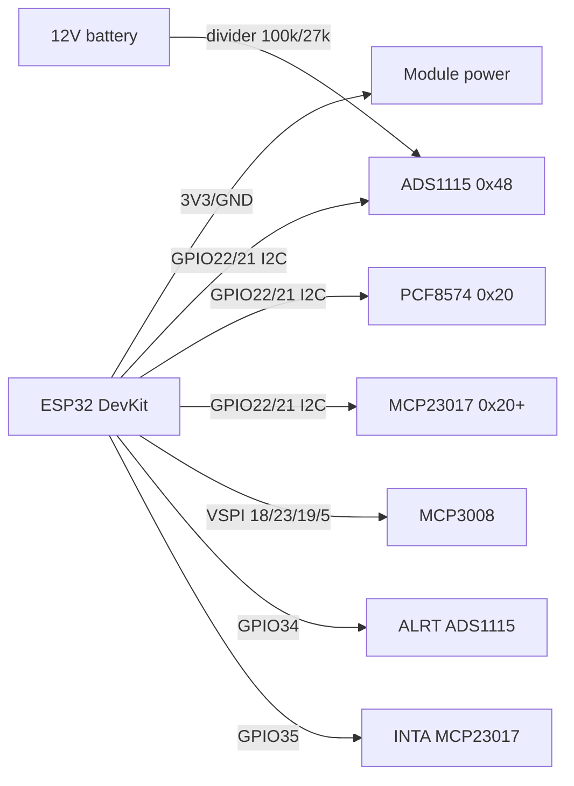

# ADS1115 / MCP3008 / PCF8574 / MCP23017 - ADC and GPIO expansion

![[assets/img/expander-scheme.png|500]]
*Fig. 1. ESP32 expansion: precise ADS1115 ADC over I2C and PCF8574 GPIO expander.*

## Purpose

The built-in ESP32 ADC is noisy (+-6 LSB) and nonlinear, and GPIO pins are often not enough. External chips fix both issues: ADS1115 - 16-bit I2C ADC with PGA for precise measurements (batteries, shunts, NTC, load cells); MCP3008 - 8-channel 10-bit SPI ADC for fast polling of potentiometers and joysticks; PCF8574 - 8-bit I2C GPIO expander (buttons, relays, LCD1602); MCP23017 - 16-bit expander with interrupts and pull-ups. A base for any ESP32 automation shield.

## Specifications

| Parameter | ADS1115 | MCP3008 | PCF8574 | MCP23017 |
| --- | --- | --- | --- | --- |
| Function | 4-channel 16-bit ADC | 8-channel 10-bit ADC | 8x GPIO | 16x GPIO (2x8) |
| Interface | I2C, 0x48-0x4B (ADDR) | SPI, up to 3.6 MHz | I2C 0x20-0x27 (A variant 0x38-0x3F) | I2C 0x20-0x27 (addresses A0-A2) |
| Speed | 8-860 SPS | 200 kSPS | about 100 kHz GPIO | about 1 MHz GPIO |
| Feature | PGA +-0.256...+-6.144 V, ALRT comparator | Cheap, 8 channels | Quasi-bidirectional pins | INTA/INTB interrupts, 100 kOhm pull-up |
| Power supply | 2.0-5.5 V | 2.7-5.5 V | 2.5-6 V | 1.8-5.5 V |
| Current | 150 uA / 0.5 uA sleep | 500 uA | 10 uA | 1 mA |
| Accuracy | 0.1875 mV/LSB at +-6.144 V | 4.9 mV/LSB at 5 V | - | - |
| Price | ~$3-4 | ~$2 | ~$1 | ~$2 |

### Dividers for ADS1115 (12 V battery -> PGA)

| Measurement | R1 (top) | R2 (bottom) | Factor | Input range |
| --- | --- | --- | --- | --- |
| 12 V battery | 100 kOhm | 27 kOhm | x4.70 | 0-2.55 V (PGA +-4.096) |
| 5 V rail | 10 kOhm | 10 kOhm | x2.0 | 0-2.5 V |
| Current via 0.1 Ohm shunt | PGA x16 (+-0.256 V) | - | 2.56 A max | Differential A0-A1 |

> R1+R2 at least 20 kOhm so the battery is not drained; 100 nF ceramic across R2 against noise.

## Module pin legend

| Pin | Type | Where | Note |
| --- | --- | --- | --- |
| VCC | Power | 3V3 ESP32 | ADS1115/MCP23017 - 3.3 V for level matching; PCF8574 may use 5 V |
| GND | Ground | GND ESP32 | Common, short |
| SCL / SDA | I2C | GPIO22 / GPIO21 | ADS1115 + PCF8574 + MCP23017 on one bus (different addresses!) |
| SCK / MOSI / MISO / CS | SPI | GPIO18/23/19/5 | MCP3008: SCK to 18, MOSI(DIN) to 23, MISO(DOUT) to 19, CS to 5 |
| A0-A3 (ADS1115) | Analog inputs | Dividers/sensors | A0-A3 single-ended or A0-A1 pairs differentially |
| CH0-CH7 (MCP3008) | Analog inputs | Potentiometers | Reference VREF - measurement accuracy equals VREF accuracy |
| P0-P7 (PCF8574) | Quasi-GPIO | Buttons/relays/LCD | for relays - via ULN2003 or transistor, pin current only 25 mA |
| GPA0-7/GPB0-7 (MCP23017) | GPIO | Buttons/LED/relays | INTA/INTB to ESP32 GPIO for interrupts |
| ALRT (ADS1115) | Comparator output | GPIO (optional) | Threshold without CPU polling |
| A0-A2 (address) | Input | GND/VCC | PCF8574: 0x20 + combination; ADS1115 ADDR: GND to 0x48, VCC to 0x49, SDA to 0x4A, SCL to 0x4B |

## Wiring diagram

| ESP32 | Module | Note |
| --- | --- | --- |
| 3V3 | ADS1115 VCC, MCP3008 VDD, MCP23017 VCC | PCF8574 - 3V3 or 5V depending on peripherals |
| GND | GND of all | Common ground |
| GPIO22 | SCL (of all I2C modules) | 4.7 kOhm pull-up |
| GPIO21 | SDA (of all I2C modules) | 4.7 kOhm pull-up |
| GPIO5 | MCP3008 CS | Separate CS per SPI device |
| GPIO18/23/19 | MCP3008 CLK/DIN/DOUT | Hardware VSPI |
| GPIO34 | ADS1115 ALRT (optional) | Input pin without internal pull-up |
| GPIO35 | MCP23017 INTA/INTB | Pin-change interrupt |

### ASCII diagram

```text
      ESP32 DevKit                  Модулі
  +---------------+    I2C    +------------------+
  | 3V3 ----------+---------->VCC ADS1115/PCF/MCP|
  | GND ----------+---------->GND x3            |
  | G22 SCL ------+---------->SCL x3 (pull-up)  |
  | G21 SDA ------+---------->SDA x3 (pull-up)  |
  +---------------+           +------------------+
  +---------------+    SPI    +------------------+
  | G18 SCK --------------->CLK MCP3008         |
  | G23 MOSI -------------->DIN MCP3008         |
  | G19 MISO <--------------DOUT MCP3008        |
  | G5  CS ---------------->CS MCP3008          |
  +---------------+           +------------------+
  Дільник 12V: [+]--100k--+--27k--[GND], середина -> A0
```

### Mermaid



## ESP-IDF code

```c
#include "driver/i2c.h"
#include "driver/spi_master.h"
#include "esp_log.h"

#define I2C_PORT I2C_NUM_0
#define ADS_ADDR 0x48
static const char *TAG = "exp";

// ADS1115: single-shot читання каналу 0, PGA ±4.096 В
static int16_t ads_read_ch0(void)
{
    uint8_t cfg[3] = {0x01, 0xC3, 0x83}; // MUX=AIN0, PGA=4.096, 128 SPS, single
    i2c_master_write_to_device(I2C_PORT, ADS_ADDR, cfg, 3, 100);
    vTaskDelay(pdMS_TO_TICKS(10));
    uint8_t reg = 0x00;
    uint8_t d[2] = {0};
    i2c_master_write_read_device(I2C_PORT, ADS_ADDR, &reg, 1, d, 2, 100);
    return (int16_t)((d[0] << 8) | d[1]);
}

// PCF8574: записати байт (біти=1 — входи з pull-up)
static void pcf_write(uint8_t v)
{
    i2c_master_write_to_device(I2C_PORT, 0x20, &v, 1, 100);
}

void app_main(void)
{
    i2c_config_t ic = {.mode = I2C_MODE_MASTER, .sda_io_num = 21,
        .scl_io_num = 22, .sda_pullup_en = 1, .scl_pullup_en = 1,
        .master.clk_speed = 100000};
    i2c_param_config(I2C_PORT, &ic);
    i2c_driver_install(I2C_PORT, ic.mode, 0, 0, 0);
    for (;;) {
        int16_t raw = ads_read_ch0();
        float v = raw * 4.096f / 32768.0f; // Вольти на A0
        ESP_LOGI(TAG, "A0=%.3f V (12V АКБ: %.2f V)", v, v * 4.7037f);
        pcf_write(0xFE); // P0 = 0, решта входи
        vTaskDelay(pdMS_TO_TICKS(500));
    }
}
// MCP3008 по SPI: послати 0x01, (0x80|ch<<4), 0x00; відповідь — 10 біт.
// MCP23017: IODIRA=0x00 (виходи), GPIOA — дані; INTCON/GPINTEN — переривання.
```

## Arduino code

```cpp
#include <Wire.h>
#include <Adafruit_ADS1X15.h>
#include <PCF8574.h>
#include <Adafruit_MCP23X17.h>
#include <Adafruit_MCP3008.h>

Adafruit_ADS1115 ads;
PCF8574 pcf(0x20);
Adafruit_MCP23X17 mcp;
Adafruit_MCP3008 mcp3008;

void setup() {
  Serial.begin(115200);
  Wire.begin(21, 22);
  ads.begin(0x48);
  ads.setGain(GAIN_ONE);      // ±4.096 В
  ads.setDataRate(RATE_ADS1115_128SPS);
  pcf.pinMode(P0, OUTPUT);
  pcf.begin();
  mcp.begin_I2C(0x20);
  mcp.pinMode(0, INPUT_PULLUP); // GPA0 кнопка
  mcp.setupInterruptPin(0, FALLING);
  mcp3008.begin(5); // CS = GPIO5 (VSPI за замовчуванням)
}

void loop() {
  int16_t raw = ads.readADC_SingleEnded(0);
  Serial.printf("ADS A0: %d -> %.3f V\n", raw, raw * 4.096 / 32768.0);
  Serial.printf("MCP3008 CH0: %d\n", mcp3008.readADC(0));
  pcf.digitalWrite(P0, !pcf.digitalRead(P0));
  delay(500);
}
```

## MicroPython code

```python
from machine import I2C, SPI, Pin
import time

i2c = I2C(0, scl=Pin(22), sda=Pin(21))
print("I2C:", [hex(a) for a in i2c.scan()])

ADS = 0x48
PCF = 0x20

def ads_read(ch=0):
    # MUX single-ended, PGA ±4.096, single-shot
    mux = 0x40 | (ch << 12)
    cfg = mux | 0x0200 | 0x0080 | 0x0003
    i2c.writeto_mem(ADS, 0x01, bytes([(cfg >> 8) & 0xFF, cfg & 0xFF]))
    time.sleep_ms(10)
    d = i2c.readfrom_mem(ADS, 0x00, 2)
    raw = (d[0] << 8) | d[1]
    return raw - 65536 if raw > 32767 else raw

spi = SPI(2, baudrate=1000000, sck=Pin(18), mosi=Pin(23), miso=Pin(19))
cs = Pin(5, Pin.OUT, value=1)

def mcp3008_read(ch):
    cs(0)
    spi.write(bytes([0x01, (0x08 | ch) << 4, 0x00]))
    cs(1)
    # спрощено: використати readinto або драйвер mcp3008.py
    return 0

while True:
    print("ADS A0:", ads_read(0) * 4.096 / 32768, "V")
    i2c.writeto(PCF, bytes([0xFE]))  # P0 = 0
    time.sleep(0.5)
```

## Common issues

| No | Issue | Symptom | Fix |
| --- | --- | --- | --- |
| 1 | Wrong MUX/PGA bit in ADS1115 | Channel reads ground or saturates at 32767 | Check the config register: MUX bits 14-12, PGA bits 11-9 |
| 2 | MCP3008 VREF from noisy 3V3 | Lower 2-3 bits jump | Separate REF (TL431) + 100 nF on VREF, averaging of 16-64 samples |
| 3 | PCF8574 treated as push-pull output | LED never fully off, relay chatters | Pins are quasi-bidirectional: write 1 for input; drive loads via transistor/ULN2003 |
| 4 | PCF8574 vs MCP23017 address conflict | Both on 0x20, bus is silent | PCF8574 (0x20-0x27), PCF8574A (0x38-0x3F); split with A0-A2 jumpers |
| 5 | SPI mode for MCP3008 | Zeros on MISO | Mode 0 (CPOL=0, CPHA=0), clock up to 3.6 MHz at 5 V, up to 1 MHz at 3.3 V |
| 6 | ALRT/INT without pull-up | False interrupts | 10 kOhm pull-up to 3V3 on ALRT (open-drain) and INTA/INTB |
| 7 | 12 V divider without margin | ADS1115 saturates at 14.4 V charge | Design for 15 V max: 100k/27k gives 2.99 V at 14.4 V - inside PGA +-4.096 |

## Official sources

- [ADS1115 - product page and datasheet (TI)](https://www.ti.com/product/ADS1115) - official specs and docs.
- [ADS1115 module - live photo (Adafruit)](https://www.adafruit.com/product/1085) - product page with photo.
- [MCP3008 - live photo (Adafruit)](https://www.adafruit.com/product/856) - product page with photo; Microchip datasheet - open in a browser (the site blocks bots).
- [PCF8574 - product page and datasheet (TI)](https://www.ti.com/product/PCF8574) - official specs and docs.
- [MCP23017 - live photo (Adafruit)](https://www.adafruit.com/product/732) - product page with photo; Microchip datasheet - open in a browser.

## See also

- [[EN/04-Interfaces/03-I2C.en|I2C]]
- [[EN/04-Interfaces/02-SPI.en|SPI]]
- [[EN/06-Analog/01-ADC.en|ADC]]
- [[EN/10-Sensors/11-NTC-PT100-MAX6675-LM35.en]]
- [[EN/10-Sensors/06-INA219-HX711-BH1750.en]]
- [[EN/03-GPIO/01-GPIO-Overview.en]]
- [[EN/03-GPIO/04-Interrupts-PWM.en]]

## Quality verification
- `check_style`: 0 violations expected; image + mermaid + common-issues + sources present.
- `check_links`: 0 broken; links to `01-Hardware/01-ESP32-Classic.en` / `02-Power-Supply/01-Power-Rails.en` / `Home.en` verified; unknown targets link UA-original with alias.
- `check_home`: 0 errors; `Home.en` links to this file via `11-Vivid/` or `10-Sensors/` section.
