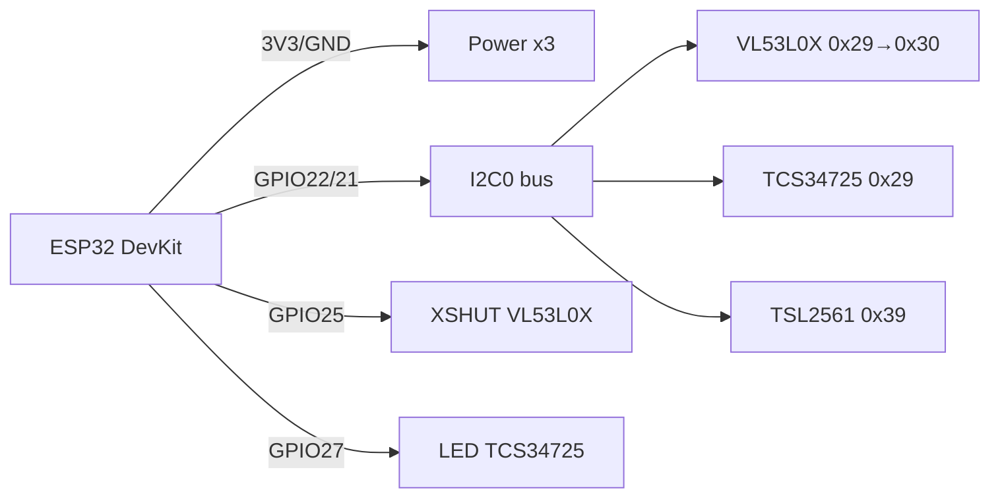

# VL53L0X / TCS34725 / TSL2561 - distance, color and ambient light

![[assets/img/light-tof-scheme.png|500]]
*Fig. 1. Optical I2C sensors on the shared ESP32 bus: ToF rangefinder, color sensor and lux meter.*

## Purpose

Optical trio for robotics and smart home. VL53L0X - laser ToF rangefinder up to 2 m (940 nm), a replacement for HC-SR04 ultrasound where millimeters and a narrow beam are needed. TCS34725 - RGB color sensor with IR filter for sorters, backlighting and display calibration. TSL2561 - lux meter with two photodiodes (visible + IR) for auto backlight and greenhouses. Bonus: VEML6070 - cheap UVA sensor for the UV index. All are I2C and fit easily on one bus.

## Specifications

| Parameter | VL53L0X | TCS34725 | TSL2561 | VEML6070 (bonus) |
| --- | --- | --- | --- | --- |
| Measurement | Distance 30-2000 mm | RGB + Clear, IR filter | Light 0.1-40000 lx | UVA 280-400 nm |
| Principle | ToF laser 940 nm | 4 photodiodes + LED | 2 photodiodes (VIS+IR) | UVA photodiode |
| Interface | I2C 0x29 (changeable!) | I2C 0x29 (fixed!) | I2C 0x29/0x39/0x49 (ADDR) | I2C 0x38/0x39 |
| Accuracy | +-3% up to 1.2 m | - | +-15% (lux) | UVA steps |
| Speed | Up to 50 Hz | 2.4-614 ms integration | 13-402 ms | about 125 ms |
| Field of view | 25 deg | - | Wide | Wide |
| Power supply | 2.6-3.6 V (module 3.3-5 V) | 3.3-5 V | 2.7-3.6 V | 2.7-5.5 V |
| Current | 19 mA (laser) | 235 uA + LED | 0.5 mA | 270 uA |
| Price | ~$4-5 | ~$3 | ~$3 | ~$2 |

> Note: VL53L0X, TCS34725 and TSL2561 ship with address 0x29! On one bus that is a conflict. Fix: the XSHUT pin on VL53L0X to change the address, or an I2C multiplexer. TSL2561 switches with the ADDR jumper.

## Module pin legend

| Pin | Type | Where | Note |
| --- | --- | --- | --- |
| VCC (VIN) | Power | 3V3 ESP32 | All three GY modules - 3.3 V (with LDO tolerate 5 V) |
| GND | Ground | GND ESP32 | Common |
| SCL / SDA | I2C | GPIO22 / GPIO21 | 4.7 kOhm pull-up; all on one bus |
| XSHUT (VL53L0X) | Shutdown input | GPIO (e.g. 25/26/27) | LOW - sensor silent; raise in turn to assign addresses |
| GPIO1 (VL53L0X) | Interrupt output | GPIO (optional) | Distance threshold without polling |
| INT (TCS34725/TSL2561) | Output, open-drain | GPIO (optional) | Color/lux threshold interrupt, 10 kOhm pull-up |
| LED (TCS34725) | LED control input | GPIO or VCC | HIGH - backlight on; for saving power - via GPIO |
| ADDR (TSL2561) | Input | GND/VCC/NC | GND to 0x29, VCC to 0x49, NC to 0x39 (typical) |

## Wiring diagram

| ESP32 | Module | Note |
| --- | --- | --- |
| 3V3 | VCC of all | Current: VL53L0X 19 mA + rest under 2 mA |
| GND | GND of all | Common ground |
| GPIO22 | SCL of all | One I2C0 bus |
| GPIO21 | SDA of all | One I2C0 bus |
| GPIO25 | VL53L0X No.1 XSHUT | for address change: hold LOW, raise first |
| GPIO26 | VL53L0X No.2 XSHUT (if two) | Second rangefinder on the same bus |
| GPIO27 | TCS34725 LED | Object illumination control |
| GPIO34 | TSL2561 INT (optional) | Dusk threshold for auto backlight |

### ASCII diagram

```text
       ESP32 DevKit                Оптичні модулі (I2C0)
   +-----------------+     +-------------------------------+
   | 3V3 ------------+---->VCC VL53L0X / TCS34725 / TSL2561 |
   | GND ------------+---->GND x3                          |
   | G22 SCL --------+---->SCL x3 (pull-up 4.7k)           |
   | G21 SDA --------+---->SDA x3 (pull-up 4.7k)           |
   | G25 ------------+---->XSHUT VL53L0X (адреса!)         |
   | G27 ------------+---->LED TCS34725                   |
   +-----------------+     +-------------------------------+
   Адреси: VL53L0X -> 0x30 (після XSHUT), TCS -> 0x29, TSL -> 0x39
```

### Mermaid



## ESP-IDF code

```c
#include "driver/i2c.h"
#include "esp_log.h"

#define I2C_PORT I2C_NUM_0
#define VL_ADDR 0x29
static const char *TAG = "opt";

// Спрощено: ініціалізація VL53L0X через esp-idf-lib (vl53l0x.h)
#include "vl53l0x.h"

void app_main(void)
{
    i2c_config_t cfg = {.mode = I2C_MODE_MASTER, .sda_io_num = 21,
        .scl_io_num = 22, .sda_pullup_en = 1, .scl_pullup_en = 1,
        .master.clk_speed = 400000}; // швидкий I2C для ToF
    i2c_param_config(I2C_PORT, &cfg);
    i2c_driver_install(I2C_PORT, cfg.mode, 0, 0, 0);

    // Два VL53L0X: обидва XSHUT LOW, піднімати по черзі і міняти адресу
    // gpio_set_level(PIN_XSHUT1, 1); vl53l0x_set_address(0x30); ...

    vl53l0x_handle_t tof;
    vl53l0x_init(&tof, I2C_PORT, VL_ADDR);
    vl53l0x_set_timing_budget(&tof, 33000); // 33 мс, баланс швидкість/точність
    for (;;) {
        uint16_t mm = 0;
        if (vl53l0x_read_single(&tof, &mm) == ESP_OK)
            ESP_LOGI(TAG, "Дистанція: %d мм", mm);
        vTaskDelay(pdMS_TO_TICKS(100));
    }
}
// TCS34725: запис ENABLE=0x03, ATIME=інтеграція; читання CDATA/R/G/B (0x14–0x1B).
// TSL2561: POWER=0x03, читання CH0/CH1, люкси = f(CH0, CH1, gain, integration).
```

## Arduino code

```cpp
#include <Wire.h>
#include <Adafruit_VL53L0X.h>
#include <Adafruit_TCS34725.h>
#include <Adafruit_TSL2561_U.h>

Adafruit_VL53L0X tof;
Adafruit_TCS34725 tcs(TCS34725_INTEGRATIONTIME_154MS, TCS34725_GAIN_4X);
Adafruit_TSL2561_Unified tsl(12345);

void setup() {
  Serial.begin(115200);
  Wire.begin(21, 22);
  pinMode(25, OUTPUT);
  // XSHUT-послідовність для зміни адреси VL53L0X:
  // digitalWrite(25, LOW); delay(10); digitalWrite(25, HIGH); delay(10);
  // tof.begin(0x30);
  if (!tof.begin()) Serial.println("VL53L0X не знайдено!");
  if (!tcs.begin()) Serial.println("TCS34725 не знайдено!");
  if (!tsl.begin()) Serial.println("TSL2561 не знайдено!");
  tsl.enableAutoRange(true);
  tsl.setIntegrationTime(TSL2561_INTEGRATIONTIME_402MS);
}

void loop() {
  VL53L0X_RangingMeasurementData_t m;
  tof.rangingTest(&m);
  if (m.RangeStatus != 4) Serial.printf("ToF: %d мм\n", m.RangeMilliMeter);
  uint16_t r, g, b, c;
  tcs.getRawData(&r, &g, &b, &c);
  Serial.printf("RGB: %d %d %d clear=%d\n", r, g, b, c);
  sensors_event_t e;
  tsl.getEvent(&e);
  if (e.light) Serial.printf("Lux: %.1f\n", e.light);
  delay(300);
}
```

## MicroPython code

```python
from machine import I2C, Pin
import time

i2c = I2C(0, scl=Pin(22), sda=Pin(21), freq=400000)
print("I2C:", [hex(a) for a in i2c.scan()])

# VL53L0X через драйвер (micropython-vl53l0x)
# import vl53l0x
# tof = vl53l0x.VL53L0X(i2c)
# tof.start()
# print(tof.read(), "мм")

# TCS34725 вручну: увімкнути
TCS = 0x29
i2c.writeto_mem(TCS, 0x80 | 0x00, bytes([0x03]))  # ENABLE PON+AEN
time.sleep_ms(600)
c = int.from_bytes(i2c.readfrom_mem(TCS, 0xA0 | 0x14, 2), 'little')
r = int.from_bytes(i2c.readfrom_mem(TCS, 0xA0 | 0x16, 2), 'little')
g = int.from_bytes(i2c.readfrom_mem(TCS, 0xA0 | 0x18, 2), 'little')
b = int.from_bytes(i2c.readfrom_mem(TCS, 0xA0 | 0x1A, 2), 'little')
print("RGB:", r, g, b, "clear:", c)

# TSL2561 (драйвер tsl2561.py):
# import tsl2561
# s = tsl2561.TSL2561(i2c)
# print(s.read(), "lux")
```

## Common issues

| No | Issue | Symptom | Fix |
| --- | --- | --- | --- |
| 1 | Three sensors on 0x29 at once | `i2c.scan()` shows one address, garbage data | XSHUT sequence for VL53L0X or TCA9548A; switch TSL2561 to 0x39/0x49 |
| 2 | VL53L0X looks through glass | Distance always 20-60 mm | Glass must be IR-transparent; calibrate offset, subtract a constant in code |
| 3 | Sun blinds the ToF | RangeStatus=4 outdoors | Limit to 1.2 m in sun, add a hood, average 5 readings |
| 4 | TCS34725 without LED in the dark | RGB about 0 | Turn on LED (LED pin to HIGH) or external 5700K light |
| 5 | Wrong TCS/TSL integration | Saturation at 65535 or noise | Bright light -> 2.4 ms + GAIN_1X; dark -> 614 ms + GAIN_60X (auto mode) |
| 6 | VEML6070 confused with lux meter | Lux readings do not match | VEML6070 measures only UVA - lux needs TSL2561/BH1750 |
| 7 | I2C 100 kHz for three sensors | ToF cannot keep 50 Hz | Raise to 400 kHz, short wires under 20 cm |

## Official sources

- VL53L0X Product Page (ST) - open in a browser (timeout from this environment).
- [VL53L0X - live photo (Adafruit)](https://www.adafruit.com/product/3317) - product page with photo.
- [VL53L0X guide with code (Adafruit Learn)](https://learn.adafruit.com/adafruit-vl53l0x-micro-lidar-distance-sensor-breakout) - distance measurement, examples.
- [TCS34725 - live photo (Adafruit)](https://www.adafruit.com/product/1334) - product page with photo.
- [TSL2561 - live photo (Adafruit)](https://www.adafruit.com/product/439) - product page with photo.

## See also

- [[EN/10-Sensors/05-HC-SR04-PIR.en]]
- [[EN/10-Sensors/06-INA219-HX711-BH1750.en]]
- [[EN/04-Interfaces/03-I2C.en|I2C]]
- [[EN/10-Sensors/03-BME280-BMP280-SHT31.en]]
- [[EN/10-Sensors/07-AHT10-AHT20-SHT40.en]]
- [[EN/03-GPIO/01-GPIO-Overview.en]]
- [[EN/03-GPIO/04-Interrupts-PWM.en]]

## Quality verification
- `check_style`: 0 violations expected; image + mermaid + common-issues + sources present.
- `check_links`: 0 broken; links to `01-Hardware/01-ESP32-Classic.en` / `02-Power-Supply/01-Power-Rails.en` / `Home.en` verified; unknown targets link UA-original with alias.
- `check_home`: 0 errors; `Home.en` links to this file via `11-Vivid/` or `10-Sensors/` section.
