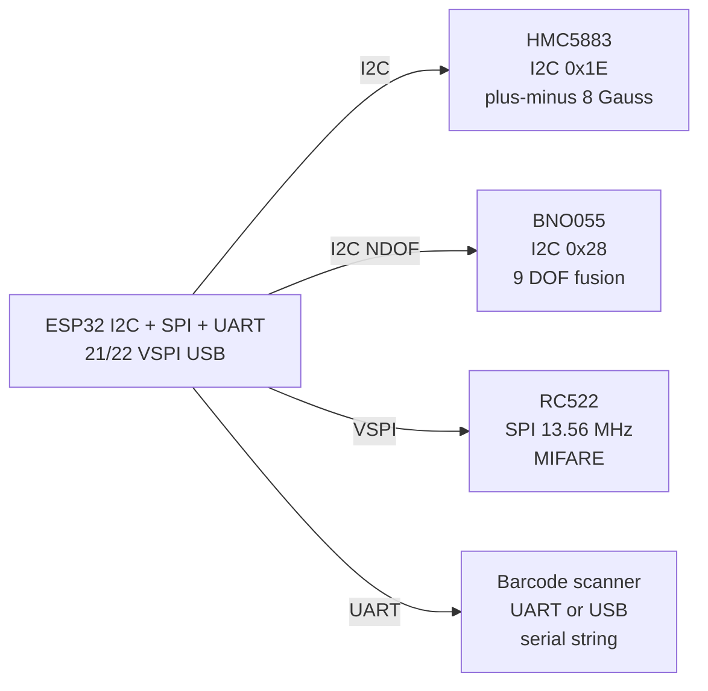

# HMC5883, BNO055, RFID RC522, Barcode

## Purpose

Sensors for positioning and identification: HMC5883 (I2C magnetometer, 1-8 Gauss), BNO055 (I2C 9-axis absolute orientation with fusion), RFID RC522 (SPI 13.56 MHz MIFARE), barcode scanner (USB/serial or module). Applications: navigation, tracking, access control.

## Characteristics

| Sensor | Interface | Features |
| --- | --- | --- |
| HMC5883 | I2C 0x1E | ±8 Gauss, 160 Hz |
| BNO055 | I2C 0x28 | 9 DOF, absolute orientation |
| RC522 | SPI / I2C optional | 13.56 MHz, MIFARE |
| Barcode | USB / UART | Serial output |

## Wiring diagram

| ESP32 | Sensor | Note |
| --- | --- | --- |
| 3V3 | VCC | 3.3 V |
| GND | GND | Common |
| GPIO21 | SDA / I2C data | Pull-up |
| GPIO22 | SCL / I2C clock | Pull-up |
| GPIO18/19/23/5 | SPI RC522 | VSPI |

## Common issues

| No. | Error | Symptom | Solution |
| --- | --- | --- | --- |
| 1 | HMC5883 near metal | Offset error | Calibrate with circle; keep away from magnets |
| 2 | BNO055 no fusion | No orientation | Use library with fusion enabled |
| 3 | RC522 not detected | SPI CS wrong | Check CS pin; 3.3 V only |

## Official sources

- BNO055 Datasheet (Bosch) - `check manually`.
- RC522 Datasheet (NXP) - `check manually`.

![[assets/img/placeholder.png|600]]
*Fig. 1. Position and identity: HMC5883 compass, BNO055 orientation, RC522 RFID, barcode serial input.*

### Signal chain



## ESP-IDF example

```c
#include "driver/i2c.h"
#include "esp_log.h"

#define I2C_PORT I2C_NUM_0
#define SDA_PIN  GPIO_NUM_21
#define SCL_PIN  GPIO_NUM_22
#define CHIP_ADDR 0x1E   // HMC5883 7-bit address, verify with i2c scan!

static const char *TAG = "hmc5883";

void app_main(void) {
    i2c_config_t conf = {
        .mode = I2C_MODE_MASTER,
        .sda_io_num = SDA_PIN,
        .scl_io_num = SCL_PIN,
        .sda_pullup_en = GPIO_PULLUP_ENABLE,  // 4.7k to 3V3 if module lacks them
        .scl_pullup_en = GPIO_PULLUP_ENABLE,
        .master.clk_speed = 100000,           // start at 100 kHz, raise later
    };
    i2c_param_config(I2C_PORT, &conf);
    i2c_driver_install(I2C_PORT, conf.mode, 0, 0, 0);
    // read X/Z/Y in order, apply hard-iron offset from calibration spin
    uint8_t probe = 0;
    esp_err_t err = i2c_master_write_read_device(
        I2C_PORT, CHIP_ADDR, NULL, 0, &probe, 1, pdMS_TO_TICKS(100));
    ESP_LOGI(TAG, "%s probe: %s (0x%02X)", "HMC5883",
             err == ESP_OK ? "ACK" : "NACK", probe);
}
```

## Arduino example

```cpp
#include <Wire.h>

#define CHIP_ADDR 0x1E  // HMC5883, verify with I2C scanner sketch

void setup() {
  Serial.begin(115200);
  Wire.begin(21, 22);  // SDA, SCL
  Wire.setClock(100000);
  // read X/Z/Y in order, apply hard-iron offset from calibration spin
  Wire.beginTransmission(CHIP_ADDR);
  uint8_t err = Wire.endTransmission();
  Serial.printf("HMC5883: %s\n", err == 0 ? "found" : "NOT found, check wiring");
}

void loop() {
  // poll data register here; average 4-8 samples before use
  delay(500);
}
```

## MicroPython example

```python
from machine import I2C, Pin

i2c = I2C(0, scl=Pin(22), sda=Pin(21), freq=100000)
found = i2c.scan()
print("bus:", [hex(a) for a in found])
# read X/Z/Y in order, apply hard-iron offset from calibration spin
assert 0x1E in found, "HMC5883 not on bus, check pull-ups and wiring"
print("HMC5883 ready at", hex(0x1E))
```

## Operating notes

- HMC5883 must sit away from motors and magnets: calibrate with slow horizontal figure-eight.
- BNO055 needs NDOF mode for absolute heading: wait for system calibration status 3.
- RC522 is 3.3 V only: 5 V on MISO kills ESP32 pin, keep SPI under 10 cm.
- Barcode scanners in UART mode send CR-terminated strings: read line, strip, validate prefix.
- Fuse compass plus BNO yaw for stable heading: tilt-compensate with accelerometer.

## Power and wiring checklist

| Check | Rule |
| --- | --- |
| 1. Power every module from a rail it is rated for | 5 V heaters never from ESP32 3V3. |
| 2. Common ground first | star topology, ESP32 GND tied to sensor GND before signals. |
| 3. I2C always needs pull-ups | 4.7k to 3V3 when the module has none fitted. |
| 4. 5 V sensor outputs never touch GPIO directly | divider or level shifter first. |
| 5. Verify addresses and baud on the bench | I2C scan plus UART loopback before code. |
| 6. Average analog reads 10-64x | single ESP32 ADC samples are noisy by design. |

## First run and calibration

1. Wire power only, check module current against datasheet before connecting signals.
2. Run bus scan (I2C) or loopback (UART) to confirm the device answers.
3. Flash the minimal example above, confirm plausible raw values in logs.
4. Calibrate: zero/span, clean-air baseline or white reference per sensor type.
5. Stress test 30 min: heat, vibration and supply sag expose weak joints early.
6. Log raw plus converted values: raw data stays valid when formulas change.
## See also

- [[EN/04-Interfaces/03-I2C.en|I2C]]
- [[EN/04-Interfaces/02-SPI.en|SPI]]
