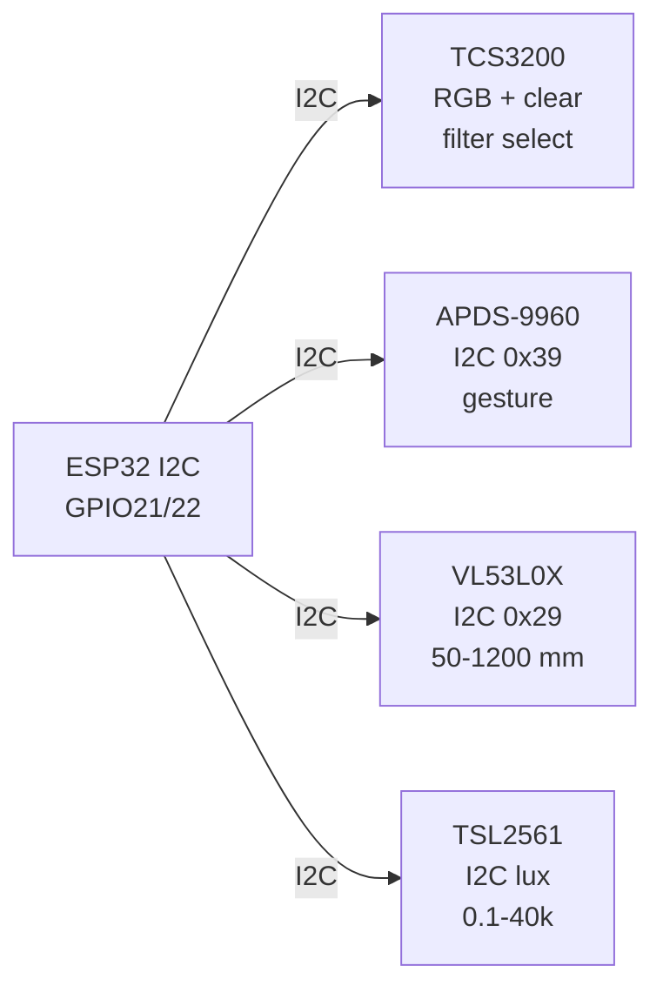

# Light Spectral Gesture

## Purpose

Ambient and interaction sensors: TCS3200 color (R-G-B clear, I2C/SPI), APDS-9960 gesture/proximity (I2C), VL53L0X ToF (I2C, 50-1200 mm), TSL2561 lux (I2C). Applications: ambient light adaptation, gesture control, distance measurement.

## Characteristics

| Sensor | Range / Feature | Interface | Note |
| --- | --- | --- | --- |
| TCS3200 | RGB + clear | I2C / SPI | Filter selection |
| APDS-9960 | Proximity 20-100 mm, gesture | I2C 0x39 | 4-direction gesture |
| VL53L0X | 50-1200 mm | I2C 0x29 | ToF, ±1 mm |
| TSL2561 | 0.1-40,000 lux | I2C 0x39 / 0x29 | Photodiode |

## Common issues

| No. | Error | Symptom | Solution |
| --- | --- | --- | --- |
| 1 | APDS gesture false | Wrong direction | Calibrate with library; avoid strong light |
| 2 | VL53L0X no reading | Out of range or black surface | Use within 50-1200 mm; avoid pure black |

## Official sources

- TCS3200 Datasheet - `check manually`.
- VL53L0X Guide (ST) - see manufacturer.

![[assets/img/placeholder.png|600]]
*Fig. 1. Light and gesture front-end: TCS3200 color, APDS-9960 gesture, VL53L0X ToF, TSL2561 lux.*

### Signal chain



## ESP-IDF example

```c
#include "driver/i2c.h"
#include "esp_log.h"

#define I2C_PORT I2C_NUM_0
#define SDA_PIN  GPIO_NUM_21
#define SCL_PIN  GPIO_NUM_22
#define CHIP_ADDR 0x39   // APDS-9960 7-bit address, verify with i2c scan!

static const char *TAG = "apds_9960";

void app_main(void) {
    i2c_config_t conf = {
        .mode = I2C_MODE_MASTER,
        .sda_io_num = SDA_PIN,
        .scl_io_num = SCL_PIN,
        .sda_pullup_en = GPIO_PULLUP_ENABLE,  // 4.7k to 3V3 if module lacks them
        .scl_pullup_en = GPIO_PULLUP_ENABLE,
        .master.clk_speed = 100000,           // start at 100 kHz, raise later
    };
    i2c_param_config(I2C_PORT, &conf);
    i2c_driver_install(I2C_PORT, conf.mode, 0, 0, 0);
    // enable gesture engine, read UDLR FIFOs, map to swipe directions
    uint8_t probe = 0;
    esp_err_t err = i2c_master_write_read_device(
        I2C_PORT, CHIP_ADDR, NULL, 0, &probe, 1, pdMS_TO_TICKS(100));
    ESP_LOGI(TAG, "%s probe: %s (0x%02X)", "APDS-9960",
             err == ESP_OK ? "ACK" : "NACK", probe);
}
```

## Arduino example

```cpp
#include <Wire.h>

#define CHIP_ADDR 0x39  // APDS-9960, verify with I2C scanner sketch

void setup() {
  Serial.begin(115200);
  Wire.begin(21, 22);  // SDA, SCL
  Wire.setClock(100000);
  // enable gesture engine, read UDLR FIFOs, map to swipe directions
  Wire.beginTransmission(CHIP_ADDR);
  uint8_t err = Wire.endTransmission();
  Serial.printf("APDS-9960: %s\n", err == 0 ? "found" : "NOT found, check wiring");
}

void loop() {
  // poll data register here; average 4-8 samples before use
  delay(500);
}
```

## MicroPython example

```python
from machine import I2C, Pin

i2c = I2C(0, scl=Pin(22), sda=Pin(21), freq=100000)
found = i2c.scan()
print("bus:", [hex(a) for a in found])
# enable gesture engine, read UDLR FIFOs, map to swipe directions
assert 0x39 in found, "APDS-9960 not on bus, check pull-ups and wiring"
print("APDS-9960 ready at", hex(0x39))
```

## Operating notes

- APDS-9960 and TSL2561 share address 0x39 on some boards: use one at a time or TCA9548A mux.
- VL53L0X hates black surfaces past 1 m: cap range in software, flag out-of-range codes.
- TCS3200 frequency output needs pulse counting: gate 100 ms, scale per filter channel.
- Gesture false triggers under strong sun: raise proximity threshold, require two consistent swipes.
- Lux to dimming curve is logarithmic: map 1-1000 lux to 1-100 percent PWM exponentially.

## Power and wiring checklist

| Check | Rule |
| --- | --- |
| 1. Power every module from a rail it is rated for | 5 V heaters never from ESP32 3V3. |
| 2. Common ground first | star topology, ESP32 GND tied to sensor GND before signals. |
| 3. I2C always needs pull-ups | 4.7k to 3V3 when the module has none fitted. |
| 4. 5 V sensor outputs never touch GPIO directly | divider or level shifter first. |
| 5. Verify addresses and baud on the bench | I2C scan plus UART loopback before code. |
| 6. Average analog reads 10-64x | single ESP32 ADC samples are noisy by design. |

## First run and calibration

1. Wire power only, check module current against datasheet before connecting signals.
2. Run bus scan (I2C) or loopback (UART) to confirm the device answers.
3. Flash the minimal example above, confirm plausible raw values in logs.
4. Calibrate: zero/span, clean-air baseline or white reference per sensor type.
5. Stress test 30 min: heat, vibration and supply sag expose weak joints early.
6. Log raw plus converted values: raw data stays valid when formulas change.
## See also

- [[EN/10-Sensors/26-Light-UV-IRArray-ToF.en]]
