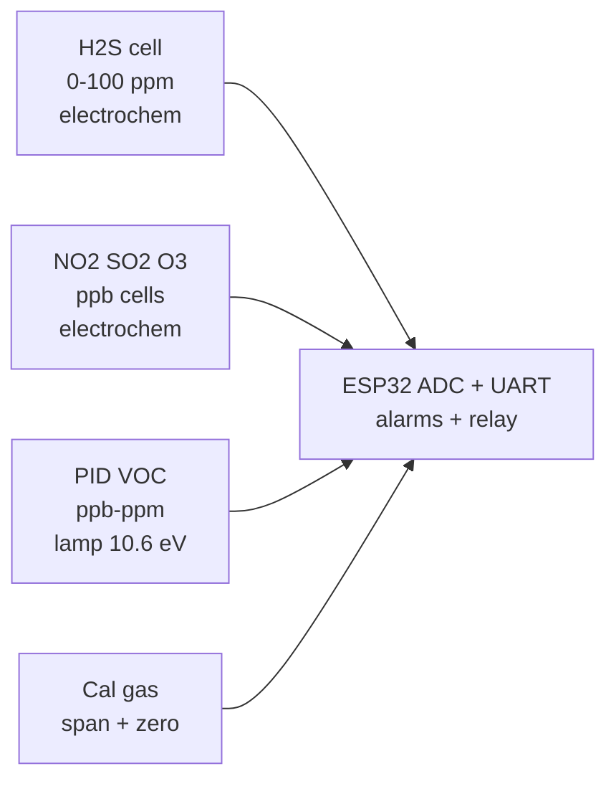

# Gas 2 VOC Industrial

## Purpose

Industrial gas sensors: H2S (electrochemical), NO2, SO2, O3 (electrochemical / PID), VOC PID (photoionization, ppb-ppm). Applications: industrial safety, environmental monitoring, chemical plants.

## Characteristics

| Gas | Range | Response time | Note |
| --- | --- | --- | --- |
| H2S | 0-100 ppm | < 30 s | Electrochemical |
| NO2 | 0-5 ppm | < 60 s | Electrochemical |
| SO2 | 0-20 ppm | < 30 s | Electrochemical |
| VOC (PID) | 0-2000 ppm / ppb | < 5 s | PID lamp |

## Common issues

| No. | Error | Symptom | Solution |
| --- | --- | --- | --- |
| 1 | No calibration | Wrong ppm | Calibrate with standard gas |
| 2 | Humidity too high | Drift | Use humidity compensation |

## Official sources

- Manufacturer datasheets - `check manually`.

![[assets/img/placeholder.png|600]]
*Fig. 1. Industrial gas safety: H2S, NO2, SO2 electrochemical cells and PID VOC into ESP32.*

### Signal chain



## ESP-IDF example

```c
#include "driver/adc.h"
#include "esp_log.h"

#define SENSOR_CH ADC1_CHANNEL_34  // electrochemical front-end analog output, GPIO34
static const char *TAG = "adc";

static int read_mv_avg(int n) {
    int sum = 0;
    for (int i = 0; i < n; i++) sum += adc1_get_raw(SENSOR_CH);
    // 12-bit, 11 dB attenuation: ~0-3.3 V full scale, see ADC docs
    return (sum / n) * 3300 / 4095;
}

void app_main(void) {
    adc1_config_width(ADC_WIDTH_BIT_12);
    adc1_config_channel_atten(SENSOR_CH, ADC_ATTEN_DB_11);
    int mv = read_mv_avg(16);  // average 16 samples against noise
    ESP_LOGI(TAG, "electrochemical front-end: %d mV", mv);
    // cells output nanoamps: transimpedance amp to volts, then ADC with averaging
}
```

## Arduino example

```cpp
#define SENSOR_PIN 34  // electrochemical front-end analog output

void setup() {
  Serial.begin(115200);
  analogReadResolution(12);
  analogSetAttenuation(ADC_11db);  // ~0-3.3 V range
}

void loop() {
  long sum = 0;
  for (int i = 0; i < 16; i++) sum += analogRead(SENSOR_PIN);
  int mv = (sum / 16) * 3300 / 4095;
  Serial.printf("electrochemical front-end: %d mV\n", mv);
  // cells output nanoamps: transimpedance amp to volts, then ADC with averaging
  delay(500);
}
```

## MicroPython example

```python
from machine import ADC, Pin
import time

adc = ADC(Pin(34))
adc.atten(ADC.ATTN_11DB)      # ~0-3.3 V range
adc.width(ADC.WIDTH_12BIT)

while True:
    raw = sum(adc.read() for _ in range(16)) // 16
    mv = raw * 3300 // 4095
    print("electrochemical front-end: %d mV" % mv)
    # cells output nanoamps: transimpedance amp to volts, then ADC with averaging
    time.sleep(0.5)
```

## Operating notes

- Electrochemical cells need span gas calibration every 6-12 months: zero in clean air first.
- PID lamp fouls in humidity: use inlet filter, log lamp hours, replace yearly in field.
- Cross-sensitivity is real: NO2 cells see O3, document interferents on the alarm panel.
- Alarm relays must fail safe: de-energize to alarm, test monthly with test gas.
- Log raw plus compensated values: compensation formulas change, raw data stays valid.

## Power and wiring checklist

| Check | Rule |
| --- | --- |
| 1. Power every module from a rail it is rated for | 5 V heaters never from ESP32 3V3. |
| 2. Common ground first | star topology, ESP32 GND tied to sensor GND before signals. |
| 3. I2C always needs pull-ups | 4.7k to 3V3 when the module has none fitted. |
| 4. 5 V sensor outputs never touch GPIO directly | divider or level shifter first. |
| 5. Verify addresses and baud on the bench | I2C scan plus UART loopback before code. |
| 6. Average analog reads 10-64x | single ESP32 ADC samples are noisy by design. |

## First run and calibration

1. Wire power only, check module current against datasheet before connecting signals.
2. Run bus scan (I2C) or loopback (UART) to confirm the device answers.
3. Flash the minimal example above, confirm plausible raw values in logs.
4. Calibrate: zero/span, clean-air baseline or white reference per sensor type.
5. Stress test 30 min: heat, vibration and supply sag expose weak joints early.
6. Log raw plus converted values: raw data stays valid when formulas change.
## See also

- [[EN/10-Sensors/17-Gas-CO2-Precision.en]]
