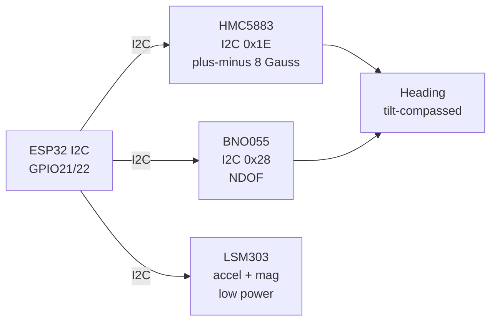

# Mag IMU 2

## Purpose

Magnetometer and IMU for navigation and orientation: HMC5883 (I2C magnetometer), BNO055 (9 DOF absolute), LSM303 (accel+mag). Applications: compass, heading, motion tracking.

## Characteristics

| Sensor | Type | Interface | Note |
| --- | --- | --- | --- |
| HMC5883 | Magnetometer | I2C 0x1E | ±8 Gauss |
| BNO055 | 9 DOF | I2C 0x28 | Fusion, absolute |
| LSM303 | Accel+Mag | I2C 0x19 | Low power |

## Common issues

| No. | Error | Symptom | Solution |
| --- | --- | --- | --- |
| 1 | Magnetometer near ferrous metal | Offset | Hard-iron calibration; keep away |

![[assets/img/placeholder.png|600]]
*Fig. 1. Compass and orientation: HMC5883 magnetometer, BNO055 fusion, LSM303 combo.*

### Signal chain



## ESP-IDF example

```c
#include "driver/i2c.h"
#include "esp_log.h"

#define I2C_PORT I2C_NUM_0
#define SDA_PIN  GPIO_NUM_21
#define SCL_PIN  GPIO_NUM_22
#define CHIP_ADDR 0x1E   // HMC5883 7-bit address, verify with i2c scan!

static const char *TAG = "hmc5883";

void app_main(void) {
    i2c_config_t conf = {
        .mode = I2C_MODE_MASTER,
        .sda_io_num = SDA_PIN,
        .scl_io_num = SCL_PIN,
        .sda_pullup_en = GPIO_PULLUP_ENABLE,  // 4.7k to 3V3 if module lacks them
        .scl_pullup_en = GPIO_PULLUP_ENABLE,
        .master.clk_speed = 100000,           // start at 100 kHz, raise later
    };
    i2c_param_config(I2C_PORT, &conf);
    i2c_driver_install(I2C_PORT, conf.mode, 0, 0, 0);
    // continuous mode, read in X/Z/Y order, subtract hard-iron offsets
    uint8_t probe = 0;
    esp_err_t err = i2c_master_write_read_device(
        I2C_PORT, CHIP_ADDR, NULL, 0, &probe, 1, pdMS_TO_TICKS(100));
    ESP_LOGI(TAG, "%s probe: %s (0x%02X)", "HMC5883",
             err == ESP_OK ? "ACK" : "NACK", probe);
}
```

## Arduino example

```cpp
#include <Wire.h>

#define CHIP_ADDR 0x1E  // HMC5883, verify with I2C scanner sketch

void setup() {
  Serial.begin(115200);
  Wire.begin(21, 22);  // SDA, SCL
  Wire.setClock(100000);
  // continuous mode, read in X/Z/Y order, subtract hard-iron offsets
  Wire.beginTransmission(CHIP_ADDR);
  uint8_t err = Wire.endTransmission();
  Serial.printf("HMC5883: %s\n", err == 0 ? "found" : "NOT found, check wiring");
}

void loop() {
  // poll data register here; average 4-8 samples before use
  delay(500);
}
```

## MicroPython example

```python
from machine import I2C, Pin

i2c = I2C(0, scl=Pin(22), sda=Pin(21), freq=100000)
found = i2c.scan()
print("bus:", [hex(a) for a in found])
# continuous mode, read in X/Z/Y order, subtract hard-iron offsets
assert 0x1E in found, "HMC5883 not on bus, check pull-ups and wiring"
print("HMC5883 ready at", hex(0x1E))
```

## Operating notes

- Hard-iron calibration is mandatory: rotate slowly on all axes, fit offset sphere.
- Keep magnetometers 10 cm from motors, speakers and steel screws or offsets drift.
- Tilt compensation needs accelerometer: raw compass heading swings when tilted.
- BNO055 magnetometer status must reach 3 before trusting absolute yaw output.
- Log raw microtesla values: fused yaw hides sensor faults during debugging.

## Power and wiring checklist

| Check | Rule |
| --- | --- |
| 1. Power every module from a rail it is rated for | 5 V heaters never from ESP32 3V3. |
| 2. Common ground first | star topology, ESP32 GND tied to sensor GND before signals. |
| 3. I2C always needs pull-ups | 4.7k to 3V3 when the module has none fitted. |
| 4. 5 V sensor outputs never touch GPIO directly | divider or level shifter first. |
| 5. Verify addresses and baud on the bench | I2C scan plus UART loopback before code. |
| 6. Average analog reads 10-64x | single ESP32 ADC samples are noisy by design. |

## First run and calibration

1. Wire power only, check module current against datasheet before connecting signals.
2. Run bus scan (I2C) or loopback (UART) to confirm the device answers.
3. Flash the minimal example above, confirm plausible raw values in logs.
4. Calibrate: zero/span, clean-air baseline or white reference per sensor type.
5. Stress test 30 min: heat, vibration and supply sag expose weak joints early.
6. Log raw plus converted values: raw data stays valid when formulas change.

## Official sources

- [ESP32 I2C (Espressif)](https://docs.espressif.com/projects/esp-idf/en/latest/esp32/api-reference/peripherals/i2c.html) - API used by the examples above.
- HMC5883 Datasheet (Honeywell) - `check manually`.
- BNO055 Datasheet (Bosch Sensortec) - `check manually`.
## See also

- [[EN/10-Sensors/19-IMU-6-9DOF.en]]
- [[EN/10-Sensors/16-HMC5883-BNO055-RFID-RC522-Barcode.en]]
