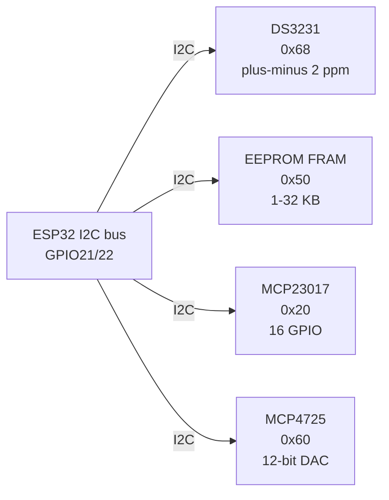

# Time Mem IO DAC

## Purpose

Supporting modules: DS3231 RTC (I2C 0x68), EEPROM/FRAM (I2C), GPIO expander MCP23017 (I2C 0x20/0x21), DAC MCP4725 (I2C 0x60). Applications: clock, storage, extra IO, analog output.

## Characteristics

| Module | Interface | Features |
| --- | --- | --- |
| DS3231 | I2C 0x68 | ±2 ppm, alarm |
| EEPROM | I2C 0x50 | 1-32 KB |
| MCP23017 | I2C 0x20 | 16 GPIO |
| MCP4725 | I2C 0x60 | 12-bit DAC |

## Common issues

| No. | Error | Symptom | Solution |
| --- | --- | --- | --- |
| 1 | DS3231 no battery | Time lost | CR2032 backup |
| 2 | MCP23017 wrong address | Not found | Check address jumpers |

![[assets/img/placeholder.png|600]]
*Fig. 1. Support modules: DS3231 clock, EEPROM storage, MCP23017 IO expander, MCP4725 DAC.*

### Signal chain



## ESP-IDF example

```c
#include "driver/i2c.h"
#include "esp_log.h"

#define I2C_PORT I2C_NUM_0
#define SDA_PIN  GPIO_NUM_21
#define SCL_PIN  GPIO_NUM_22
#define CHIP_ADDR 0x20   // MCP23017 7-bit address, verify with i2c scan!

static const char *TAG = "mcp23017";

void app_main(void) {
    i2c_config_t conf = {
        .mode = I2C_MODE_MASTER,
        .sda_io_num = SDA_PIN,
        .scl_io_num = SCL_PIN,
        .sda_pullup_en = GPIO_PULLUP_ENABLE,  // 4.7k to 3V3 if module lacks them
        .scl_pullup_en = GPIO_PULLUP_ENABLE,
        .master.clk_speed = 100000,           // start at 100 kHz, raise later
    };
    i2c_param_config(I2C_PORT, &conf);
    i2c_driver_install(I2C_PORT, conf.mode, 0, 0, 0);
    // set IODIR then GPIO registers, verify address jumpers A0-A2 first
    uint8_t probe = 0;
    esp_err_t err = i2c_master_write_read_device(
        I2C_PORT, CHIP_ADDR, NULL, 0, &probe, 1, pdMS_TO_TICKS(100));
    ESP_LOGI(TAG, "%s probe: %s (0x%02X)", "MCP23017",
             err == ESP_OK ? "ACK" : "NACK", probe);
}
```

## Arduino example

```cpp
#include <Wire.h>

#define CHIP_ADDR 0x20  // MCP23017, verify with I2C scanner sketch

void setup() {
  Serial.begin(115200);
  Wire.begin(21, 22);  // SDA, SCL
  Wire.setClock(100000);
  // set IODIR then GPIO registers, verify address jumpers A0-A2 first
  Wire.beginTransmission(CHIP_ADDR);
  uint8_t err = Wire.endTransmission();
  Serial.printf("MCP23017: %s\n", err == 0 ? "found" : "NOT found, check wiring");
}

void loop() {
  // poll data register here; average 4-8 samples before use
  delay(500);
}
```

## MicroPython example

```python
from machine import I2C, Pin

i2c = I2C(0, scl=Pin(22), sda=Pin(21), freq=100000)
found = i2c.scan()
print("bus:", [hex(a) for a in found])
# set IODIR then GPIO registers, verify address jumpers A0-A2 first
assert 0x20 in found, "MCP23017 not on bus, check pull-ups and wiring"
print("MCP23017 ready at", hex(0x20))
```

## Operating notes

- Four I2C addresses must not collide: scan bus, move MCP23017 jumpers if clash with RTC.
- EEPROM writes wear out: buffer in RAM, store hourly, spread addresses with wear leveling.
- MCP23017 interrupts on pin change: wire INTA to GPIO, read INTCAP to clear latch.
- MCP4725 keeps last DAC value in EEPROM: set power-on default deliberately once.
- DS3231 alarms wake ESP32: route SQW or INT to RTC_GPIO for deep-sleep wake.

## Power and wiring checklist

| Check | Rule |
| --- | --- |
| 1. Power every module from a rail it is rated for | 5 V heaters never from ESP32 3V3. |
| 2. Common ground first | star topology, ESP32 GND tied to sensor GND before signals. |
| 3. I2C always needs pull-ups | 4.7k to 3V3 when the module has none fitted. |
| 4. 5 V sensor outputs never touch GPIO directly | divider or level shifter first. |
| 5. Verify addresses and baud on the bench | I2C scan plus UART loopback before code. |
| 6. Average analog reads 10-64x | single ESP32 ADC samples are noisy by design. |

## First run and calibration

1. Wire power only, check module current against datasheet before connecting signals.
2. Run bus scan (I2C) or loopback (UART) to confirm the device answers.
3. Flash the minimal example above, confirm plausible raw values in logs.
4. Calibrate: zero/span, clean-air baseline or white reference per sensor type.
5. Stress test 30 min: heat, vibration and supply sag expose weak joints early.
6. Log raw plus converted values: raw data stays valid when formulas change.

## Official sources

- [ESP32 I2C (Espressif)](https://docs.espressif.com/projects/esp-idf/en/latest/esp32/api-reference/peripherals/i2c.html) - API used by the examples above.
- DS3231 Datasheet (Analog Devices/Maxim) - `check manually`.
- MCP23017 Datasheet (Microchip) - `check manually`.
- MCP4725 Datasheet (Microchip) - `check manually`.
## See also

- [[EN/04-Interfaces/03-I2C.en|I2C]]
- [[EN/10-Sensors/14-DS3231-Encoder-Keypad-Joystick.en]]
