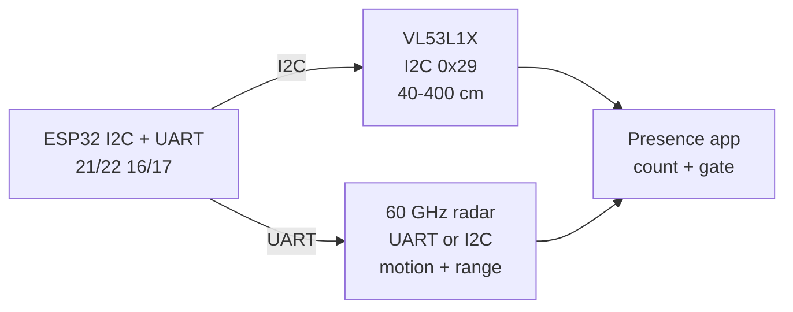

# Range Lidar 60GHz

## Purpose

Range sensors: VL53L1X ToF 400-4000 mm (I2C 0x29), 60 GHz mmWave radar modules (motion + distance). Applications: presence detection, distance measurement, people counting.

## Characteristics

| Sensor | Range | Interface | Note |
| --- | --- | --- | --- |
| VL53L1X | 40-400 cm | I2C 0x29 | ToF |
| 60 GHz radar | 0-8 m / motion | UART / I2C | mmWave |

## Common issues

| No. | Error | Symptom | Solution |
| --- | --- | --- | --- |
| 1 | VL53L1X black surface | No reading | Use within range; avoid pure black |

![[assets/img/placeholder.png|600]]
*Fig. 1. Ranging: VL53L1X long-range ToF plus 60 GHz mmWave presence radar.*

### Signal chain



## ESP-IDF example

```c
#include "driver/i2c.h"
#include "esp_log.h"

#define I2C_PORT I2C_NUM_0
#define SDA_PIN  GPIO_NUM_21
#define SCL_PIN  GPIO_NUM_22
#define CHIP_ADDR 0x29   // VL53L1X 7-bit address, verify with i2c scan!

static const char *TAG = "vl53l1x";

void app_main(void) {
    i2c_config_t conf = {
        .mode = I2C_MODE_MASTER,
        .sda_io_num = SDA_PIN,
        .scl_io_num = SCL_PIN,
        .sda_pullup_en = GPIO_PULLUP_ENABLE,  // 4.7k to 3V3 if module lacks them
        .scl_pullup_en = GPIO_PULLUP_ENABLE,
        .master.clk_speed = 100000,           // start at 100 kHz, raise later
    };
    i2c_param_config(I2C_PORT, &conf);
    i2c_driver_install(I2C_PORT, conf.mode, 0, 0, 0);
    // set distance mode short/medium/long, timing budget 33 ms or more
    uint8_t probe = 0;
    esp_err_t err = i2c_master_write_read_device(
        I2C_PORT, CHIP_ADDR, NULL, 0, &probe, 1, pdMS_TO_TICKS(100));
    ESP_LOGI(TAG, "%s probe: %s (0x%02X)", "VL53L1X",
             err == ESP_OK ? "ACK" : "NACK", probe);
}
```

## Arduino example

```cpp
#include <Wire.h>

#define CHIP_ADDR 0x29  // VL53L1X, verify with I2C scanner sketch

void setup() {
  Serial.begin(115200);
  Wire.begin(21, 22);  // SDA, SCL
  Wire.setClock(100000);
  // set distance mode short/medium/long, timing budget 33 ms or more
  Wire.beginTransmission(CHIP_ADDR);
  uint8_t err = Wire.endTransmission();
  Serial.printf("VL53L1X: %s\n", err == 0 ? "found" : "NOT found, check wiring");
}

void loop() {
  // poll data register here; average 4-8 samples before use
  delay(500);
}
```

## MicroPython example

```python
from machine import I2C, Pin

i2c = I2C(0, scl=Pin(22), sda=Pin(21), freq=100000)
found = i2c.scan()
print("bus:", [hex(a) for a in found])
# set distance mode short/medium/long, timing budget 33 ms or more
assert 0x29 in found, "VL53L1X not on bus, check pull-ups and wiring"
print("VL53L1X ready at", hex(0x29))
```

## Operating notes

- VL53L1X timing budget trades speed for range: 140 ms budget reaches 4 m reliably.
- mmWave sees through plastic but not metal: hide sensor behind plastic panel, not box.
- Radar sensitivity zones need tuning: gate far targets in software to stop wall triggers.
- ToF plus radar fuse well: radar wakes, ToF measures, both must agree to count.
- Multiple ToF sensors share 0x29: use XSHUT pins to readdress each at boot.

## Power and wiring checklist

| Check | Rule |
| --- | --- |
| 1. Power every module from a rail it is rated for | 5 V heaters never from ESP32 3V3. |
| 2. Common ground first | star topology, ESP32 GND tied to sensor GND before signals. |
| 3. I2C always needs pull-ups | 4.7k to 3V3 when the module has none fitted. |
| 4. 5 V sensor outputs never touch GPIO directly | divider or level shifter first. |
| 5. Verify addresses and baud on the bench | I2C scan plus UART loopback before code. |
| 6. Average analog reads 10-64x | single ESP32 ADC samples are noisy by design. |

## First run and calibration

1. Wire power only, check module current against datasheet before connecting signals.
2. Run bus scan (I2C) or loopback (UART) to confirm the device answers.
3. Flash the minimal example above, confirm plausible raw values in logs.
4. Calibrate: zero/span, clean-air baseline or white reference per sensor type.
5. Stress test 30 min: heat, vibration and supply sag expose weak joints early.
6. Log raw plus converted values: raw data stays valid when formulas change.

## Official sources

- [ESP32 I2C (Espressif)](https://docs.espressif.com/projects/esp-idf/en/latest/esp32/api-reference/peripherals/i2c.html) - API used by the examples above.
- VL53L1X Datasheet (ST) - `check manually`.
- 60 GHz radar module datasheet (manufacturer) - `check manually`.
## See also

- [[EN/10-Sensors/10-VL53L0X-TCS34725-TSL2561.en]]
