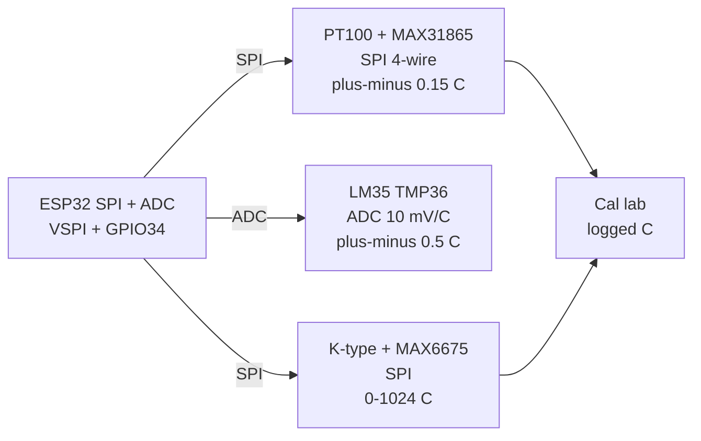

# Temp Precision

## Purpose

High-precision temperature measurement: PT100/PT1000 4-wire (MAX31865 SPI), LM35/TMP36 analog 10 mV/°C, DS18B20 12-bit, K/N thermocouple with cold-junction compensation. Applications: calibration, lab, industrial.

## Characteristics

| Sensor | Accuracy | Interface | Range |
| --- | --- | --- | --- |
| PT100 class A | ±0.15 °C | SPI MAX31865 | −200…+850 °C |
| LM35 | ±0.5 °C | ADC | −55…+150 °C |
| TMP36 | ±1 °C | ADC | −40…+125 °C |
| K thermocouple | ±2 °C | SPI MAX6675 | 0…1024 °C |

## Common issues

| No. | Error | Symptom | Solution |
| --- | --- | --- | --- |
| 1 | PT100 2-wire | +1-2 °C error | Use 3/4-wire |
| 2 | No cold-junction comp | Wrong thermocouple | Use MAX6675 / MAX31865 |

![[assets/img/placeholder.png|600]]
*Fig. 1. Precision temperature: PT100 4-wire, LM35 analog, thermocouple with cold junction.*

### Signal chain



## ESP-IDF example

```c
#include "driver/spi_master.h"
#include "esp_log.h"

#define SPI_HOST SPI2_HOST
#define PIN_SCK  18
#define PIN_MISO 19
#define PIN_MOSI 23
#define PIN_CS   5   // MAX31865 chip select, idle high
static const char *TAG = "spi";

void app_main(void) {
    spi_bus_config_t bus = {
        .mosi_io_num = PIN_MOSI,
        .miso_io_num = PIN_MISO,
        .sclk_io_num = PIN_SCK,
        .quadwp_io_num = -1,
        .quadhd_io_num = -1,
    };
    spi_bus_initialize(SPI_HOST, &bus, SPI_DMA_CH_AUTO);
    spi_device_interface_config_t dev = {
        .clock_speed_hz = 1000000,  // start at 1 MHz, raise when stable
        .mode = 0,                  // verify CPOL/CPHA in datasheet!
        .spics_io_num = PIN_CS,
        .queue_size = 2,
    };
    spi_device_handle_t handle;
    spi_bus_add_device(SPI_HOST, &dev, &handle);
    // select 4-wire mode bit, 50/60 Hz filter, read RTD resistance then convert
    uint8_t rx[2] = {0};
    spi_transaction_t tr = { .length = 16, .rx_buffer = rx };
    spi_device_transmit(handle, &tr);
    ESP_LOGI(TAG, "MAX31865: reply 0x%02X 0x%02X", rx[0], rx[1]);
}
```

## Arduino example

```cpp
#include <SPI.h>

#define PIN_CS 5  // MAX31865 chip select

void setup() {
  Serial.begin(115200);
  SPI.begin(18, 19, 23, PIN_CS);  // SCK MISO MOSI CS
  pinMode(PIN_CS, OUTPUT);
  digitalWrite(PIN_CS, HIGH);
  SPI.beginTransaction(SPISettings(1000000, MSBFIRST, SPI_MODE0));
  // select 4-wire mode bit, 50/60 Hz filter, read RTD resistance then convert
  digitalWrite(PIN_CS, LOW);
  uint8_t hi = SPI.transfer(0x00);
  uint8_t lo = SPI.transfer(0x00);
  digitalWrite(PIN_CS, HIGH);
  SPI.endTransaction();
  Serial.printf("MAX31865: 0x%02X 0x%02X\n", hi, lo);
}

void loop() {
  delay(500);
}
```

## MicroPython example

```python
from machine import SPI, Pin
import time

spi = SPI(2, baudrate=1000000, sck=Pin(18), mosi=Pin(23), miso=Pin(19))
cs = Pin(5, Pin.OUT, value=1)  # MAX31865 chip select
# select 4-wire mode bit, 50/60 Hz filter, read RTD resistance then convert
while True:
    cs(0)
    rx = spi.read(2, 0x00)
    cs(1)
    print("MAX31865:", rx.hex())
    time.sleep(0.5)
```

## Operating notes

- 4-wire PT100 kills lead error: 2-wire adds 1-2 C per 10 m of cable, always use 3-4 wire.
- MAX31865 reference resistor must match probe: 400 Ohm for PT100, 4 kOhm for PT1000.
- LM35 needs stable ADC reference: ESP32 ADC is noisy, average 64 samples plus RC filter.
- Thermocouple cold junction lives in MAX6675: keep chip isothermal, away from heaters.
- Ice-point check yearly: 0 C bath exposes drift before it ruins calibration.

## Power and wiring checklist

| Check | Rule |
| --- | --- |
| 1. Power every module from a rail it is rated for | 5 V heaters never from ESP32 3V3. |
| 2. Common ground first | star topology, ESP32 GND tied to sensor GND before signals. |
| 3. I2C always needs pull-ups | 4.7k to 3V3 when the module has none fitted. |
| 4. 5 V sensor outputs never touch GPIO directly | divider or level shifter first. |
| 5. Verify addresses and baud on the bench | I2C scan plus UART loopback before code. |
| 6. Average analog reads 10-64x | single ESP32 ADC samples are noisy by design. |

## First run and calibration

1. Wire power only, check module current against datasheet before connecting signals.
2. Run bus scan (I2C) or loopback (UART) to confirm the device answers.
3. Flash the minimal example above, confirm plausible raw values in logs.
4. Calibrate: zero/span, clean-air baseline or white reference per sensor type.
5. Stress test 30 min: heat, vibration and supply sag expose weak joints early.
6. Log raw plus converted values: raw data stays valid when formulas change.

## Official sources

- [ESP32 SPI (Espressif)](https://docs.espressif.com/projects/esp-idf/en/latest/esp32/api-reference/peripherals/spi_master.html) - API used by the examples above.
- MAX31865 Datasheet (Analog Devices/Maxim) - `check manually`.
- PT100 class A spec (IEC 60751) - `check manually`.
## See also

- [[EN/10-Sensors/11-NTC-PT100-MAX6675-LM35.en]]
