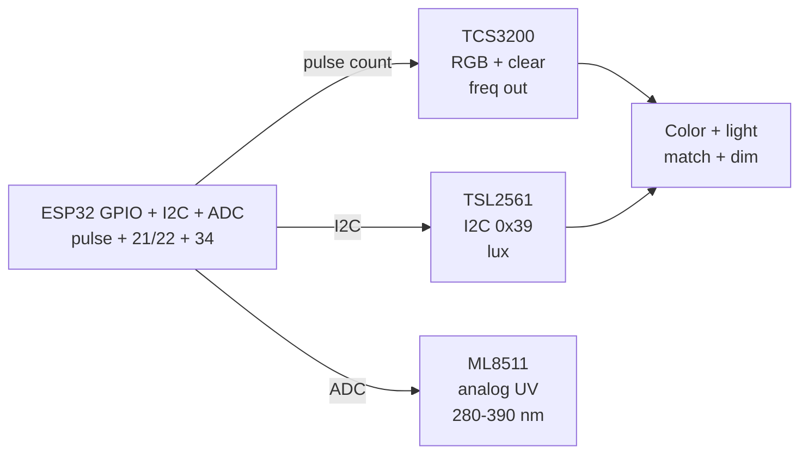

# Light Color 2

## Purpose

Light and color sensors: TCS3200 (RGB + clear), TSL2561 lux, ML8511 UV, APDS-9960 gesture/proximity. Applications: ambient adaptation, color control, gesture.

## Characteristics

| Sensor | Feature | Interface | Note |
| --- | --- | --- | --- |
| TCS3200 | RGB + clear | I2C / SPI | Filter selection |
| TSL2561 | Lux 0.1-40k | I2C 0x39 | Photodiode |
| ML8511 | UV index | Analog / I2C | 280-390 nm |

![[assets/img/placeholder.png|600]]
*Fig. 1. Light and color: TCS3200 RGB frequency, TSL2561 lux, ML8511 UV analog.*

### Signal chain



## ESP-IDF example

```c
#include "driver/adc.h"
#include "esp_log.h"

#define SENSOR_CH ADC1_CHANNEL_34  // ML8511 analog output, GPIO34
static const char *TAG = "adc";

static int read_mv_avg(int n) {
    int sum = 0;
    for (int i = 0; i < n; i++) sum += adc1_get_raw(SENSOR_CH);
    // 12-bit, 11 dB attenuation: ~0-3.3 V full scale, see ADC docs
    return (sum / n) * 3300 / 4095;
}

void app_main(void) {
    adc1_config_width(ADC_WIDTH_BIT_12);
    adc1_config_channel_atten(SENSOR_CH, ADC_ATTEN_DB_11);
    int mv = read_mv_avg(16);  // average 16 samples against noise
    ESP_LOGI(TAG, "ML8511: %d mV", mv);
    // night offset near 1 V is UV index 0: subtract, scale 0.1 V per index
}
```

## Arduino example

```cpp
#define SENSOR_PIN 34  // ML8511 analog output

void setup() {
  Serial.begin(115200);
  analogReadResolution(12);
  analogSetAttenuation(ADC_11db);  // ~0-3.3 V range
}

void loop() {
  long sum = 0;
  for (int i = 0; i < 16; i++) sum += analogRead(SENSOR_PIN);
  int mv = (sum / 16) * 3300 / 4095;
  Serial.printf("ML8511: %d mV\n", mv);
  // night offset near 1 V is UV index 0: subtract, scale 0.1 V per index
  delay(500);
}
```

## MicroPython example

```python
from machine import ADC, Pin
import time

adc = ADC(Pin(34))
adc.atten(ADC.ATTN_11DB)      # ~0-3.3 V range
adc.width(ADC.WIDTH_12BIT)

while True:
    raw = sum(adc.read() for _ in range(16)) // 16
    mv = raw * 3300 // 4095
    print("ML8511: %d mV" % mv)
    # night offset near 1 V is UV index 0: subtract, scale 0.1 V per index
    time.sleep(0.5)
```

## Operating notes

- TCS3200 needs dark calibration: read with LED off, subtract baselines per channel.
- White balance against known card: raw RGB drifts with illumination color temperature.
- TSL2561 saturates in sun over 40k lux: add ND filter or shade for outdoor use.
- ML8511 reads zero behind glass: expose bare sensor or apply glass transmission factor.
- Gate color reads with proximity: only sample when object distance is fixed.

## Power and wiring checklist

| Check | Rule |
| --- | --- |
| 1. Power every module from a rail it is rated for | 5 V heaters never from ESP32 3V3. |
| 2. Common ground first | star topology, ESP32 GND tied to sensor GND before signals. |
| 3. I2C always needs pull-ups | 4.7k to 3V3 when the module has none fitted. |
| 4. 5 V sensor outputs never touch GPIO directly | divider or level shifter first. |
| 5. Verify addresses and baud on the bench | I2C scan plus UART loopback before code. |
| 6. Average analog reads 10-64x | single ESP32 ADC samples are noisy by design. |

## First run and calibration

1. Wire power only, check module current against datasheet before connecting signals.
2. Run bus scan (I2C) or loopback (UART) to confirm the device answers.
3. Flash the minimal example above, confirm plausible raw values in logs.
4. Calibrate: zero/span, clean-air baseline or white reference per sensor type.
5. Stress test 30 min: heat, vibration and supply sag expose weak joints early.
6. Log raw plus converted values: raw data stays valid when formulas change.

## Common issues

| Symptom | Cause | Fix |
| --- | --- | --- |
| RGB shifts under lamps | No white balance to known reference | Calibrate against white card per lighting setup |
| Lux stuck at maximum | TSL2561 saturated in direct sun | Add shade or ND filter for outdoor range |
| UV reads zero outdoors | Sensor behind UV-blocking glass | Expose bare sensor or apply transmission factor |
| Color jumps between reads | Sampling without fixed distance gate | Trigger color read only at fixed proximity |


## Official sources

- [ESP32 ADC (Espressif)](https://docs.espressif.com/projects/esp-idf/en/latest/esp32/api-reference/peripherals/adc.html) - API used by the examples above.
- TCS3200 Datasheet (ams-OSRAM/TAOS) - `check manually`.
- TSL2561 Datasheet (ams-OSRAM) - `check manually`.
## See also

- [[EN/10-Sensors/18-Light-Spectral-Gesture.en]]
- [[EN/10-Sensors/10-VL53L0X-TCS34725-TSL2561.en]]
