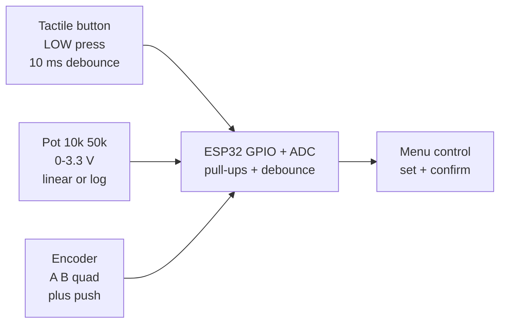

# Buttons Switches Pots

## Purpose

Basic input devices: tactile buttons, rocker switches, potentiometers (10k, 50k, linear/log), rotary encoders, slide switches. Applications: user control, settings.

## Characteristics

| Component | Type | Note |
| --- | --- | --- |
| Tactile button | Digital | Pull-up, debounce 1-2 ms |
| Potentiometer | Analog 10k | 0-3.3 V, linear/log |
| Encoder | Quadrature A/B | Count direction |

## Common issues

| No. | Error | Symptom | Solution |
| --- | --- | --- | --- |
| 1 | Button bounce | Multiple presses | Software debounce 10-20 ms |
| 2 | Pot noisy | Jumping ADC | Average 10 samples; add 100 nF cap |

![[assets/img/placeholder.png|600]]
*Fig. 1. Human inputs: tactile buttons, rocker switches, 10k pots, quadrature encoders.*

### Signal chain



## ESP-IDF example

```c
#include "driver/gpio.h"
#include "esp_log.h"
#include "freertos/FreeRTOS.h"
#include "freertos/task.h"

#define EVT_PIN GPIO_NUM_4  // buttons and encoder digital output, LOW = event
static const char *TAG = "gpio";
static volatile uint32_t evt_count = 0;

static void IRAM_ATTR isr_handler(void *arg) {
    evt_count++;  // keep ISR short: count only, debounce in task
}

void app_main(void) {
    gpio_config_t io = {
        .mode = GPIO_MODE_INPUT,
        .pull_up_en = GPIO_PULLUP_ENABLE,  // most modules are open-drain LOW
        .intr_type = GPIO_INTR_NEGEDGE,
        .pin_bit_mask = (1ULL << EVT_PIN),
    };
    gpio_config(&io);
    gpio_install_isr_service(0);
    gpio_isr_handler_add(EVT_PIN, isr_handler, NULL);
    // buttons on GPIO with pull-ups, encoder A/B on interrupt pins
    for (;;) {
        ESP_LOGI(TAG, "buttons and encoder: events=%lu", (unsigned long)evt_count);
        vTaskDelay(pdMS_TO_TICKS(1000));
    }
}
```

## Arduino example

```cpp
#define EVT_PIN 4  // buttons and encoder digital output

volatile uint32_t evt_count = 0;
void IRAM_ATTR onEvt() { evt_count++; }  // short ISR, filter in loop

void setup() {
  Serial.begin(115200);
  pinMode(EVT_PIN, INPUT_PULLUP);
  attachInterrupt(digitalPinToInterrupt(EVT_PIN), onEvt, FALLING);
  // buttons on GPIO with pull-ups, encoder A/B on interrupt pins
}

void loop() {
  static uint32_t last = 0;
  if (millis() - last > 1000) {  // 1 s software debounce window
    last = millis();
    Serial.printf("buttons and encoder: events=%lu\n", (unsigned long)evt_count);
  }
}
```

## MicroPython example

```python
from machine import Pin
import time

evt_count = 0
last_ms = 0

def on_evt(p):
    global evt_count, last_ms
    now = time.ticks_ms()
    if time.ticks_diff(now, last_ms) > 200:  # 200 ms debounce
        last_ms = now
        evt_count += 1

pin = Pin(4, Pin.IN, Pin.PULL_UP)
pin.irq(trigger=Pin.IRQ_FALLING, handler=on_evt)
# buttons on GPIO with pull-ups, encoder A/B on interrupt pins
while True:
    print("buttons and encoder: events=%d" % evt_count)
    time.sleep(1)
```

## Operating notes

- Button debounce 10-20 ms: shorter misses bounces, longer eats fast double-clicks.
- Linear pots for position, log pots for volume: wrong taper makes controls feel broken.
- Encoder detents must match software steps: divide quadrature counts by 4 per click.
- RC filter 10k plus 100 nF on pot wiper kills ADC noise before software averaging.
- Long-press plus double-click need state machine: timestamp edges, decide on release.

## Power and wiring checklist

| Check | Rule |
| --- | --- |
| 1. Power every module from a rail it is rated for | 5 V heaters never from ESP32 3V3. |
| 2. Common ground first | star topology, ESP32 GND tied to sensor GND before signals. |
| 3. I2C always needs pull-ups | 4.7k to 3V3 when the module has none fitted. |
| 4. 5 V sensor outputs never touch GPIO directly | divider or level shifter first. |
| 5. Verify addresses and baud on the bench | I2C scan plus UART loopback before code. |
| 6. Average analog reads 10-64x | single ESP32 ADC samples are noisy by design. |

## First run and calibration

1. Wire power only, check module current against datasheet before connecting signals.
2. Run bus scan (I2C) or loopback (UART) to confirm the device answers.
3. Flash the minimal example above, confirm plausible raw values in logs.
4. Calibrate: zero/span, clean-air baseline or white reference per sensor type.
5. Stress test 30 min: heat, vibration and supply sag expose weak joints early.
6. Log raw plus converted values: raw data stays valid when formulas change.

## Official sources

- [ESP32 GPIO (Espressif)](https://docs.espressif.com/projects/esp-idf/en/latest/esp32/api-reference/peripherals/gpio.html) - API used by the examples above.
- ESP32 GPIO and RTC GPIO notes in ESP-IDF docs - see link above.
- Encoder and switch application notes (manufacturer) - `check manually`.
## See also

- [[EN/03-GPIO/01-GPIO-Overview.en]]
