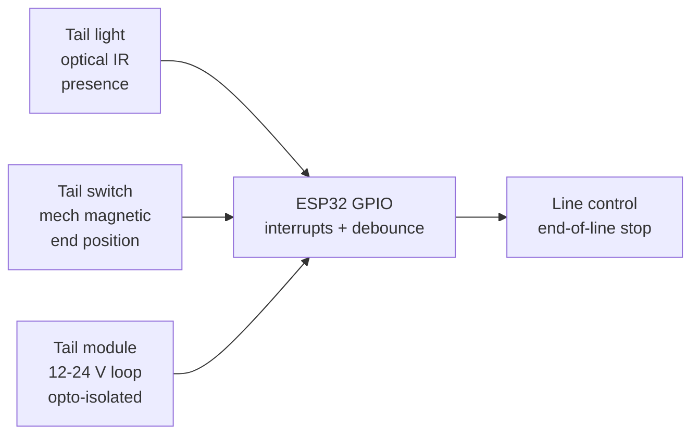

# Tails

## Purpose

Tail / end detection sensors for industrial lines, vehicles: tail light detector, tail switch, tail module. Applications: end-of-line, presence at end.

## Characteristics

| Sensor | Type | Note |
| --- | --- | --- |
| Tail light | Optical / IR | Detects tail presence |
| Tail switch | Mechanical / magnetic | End position |

![[assets/img/placeholder.png|600]]
*Fig. 1. End-of-line detection: tail light sensors, tail switches and tail modules for lines and vehicles.*

### Signal chain



## ESP-IDF example

```c
#include "driver/gpio.h"
#include "esp_log.h"
#include "freertos/FreeRTOS.h"
#include "freertos/task.h"

#define EVT_PIN GPIO_NUM_4  // tail switches and sensors digital output, LOW = event
static const char *TAG = "gpio";
static volatile uint32_t evt_count = 0;

static void IRAM_ATTR isr_handler(void *arg) {
    evt_count++;  // keep ISR short: count only, debounce in task
}

void app_main(void) {
    gpio_config_t io = {
        .mode = GPIO_MODE_INPUT,
        .pull_up_en = GPIO_PULLUP_ENABLE,  // most modules are open-drain LOW
        .intr_type = GPIO_INTR_NEGEDGE,
        .pin_bit_mask = (1ULL << EVT_PIN),
    };
    gpio_config(&io);
    gpio_install_isr_service(0);
    gpio_isr_handler_add(EVT_PIN, isr_handler, NULL);
    // tail inputs on GPIO with pull-ups, 50 ms debounce, 12-24 V via optocoupler
    for (;;) {
        ESP_LOGI(TAG, "tail switches and sensors: events=%lu", (unsigned long)evt_count);
        vTaskDelay(pdMS_TO_TICKS(1000));
    }
}
```

## Arduino example

```cpp
#define EVT_PIN 4  // tail switches and sensors digital output

volatile uint32_t evt_count = 0;
void IRAM_ATTR onEvt() { evt_count++; }  // short ISR, filter in loop

void setup() {
  Serial.begin(115200);
  pinMode(EVT_PIN, INPUT_PULLUP);
  attachInterrupt(digitalPinToInterrupt(EVT_PIN), onEvt, FALLING);
  // tail inputs on GPIO with pull-ups, 50 ms debounce, 12-24 V via optocoupler
}

void loop() {
  static uint32_t last = 0;
  if (millis() - last > 1000) {  // 1 s software debounce window
    last = millis();
    Serial.printf("tail switches and sensors: events=%lu\n", (unsigned long)evt_count);
  }
}
```

## MicroPython example

```python
from machine import Pin
import time

evt_count = 0
last_ms = 0

def on_evt(p):
    global evt_count, last_ms
    now = time.ticks_ms()
    if time.ticks_diff(now, last_ms) > 200:  # 200 ms debounce
        last_ms = now
        evt_count += 1

pin = Pin(4, Pin.IN, Pin.PULL_UP)
pin.irq(trigger=Pin.IRQ_FALLING, handler=on_evt)
# tail inputs on GPIO with pull-ups, 50 ms debounce, 12-24 V via optocoupler
while True:
    print("tail switches and sensors: events=%d" % evt_count)
    time.sleep(1)
```

## Operating notes

- Tail optical sensors need sun hoods outdoors: ambient IR blinds unshielded heads.
- End-position switches want 2-5 mm actuation gap: test ten cycles after mounting.
- Vehicle 12-24 V tail signals never touch GPIO: optocoupler plus fuse on the feed.
- Confirm window 200 ms on end-of-line stop: vibration causes single-edge ghosts.
- Failsafe wiring: broken wire must read as tail-present or line-stopped, never as clear.

## Power and wiring checklist

| Check | Rule |
| --- | --- |
| 1. Power every module from a rail it is rated for | 5 V heaters never from ESP32 3V3. |
| 2. Common ground first | star topology, ESP32 GND tied to sensor GND before signals. |
| 3. I2C always needs pull-ups | 4.7k to 3V3 when the module has none fitted. |
| 4. 5 V sensor outputs never touch GPIO directly | divider or level shifter first. |
| 5. Verify addresses and baud on the bench | I2C scan plus UART loopback before code. |
| 6. Average analog reads 10-64x | single ESP32 ADC samples are noisy by design. |

## First run and calibration

1. Wire power only, check module current against datasheet before connecting signals.
2. Run bus scan (I2C) or loopback (UART) to confirm the device answers.
3. Flash the minimal example above, confirm plausible raw values in logs.
4. Calibrate: zero/span, clean-air baseline or white reference per sensor type.
5. Stress test 30 min: heat, vibration and supply sag expose weak joints early.
6. Log raw plus converted values: raw data stays valid when formulas change.

## Common issues

| Symptom | Cause | Fix |
| --- | --- | --- |
| Tail event missed | Switch gap too wide or bounce filtered wrong | Set 2-5 mm gap, 50 ms debounce, test ten cycles |
| False tail triggers | Vibration shakes optical path | Add hysteresis plus 200 ms confirm window |
| 12/24 V signal kills GPIO | Vehicle voltage wired direct to pin | Optocoupler or divider to 3V3, fuse the feed |
| No detection in sunlight | Ambient IR blinds optical tail sensor | Add sun hood, modulate beam, raise threshold |


## Official sources

- [ESP32 GPIO (Espressif)](https://docs.espressif.com/projects/esp-idf/en/latest/esp32/api-reference/peripherals/gpio.html) - API used by the examples above.
- Tail sensor module datasheets (manufacturer) - `check manually`.
- Optocoupler isolation notes for 12/24 V vehicle signals - `check manually`.
## See also

- [[EN/10-Sensors/13-RCWL0516-Reed-Vibration-Tilt-Flow.en]]
