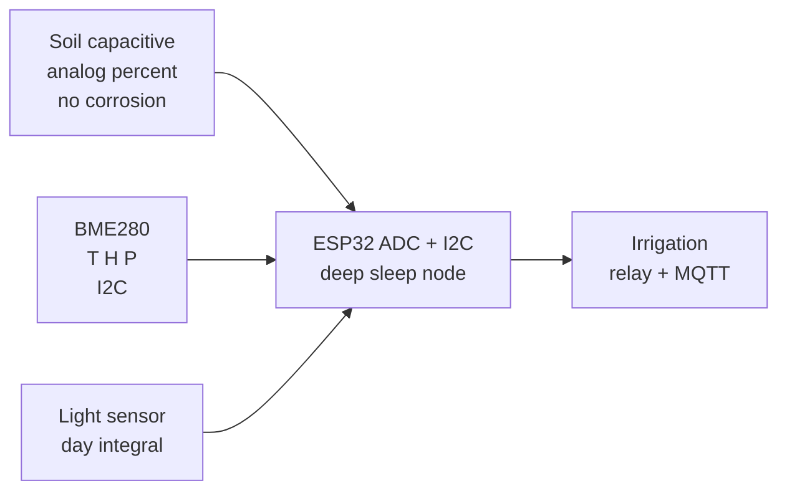

# Agro

## Purpose

Agricultural sensors: soil moisture (capacitive / resistive), temperature, humidity, light for greenhouse / irrigation. Applications: smart farming, auto-irrigation.

## Characteristics

| Sensor | Range | Interface | Note |
| --- | --- | --- | --- |
| Soil moisture | 0-100% | Analog | Capacitive preferred |
| Temp/Humidity | −40…85 °C / 0-100% RH | I2C / analog | BME280 / DHT |

## Common issues

| No. | Error | Symptom | Solution |
| --- | --- | --- | --- |
| 1 | Resistive soil sensor | Corrosion | Use capacitive; calibrate |
| 2 | Direct sun on sensor | Drift | Shade / enclosure |

![[assets/img/placeholder.png|600]]
*Fig. 1. Smart agriculture: capacitive soil moisture, BME280 climate, light for greenhouse.*

### Signal chain



## ESP-IDF example

```c
#include "driver/adc.h"
#include "esp_log.h"

#define SENSOR_CH ADC1_CHANNEL_34  // soil capacitive probe analog output, GPIO34
static const char *TAG = "adc";

static int read_mv_avg(int n) {
    int sum = 0;
    for (int i = 0; i < n; i++) sum += adc1_get_raw(SENSOR_CH);
    // 12-bit, 11 dB attenuation: ~0-3.3 V full scale, see ADC docs
    return (sum / n) * 3300 / 4095;
}

void app_main(void) {
    adc1_config_width(ADC_WIDTH_BIT_12);
    adc1_config_channel_atten(SENSOR_CH, ADC_ATTEN_DB_11);
    int mv = read_mv_avg(16);  // average 16 samples against noise
    ESP_LOGI(TAG, "soil capacitive probe: %d mV", mv);
    // dry-air value versus water-glass value: map to 0-100 percent per probe
}
```

## Arduino example

```cpp
#define SENSOR_PIN 34  // soil capacitive probe analog output

void setup() {
  Serial.begin(115200);
  analogReadResolution(12);
  analogSetAttenuation(ADC_11db);  // ~0-3.3 V range
}

void loop() {
  long sum = 0;
  for (int i = 0; i < 16; i++) sum += analogRead(SENSOR_PIN);
  int mv = (sum / 16) * 3300 / 4095;
  Serial.printf("soil capacitive probe: %d mV\n", mv);
  // dry-air value versus water-glass value: map to 0-100 percent per probe
  delay(500);
}
```

## MicroPython example

```python
from machine import ADC, Pin
import time

adc = ADC(Pin(34))
adc.atten(ADC.ATTN_11DB)      # ~0-3.3 V range
adc.width(ADC.WIDTH_12BIT)

while True:
    raw = sum(adc.read() for _ in range(16)) // 16
    mv = raw * 3300 // 4095
    print("soil capacitive probe: %d mV" % mv)
    # dry-air value versus water-glass value: map to 0-100 percent per probe
    time.sleep(0.5)
```

## Operating notes

- Capacitive probes only: resistive forks corrode in weeks and poison readings.
- Calibrate per soil type: same probe reads different in sand versus clay loam.
- Bury at root depth 10-20 cm: surface readings swing wildly and mislead irrigation.
- Waterproof the node, not the probe head: condensation in box kills electronics first.
- Irrigate at dawn by threshold plus forecast: night watering breeds fungus.

## Power and wiring checklist

| Check | Rule |
| --- | --- |
| 1. Power every module from a rail it is rated for | 5 V heaters never from ESP32 3V3. |
| 2. Common ground first | star topology, ESP32 GND tied to sensor GND before signals. |
| 3. I2C always needs pull-ups | 4.7k to 3V3 when the module has none fitted. |
| 4. 5 V sensor outputs never touch GPIO directly | divider or level shifter first. |
| 5. Verify addresses and baud on the bench | I2C scan plus UART loopback before code. |
| 6. Average analog reads 10-64x | single ESP32 ADC samples are noisy by design. |

## First run and calibration

1. Wire power only, check module current against datasheet before connecting signals.
2. Run bus scan (I2C) or loopback (UART) to confirm the device answers.
3. Flash the minimal example above, confirm plausible raw values in logs.
4. Calibrate: zero/span, clean-air baseline or white reference per sensor type.
5. Stress test 30 min: heat, vibration and supply sag expose weak joints early.
6. Log raw plus converted values: raw data stays valid when formulas change.

## Official sources

- [ESP32 ADC (Espressif)](https://docs.espressif.com/projects/esp-idf/en/latest/esp32/api-reference/peripherals/adc.html) - API used by the examples above.
- Capacitive soil probe datasheet (manufacturer) - `check manually`.
- BME280 Datasheet (Bosch Sensortec) - `check manually`.
## See also

- [[EN/10-Sensors/03-BME280-BMP280-SHT31.en]]
- [[EN/10-Sensors/07-AHT10-AHT20-SHT40.en]]
