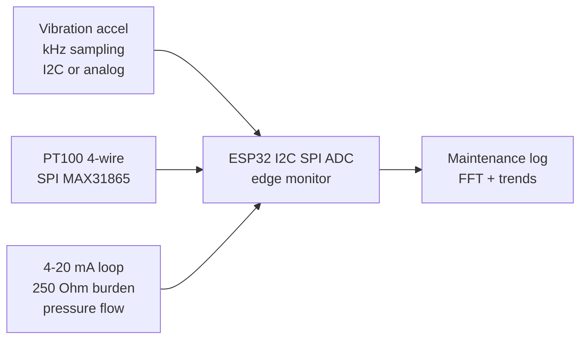

# Industrial Sensors

## Purpose

Industrial monitoring sensors: vibration (accelerometer), temperature (PT100, thermocouple), pressure (4-20 mA), gas (electrochemical), flow (Hall / ultrasonic). Applications: predictive maintenance, process control.

## Characteristics

| Sensor | Type | Interface | Note |
| --- | --- | --- | --- |
| Vibration | Accel / piezo | I2C / analog | High frequency |
| Temperature PT100 | Resistance | SPI MAX31865 | 4-wire |
| Pressure | 4-20 mA / 0-10V | ADC / I2C | Calibrate |
| Gas | Electrochemical | UART / analog | Calibrate with standard |

## Common issues

| No. | Error | Symptom | Solution |
| --- | --- | --- | --- |
| 1 | 4-20 mA wrong resistor | Wrong pressure | Use 250 Ω resistor; 1V = 4 mA, 5V = 20 mA |
| 2 | Industrial noise | Unstable values | Shielded cables; filter; average 10-20 samples |

![[assets/img/placeholder.png|600]]
*Fig. 1. Predictive maintenance: vibration accel, PT100 temperature, 4-20 mA pressure loops.*

### Signal chain



## ESP-IDF example

```c
#include "driver/adc.h"
#include "esp_log.h"

#define SENSOR_CH ADC1_CHANNEL_34  // 4-20 mA loop analog output, GPIO34
static const char *TAG = "adc";

static int read_mv_avg(int n) {
    int sum = 0;
    for (int i = 0; i < n; i++) sum += adc1_get_raw(SENSOR_CH);
    // 12-bit, 11 dB attenuation: ~0-3.3 V full scale, see ADC docs
    return (sum / n) * 3300 / 4095;
}

void app_main(void) {
    adc1_config_width(ADC_WIDTH_BIT_12);
    adc1_config_channel_atten(SENSOR_CH, ADC_ATTEN_DB_11);
    int mv = read_mv_avg(16);  // average 16 samples against noise
    ESP_LOGI(TAG, "4-20 mA loop: %d mV", mv);
    // 250 Ohm burden gives 1-5 V: divide to 3V3 range, 4 mA equals live-zero
}
```

## Arduino example

```cpp
#define SENSOR_PIN 34  // 4-20 mA loop analog output

void setup() {
  Serial.begin(115200);
  analogReadResolution(12);
  analogSetAttenuation(ADC_11db);  // ~0-3.3 V range
}

void loop() {
  long sum = 0;
  for (int i = 0; i < 16; i++) sum += analogRead(SENSOR_PIN);
  int mv = (sum / 16) * 3300 / 4095;
  Serial.printf("4-20 mA loop: %d mV\n", mv);
  // 250 Ohm burden gives 1-5 V: divide to 3V3 range, 4 mA equals live-zero
  delay(500);
}
```

## MicroPython example

```python
from machine import ADC, Pin
import time

adc = ADC(Pin(34))
adc.atten(ADC.ATTN_11DB)      # ~0-3.3 V range
adc.width(ADC.WIDTH_12BIT)

while True:
    raw = sum(adc.read() for _ in range(16)) // 16
    mv = raw * 3300 // 4095
    print("4-20 mA loop: %d mV" % mv)
    # 250 Ohm burden gives 1-5 V: divide to 3V3 range, 4 mA equals live-zero
    time.sleep(0.5)
```

## Operating notes

- 4 mA live-zero detects broken wire: 0 mA means fault, never a valid reading.
- Vibration needs kHz sampling for bearing faults: 100 Hz loop rates miss everything.
- Isolate sensor ground from machine chassis: ground loops inject 50 Hz into signals.
- Trend RMS velocity monthly: ISO 10816 bands turn numbers into go or no-go.
- Shielded twisted pair everywhere: VFD drives next door radiate into unshielded runs.

## Power and wiring checklist

| Check | Rule |
| --- | --- |
| 1. Power every module from a rail it is rated for | 5 V heaters never from ESP32 3V3. |
| 2. Common ground first | star topology, ESP32 GND tied to sensor GND before signals. |
| 3. I2C always needs pull-ups | 4.7k to 3V3 when the module has none fitted. |
| 4. 5 V sensor outputs never touch GPIO directly | divider or level shifter first. |
| 5. Verify addresses and baud on the bench | I2C scan plus UART loopback before code. |
| 6. Average analog reads 10-64x | single ESP32 ADC samples are noisy by design. |

## First run and calibration

1. Wire power only, check module current against datasheet before connecting signals.
2. Run bus scan (I2C) or loopback (UART) to confirm the device answers.
3. Flash the minimal example above, confirm plausible raw values in logs.
4. Calibrate: zero/span, clean-air baseline or white reference per sensor type.
5. Stress test 30 min: heat, vibration and supply sag expose weak joints early.
6. Log raw plus converted values: raw data stays valid when formulas change.

## Official sources

- [ESP32 ADC (Espressif)](https://docs.espressif.com/projects/esp-idf/en/latest/esp32/api-reference/peripherals/adc.html) - API used by the examples above.
- 4-20 mA loop design notes (TI/Analog Devices) - `check manually`.
- ISO 10816 vibration severity (ISO) - `check manually`.
## See also

- [[EN/10-Sensors/30-Temp-Precision.en]]
- [[EN/10-Sensors/15-ACS712-ZMPT101B-PZEM-AS5600-FSR.en]]
