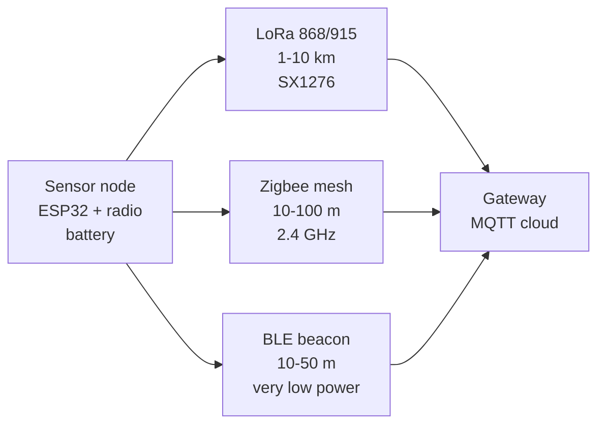

# Wireless Sensors

## Purpose

Wireless sensor nodes using ESP32 + radio: LoRa (SX1276, 868/915 MHz), Zigbee (CC2530/ESP32-ZB), Wi-Fi access points, BLE peripherals, sub-GHz. Applications: remote monitoring, wireless IoT.

## Characteristics

| Radio | Range | Power | Note |
| --- | --- | --- | --- |
| LoRa | 1-10 km | Low | SX1276 / RFM95 |
| Zigbee | 10-100 m | Low | Mesh, 2.4 GHz |
| BLE | 10-50 m | Very low | 2.4 GHz |
| Wi-Fi | 10-100 m | Medium | STA/AP |

## Common issues

| No. | Error | Symptom | Solution |
| --- | --- | --- | --- |
| 1 | LoRa wrong frequency | No packet | Match region 868/915 MHz |
| 2 | Zigbee not paired | No network | Check PAN ID; power cycle |

![[assets/img/placeholder.png|600]]
*Fig. 1. Wireless sensor nodes: LoRa long range, Zigbee mesh, BLE beacons, WiFi direct.*

### Signal chain



## ESP-IDF example

```c
#include "driver/uart.h"
#include "esp_log.h"

#define UART_PORT UART_NUM_2
#define RX_PIN 16
#define TX_PIN 17
#define BAUD 9600   // E32 LoRa-UART bridge default rate, check datasheet
static const char *TAG = "uart";

void app_main(void) {
    uart_config_t cfg = {
        .baud_rate = BAUD,
        .data_bits = UART_DATA_8_BITS,
        .parity = UART_PARITY_DISABLE,
        .stop_bits = UART_STOP_BITS_1,
        .flow_ctrl = UART_HW_FLOWCTRL_DISABLE,
    };
    uart_param_config(UART_PORT, &cfg);
    // RX buffer 2x frame: E32 LoRa-UART bridge frames are short but bursty
    uart_driver_install(UART_PORT, 2048, 0, 0, NULL, 0);
    uart_set_pin(UART_PORT, TX_PIN, RX_PIN, UART_PIN_NO_CHANGE, UART_PIN_NO_CHANGE);
    // configure address and channel in Sleep mode, wait AUX high
    uint8_t frame[64];
    int n = uart_read_bytes(UART_PORT, frame, sizeof(frame), pdMS_TO_TICKS(2000));
    ESP_LOGI(TAG, "E32 LoRa-UART bridge: got %d bytes", n);
}
```

## Arduino example

```cpp
#include <HardwareSerial.h>

HardwareSerial sens(2);  // UART2: RX 16, TX 17

void setup() {
  Serial.begin(115200);
  sens.begin(9600, SERIAL_8N1, 16, 17);
  // configure address and channel in Sleep mode, wait AUX high
}

void loop() {
  if (sens.available()) {
    String line = sens.readStringUntil('\n');
    Serial.printf("E32 LoRa-UART bridge: %s\n", line.c_str());
  }
  delay(200);
}
```

## MicroPython example

```python
from machine import UART
import time

u = UART(2, baudrate=9600, rx=16, tx=17, timeout=2000)
# configure address and channel in Sleep mode, wait AUX high
while True:
    if u.any():
        print("E32 LoRa-UART bridge:", u.readline())
    time.sleep(0.2)
```

## Operating notes

- Match region frequency by law: 868 MHz EU, 915 MHz US, wrong band is illegal.
- Antenna orientation matters more than power: vertical whip to vertical whip for range.
- Battery nodes sleep 99 percent: wake, measure, send, confirm, back to deep sleep.
- Encrypt node payloads: LoRa is plaintext radio, AES on ESP32 before transmit.
- Gateway needs height and clear Fresnel zone: roof beats window by kilometers.

## Power and wiring checklist

| Check | Rule |
| --- | --- |
| 1. Power every module from a rail it is rated for | 5 V heaters never from ESP32 3V3. |
| 2. Common ground first | star topology, ESP32 GND tied to sensor GND before signals. |
| 3. I2C always needs pull-ups | 4.7k to 3V3 when the module has none fitted. |
| 4. 5 V sensor outputs never touch GPIO directly | divider or level shifter first. |
| 5. Verify addresses and baud on the bench | I2C scan plus UART loopback before code. |
| 6. Average analog reads 10-64x | single ESP32 ADC samples are noisy by design. |

## First run and calibration

1. Wire power only, check module current against datasheet before connecting signals.
2. Run bus scan (I2C) or loopback (UART) to confirm the device answers.
3. Flash the minimal example above, confirm plausible raw values in logs.
4. Calibrate: zero/span, clean-air baseline or white reference per sensor type.
5. Stress test 30 min: heat, vibration and supply sag expose weak joints early.
6. Log raw plus converted values: raw data stays valid when formulas change.

## Official sources

- [ESP32 UART (Espressif)](https://docs.espressif.com/projects/esp-idf/en/latest/esp32/api-reference/peripherals/uart.html) - API used by the examples above.
- E32 LoRa-UART module manual (EBYTE) - `check manually`.
- LoRaWAN Specification (LoRa Alliance) - `check manually`.
## See also

- [[EN/05-Radio/01-WiFi-STA-AP.en]]
- [[EN/05-Radio/02-BLE-Bluetooth.en]]
