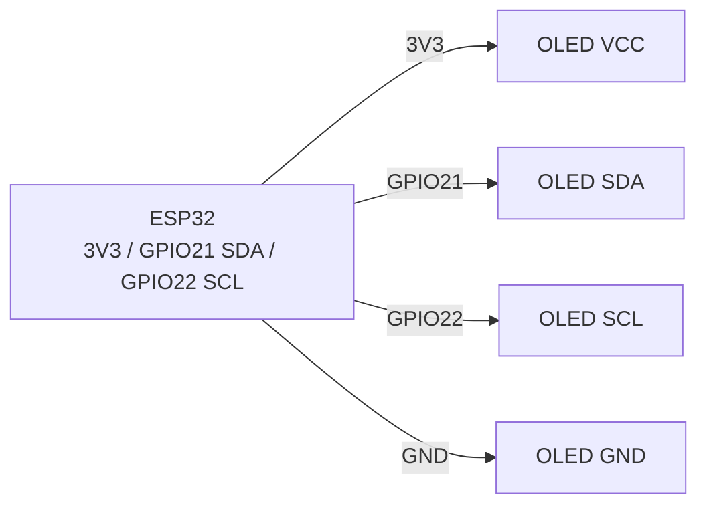

# OLED SSD1306 128x64 (I2C) - Display

## Purpose

Monochrome OLED 0.96″ 128x64 on SSD1306 controller - standard display for debug, menus, mini-dashboards, clocks, touch nodes. I2C interface (2 wires), 3.3 V power, U8g2 / Adafruit_SSD1306 / esp-SSD1306 libraries. Does not burn in quickly at moderate brightness; for static images over years - enable screensaver/invert.

## Characteristics

| Parameter | value |
| --- | --- |
| controller | SSD1306 (less often SH1106 - different driver!) |
| resolution | 128x64, mono (white/blue/yellow-blue) |
| Interface | I2C, address 0x3C (typically) / 0x3D (jumper) |
| power supply | 3.3-5 V (module with LDO/charge-pump; 3.3 V logic OK) |
| current | ~15-25 mA (depends on white pixel count) |
| Frame buffer | 1024 bytes (128x64/8) - in controller RAM |
| speed | I2C 400 kHz → ~10-20 fps full frame |
| lifetime | ~10 000 hours up to noticeable burn-in |

> SH1106 looks the same, but has 132x64 memory with a 2 px shift - with the SSD1306 driver the image slides off. Check the marking and select driver/constructor.

## Pinout

| Module pin (4-pin I2C) | Purpose | Note |
| --- | --- | --- |
| VCC | 3.3 V (or 5 V if LDO present) | 3.3 V recommended on ESP32 |
| GND | ground | common ground |
| SCL | I2C clock | GPIO22 + pull-up (is on module) |
| SDA | I2C data | GPIO21 + pull-up (is on module) |

SPI versions (7 pin: CS/DC/RES/DIN/CLK): faster, but occupy 5 GPIO - see [[04-Interfaces/02-SPI.en | SPI]].

## Wiring diagram

| ESP32 | OLED SSD1306 | Note |
| --- | --- | --- |
| 3V3 | VCC | power supply 3.3 in |
| GND | GND | common ground |
| GPIO22 | SCL | hardware I2C0, up to 400 kHz-1 MHz |
| GPIO21 | SDA | hardware I2C0 |

Check addresses: `I2C.scan()` should show `0x3C`. If 0x3D - pass address in constructor. Two displays: one with address 0x3C, second resoldered to 0x3D (jumper SA0) or second I2C port.

### ASCII-schem

```text
ESP32 DevKit            OLED SSD1306 128×64 (I2C, 4-pin)
------------            --------------------------------
3V3 ──────────────────► VCC (3.3 В рекомендовано)
GND ──────────────────► GND
GPIO22 ───────────────► SCL (400 кГц, pull-up на модулі)
GPIO21 ───────────────► SDA (pull-up на модулі)
VCC ◄──[100 нФ]──► GND (біля дисплея проти артефактів)
Адреса: 0x3C типово; SA0-перемичка → 0x3D
```

### Mermaid



![[assets/img/oled-ssd1306-i2c.png|500]]
*Fig. OLED SSD1306 - I2C bus 400 kHz, address 0x3C, 3V3 power. Space below photo - see [[assets/README]].*

## Code ESP-IDF

```c
#include "ssd1306.h"  // компонент esp-ssd1306 / esp-idf-lib
#include "driver/i2c.h"
#include "font8x8_basic.h"

#define I2C_PORT I2C_NUM_0

void app_main(void)
{
    i2c_config_t cfg = {
        .mode = I2C_MODE_MASTER,
        .sda_io_num = GPIO_NUM_21, .scl_io_num = GPIO_NUM_22,
        .sda_pullup_en = GPIO_PULLUP_ENABLE,
        .scl_pullup_en = GPIO_PULLUP_ENABLE,
        .master.clk_speed = 400000,
    };
    i2c_param_config(I2C_PORT, &cfg);
    i2c_driver_install(I2C_PORT, cfg.mode, 0, 0, 0);

    SSD1306_t dev;
    i2c_init(&dev, 128, 64, 0x3C, I2C_PORT);
    ssd1306_init(&dev);
    ssd1306_clear_screen(&dev, false);
    ssd1306_display_text(&dev, 0, "ESP32 OLED", 9, false);
    ssd1306_display_text(&dev, 1, "T=24.5C H=55%", 13, false);
    // Графіка: ssd1306_draw_pixel / line / bitmap, потім ssd1306_show_buffer
}
```

## Code Arduino

```cpp
#include <Wire.h>
#include <Adafruit_GFX.h>
#include <Adafruit_SSD1306.h>

#define SCREEN_W 128
#define SCREEN_H 64
Adafruit_SSD1306 display(SCREEN_W, SCREEN_H, &Wire, -1);

void setup() {
  Serial.begin(115200);
  Wire.begin(21, 22);
  Wire.setClock(400000);
  if (!display.begin(SSD1306_SWITCHCAPVCC, 0x3C)) {
    Serial.println("SSD1306 не знайдено!");
    for (;;) delay(10);
  }
  display.clearDisplay();
  display.setTextSize(1);
  display.setTextColor(SSD1306_WHITE);
  display.setCursor(0, 0);
  display.println("ESP32 OLED OK");
  display.printf("T=24.5C H=55%%\n");
  display.display();
}

void loop() {
  // U8g2-альтернатива: U8G2_SSD1306_128X64_NONAME_F_HW_I2C u8g2(U8G2_R0);
}
```

## Code MicroPython

```python
from machine import I2C, Pin
import ssd1306  # вбудований драйвер

i2c = I2C(0, scl=Pin(22), sda=Pin(21), freq=400000)
print("I2C:", [hex(a) for a in i2c.scan()])
oled = ssd1306.SSD1306_I2C(128, 64, i2c, addr=0x3C)

oled.fill(0)
oled.text("ESP32 OLED OK", 0, 0)
oled.text("T=24.5C H=55%", 0, 12)
oled.hline(0, 30, 128, 1)
oled.rect(0, 35, 60, 20, 1)
oled.show()
```

## Common issues

1. **SH1106 instead of SSD1306** → image shifted/garbled. Use SH1106 driver (`Adafruit_SH110X`, `U8G2_SH1106_...`).
2. **Wrong address (0x3D)** → black screen. Scan I2C, pass correct address to `begin()`/constructor.
3. **5 V power to module without LDO** → overheat/failure. Check regulator presence; default to 3.3 V.
4. **I2C 100 kHz + full redraw every frame** → flicker. Raise to 400 kHz, update only changed lines.
5. **Forgotten `display.display()` / `OLED.show()`** → buffer is not pushed. Call show after every frame.
6. **Static image for years** → burn-in. Periodically invert, blank (`ssd1306_display_off` / `display.ssd1306_command(SSD1306_DISPLAYOFF)`), lower contrast.
7. **Long SDA/SCL wires** → artifacts. Short wires, 4.7 k pull-up, 100 nF across power near display.

## Official sources

- SSD1306 Datasheet (Solomon Systech) - see manufacturer page.
- [OLED 0.96″ - live photo (Adafruit)](https://www.adafruit.com/product/326) - product page with photo.
- [OLED + ESP32 tutorial with code (RNT)](https://randomnerdtutorials.com/esp32-SSD1306-OLED-display-arduino-ide/) - Adafruit_SSD1306, examples.
- [Monochrome OLED guide with code (Adafruit Learn)](https://learn.adafruit.com/monochrome-OLED-breakouts) - SSD1306/SH1106, libraries.

## See also

- [[04-Interfaces/03-I2C.en | I2C]]
- [[04-Interfaces/02-SPI.en | SPI]]
- [[03-GPIO/01-GPIO-Overview.en | GPIO Overview]]
- [[06-Analog/01-ADC.en | ADC]]
- [[03-GPIO/04-Interrupts-PWM.en | Interrupts / PWM]]
- [[11-Vivid/02-TFT-LCD-Epaper.en | TFT LCD Epaper]]
- [[11-Vivid/03-NeoPixel-Servo-Rele-MOSFET.en | NeoPixel Servo Relay MOSFET]]
