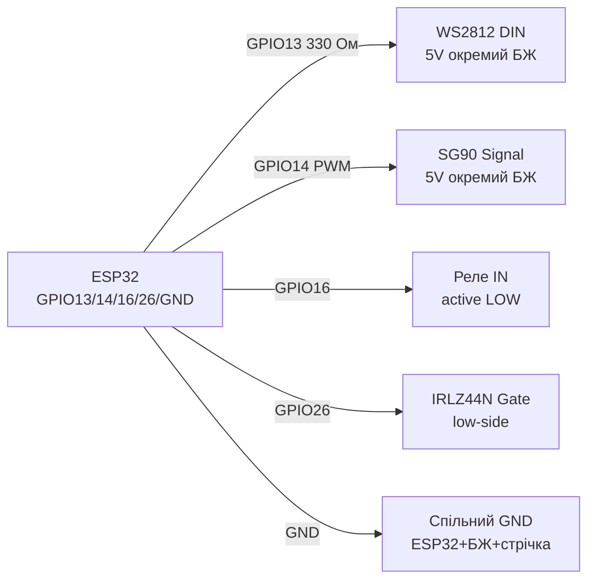

# NeoPixel WS2812, Servo SG90, Relay SRD-05V, MOSFET - Actuators

## Purpose

Basic ESP32 actuators: addressable WS2812B LEDs (NeoPixel) for indication/backlight; SG90 servo (50 Hz PWM) for angle rotation; SRD-05VDC relay with opto-isolation for 220 V / large DC load switching; logic-level MOSFET (IRLZ44N) for PWM control of motors, strips, heaters directly from GPIO.

## Characteristics

| Device | Control | power supply | Key rule |
| --- | --- | --- | --- |
| WS2812B | 1-Wire 800 kHz (RMT - ideal) | 5 V, ~60 mA/LED at white | 1000 uF capacitor + 330 Ohm resistor on DATA |
| SG90 | PWM 50 Hz, 1-2 ms (0-180 deg) | 4.8-6 V, ~250 mA peak (stall ~650 mA) | Separate power, common GND; not from board 3V3! |
| SRD-05V relay (1-channel module) | IN 5 V (active LOW), opto PC817 | Coil 5 V ~70 mA; contacts 10 A/250 VAC | JD-VCC for full isolation; flyback diode already on module |
| IRLZ44N (logic-level) | Vgs(th) 1-2 V → opens at 3.3 V | Id up to 47 A (practically 5-10 A without heatsink) | IRFZ44N/IRF540 not suitable (Vgs 10 V)! |

> ESP32 has hardware RMT peripheral - WS2812 generation without jitter even under Wi-Fi. Libraries: NeoPixelBus (RMT method), Adafruit_NeoPixel (bitbang - worse), FastLED (RMT driver for ESP32).

## Pinout

| WS2812 strip | Purpose |
| --- | --- |
| 5V (red) | 5 V from separate PSU (not from board at >5 LEDs!) |
| DIN | DATA on GPIO through 330 Ом |
| GND | Common GND with ESP32 and PSU |

| SG90 | Color | Purpose |
| --- | --- | --- |
| Brown/black | GND | common ground |
| Red | 5 V | Separate PSU 5 V / 1 A+ |
| Orange/yellow | Signal | PWM 50 Hz on GPIO |

| Реле-module (low-level trigger) | Purpose |
| --- | --- |
| VCC | 5 in котушки |
| IN | GPIO (LOW = relay ON); better via transistor/inversion |
| GND | ground |
| JD-VCC (jumper) | Remove jumper → separate coil supply for isolation |
| COM/NO/NC | Power contacts |

## Wiring diagram

| ESP32 | WS2812 | Note |
| --- | --- | --- |
| GPIO13 | DIN through 330 Ohm | Any GPIO with RMT; resistor near first LED |
| GND | Strip GND | common ground with 5 V PSU mandatory |
| - | Strip 5V | PSU 5 V: 60 mA x N LEDs (e.g. 30 LEDs → 2 A margin) |
| - | Strip 5V-GND | 1000 uF electrolytic x 6.3-16 V near strip start |

| ESP32 | SG90 | Note |
| --- | --- | --- |
| GND | Servo GND | common ground |
| 5V PSU | Servo VCC | Separate PSU; 470 uF capacitor in parallel |
| GPIO14 | Signal | PWM 50 Гц, 500-2400 мкс |

| ESP32 | Реле SRD-05V | Note |
| --- | --- | --- |
| GPIO12 | IN | LOW turns on; at boot GPIO12 is strapping, better GPIO16/17 |
| 5V | VCC (або JD-VCC) | Котушка 5 in |
| GND | GND | with JD-VCC isolation - separate grounds |

| ESP32 | IRLZ44N (N-channel, low-side) | Note |
| --- | --- | --- |
| GPIO26 | Gate through 100 Ohm (+ 10 k pull-down to GND) | Pull-down holds closed during boot |
| GND | Source | ground |
| Load- | Drain | Load+ → VCC; flyback diode for inductance |

### ASCII-schem

```text
ESP32 DevKit            WS2812B + SG90 + реле + MOSFET
------------            -------------------------------
GPIO13 ──[330 Ом]─────► DIN стрічки (перший LED поруч!)
GND ──────────────────► GND стрічки (= GND БЖ 5 В!)
БЖ 5 В (60 мА×N) ─────► 5V стрічки + [1000 мкФ] на початок
GPIO14 ───────────────► Signal SG90 (PWM 50 Гц, 1-2 мс)
БЖ 5 В / 1-2 А ───────► VCC серво + [470 мкФ] паралельно
GPIO16 ───────────────► IN реле (LOW = ON; краще не strapping-пін)
5V ───────────────────► VCC / JD-VCC реле (котушка ~70 мА)
GPIO26 ──[100 Ом]─────► Gate IRLZ44N + [10 кОм] до GND (pull-down)
Source ───────────────► GND; Drain ──► навантаження− (low-side)
Індуктивність (мотор/реле голе): flyback-діод паралельно!
```

### Mermaid



![[assets/img/neopixel-5v.png]]
*Fig. NeoPixel - separate 5 V PSU, 330 Ohm resistor and 1000 uF; servo and MOSFET with common GND. Space below photo - see [[assets/README]].*

## Code ESP-IDF

```c
// WS2812 через RMT (led_strip) + Servo через LEDC
#include "led_strip.h"
#include "driver/ledc.h"

#define STRIP_GPIO GPIO_NUM_13
#define SERVO_GPIO GPIO_NUM_14

void app_main(void)
{
    // --- NeoPixel ---
    led_strip_config_t strip_cfg = {
        .strip_gpio_num = STRIP_GPIO,
        .max_leds = 8,
        .led_model = LED_MODEL_WS2812,
        .color_format = LED_STRIP_COLOR_COMPONENT_FMT_GRB,
        .flags.invert_out = false,
    };
    led_strip_rmt_config_t rmt_cfg = {.resolution_hz = 10 * 1000 * 1000};
    led_strip_handle_t strip;
    led_strip_new_rmt_device(&strip_cfg, &rmt_cfg, &strip);
    led_strip_set_pixel(strip, 0, 255, 0, 0);
    led_strip_refresh(strip);

    // --- Servo 50 Гц ---
    ledc_timer_config_t t = {
        .speed_mode = LEDC_LOW_SPEED_MODE, .timer_num = LEDC_TIMER_0,
        .duty_resolution = LEDC_TIMER_14_BIT, .freq_hz = 50,
        .clk_cfg = LEDC_AUTO_CLK,
    };
    ledc_timer_config(&t);
    ledc_channel_config_t ch = {
        .gpio_num = SERVO_GPIO, .speed_mode = LEDC_LOW_SPEED_MODE,
        .channel = LEDC_CHANNEL_0, .timer_sel = LEDC_TIMER_0,
        .duty = 0, .hpoint = 0,
    };
    ledc_channel_config(&ch);
    // 1.5 мс / 20 мс * 16383 = ~1229 (центр 90°)
    ledc_set_duty(LEDC_LOW_SPEED_MODE, LEDC_CHANNEL_0, 1229);
    ledc_update_duty(LEDC_LOW_SPEED_MODE, LEDC_CHANNEL_0);
}
```

## Code Arduino

```cpp
#include <NeoPixelBus.h>
#include <ESP32Servo.h>

#define LED_PIN 13
#define LED_COUNT 8
#define SERVO_PIN 14
#define RELAY_PIN 16

NeoPixelBus<NeoGrbFeature, NeoEsp32Rmt0Ws2812xMethod> strip(LED_COUNT, LED_PIN);
Servo servo;

void setup() {
  strip.Begin();
  strip.SetPixelColor(0, RgbColor(255, 0, 0));
  strip.Show();
  servo.setPeriodHertz(50);
  servo.attach(SERVO_PIN, 500, 2400);
  servo.write(90);
  pinMode(RELAY_PIN, OUTPUT);
  digitalWrite(RELAY_PIN, HIGH); // реле OFF (active LOW)
}

void loop() {
  servo.write(0); delay(1000);
  servo.write(180); delay(1000);
  digitalWrite(RELAY_PIN, LOW); delay(500);   // реле ON
  digitalWrite(RELAY_PIN, HIGH); delay(500);  // реле OFF
}
```

## Code MicroPython

```python
from machine import Pin, PWM
import neopixel
import time

# NeoPixel
np = neopixel.NeoPixel(Pin(13), 8)
np[0] = (255, 0, 0)
np.write()

# Servo 50 Гц
servo = PWM(Pin(14), freq=50)
def angle(a):  # 0..180 -> duty_u16 (1мс..2мс)
    us = 1000 + a * 1000 // 180
    servo.duty_u16(int(us * 65535 // 20000))
angle(90)

# Реле (active LOW)
relay = Pin(16, Pin.OUT, value=1)
relay.value(0); time.sleep_ms(500)  # ON
relay.value(1)                      # OFF
```

## Common issues

1. **WS2812 on board 3V3 at 10+ LEDs** → sag, overload, pink instead of white. Separate 5 V PSU with 20% margin.
2. **No common ground ESP32-PSU-strip** → flicker/random colors. Connect all GNDs at one point.
3. **No 330 Ohm + 1000 uF** → first LED burns on ringing/current spike. Resistor on DATA, capacitor on 5V near strip.
4. **SG90 powered from board VIN/USB** → USB sags at stall, ESP32 reboots. Separate 5 V / 1-2 A PSU.
5. **IRFZ44N/IRF540 on 3.3 V** → half-open, heats, voltage drops. Only logic-level: IRLZ44N, IRL540, AO3400 (SMD).
6. **Relay without flyback diode (bare relay)** → EMF spike kills transistor. Modules have diode; shunt bare coil with 1N4148/1N4007.
7. **220 V switching without isolation and enclosure** → shock danger. JD-VCC isolation, fuse, enclosure, snubber/varistor on contacts.

## Official sources

- [NeoPixel strip - live photo (Adafruit)](https://www.adafruit.com/product/1426) - product page with photo; WS2812 datasheet (WorldSemi) - `check manually`.
- [NeoPixel Uberguide with code (Adafruit Learn)](https://learn.adafruit.com/adafruit-neopixel-uberguide) - power, timings, effects.
- [Servo + ESP32 tutorial with code (RNT)](https://randomnerdtutorials.com/esp32-servo-motor-web-server-arduino-ide/) - SG90, control.
- [Relay + ESP32 tutorial with code (RNT)](https://randomnerdtutorials.com/esp32-relay-module-ac-web-server/) - relay and MOSFET load switching.

## See also

- [[03-GPIO/01-GPIO-Overview.en | GPIO Overview]]
- [[03-GPIO/04-Interrupts-PWM.en | Interrupts / PWM]]
- [[06-Analog/01-ADC.en | ADC]]
- [[04-Interfaces/03-I2C.en | I2C]]
- [[04-Interfaces/02-SPI.en | SPI]]
- [[11-Vivid/01-OLED-SSD1306.en | OLED SSD1306]]
- [[11-Vivid/04-L298N-TB6612-A4988-Buzzer.en | L298N TB6612 A4988 Buzzer]]
