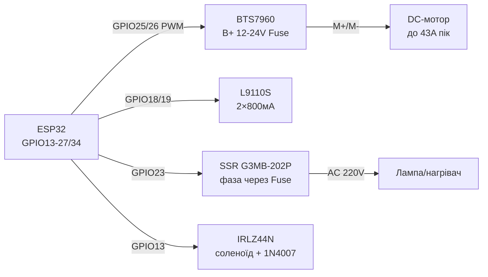

# BTS7960, L9110S, SSR, Solenoid - Power Keys and Safety

## Purpose

Heavy power switching with ESP32: BTS7960 (43 A H-bridge) for large DC motors, winches, actuators; L9110S - compact 2-channel bridge up to 800 mA for small motors and wheel platforms; solid-state relay SSR G3MB-202P for silent AC 220 V switching (heaters, lamps); solenoids, valves, pumps via MOSFET + flyback diode. Special focus - mains 220 V safety.

## Characteristics

| Module | current / voltage | Control | Key rule |
| --- | --- | --- | --- |
| BTS7960 (IBT-2) | up to 43 A peak, VM 6-27 V (pract. 12/24 V) | RPWM + LPWM (or R_EN/L_EN + PWM) | R_IS/L_IS - current sense; big heatsink + fuse! |
| L9110S | 2 channels x 800 mA, VCC 2.5-12 V | IA/IB per channel (PWM on one) | No heatsink - small motors only; shoot-through if both HIGH |
| SSR G3MB-202P | AC 2 A / 240 V, zero-cross | DC 3-32 V (ESP32 3.3 V OK) | AC loads ONLY! Heatsink above 1 A; varistor on output |
| Solenoid / valve / pump | 12/24 V, 0.3-2 A | MOSFET low-side + flyback 1N4007 | Diode MANDATORY, else MOSFET breakdown |
| MOSFET for solenoid | IRLZ44N logic-level | Gate 3.3 V via 100 Ohm + 10 k pull-down | Schottky/1N4007 across coil (cathode to +) |
| Mains protection | Fuse + breaker + enclosure | - | No exposed 220 V on breadboard! |

> SAFETY: 220 V kills. SSR and relays switch phase via fuse, all AC joints in closed enclosure with cable glands, metal parts grounded to PE. ESP32 and low-voltage parts galvanically isolated (SSR/relay opto gives this, but enclosure and fuse still mandatory).

## Легенда pinandin модуля

| pin | Тип | Куди | Note |
| --- | --- | --- | --- |
| BTS7960 VCC | 5 V logic | 5 V | Powers bridge logic |
| BTS7960 GND | ground | GND ESP32 | common with logic |
| BTS7960 B+ / B- (VM/GND) | Power 6-27 V | Battery/PSU + fuse | Thick wires; 470+ uF electrolytic |
| BTS7960 M+ / M- | motor output | DC motor | Swap polarity = direction |
| BTS7960 RPWM / LPWM | PWM inputs | GPIO (LEDC 20 kHz) | speed via duty; direction - which channel active |
| BTS7960 R_EN / L_EN | Half-bridge enable | GPIO or VCC (jumper) | Both HIGH = bridge active; LOW = off |
| BTS7960 R_IS / L_IS | Current analog | ADC (via divider!) | ~2500:1; voltage proportional to current |
| L9110S VCC / GND | 2.5-12 V supply | Motor PSU | Common GND with ESP32 |
| L9110S IA / IB (channel A) | Inputs | 2x GPIO | HIGH/LOW = direction; PWM on one = speed |
| L9110S OA / OB | output | Мотор A | up to 800 мА |
| SSR 3+ (DC+) / 4- (DC-) | Control | GPIO / GND | 3.3 V is enough; LED indicator inside |
| SSR 1~ / 2~ (AC) | AC power | Phase via fuse → load | Zero-cross: switches at zero - no sparks |
| Solenoid + | Power | 12/24 V PSU | via fuse per rating |
| Solenoid - | via MOSFET | Drain IRLZ44N | 1N4007 diode cathode to + across coil |
| MOSFET Gate | input | GPIO via 100 Ohm + 10 k to GND | Pull-down against turn-on at boot |

## Wiring diagram

| ESP32 | module | Note |
| --- | --- | --- |
| GPIO25 | BTS7960 RPWM | LEDC 20 кГц; inbefore |
| GPIO26 | BTS7960 LPWM | LEDC 20 kHz; backward |
| GPIO27 | BTS7960 R_EN | HIGH = enabled; can jumper to 5 V |
| GPIO14 | BTS7960 L_EN | HIGH = enabled |
| GPIO34 | BTS7960 R_IS (via divider 2:1) | Current analog; do not exceed 3.3 V! |
| 12/24 V + fuse | BTS7960 B+ | Battery/PSU, thick wires |
| GPIO18/19 | L9110S IA/IB (мотор A) | DIR + PWM |
| GPIO21/22 | L9110S OA pair (motor B) | Optional second motor |
| GPIO23 | SSR DC+ (3+) | HIGH = AC ON; DC− → GND |
| Phase→fuse→SSR 1~ | SSR AC | SSR 2~ → lamp/heater → N |
| GPIO13 | MOSFET Gate (соленоїд) | 100 Ом + pull-down 10 кОм |
| 12 V | Solenoid + | 1N4007 diode across coil |

### ASCII-schem

```text
ESP32 DevKit              BTS7960 + L9110S + SSR + соленоїд
------------              ----------------------------------
GPIO25 ──────────────────► RPWM BTS7960 (LEDC 20кГц, вперед)
GPIO26 ──────────────────► LPWM BTS7960 (назад)
GPIO27/14 ───────────────► R_EN/L_EN (HIGH=дозвіл)
GPIO34 ◄──[дільник]────── R_IS (струм мотора → ADC)
B+ ◄──[запобіжник]── 12/24V АКБ; M+/M- ──► DC-мотор
GPIO18/19 ───────────────► IA/IB L9110S ──► OA/OB мотор A
GPIO23 ──────────────────► SSR 3+ (DC- ──► GND)
ФАЗА ──[запобіжник]──► SSR 1~ ... 2~ ──► лампа ──► N
GPIO13 ──[100 Ом]──┬────► Gate IRLZ44N (+[10к] до GND)
                   └──── Source ──► GND; Drain ──► соленоїд-
12V ──[запобіжник]──────► соленоїд+ ; [1N4007] катодом до +
```

### Mermaid



![[assets/img/bts7960-ssr-solenoid-scheme.png]]
*Fig. BTS7960 with fuse in power loop, L9110S for small motors, SSR with zero-cross on phase, solenoid via MOSFET with flyback diode. Space below photo - see [[assets/README]].*

## Code ESP-IDF

```c
// BTS7960: LEDC 20 кГц на RPWM/LPWM; L9110S і соленоїд - GPIO; SSR - GPIO
#include "driver/ledc.h"
#include "driver/gpio.h"
#include "driver/adc.h"

#define RPWM 25
#define LPWM 26

static void pwm_init(gpio_num_t pin, ledc_channel_t ch) {
    ledc_timer_config_t t = {.speed_mode = LEDC_LOW_SPEED_MODE,
        .timer_num = LEDC_TIMER_0, .duty_resolution = LEDC_TIMER_10_BIT,
        .freq_hz = 20000, .clk_cfg = LEDC_AUTO_CLK};
    ledc_timer_config(&t);
    ledc_channel_config_t c = {.gpio_num = pin,
        .speed_mode = LEDC_LOW_SPEED_MODE, .channel = ch,
        .timer_sel = LEDC_TIMER_0, .duty = 0, .hpoint = 0};
    ledc_channel_config(&c);
}

static void motor(int speed) {  // -1023..1023
    if (speed >= 0) {
        ledc_set_duty(LEDC_LOW_SPEED_MODE, LEDC_CHANNEL_0, speed);
        ledc_set_duty(LEDC_LOW_SPEED_MODE, LEDC_CHANNEL_1, 0);
    } else {
        ledc_set_duty(LEDC_LOW_SPEED_MODE, LEDC_CHANNEL_0, 0);
        ledc_set_duty(LEDC_LOW_SPEED_MODE, LEDC_CHANNEL_1, -speed);
    }
    ledc_update_duty(LEDC_LOW_SPEED_MODE, LEDC_CHANNEL_0);
    ledc_update_duty(LEDC_LOW_SPEED_MODE, LEDC_CHANNEL_1);
}

void app_main(void) {
    pwm_init(RPWM, LEDC_CHANNEL_0);
    pwm_init(LPWM, LEDC_CHANNEL_1);
    gpio_set_direction(27, GPIO_MODE_OUTPUT);  // R_EN
    gpio_set_direction(14, GPIO_MODE_OUTPUT);  // L_EN
    gpio_set_level(27, 1); gpio_set_level(14, 1);
    gpio_set_direction(23, GPIO_MODE_OUTPUT);  // SSR
    gpio_set_direction(13, GPIO_MODE_OUTPUT);  // соленоїд
    motor(512);  // пів швидкості вперед
}
```

## Code Arduino

```cpp
// BTS7960 + L9110S + SSR + соленоїд
#define RPWM 25
#define LPWM 26
#define R_EN 27
#define L_EN 14
#define L_IA 18
#define L_IB 19
#define SSR_PIN 23
#define SOL_PIN 13

void bts(int speed) {  // -255..255
  // analogWrite на ESP32 = LEDC-обгортка сумісності (частота/розрядність за ядром!); точно - через ledcAttach
  if (speed >= 0) { analogWrite(RPWM, speed); analogWrite(LPWM, 0); }
  else { analogWrite(RPWM, 0); analogWrite(LPWM, -speed); }
}

void setup() {
  pinMode(RPWM, OUTPUT); pinMode(LPWM, OUTPUT);
  pinMode(R_EN, OUTPUT); pinMode(L_EN, OUTPUT);
  digitalWrite(R_EN, HIGH); digitalWrite(L_EN, HIGH);
  // ESP32 Arduino: налаштувати LEDC для 20 кГц
  analogWriteFrequency(20000);
  analogWriteResolution(10);  // узгоджено з кодом? тримати 8 біт або перерахувати

  pinMode(L_IA, OUTPUT); pinMode(L_IB, OUTPUT);
  pinMode(SSR_PIN, OUTPUT); digitalWrite(SSR_PIN, LOW);
  pinMode(SOL_PIN, OUTPUT); digitalWrite(SOL_PIN, LOW);
}

void loop() {
  bts(500);                       // великий мотор вперед
  digitalWrite(L_IA, HIGH);       // малий мотор A
  analogWrite(L_IB, 128);         // (протилежний пін у PWM - гальмо/реверс за схемою)
  digitalWrite(SSR_PIN, HIGH);    // AC-навантаження ON
  delay(2000);
  digitalWrite(SSR_PIN, LOW);
  digitalWrite(SOL_PIN, HIGH);    // соленоїд ON (коротко!)
  delay(500);
  digitalWrite(SOL_PIN, LOW);
  delay(2000);
}
```

## Code MicroPython

```python
from machine import Pin, PWM
import time

rpwm = PWM(Pin(25), freq=20000, duty_u16=0)
lpwm = PWM(Pin(26), freq=20000, duty_u16=0)
r_en = Pin(27, Pin.OUT, value=1)
l_en = Pin(14, Pin.OUT, value=1)

def bts(speed):  # -1.0..1.0
    if speed >= 0:
        rpwm.duty_u16(int(speed * 65535))
        lpwm.duty_u16(0)
    else:
        rpwm.duty_u16(0)
        lpwm.duty_u16(int(-speed * 65535))

# L9110S малий мотор
ia, ib = Pin(18, Pin.OUT), Pin(19, Pin.OUT)
ssr = Pin(23, Pin.OUT, value=0)
sol = Pin(13, Pin.OUT, value=0)

bts(0.5)
ia.value(1); ib.value(0)
ssr.value(1)   # AC ON - обережно, 220 В!
time.sleep(2)
ssr.value(0)
sol.value(1)   # соленоїд коротким імпульсом
time.sleep_ms(500)
sol.value(0)
bts(0)
```

### AQY212S - PhotoMOS relay for small loads

| Parameter | AQY212S (Panasonic) |
| --- | --- |
| Switching | up to 1.1 A / 60 V AC/DC, no arcs or clicks |
| Control | LED 3-5 mA directly from GPIO (do not forget resistor!) |
| Speed | Milliseconds (slower than MOSFET, faster than reed) |
| When to use | Signal circuits, sensors, dry PLC contacts; not for starters/heaters |

## Common issues

| # | error | Symptom | Fix |
| --- | --- | --- | --- |
| 1 | BTS7960 without fuse in B+ | Fire on stall/short | Automotive fuse per motor rating + thick wires |
| 2 | R_IS/L_IS directly to ADC | 5 V on GPIO → pin death | Divider 2:1 (max ~3 V), averaging, threshold search in code |
| 3 | Both RPWM and LPWM HIGH (L9110S: IA=IB=HIGH) | Through current, heat | Pause with dead-time on reverse; never both HIGH together |
| 4 | SSR on DC load | never turns off (thyristor holds) | G3MB-202P - AC ONLY; for DC - MOSFET/relay |
| 5 | SSR without heatsink at 1.5+ A | Overheat, degradation, sticking | Heatsink + paste above 1 A; 2x current margin |
| 6 | Solenoid without flyback diode | MOSFET breakdown on turn-off | 1N4007 (cathode to +) right at coil terminals |
| 7 | Long solenoid hold | Coil overheat | Short pulses; for hold - lower current (hold-PWM) |
| 8 | Exposed 220 V on breadboard | Shock/fire risk | Closed enclosure, cable glands, fuse, marking |
| 9 | Shared thin power/logic GND | ESP32 resets on motor start | Star GND with thick wires; 470+ uF electrolytic on B+ |
| 10 | AQY212S confused with ordinary relay | No click, small load current | PhotoMOS: up to 1.1 A / 60 V, control 3-5 mA; for starters - ordinary contactor! |

## Official sources

- [BTS7960 + Arduino with code (DeepBlue)](https://deepbluembedded.com/arduino-bts7960-dc-motor-driver/) - 43 A H-bridge, PWM, ex.
- BTS7960 Datasheet (Infineon) - `check manually`.
- AQY212S Datasheet (Panasonic, пошук PDF): [AQY212S search](https://www.alldatasheet.com/view.jsp?Searchword=AQY212S) - PhotoMOS 60 in/1.1 but.
- L9110S / SSR / solenoid - `check manually`.
- [AC load control with code (RNT)](https://randomnerdtutorials.com/esp32-relay-module-ac-web-server/) - relay/SSR, safety.

## See also

- [[03-GPIO/04-Interrupts-PWM.en | Interrupts / PWM]]
- [[EN/07-Timers/01-Timers-MCPWM-PCNT-RMT.en]]
- [[02-Power-Supply/01-Power-Rails.en | Power Supply Rails]]
- [[04-Interfaces/01-UART.en | UART]]
- [[Home.en | Home]]
- [[11-Vivid/03-NeoPixel-Servo-Rele-MOSFET.en | NeoPixel Servo Relay MOSFET]]
- [[11-Vivid/06-PCA9685-MG996R-28BYJ48-TMC2209.en | PCA9685 MG996R 28BYJ48 TMC2209]]
