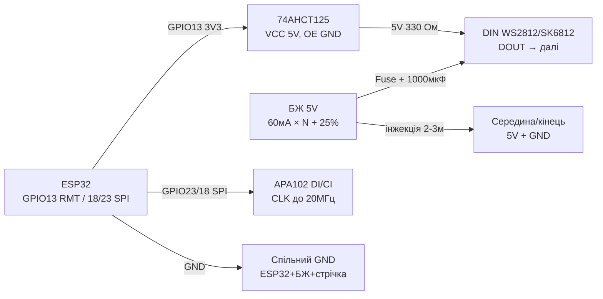

# LED Strip Power, SK6812, APA102 - RMT, DMA, Effects

## Purpose

Power and control of addressable strips without magic smoke: current calc (60 mA/LED rule), power injection every 2-3 m, DATA wiring (330 Ohm + 1000 uF), 3.3 V → 5 V level matching via 74AHCT125, SK6812 RGBW vs WS2812 vs APA102 difference (SPI with clock up to 20 MHz). Plus ESP32 hardware RMT + DMA for jitter-free effects even under Wi-Fi - with ready code for fun, running fire and strobe.

## Characteristics

| Strip | Protocol | power / current | Key rule |
| --- | --- | --- | --- |
| WS2812B / NeoPixel | 1-wire 800 kHz, GRB | 5 V, 60 mA/LED white (20 mA x RGB) | 330 Ohm on DATA + 1000 uF on 5 V near start |
| SK6812 RGBW | 1-wire 800 kHz, RGBW (compatible timing) | 5 V, up to 80 mA/LED (white channel separate!) | Cleaner white; W channel = 4th byte |
| APA102 / DotStar | SPI: DATA + CLOCK up to 20 MHz | 5 V, 60 mA/LED | 20 kHz PWM - no flicker on camera; long lines OK |
| WS2811 / WS2801 (external driver) | 1-wire 800 kHz as WS2812 | 12 V (WS2811) strip power | Driver separate from LED: for 12 V strips and big power; same timing |
| Power | 60 mA x N rule | 30 LED/m white = 1.8 A/m; 60/m = 3.6 A/m | Injection every 2-3 m from both sides of long strips |
| Level shifter | 74AHCT125 / 74HCT245 | 3.3 V → 5 V on DATA | TXS0102 not for NeoPixel (weak drive); 74AHCT - yes |
| ESP32 RMT | 8 TX channels, DMA | Resolution 10 MHz typ. | led_strip (IDF) / NeoPixelBus RMT method (Arduino) |

> White current at full: 30 LEDs = 1.8 A, 60 LEDs = 3.6 A, 144 LED/m x 5 m = 43 A - this is a welder, not USB. PSU with 20-30% margin, wires per current (1.5 mm2 at 10 A), fuse per branch.

## Module pin legend

| Pin | Type | To | Note |
| --- | --- | --- | --- |
| Strip 5V (red) | Power | 5 V PSU (not board!) | Injection every 2-3 m; fuse per branch |
| Strip GND (white/black) | ground | GND PSU + GND ESP32 | common point; thick wires! |
| WS2812/SK6812 DIN | data input | GPIO via 74AHCT125 + 330 Ohm | Resistor near FIRST LED |
| WS2812/SK6812 DOUT | output | DIN of next segment | up to 500+ LEDs in one chain (RAM!) |
| APA102 DI (MOSI) | data input | GPIO23 / through shifter | SPI up to 20 MHz |
| APA102 CI (SCK) | clock input | GPIO18 / via shifter | Separate clock = jitter immunity |
| 74AHCT125 A (1A) | 3.3 V input | GPIO ESP32 | Fast buffer, 8 mA drive |
| 74AHCT125 Y (1Y) | 5 V output | Strip DIN via 330 Ohm | Buffer powered at 5 V! OE to GND |
| 1000 uF capacitor | 6.3-16 V | 5V-GND near strip start | Kills spike on white turn-on |
| Fuse | 5-10 A | in 5V break of each branch | Automotive blade - cheap and solid |

## Wiring diagram

| ESP32 | module | Note |
| --- | --- | --- |
| GPIO13 | 74AHCT125 1A (input) | ESP32 3.3 V logic |
| 74AHCT125 1Y via 330 Ohm | Strip DIN | 5 V level after buffer |
| GND | 74AHCT125 OE (active LOW) | to ground = channel enabled |
| 5V | 74AHCT125 VCC | buffer powered at 5 V! |
| GND | Strip GND + PSU GND | common ground mandatory |
| 5 V PSU (Nx60 mA + 25%) | Strip 5V + 1000 uF | Injection every 2-3 m |
| GPIO23 | APA102 DI (through shifter) | MOSI |
| GPIO18 | APA102 CI (through shifter) | SCK up to 20 MHz |
| GPIO13 (RMT) | WS2812/SK6812 chain | One RMT channel per strip |

### ASCII-schem

```text
ESP32 DevKit              74AHCT125 + стрічка + БЖ 5V
------------              --------------------------------
GPIO13 ──────────────────► 1A 74AHCT125 (VCC=5V, OE ──► GND)
1Y ────[330 Ом]──────────► DIN стрічки (резистор біля LED!)
GND ─────────────────────► GND стрічки (= GND БЖ 5V + ESP32!)
БЖ 5V (60мА×N+25%) ──┬───► 5V початок + [1000мкФ 6.3V]
                     ├──[Fuse 5A]──► 5V середина (інжекція 2-3м)
                     └──[Fuse 5A]──► 5V кінець (довгі ──► ззаду)
APA102: GPIO23 ──► DI ; GPIO18 ──► CI (обидва через shifter)
DOUT ────────────────────► DIN наступного відрізка (ланцюг)
```

### Mermaid



![[assets/img/led-strip-power-shifter-scheme.png]]
*Fig. 5 V PSU with margin and injection every 2-3 m, 74AHCT125 for 3.3 V → 5 V, 330 Ohm on DATA, 1000 uF at start. Space below photo - see [[assets/README]].*

## Code ESP-IDF

```c
// led_strip (RMT + DMA): веселка + rotate. SK6812 RGBW: LED_MODEL_SK6812, формат GRBW.
#include "led_strip.h"
#include "esp_timer.h"

#define N_LEDS 60
static led_strip_handle_t strip;

// HSV -> RGB (h 0..360)
static void hsv2rgb(float h, uint8_t *r, uint8_t *g, uint8_t *b) {
    float c = 1.0f, x = c * (1 - fabsf(fmodf(h / 60.0f, 2) - 1));
    float m = 0, rr = 0, gg = 0, bb = 0;
    int s = (int)(h / 60) % 6;
    if (s == 0) { rr = c; gg = x; }
    else if (s == 1) { rr = x; gg = c; }
    else if (s == 2) { gg = c; bb = x; }
    else if (s == 3) { gg = x; bb = c; }
    else if (s == 4) { rr = x; bb = c; }
    else { rr = c; bb = x; }
    *r = (rr + m) * 255; *g = (gg + m) * 255; *b = (bb + m) * 255;
}

void app_main(void) {
    led_strip_config_t sc = {.strip_gpio_num = 13, .max_leds = N_LEDS,
        .led_model = LED_MODEL_WS2812,
        .color_format = LED_STRIP_COLOR_COMPONENT_FMT_GRB,
        .flags.invert_out = false};
    led_strip_rmt_config_t rc = {.resolution_hz = 10 * 1000 * 1000,
        .flags.with_dma = true};  // DMA - довгі стрічки без навантаження CPU
    led_strip_new_rmt_device(&sc, &rc, &strip);
    led_strip_clear(strip);

    uint32_t t = 0;
    while (1) {
        for (int i = 0; i < N_LEDS; i++) {
            uint8_t r, g, b;
            hsv2rgb(fmodf(i * 360.0f / N_LEDS + t, 360), &r, &g, &b);
            // Обмежити яскравість 50% - і тепло, і струм:
            led_strip_set_pixel(strip, i, r / 2, g / 2, b / 2);
        }
        led_strip_refresh(strip);
        t += 5;
        vTaskDelay(pdMS_TO_TICKS(30));
    }
}
```

## Code Arduino

```cpp
#include <NeoPixelBus.h>
#include <SPI.h>

#define LED_PIN 13
#define N_LEDS 60
// WS2812: NeoGrbFeature; SK6812 RGBW: NeoGrbwFeature + метод Sk6812:
NeoPixelBus<NeoGrbFeature, NeoEsp32Rmt0Ws2812xMethod> strip(N_LEDS, LED_PIN);
// APA102 окремо по SPI:
#define APA_N 30
uint8_t apaBuf[4 + APA_N * 4 + 4];  // start + LED frames + end

void apaShow(uint8_t r, uint8_t g, uint8_t b, uint8_t bright = 31) {
  apaBuf[0] = apaBuf[1] = apaBuf[2] = apaBuf[3] = 0x00;
  for (int i = 0; i < APA_N; i++) {
    apaBuf[4 + i * 4 + 0] = 0xE0 | (bright & 31);  // глобальна яскравість 5 біт
    apaBuf[4 + i * 4 + 1] = b;
    apaBuf[4 + i * 4 + 2] = g;
    apaBuf[4 + i * 4 + 3] = r;
  }
  for (int i = 0; i < 4; i++) apaBuf[4 + APA_N * 4 + i] = 0xFF;
  SPI.begin(18, -1, 23);  // SCK, MISO(-), MOSI
  SPI.beginTransaction(SPISettings(8000000, MSBFIRST, SPI_MODE0));
  SPI.writeBytes(apaBuf, sizeof(apaBuf));
  SPI.endTransaction();
}

void rainbow(uint8_t base) {
  for (int i = 0; i < N_LEDS; i++) {
    // Просте колесо кольорів без float:
    uint8_t p = base + i * 256 / N_LEDS;
    uint8_t r = (p < 85) ? 255 - p * 3 : (p < 170) ? 0 : (p - 170) * 3;
    uint8_t g = (p < 85) ? p * 3 : (p < 170) ? 255 - (p - 85) * 3 : 0;
    uint8_t b = (p < 85) ? 0 : (p < 170) ? (p - 85) * 3 : 255 - (p - 170) * 3;
    strip.SetPixelColor(i, RgbColor(r / 2, g / 2, b / 2));  // 50% струму
  }
  strip.Show();
}

void fire() {  // бігучий вогонь: червоний з жовтим хвостом
  static int pos = 0;
  strip.ClearTo(RgbColor(0, 0, 0));
  for (int i = 0; i < 8; i++) {
    int p = (pos - i + N_LEDS) % N_LEDS;
    strip.SetPixelColor(p, RgbColor(255, 120 - i * 15, 0));
  }
  strip.Show();
  pos = (pos + 1) % N_LEDS;
}

void setup() {
  strip.Begin();
  strip.Show();
}

void loop() {
  static uint8_t h = 0;
  rainbow(h++);
  delay(30);
  // fire(); apaShow(255, 0, 0);  // альтернативні ефекти
}
```

## Code MicroPython

```python
from machine import Pin, SPI
import neopixel
import time
import math

N = 60
np = neopixel.NeoPixel(Pin(13), N)

def wheel(p):  # 0..255 -> (r,g,b)
    p %= 256
    if p < 85: return (255 - p * 3, p * 3, 0)
    if p < 170: p -= 85; return (0, 255 - p * 3, p * 3)
    p -= 170; return (p * 3, 0, 255 - p * 3)

def rainbow(base, scale=2):  # scale=2 -> 50% яскравості (струм!)
    for i in range(N):
        r, g, b = wheel(base + i * 256 // N)
        np[i] = (r // scale, g // scale, b // scale)
    np.write()

def fire(pos):  # бігучий вогонь
    for i in range(N): np[i] = (0, 0, 0)
    for i in range(8):
        np[(pos - i) % N] = (255, max(0, 120 - i * 15), 0)
    np.write()

# APA102 по SPI (DI=23, CI=18):
spi = SPI(2, baudrate=8_000_000, sck=Pin(18), mosi=Pin(23))
def apa_show(r, g, b, n=30, bright=15):
    buf = bytearray([0, 0, 0, 0])
    for _ in range(n):
        buf += bytes([0xE0 | bright, b, g, r])
    buf += b'\xff\xff\xff\xff'
    spi.write(buf)

h = 0
pos = 0
while True:
    rainbow(h)
    h = (h + 1) % 256
    pos = (pos + 1) % N
    # fire(pos); apa_show(255, 0, 0)
    time.sleep_ms(30)
```

### WS2815 / WS2813 - 12 V strips with redundancy

| Parameter | WS2815 | WS2813 (5 V with redundancy) |
| --- | --- | --- |
| Power | 12 V (less current on length!) | 5 V |
| Redundant input | BI: one dead LED does not break chain | BI: same at 5 V |
| Logic | 5 V (level converter mandatory!) | 5 V |
| When to use | Street/facade 5-10 m without injection every 2 m | Reliability inside where 12 V missing |

```text
БЖ 12V ──► 12V-шина стрічки (інжекція кожні 5 м)
ESP32 GPIO ──[74AHCT125]──► DIN; BI наступного ──► вільний або до BI-попереднього
GND спільна обов'язково!
```

![[assets/img/ws2815-12v-scheme.png]]
*Fig. WS2815: 12 V power, redundant BI line, level converter on DIN.*

## Common issues

| # | error | Symptom | Fix |
| --- | --- | --- | --- |
| 1 | 60+ LED supply from USB/board pin | Reboot on white, pink instead of white | PSU 5 V: 60 mA x N + 25%; USB only for flashing |
| 2 | No common GND | Random colors, flicker | GND ESP32 = GND PSU = strip GND, with thick wire |
| 3 | No 330 Ohm / 1000 uF | Burnt first LED, current spikes | 330 Ohm near DIN, 1000 uF near 5V start |
| 4 | 3.3 V DATA directly on long line | Far LEDs glitch | 74AHCT125 near ESP32; TXS0102 not suitable |
| 5 | Thin wires / single feed at 5 m | Far end yellow/red | Injection every 2-3 m from both sides, 1.5 mm2 at 10 A |
| 6 | SK6812 as WS2812 (3 bytes instead of 4) | Shifted colors, bad white | RGBW = 4 bytes, GRBW format, LED_MODEL_SK6812 |
| 7 | APA102 without end-frame | Last LEDs stay off | +4 bytes 0xFF at end; start 4x0x00 |
| 8 | Full white brightness maxed | PSU overheat, connector melt | Limit 50-70% in code; fuse per branch; ventilation |
| 9 | NeoPixel bitbang under Wi-Fi | Flicker on traffic | RMT only (+DMA for long): led_strip / NeoPixelBus RMT |
| 10 | WS2815 powered at 5 V | no start / dim colors | WS2815 strictly 12 V; 5 V means WS2812B/WS2813 |

## Official sources

- [DotStar APA102 strip - live photo (Adafruit)](https://www.adafruit.com/product/2343) - product page with photo; SK6812/APA102 datasheets (WorldSemi) - see manufacturer page.
- [NeoPixel Uberguide with code (Adafruit Learn)](https://learn.adafruit.com/adafruit-neopixel-uberguide) - power, levels, effects.
- [ESP-IDF RMT - official documentation (Espressif)](https://docs.espressif.com/projects/esp-idf/en/latest/esp32/api-reference/peripherals/rmt.html) - signal generation for addressable strips.

### WS2815: 12V strip with redundant line

| Parameter | WS2812B (5V) | WS2815 (12V) |
| --- | --- | --- |
| Power | 5V (sag on length!) | 12V (same watts - 2.4x less current!) |
| Data redundancy | None (one break = dead tail) | Bi/B0: bypass of one dead LED! |
| DIN logic | 5V (on 3.3V - marginal!) | 5V (shifter mandatory!) |
| Use | Room, ceiling | Street, facade, long 5-10 m lines |

```text
Живлення WS2815: 12V БЖ → інжекція кожні 5 м; ESP32 керує через 74AHCT125
(3.3V→5V, див. 13-02!); спільна GND обов'язкова; запобіжник на 12V-лінію.
Резерв Bi: при згорілому LED сигнал йде в обхід - гірлянда живе далі (але яскравість сусідів перевіряти!).
```

## See also

- [[03-GPIO/04-Interrupts-PWM.en | Interrupts / PWM]]
- [[EN/07-Timers/01-Timers-MCPWM-PCNT-RMT.en]]
- [[02-Power-Supply/01-Power-Rails.en | Power Supply Rails]]
- [[04-Interfaces/02-SPI.en | SPI]]
- [[04-Interfaces/03-I2C.en | I2C]]
- [[Home.en | Home]]
- [[11-Vivid/03-NeoPixel-Servo-Rele-MOSFET.en | NeoPixel Servo Relay MOSFET]]
- [[11-Vivid/05-MAX7219-TM1637-74HC595.en | MAX7219 TM1637 74HC595]]
