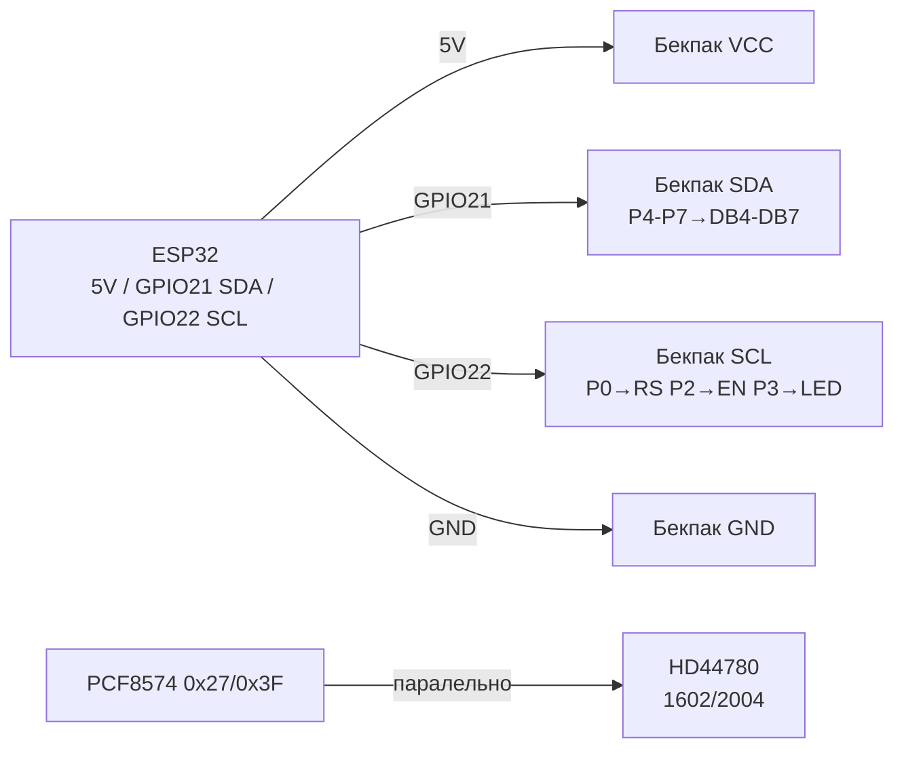

# LCD Character HD44780 / KS0066 / ST7066 - 1602/2004 Deep

## Purpose

Character LCD (16x2, 20x4) on HD44780 / KS0066 / ST7066 controllers -
cheapest text display: cash-register menus, counters, relay statuses,
debug without PC. Run for years, readable without backlight
at angle, powered at 5 V.

This note goes deep, not hello world: 4-bit mode (6 GPIO instead of 11);
own CGRAM symbols (degree, battery, arrows, progress bar); large digits
from custom glyphs; DDRAM addressing difference in 1602 vs 2004 (why 3rd row
jumps); Vo contrast and PWM backlight; PCF8574 backpack bit mapping
and 0x27 / 0x3F address conflicts (scan!); LiquidCrystal_I2C code;
Cyrillic (missing in ROM - only own glyphs!).

> Seeing "blocks" in first row - this is not death,
> this is uninitialised HD44780 (power present, init not passed / wrong contrast).

## Characteristics

| Parameter | value |
| --- | --- |
| Controllers | HD44780 (Hitachi original), KS0066 (Samsung clone), ST7066 (Sitronix clone) - command compatible |
| Formats | 1602 (16x2), 2004 (20x4), less often 0802 / 1604 / 4002 |
| Symbol matrix | 5x8 dots (8th row - cursor), CGRAM - 8 slots 0-7 |
| ROM font | A00 (Japanese katakana) or A02 (European with diacritics); NO CYRILLIC in either! |
| Bare interface | 8-bit (DB0-DB7) or 4-bit (DB4-DB7) + RS + EN (+ RW to ground) |
| Backpack interface | I2C PCF8574: SDA/SCL, addresses 0x27 / 0x3F (less often 0x20-0x26) |
| Power | 5 V logic (some 3.3 V versions with ICL7660); LED backlight ~4.2 V / 20-120 mA |
| Contrast | Vo (pin 3) via 10 k pot between VCC-GND; without it - blank or blocks |
| Current | Logic ~1-2 mA + backlight 20-100 mA (via backpack transistor!) |
| Speed | EN cycle ~1 us; `clear()` ~1.5 ms - do not send commands faster without delays! |
| Temperature | 0…+50 C typically; in frost symbols slow down (slow LC) |
| Libraries | LiquidCrystal (parallel), LiquidCrystal_I2C / LCD_I2C (backpack), HD44780 (Bill Perry, fullest) |

### 4-bit mode - why everyone does it

| Mode | Data pins | Total GPIO | When to use |
| --- | --- | --- | --- |
| 8-bit | DB0-DB7 + RS + EN | 10 (+RW) | Never on ESP32 (pin waste) |
| 4-bit | DB4-DB7 + RS + EN | 6 | Bare LCD without backpack, learning rig |
| I2C backpack | SDA + SCL | 2 | Combat option: 2 wires, addressing, backlight command |

in 4-bit mode each byte goes as two nibbles (high → low),
LiquidCrystal library does this itself: `LiquidCrystal(rs, en, d4, d5, d6, d7)`.
RW pressed to GND (write only) - busy-flag read not needed,
delays sewn into library.

### DDRAM addressing: 1602 vs 2004 (main pitfall!)

| Row | 1602 (16x2) address | 2004 (20x4) address | Length |
| --- | --- | --- | --- |
| 0 | 0x00-0x0F | 0x00-0x13 | 16 / 20 |
| 1 | 0x40-0x4F | 0x40-0x53 | 16 / 20 |
| 2 | - | 0x14-0x27 | 2004 only! |
| 3 | - | 0x54-0x67 | 2004 only! |

Consequences:

- 2004 rows go out of order: address order 0, 1, 2, 3 = 0x00, 0x40, 0x14, 0x54.
  therefore a 1602 library on 2004 writes 3rd row shifted by 4 symbols -
  classic bug with `setCursor(0,2)`.
- Fix: pass correct geometry `LiquidCrystal_I2C(0x27, 20, 4)`,
  never `16, 2` on physical 2004!
- 40-symbol controller trims row to window: symbols 16-39 exist
  in DDRAM but invisible - text can hide there for scrolling.

### CGRAM - own symbols (8 slots)

Each slot is 8 bytes (low 5 bits of each = row dots):

| Slot | Glyph | Bytes (ex.) | Use |
| --- | --- | --- | --- |
| 0 | Degree `°` | 0x06,0x09,0x09,0x06,0x00,0x00,0x00,0x00 | `24°C` |
| 1 | Battery frame | 0x0E,0x1B,0x11,0x11,0x11,0x11,0x11,0x1F | Charge indicator |
| 2 | Up arrow | 0x04,0x0E,0x15,0x04,0x04,0x04,0x04,0x00 | Menu/trends |
| 3 | Down arrow | 0x00,0x04,0x04,0x04,0x04,0x15,0x0E,0x04 | Menu/trends |
| 4-6 | Progress 1/3, 2/3, 3/3 | Columns 0x10/0x18/0x1C… | 0-100% bar graph |
| 7 | Checkmark OK | 0x00,0x01,0x03,0x16,0x1C,0x08,0x00,0x00 | Statuses |

Limit: only 8! For Cyrillic + icons together not enough -
reload CGRAM on screen change (`createChar` before each screen).

### Large digits (double-size)

Trick: digit 0-9 drawn in two rows from 3 custom glyphs
(top/bottom halves). Need 6 slots per set - so large digits
occupy ALL CGRAM and clash with Cyrillic on same screen.
Alternate: clock screen (large digits) vs menu screen (Cyrillic).

### Vo contrast + backlight

- **Vo (pin 3):** 0-1 V for visible symbols (not 2.5 V middle!).
  10 k pot: VCC-Vo-GND. Without backpack - turn MANDATORY.
  on I2C backpack pot already soldered (blue cube) - turn with screwdriver.
- **Backlight (pins 15/16, A/K):** LED via ~100 Ohm resistor on module.
  current 20-100 mA - not from GPIO directly! On backpack - transistor,
  control via `lcd.backlight()` / `lcd.noBacklight()`.
- **PWM dimming:** unsolder J (LED) jumper on backpack → cathode pin
  via N-MOSFET to GPIO with `ledc` 5 kHz. Or leave J and accept ON/OFF.

## Module pin legend

Bare HD44780 (16 pins) + what the PCF8574 backpack does:

| LCD pin | Value | Type | Where / via backpack | Note |
| --- | --- | --- | --- | --- |
| 1 | VSS | GND | GND | ground |
| 2 | VDD | +5 V | 5V (VU/VIN!) | 5 V! On 3V3 - dim/blank |
| 3 | Vo | Contrast | 10 k pot | 0-1 V; on backpack - blue trimmer |
| 4 | RS | Register select | Backpack P0 | 0 = command, 1 = data |
| 5 | RW | Read/write | GND (write) | on backpack pressed to GND |
| 6 | EN | Strobe | Backpack P2 | Edge writes nibble |
| 7-10 | DB0-DB3 | data | Nowhere (4-bit!) | Leave floating |
| 11-14 | DB4-DB7 | data | Backpack P4-P7 | High nibble first |
| 15 | A/LED+ | Backlight + | 5 V via resistor/transistor | on backpack - key + `backlight()` |
| 16 | K/LED- | Backlight - | GND | via J jumper on backpack |

PCF8574 → LCD mapping (standard backpack, memorise!):

| PCF8574 bit | Where | Purpose |
| --- | --- | --- |
| P0 | RS | Register Select |
| P1 | RW | in most backpacks - NC/GND logic (not RW!) |
| P2 | EN | Enable strobe |
| P3 | LED | Backlight (1 = ON) |
| P4-P7 | DB4-DB7 | 4 data bits |

PCF8574/PCF8574A addresses:

| Microscheme | Range | Typical | how to tell |
| --- | --- | --- | --- |
| PCF8574 | 0x20-0x27 (A0-A2) | **0x27** (all jumpers open) | Marking `PCF8574T` |
| PCF8574A | 0x38-0x3F | **0x3F** (all open) | Marking `PCF8574AT` with letter A! |

> Bought same display but different address - this is 8574 vs 8574A.
> Soldered A0-A2 jumpers LOWER the address. Always run scanner!

## Wiring diagram

| ESP32 | LCD + PCF8574 backpack | Note |
| --- | --- | --- |
| 5V (VU/VIN) | VCC | 5 V! Backlight and contrast want 5 V |
| GND | GND | common ground |
| GPIO22 | SCL | hardware I2C0 |
| GPIO21 | SDA | hardware I2C0, 4.7 kOhm pull-up (present on backpack) |
| - | Vo pot | Turn until symbols appear! |
| GPIO16 (optional) | LED cathode via MOSFET | Only if J jumper removed (PWM dimming) |

Bare LCD without backpack (4-bit, learning option):

| ESP32 | bare HD44780 | Note |
| --- | --- | --- |
| 5V / GND | VDD / VSS | 5 V power supply |
| 10 k pot | Vo (pin 3) | Middle pin → Vo |
| GPIO4 | RS (pin 4) | |
| GND | RW (pin 5) | Press to ground! |
| GPIO5 | EN (pin 6) | |
| GPIO13/12/14/27 | DB4-DB7 (pins 11-14) | Avoid strapping pins for EN/RS! |

### ASCII-schem

```text
ESP32 DevKit              PCF8574-бекпак ──► HD44780 LCD
-------------             --------------------------------
5V (VU) ────────────────► VCC (5 В! підсвітка+контраст)
GND ────────────────────► GND
GPIO22 ─────────────────► SCL (I2C 100-400 кГц)
GPIO21 ─────────────────► SDA (pull-up 4.7к на бекпаку)
                          P0→RS | P2→EN | P3→LED | P4-P7→DB4-DB7
                          [синій потенціометр] → крутити до символів!
Адреса: 0x27 (PCF8574) або 0x3F (PCF8574A) - ганяти I2C-сканер!

Голий 4-біт (без бекпака):
5V→VDD, GND→VSS+RW, Vo→[10к]→VCC/GND, GPIO4→RS, GPIO5→EN,
GPIO13/12/14/27→DB4/DB5/DB6/DB7, 5V→A(15), GND→K(16)
```

### Mermaid



![[assets/img/lcd-char-hd44780-scheme.png]]
*Fig. Character LCD via PCF8574: 2-wire I2C, 5 V power, address 0x27/0x3F. Space below schematic - see [[assets/README]].*

## Code ESP-IDF

ESP-IDF (via I2C driver + HD44780 `esp-idf-lib` component):

```c
#include "driver/i2c.h"
#include "hd44780.h" // компонент esp-idf-lib hd44780 + pcf8574

#define I2C_PORT I2C_NUM_0
#define LCD_ADDR 0x27 // або 0x3F - перевірити сканером!

void app_main(void) {
    i2c_config_t cfg = {
        .mode = I2C_MODE_MASTER,
        .sda_io_num = GPIO_NUM_21, .scl_io_num = GPIO_NUM_22,
        .sda_pullup_en = GPIO_PULLUP_ENABLE,
        .scl_pullup_en = GPIO_PULLUP_ENABLE,
        .master.clk_speed = 100000, // бекпаку вистачить 100 кГц
    };
    i2c_param_config(I2C_PORT, &cfg);
    i2c_driver_install(I2C_PORT, cfg.mode, 0, 0, 0);

    // Сканер: шукаємо 0x27 або 0x3F
    for (uint8_t a = 1; a < 127; a++) {
        i2c_cmd_handle_t c = i2c_cmd_link_create();
        i2c_master_start(c);
        i2c_master_write_byte(c, (a << 1) | I2C_MASTER_WRITE, true);
        i2c_master_stop(c);
        if (i2c_master_cmd_begin(I2C_PORT, c, pdMS_TO_TICKS(50)) == ESP_OK) {
            printf("I2C found: 0x%02X\n", a);
        }
        i2c_cmd_link_delete(c);
    }

    hd44780_t lcd = {
        .write_cb = NULL, // прив'язка PCF8574 за прикладом esp-idf-lib
        .addr = LCD_ADDR, .cols = 20, .rows = 4, // УВАГА: геометрія своєї панелі!
        .backlight = true,
    };
    // hd44780_init(&lcd); hd44780_gotoxy(&lcd, 0, 0);
    // hd44780_puts(&lcd, "ESP32 LCD OK");
    printf("Init LCD %dx%d at 0x%02X\n", lcd.cols, lcd.rows, lcd.addr);
}
```

> in practice on ESP-IDF fastest is to take ready ex.
> `esp-idf-lib/examples/hd44780` as is, not write `write_cb` manually.

## Code Arduino - LiquidCrystal_I2C

```cpp
#include <Wire.h>
#include <LiquidCrystal_I2C.h>

// УВАГА: адреса і геометрія - ПІД СВОЮ ПАНЕЛЬ!
// 0x27 + 16x2  або  0x3F + 20x4 - перевірити сканером і написом на PCB!
LiquidCrystal_I2C lcd(0x27, 16, 2);

// Свої символи CGRAM: градус, батарея, стрілки
byte degGlyph[8]   = {0x06,0x09,0x09,0x06,0x00,0x00,0x00,0x00};
byte battGlyph[8]  = {0x0E,0x1B,0x11,0x11,0x11,0x11,0x11,0x1F};
byte upGlyph[8]    = {0x04,0x0E,0x15,0x04,0x04,0x04,0x04,0x00};
byte downGlyph[8]  = {0x00,0x04,0x04,0x04,0x04,0x15,0x0E,0x04};
byte bar1[8]       = {0x10,0x10,0x10,0x10,0x10,0x10,0x10,0x10};
byte bar2[8]       = {0x18,0x18,0x18,0x18,0x18,0x18,0x18,0x18};
byte bar3[8]       = {0x1C,0x1C,0x1C,0x1C,0x1C,0x1C,0x1C,0x1C};
byte okGlyph[8]    = {0x00,0x01,0x03,0x16,0x1C,0x08,0x00,0x00};

void i2c_scanner() {
  Serial.println("I2C scan:");
  for (uint8_t a = 1; a < 127; a++) {
    Wire.beginTransmission(a);
    if (Wire.endTransmission() == 0) {
      Serial.printf("  found 0x%02X\n", a);
    }
  }
}

void setup() {
  Serial.begin(115200);
  Wire.begin(21, 22);
  Wire.setClock(100000);
  i2c_scanner(); // 0x27 vs 0x3F - дивитись у монітор!

  lcd.init();      // замість lcd.begin() у нових версіях!
  lcd.backlight();
  lcd.createChar(0, degGlyph);
  lcd.createChar(1, battGlyph);
  lcd.createChar(2, upGlyph);
  lcd.createChar(3, downGlyph);
  lcd.createChar(4, bar1);
  lcd.createChar(5, bar2);
  lcd.createChar(6, bar3);
  lcd.createChar(7, okGlyph);

  lcd.setCursor(0, 0);
  lcd.print("ESP32 LCD OK ");
  lcd.write(7); // галочка
  lcd.setCursor(0, 1);
  lcd.print("T=24.5");
  lcd.write(0); // градус
  lcd.print("C ");
  lcd.write(1); // батарея
  lcd.print(" ");
  lcd.write(2); // вгору
  lcd.write(3); // вниз
}

void loop() {
  // Прогрес-бар другим рядком (приклад):
  static int pct = 0;
  lcd.setCursor(0, 1);
  int full = pct * 16 / 100;
  for (int i = 0; i < 16; i++) {
    if (i < full) lcd.write(6);
    else lcd.print(" ");
  }
  pct = (pct + 5) % 105;
  delay(500);
}
```

Cyrillic with own glyphs (ex. - big-5 letters, draw the rest!):

```cpp
// Кирилиці в ROM НЕМАЄ - кожну літеру малюємо самі (5x8).
// Приклад: А, Д, Ж, І, Т (повний алфавіт - 33 літери > 8 слотів!
// перезавантажувати CGRAM постранично: екран1 - А-З, екран2 - І-П...).
byte cyrA[8] = {0x0E,0x11,0x11,0x1F,0x11,0x11,0x11,0x00}; // А
byte cyrD[8] = {0x00,0x1E,0x11,0x11,0x11,0x1F,0x11,0x1F}; // Д спрощено
void cyrDemo() {
  lcd.createChar(0, cyrA);
  lcd.createChar(1, cyrD);
  lcd.setCursor(0, 0);
  lcd.write(0); lcd.write(1); // А Д
}
```

## Code MicroPython

```python
from machine import I2C, Pin, PWM
import time

# I2C-сканер - ПЕРШІМ ділом (0x27 vs 0x3F)!
i2c = I2C(0, scl=Pin(22), sda=Pin(21), freq=100000)
found = i2c.scan()
print("I2C:", [hex(a) for a in found])
ADDR = 0x27 if 0x27 in found else (0x3F if 0x3F in found else None)
assert ADDR, "LCD не знайдено! Перевір 5V і Vo!"

# Мінімальний драйвер PCF8574-бекпака (мапінг: P0=RS P2=EN P3=LED P4-7=DB)
RS, EN, LED = 0x01, 0x04, 0x08
bl = True
def nibble(n, rs):
    b = (n << 4) | (LED if bl else 0) | (RS if rs else 0)
    i2c.writeto(ADDR, bytes([b | EN])); time.sleep_us(1)
    i2c.writeto(ADDR, bytes([b & ~EN])); time.sleep_us(50)

def cmd(c):
    nibble(c >> 4, 0); nibble(c & 0x0F, 0)
    if c in (0x01, 0x02): time.sleep_ms(2)

def putc(ch):
    nibble(ord(ch) >> 4, 1); nibble(ord(ch) & 0x0F, 1)

def goto(col, row):
    # DDRAM 2004: 0x00,0x40,0x14,0x54 - для 1602 тільки перші два!
    off = [0x00, 0x40, 0x14, 0x54][row] + col
    cmd(0x80 | off)

def puts(s):
    for ch in s: putc(ch)

def custom(slot, glyph):
    cmd(0x40 | (slot << 3))
    for b in glyph: putc(chr(b))

# Init HD44780 в 4-біт:
time.sleep_ms(50)
for _ in range(3):
    nibble(0x03, 0); time.sleep_ms(5)
nibble(0x02, 0)  # 4-біт режим
cmd(0x28); cmd(0x0C); cmd(0x06); cmd(0x01); time.sleep_ms(2)

DEG = [0x06,0x09,0x09,0x06,0x00,0x00,0x00,0x00]
custom(0, DEG)
goto(0, 0); puts("ESP32 LCD OK")
goto(0, 1); puts("T=24.5"); putc(chr(0)); puts("C")

# PWM підсвітки (якщо знято J-перемичку, катод через MOSFET на GPIO16):
# pwm = PWM(Pin(16), freq=5000, duty=512)  # 0-1023, диммінг
```

## Common issues

| Error (symptom) | cause | Fix |
| --- | --- | --- |
| Blocks in 1st row | Init not passed (wrong address/library) or RW not to GND | I2C scan, correct constructor, RW→GND, `lcd.init()` |
| Blank but backlight on | Vo contrast at zero | Turn blue pot on backpack until symbols |
| `No I2C device` in scan | 3V3 supply instead of 5V / SDA/SCL swapped | VCC→5V (VU), SDA=21/SCL=22, common GND |
| Works at 0x27, new one silent | New module on PCF8574A (0x3F) | Scan + `LiquidCrystal_I2C(0x3F,...)` |
| 2004 3rd row shifted by 4 symbols | `16,2` constructor on physical `20,4` | `LiquidCrystal_I2C(addr, 20, 4)` |
| Dim symbols on 3V3 | Logic wants 5 V, no ICL7660 | Power 5V; 3.3 V SDA/SCL is enough (4.7k pull-up to 5V - fine) |
| Cyrillic shows hieroglyphs/dots | Missing in ROM A00/A02 | Only `createChar` (8 slots, reload per screens) |
| CGRAM flew after `clear()` | `clear()` does not touch CGRAM, but foreign `createChar` overwrote | Call `createChar` BEFORE each screen, do not share slots silently |
| Backlight ignores `noBacklight()` | J jumper soldered by default | for PWM - remove J, cathode via MOSFET; for ON/OFF - keep J |
| Garbage on long wires | I2C 400 kHz + 50 cm Dupont | 100 kHz, shorter wires, 100 nF on power |

## Official sources

- [RNT - I2C LCD with ESP32 in Arduino IDE](https://randomnerdtutorials.com/esp32-esp8266-I2C-lcd-arduino-ide/) - wiring, address scan, `LiquidCrystal_I2C`, custom symbols.
- [LiquidCrystal_I2C - library Marco Schwartz (fdebrabander fork)](https://github.com/fdebrabander/Arduino-LiquidCrystal-I2C-library) - API `init/backlight/createChar`.
- [LiquidCrystal_I2C - DFRobot library (johnrickman)](https://github.com/johnrickman/LiquidCrystal_I2C) - alternative fork, Hello World ex.
- [Adafruit - Character LCDs (HD44780)](https://learn.adafruit.com/character-lcds) - 4-bit mode, bare LCD wiring, contrast.

## See also

- [[Home.en | Home]]
- [[11-Vivid/02-TFT-LCD-Epaper.en | TFT LCD Epaper]]
- [[11-Vivid/12-LVGL-SquareLine.en | LVGL SquareLine]]
- [[11-Vivid/15-EInk.en | E-Ink]]
- [[11-Vivid/16-LCD-Char.en | LCD Char]]
- [[11-Vivid/17-Touchscreens.en | Touchscreens]]
- [[04-Interfaces/03-I2C.en | I2C]]
- [[04-Interfaces/02-SPI.en | SPI]]
