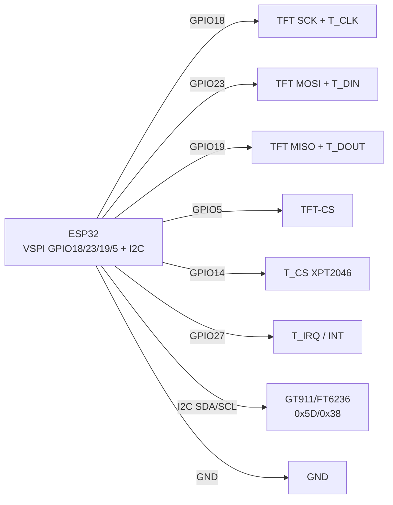

# Touchscreens - Capacitive, Resistive, Calibration, LVGL

## Purpose

Touchscreen turns TFT into control panel: buttons, sliders, keyboards,
gestures. Two families: capacitive (CST816 / GT911 / FT6236 - finger, multitouch,
I2C + INT + RST) and resistive (XPT2046 / TSC2007 / ADS7843 - stylus,
pressure Z, SPI + separate CS, calibration mandatory!).

This note covers: capacitive addresses and pins (INT + RST matter, multitouch);
resistive with Z pressure and 3-point calibration; LVGL `indev` binding
(`read_cb`, PRESSED/RELEASED states); modern S3 displays with touch
(Sunton ESP32-2432S028 / CrowPanel / WT32-SC01 - where pin conflicts are);
calibration code + LVGL for both types.

> 10-second choice: finger + glass + gestures → capacitive (GT911/FT6236);
> stylus + gloves + cheap ILI9341 shield → resistive XPT2046.
> Drivers are not interchangeable: I2C touch and SPI touch need different code!

## Characteristics

| Parameter | Capacitive (CST816 / GT911 / FT6236) | Resistive (XPT2046 / TSC2007) |
| --- | --- | --- |
| Principle | Finger capacitance, glass panel | Film pressure, needs press/stylus |
| Interface | I2C (SDA/SCL) + INT + RST | SPI (common with TFT!) + T_CS + T_IRQ |
| I2C addresses | CST816 0x15; FT6236/FT6206 0x38; GT911 0x5D (or 0x14!) | None (SPI device, selected via CS) |
| Control pins | INT (touch interrupt), RST (controller reset) | T_CS (separate from TFT-CS!), T_IRQ (optional) |
| Points | 1-5 (CST816: 1 gesture; FT6236: 2; GT911: 5) + gestures/swipes | 1 point + Z pressure (press force) |
| Accuracy | Factory, no calibration needed | Raw ADC 0-4095 → 2-3 point calibration MANDATORY |
| Gloves/water | Bad (false trips on water!) | Work (pressure is pressure) |
| Price/glass | Pricier, hardened glass | Cheap film ILI9341 2.4-2.8″ shields |
| LVGL type | `LV_INDEV_TYPE_POINTER`, coordinates ready | Same type, but via `map()` + median + debounce |
| Typical modules | S3 displays 2.8-7″ (Sunton, CrowPanel, WT32-SC01) | ILI9341 2.4″ shield + XPT2046 on same board |

### Capacitive in detail

| controller | I2C-address | INT / RST | Multitouch | Where used |
| --- | --- | --- | --- | --- |
| CST816S | 0x15 | INT + RST mandatory | 1 point + gestures (swipe/tap/long-press) | Round / small S3 1.28-2.1″ |
| FT6236 (FT5x06) | 0x38 | INT optional, RST desired | 2 points | ILI9341/ST7789 panels 2.4-3.5″ |
| GT911 | 0x5D (INT HIGH at start) / 0x14 (INT LOW) | INT sets address! RST is reset | 5 points | Large 4.3-7″ (Sunton 4827S043, CrowPanel 7″) |

GT911 pitfalls:

1. Address picked by INT level at reset: hold INT HIGH → 0x5D,
   LOW → 0x14. Wrong level means touch missing from scan!
2. After `RST` need 10-50 ms delay before first read.
3. Read: status register 0x814E → point count → coordinates
   0x8150… (low byte first!), then write 0 to 0x814E (clear!).

### Resistive in detail

| controller | Interface | Z pressure | Note |
| --- | --- | --- | --- |
| XPT2046 | SPI, commands 0x90 (X) / 0xD0 (Y) / 0xB0 (Z1) / 0xC0 (Z2) | Yes (Z1/Z2) | ILI9341 shield standard; PaulStoffregen library |
| TSC2007 | I2C 0x48 | Yes | rarer, for small panels |
| ADS7843 | SPI (XPT2046 predecessor) | Yes | Command compatible with XPT2046 |

Raw values: X/Y/Z - 12-bit ADC (0-4095), noise ±50 units.
read minimum 3 times + median. Pressure: `z = z1 + 4095 - z2`;
touch valid at `z > 300` (tune threshold!). Without press X/Y is garbage.

### Modern S3 displays with touch

| Display | Panel + touch | Pins (typically) | Pitfall |
| --- | --- | --- | --- |
| Sunton ESP32-2432S028 (2.8″) | ILI9341 + XPT2046 | TFT_CS 15, DC 2, T_CS 14, T_IRQ 36 | T_CS vs TFT-CS differ! 5V USB power |
| Sunton ESP32-4827S043 (4.3″) | ST7262 RGB + GT911 | I2C SDA 19 / SCL 20, INT 38, RST 39 | RGB panel eats DMA + PSRAM; GT911 address 0x5D |
| CrowPanel 2.4-7″ (Elecrow) | ILI9341/ST series + XPT2046/GT911 | Check revision wiki! | Revisions swap INT/RST - verify silkscreen |
| WT32-SC01 / Plus | ST7796 + FT6336U | I2C 0x38 | LovyanGFX has ready `LGFX_WT32_SC01` profile |

> in S3 all-in-one displays touch is often already pulled to 3.3 V -
> do not add external 10 k pull-up needlessly, it makes a divider!

## Module pin legend

Capacitive flex (GT911 / FT6236, 6 pins, I2C):

| Pin | Value | Type | To ESP32 | Note |
| --- | --- | --- | --- | --- |
| 1 | VCC | 3V3 | 3V3 | 3.3 V only! |
| 2 | GND | ground | GND | common ground |
| 3 | SDA | I2C data | GPIO21 (or 19 on S3 displays!) | 4.7 k pull-up (often already on board) |
| 4 | SCL | I2C clock | GPIO22 (or 20!) | 100-400 kHz |
| 5 | INT | output → MCU input | GPIO27 (or 38!) | interrupt + GT911 address select! |
| 6 | RST | input | GPIO33 (or 39!) | Controller reset, delay after |

Resistive shield (XPT2046 on ILI9341 board, SPI):

| Pin | Value | Type | To ESP32 | Note |
| --- | --- | --- | --- | --- |
| 1 | T_CS | input CS | GPIO14 | SEPARATE from TFT-CS (GPIO5)! |
| 2 | T_IRQ | output → MCU input | GPIO27 (optional) | LOW = touched; without it - polling |
| 3 | T_CLK | SPI clock | GPIO18 (shared with TFT!) | Same VSPI bus |
| 4 | T_DIN | SPI MOSI | GPIO23 (shared!) | Controller commands |
| 5 | T_DOUT | SPI MISO | GPIO19 (shared!) | X/Y/Z read - MISO MANDATORY! |
| 6 | VCC/GND | power supply | 3V3 / GND | From display board |

Explanation:

- **INT + RST on capacitive are not spare.** Without RST controller may start
  with old address; without INT only status polling (I2C load).
- **Separate T_CS is holy.** Shared TFT+touch CS means both silent.
  raise T_CS in `flush_cb`, raise TFT-CS in `touch_read`.
- **Touch needs MISO, TFT does not.** ST7789 lives without MISO, XPT2046 does not.
  missing MISO means `touched()` always false.

## Wiring diagram

| ESP32 | ILI9341 + XPT2046 (resistive) | Note |
| --- | --- | --- |
| 3V3 | VCC | Module with LDO - 5V possible (check J1!) |
| GND | GND | common ground |
| GPIO18 | SCK + T_CLK | Shared clock |
| GPIO23 | MOSI + T_DIN | Shared MOSI |
| GPIO19 | MISO + T_DOUT | Shared MISO (mandatory for touch!) |
| GPIO5 | TFT-CS | Display |
| GPIO2 | DC | data/command |
| GPIO4 | TFT-RST | TFT reset |
| GPIO14 | T_CS | Touch (separate!) |
| GPIO27 | T_IRQ | touch interrupt (optional) |

| ESP32 | GT911 capacitive (ex. Sunton 4.3″) | Note |
| --- | --- | --- |
| 3V3 / GND | VCC / GND | 3.3 V |
| GPIO19 | SDA | I2C (on S3 - own pins per board schematic!) |
| GPIO20 | SCL | I2C |
| GPIO38 | INT | address 0x5D at HIGH at reset |
| GPIO39 | RST | Reset, 50 ms delay |

### ASCII-schem

```text
ESP32 DevKit (VSPI+I2C)      ILI9341 TFT + XPT2046 (резистивний)
-----------------------      -----------------------------------
3V3 ───────────────────────► VCC
GND ───────────────────────► GND
GPIO18 ────────────────────► SCK + T_CLK (спільні!)
GPIO23 ────────────────────► MOSI + T_DIN (спільні!)
GPIO19 ────────────────────► MISO + T_DOUT (тачу ОБОВ'ЯЗКОВО!)
GPIO5 ─────────────────────► TFT-CS (дисплей)
GPIO2 ─────────────────────► DC
GPIO4 ─────────────────────► TFT-RST
GPIO14 ────────────────────► T_CS (ОКРЕМИЙ від TFT-CS!)
GPIO27 ◄──────────────────── T_IRQ (LOW = дотик, опційно)

Окремо - ємнісний GT911 (I2C):
GPIO19/20 ──► SDA/SCL (pull-up на платі), GPIO38 ──► INT, GPIO39 ──► RST
INT HIGH при RST → адреса 0x5D, LOW → 0x14 (перевірити сканером!)
```

### Mermaid



![[assets/img/touchscreens-cap-res-scheme.png]]
*Fig. Touch: resistive XPT2046 on shared VSPI (separate T_CS) + capacitive GT911 on I2C (INT/RST). Space below schematic - see [[assets/README]].*

## Code ESP-IDF - GT911 (capacitive, I2C)

```c
#include "driver/i2c.h"
#include "driver/gpio.h"

#define I2C_PORT I2C_NUM_0
#define GT911_ADDR 0x5D // або 0x14 - перевірити сканером!
#define PIN_INT 38
#define PIN_RST 39

static void gt911_reset(void) {
    // INT HIGH → адреса 0x5D (тримати до кінця reset!)
    gpio_set_direction(PIN_INT, GPIO_MODE_OUTPUT);
    gpio_set_direction(PIN_RST, GPIO_MODE_OUTPUT);
    gpio_set_level(PIN_INT, 1);
    gpio_set_level(PIN_RST, 0); vTaskDelay(pdMS_TO_TICKS(10));
    gpio_set_level(PIN_RST, 1); vTaskDelay(pdMS_TO_TICKS(50));
    gpio_set_direction(PIN_INT, GPIO_MODE_INPUT); // відпустити INT
}

static esp_err_t gt911_read(uint8_t reg_h, uint8_t reg_l,
                            uint8_t *buf, size_t len) {
    i2c_cmd_handle_t c = i2c_cmd_link_create();
    i2c_master_start(c);
    i2c_master_write_byte(c, (GT911_ADDR << 1) | I2C_MASTER_WRITE, true);
    i2c_master_write_byte(c, reg_h, true);
    i2c_master_write_byte(c, reg_l, true);
    i2c_master_start(c);
    i2c_master_write_byte(c, (GT911_ADDR << 1) | I2C_MASTER_READ, true);
    i2c_master_read(c, buf, len, I2C_MASTER_LAST_NACK);
    i2c_master_stop(c);
    esp_err_t r = i2c_master_cmd_begin(I2C_PORT, c, pdMS_TO_TICKS(100));
    i2c_cmd_link_delete(c);
    return r;
}

void app_main(void) {
    i2c_config_t cfg = {
        .mode = I2C_MODE_MASTER,
        .sda_io_num = 19, .scl_io_num = 20,
        .sda_pullup_en = GPIO_PULLUP_ENABLE,
        .scl_pullup_en = GPIO_PULLUP_ENABLE,
        .master.clk_speed = 400000,
    };
    i2c_param_config(I2C_PORT, &cfg);
    i2c_driver_install(I2C_PORT, cfg.mode, 0, 0, 0);
    gt911_reset();

    while (1) {
        uint8_t st = 0;
        if (gt911_read(0x81, 0x4E, &st, 1) == ESP_OK && (st & 0x0F)) {
            uint8_t p[8];
            gt911_read(0x81, 0x50, p, 8); // точка 1: xL xH yL yH size..
            int x = p[1] << 8 | p[0], y = p[3] << 8 | p[2];
            printf("touch x=%d y=%d n=%d\n", x, y, st & 0x0F);
            uint8_t z = 0; // clear status 0x814E!
            i2c_cmd_handle_t c = i2c_cmd_link_create();
            i2c_master_start(c);
            i2c_master_write_byte(c, (GT911_ADDR << 1) | 1, true);
            i2c_master_write(c, (uint8_t[]){0x81, 0x4E, 0x00}, 3, true);
            i2c_master_stop(c);
            i2c_master_cmd_begin(I2C_PORT, c, pdMS_TO_TICKS(100));
            i2c_cmd_link_delete(c);
        }
        vTaskDelay(pdMS_TO_TICKS(20));
    }
}
```

## Code Arduino - XPT2046 + 3-point calibration + LVGL indev

```cpp
#include <SPI.h>
#include <XPT2046_Touchscreen.h> // PaulStoffregen
#include <lvgl.h>

#define TFT_CS 5
#define T_CS 14
#define T_IRQ 27
XPT2046_Touchscreen ts(T_CS, T_IRQ);

// --- Калібрування: виміряти СВОЇМ стилусом 3 точки! ---
// Процедура: намалювати хрестики (20,20), (220,160), (120,300),
// записати сирі p.x/p.y з Serial, підставити нижче.
struct Cal { int x0, x1, y0, y1; };
Cal cal = { .x0 = 300, .x1 = 3800, .y0 = 300, .y1 = 3800 }; // ЗАГЛУШКА!
const int DISP_W = 240, DISP_H = 320;

static int median3(int a, int b, int c) {
  if ((a - b) * (b - c) >= 0) return b;
  if ((b - a) * (a - c) >= 0) return a;
  return c;
}

bool touch_read_raw(int &sx, int &sy, int &z) {
  if (!ts.touched()) return false;
  // 3 читання + медіана проти шуму:
  int x[3], y[3], z0[3];
  for (int i = 0; i < 3; i++) {
    TS_Point p = ts.getPoint();
    x[i] = p.x; y[i] = p.y; z0[i] = p.z;
    delay(2);
  }
  int mx = median3(x[0], x[1], x[2]);
  int my = median3(y[0], y[1], y[2]);
  int mz = median3(z0[0], z0[1], z0[2]);
  if (mz < 300) return false; // поріг тиску (підібрати 200-600!)
  // Мапінг у пікселі (після фінального setRotation!):
  sx = map(mx, cal.x0, cal.x1, 0, DISP_W);
  sy = map(my, cal.y0, cal.y1, 0, DISP_H);
  z = mz;
  sx = constrain(sx, 0, DISP_W - 1);
  sy = constrain(sy, 0, DISP_H - 1);
  return true;
}

// --- LVGL indev прив'язка ---
void touch_cb(lv_indev_drv_t *d, lv_indev_data_t *dt) {
  static int lx = 0, ly = 0;
  int sx, sy, z;
  if (touch_read_raw(sx, sy, z)) {
    lx = sx; ly = sy;
    dt->state = LV_INDEV_STATE_PRESSED;
    dt->point.x = lx; dt->point.y = ly;
  } else {
    dt->state = LV_INDEV_STATE_RELEASED;
    dt->point.x = lx; dt->point.y = ly;
  }
}

void setup() {
  Serial.begin(115200);
  pinMode(TFT_CS, OUTPUT); digitalWrite(TFT_CS, HIGH);
  SPI.begin(18, 19, 23, T_CS); // SCK, MISO, MOSI, SS
  ts.begin();
  ts.setRotation(1); // ТА САМА що й у tft.setRotation(1)!

  lv_init();
  // ... дисплей-драйвер як у 12-LVGL-SquareLine ...
  static lv_indev_drv_t id;
  lv_indev_drv_init(&id);
  id.type = LV_INDEV_TYPE_POINTER;
  id.read_cb = touch_cb;
  lv_indev_drv_register(&id);
  Serial.println("Торкни 3 хрестики, запиши сирі координати для cal!");
}

void loop() {
  lv_timer_handler();
  delay(5);
}
```

Calibration sketch (one-off, before combat):

```cpp
// Малює хрестик, чекає дотику, друкує сире значення. Повторити 3 рази.
void calPoint(int px, int py, const char *name) {
  // tft.drawLine(px-10, py, px+10, py, RED); tft.drawLine(px, py-10, px, py+10, RED);
  Serial.printf("Торкни %s (%d,%d)...\n", name, px, py);
  while (!ts.touched()) delay(20);
  delay(100); // дебаунс!
  TS_Point p = ts.getPoint();
  Serial.printf("  %s raw x=%d y=%d z=%d\n", name, p.x, p.y, p.z);
  while (ts.touched()) delay(20);
  delay(300);
}
// Виклик: calPoint(20,20,"TL"); calPoint(220,160,"MID"); calPoint(120,300,"BR");
// Потім: cal.x0 = TL.x; cal.x1 = ... (залежно від rotation - осі можуть мінятися!)
```

## Code MicroPython - FT6236 (capacitive) + XPT2046 polling

```python
from machine import I2C, SPI, Pin
import time

# --- Ємнісний FT6236 (I2C 0x38) ---
i2c = I2C(0, scl=Pin(22), sda=Pin(21), freq=400000)
print("I2C:", [hex(a) for a in i2c.scan()])  # чекаємо 0x38
FT_ADDR = 0x38

def ft_read():
    # Статус 0x02 → кількість, координати з 0x03
    d = i2c.readfrom_mem(FT_ADDR, 0x02, 7)
    n = d[0] & 0x0F
    if n == 0:
        return None
    x = ((d[1] & 0x0F) << 8) | d[2]
    y = ((d[3] & 0x0F) << 8) | d[4]
    return (x, y, n)

# --- Резистивний XPT2046 (SPI, спільна шина з TFT) ---
spi = SPI(2, baudrate=2000000, sck=Pin(18), mosi=Pin(23), miso=Pin(19))
tcs = Pin(14, Pin.OUT, value=1)

def xpt_cmd(c):
    tcs(0)
    spi.write(bytes([c, 0x00, 0x00]))
    tcs(1)
    # Друге читання для точності (перше - сміття після перемикання):
    tcs(0)
    r = bytearray(3)
    spi.write_readinto(bytes([c, 0x00, 0x00]), r)
    tcs(1)
    return ((r[1] << 4) | (r[2] >> 4))  # 12 біт

def xpt_read():
    x = xpt_cmd(0x90); y = xpt_cmd(0xD0)
    z1 = xpt_cmd(0xB0); z2 = xpt_cmd(0xC0)
    z = z1 + 4095 - z2
    if z < 300:
        return None
    # Калібрування ПІД СВІЙ module (виміряти!):
    sx = min(max((x - 300) * 240 // (3800 - 300), 0), 239)
    sy = min(max((y - 300) * 320 // (3800 - 300), 0), 319)
    return (sx, sy, z)

while True:
    f = ft_read()
    if f: print("FT6236:", f)
    x = xpt_read()
    if x: print("XPT2046:", x)
    time.sleep_ms(50)
```

## LVGL indev - capacitive touch (GT911/FT6236/CST816)

```cpp
// Ємнісний: координати вже в пікселях, калібрування НЕ потрібне.
// Тільки rotation + межі екрану!
#include <lvgl.h>
#include <Wire.h>

#define GT911_ADDR 0x5D
static int lx_, ly_;

bool cap_read(int &x, int &y) {
  Wire.beginTransmission(GT911_ADDR);
  Wire.write(0x81); Wire.write(0x4E);
  Wire.endTransmission(false);
  Wire.requestFrom(GT911_ADDR, 9);
  if (Wire.available() < 9) return false;
  uint8_t st = Wire.read();
  if ((st & 0x0F) == 0) return false;
  uint8_t xl = Wire.read(), xh = Wire.read();
  uint8_t yl = Wire.read(), yh = Wire.read();
  x = (xh << 8) | xl; y = (yh << 8) | yl;
  // clear 0x814E:
  Wire.beginTransmission(GT911_ADDR);
  Wire.write(0x81); Wire.write(0x4E); Wire.write(0x00);
  Wire.endTransmission();
  return true;
}

void cap_cb(lv_indev_drv_t *d, lv_indev_data_t *dt) {
  int x, y;
  if (cap_read(x, y)) {
    // Rotation-мапінг ПІД СВІЙ setRotation (приклад для rotation=1: swap!):
    // dt->point.x = y; dt->point.y = 240 - x;
    lx_ = x; ly_ = y;
    dt->state = LV_INDEV_STATE_PRESSED;
    dt->point.x = lx_; dt->point.y = ly_;
  } else {
    dt->state = LV_INDEV_STATE_RELEASED;
    dt->point.x = lx_; dt->point.y = ly_;
  }
}
```

## Common issues

| Error (symptom) | cause | Fix |
| --- | --- | --- |
| `touched()` always false (XPT2046) | MISO not wired / T_CS = TFT-CS | MISO→GPIO19, T_CS→GPIO14 separate from TFT-CS=GPIO5 |
| Touch mirrors / axes swapped | Calibration before `setRotation`, X/Y axes not swapped | Calibrate AFTER final rotation; for 90° - `x=map(y)`, `y=map(x)` |
| Coordinate jitter ±20 px | ADC noise, single read without median | 3 reads + median + 30 ms debounce + Z>300 threshold |
| Reacts without press / phantoms | Z threshold too low, long SPI wires | Raise threshold to 400-600, touch SPI ≤2 MHz, 100 nF |
| GT911 missing from scan | wrong INT level at reset (0x5D vs 0x14) | INT HIGH→0x5D / LOW→0x14, 50 ms delay after RST |
| GT911 reads one point forever | register 0x814E never cleared | After each read write 0 to 0x814E |
| FT6236 shifts at screen edge | TFT vs touch rotation mismatch | Sync rotation mapping; check SWAP XY bit in 0x00 |
| Water/palm presses alone (capacitive) | False capacitance trips | Waterproof film, raise threshold, sleep when idle |
| T_IRQ stuck LOW always | Touch read holds IRQ LOW during SPI | Normal! Read by 30 Hz polling, IRQ only for wakeup |
| LVGL buttons dead, touch reads fine | `read_cb` not registered or tick missing | `lv_indev_drv_register` + `lv_tick_inc(5)` esp_timer (see 12-LVGL) |

## Official sources

- [LVGL - documentation (displays, indev, events)](https://docs.lvgl.io/master/) - `lv_indev_drv_t`, `read_cb`, PRESSED/RELEASED.
- [XPT2046_Touchscreen - library (PaulStoffregen)](https://github.com/PaulStoffregen/XPT2046_Touchscreen) - `touched/getPoint`, T_IRQ, rotation.
- [TFT_eSPI - library (Bodmer)](https://github.com/Bodmer/TFT_eSPI) - built-in XPT2046 support, common SPI bus, `TOUCH_CS`.
- [LovyanGFX - CST816/FT5x06/GT911/XPT2046 touch drivers](https://github.com/lovyan03/LovyanGFX) - ready Sunton/WT32-SC01 profiles, I2C/SPI touch.

- ADS7843 Datasheet (TI): <https://www.ti.com/product/ADS7843> - resistive-touch ADC, SPI.
- TSC2007 Datasheet (TI): <https://www.ti.com/product/TSC2007> - touch + temp/aux ADC, I2C.
- CST816S Datasheet (Hynitron, PDF search): [CST816S search](https://www.alldatasheet.com/view.jsp?Searchword=CST816S) - capacitive touch.
- FT6206/FT6236 Datasheet (FocalTech, PDF search): [FT6206 search](https://www.alldatasheet.com/view.jsp?Searchword=FT6206) - capacitive touch, I2C.

## See also

- [[Home.en | Home]]
- [[11-Vivid/02-TFT-LCD-Epaper.en | TFT LCD Epaper]]
- [[11-Vivid/12-LVGL-SquareLine.en | LVGL SquareLine]]
- [[11-Vivid/15-EInk.en | E-Ink]]
- [[11-Vivid/16-LCD-Char.en | LCD Char]]
- [[11-Vivid/17-Touchscreens.en | Touchscreens]]
- [[04-Interfaces/03-I2C.en | I2C]]
- [[04-Interfaces/02-SPI.en | SPI]]
