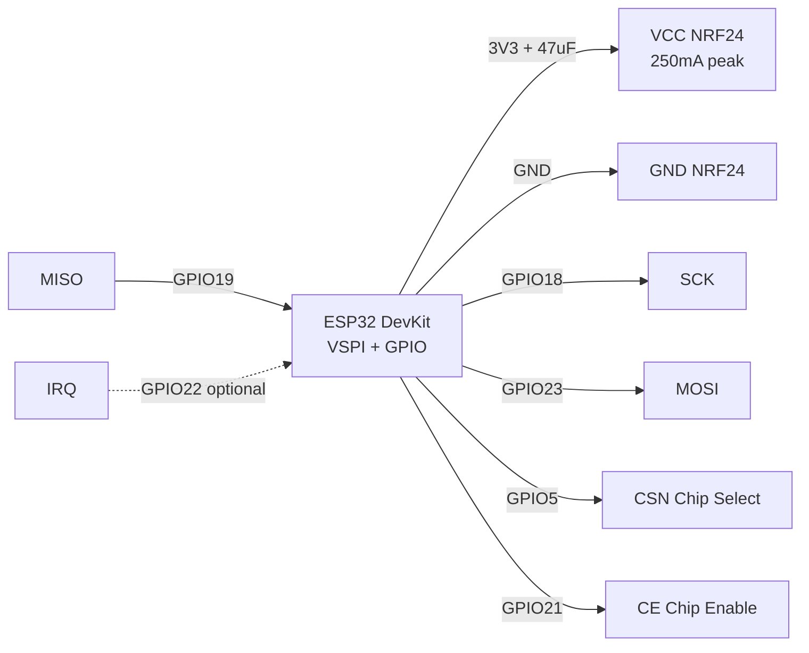
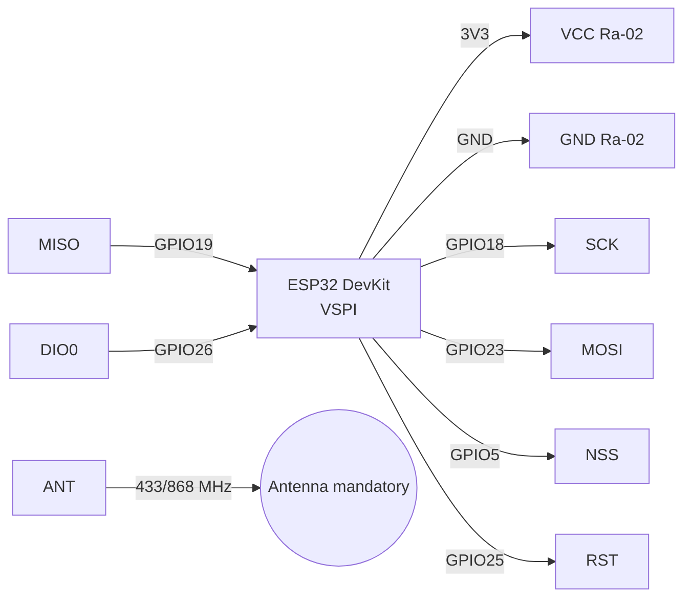

# NRF24L01+ and LoRa SX1276 (Ra-02)

> [!warning] Both modules - 3.3V only! NRF24 with PA+LNA draws up to 250 mA in TX - needs 10 µF capacitor. LoRa without antenna DO NOT turn on - output stage will burn!

Radio overview: [[EN/05-Radio/01-WiFi-STA-AP.en]], bus [[EN/04-Interfaces/02-SPI.en|SPI]], power supply [[EN/02-Power-Supply/01-Power-Rails.en]], pins [[EN/03-GPIO/01-GPIO-Overview.en]], diagnostics [[EN/99-Additions/02-Troubleshooting-FAQ.en]], start [[EN/Home.en]].

## Purpose

NRF24L01+ and LoRa SX1276 (Ra-02) - NRF24L01+PA+LNA; NRF24L01 module pin legend; connecting ESP32 to NRF24. Both modules - 3.3V only! NRF24 with PA+LNA draws up to 250 mA in TX - needs 10 uF capacitor. LoRa without antenna DO NOT turn on - output stage will burn! Radio overview: [[EN/05-Radio/01-WiFi-STA-AP.en]], bus [[EN/04-Interfaces/02-SPI.en|SPI]], power supply [[EN/02-Power-Supply/01-Power-Rails.en]], pins [[EN/03-GPIO/01-GPIO-Overview.en]], diagnostics [[EN/99-Additions/02-Troubleshooting-FAQ.en]], start Home.

## 1. NRF24L01+PA+LNA

Specifications: 2.4 GHz, Enhanced ShockBurst, 250 kbps/1M/2M, PA+LNA + external antenna, range up to 1 km at 250 kbps in line of sight.
Power: 1.9-3.6V, peak 250 mA (PA+LNA). DevKit regulator cannot handle peaks - place electrolytic 10-47 µF + ceramic 100 nF directly on VCC/GND pins of module. Adapter board with AMS1117-3.3 for NRF24 - recommended solution.

![[assets/img/nrf24-wiring.png|500]]
*Fig. NRF24L01+PA+LNA - connection over SPI, 10-100 uF capacitor directly on VCC/GND.*

### Module pin legend NRF24L01

| Pin | Label | Type | To ESP32 | Note |
| --- | --- | --- | --- | --- |
| 1 | VCC | Power input | 3V3 (better via AMS1117-3.3 adapter from 5V) | 3.3V only! 250 mA peak in PA+LNA - built-in DevKit LDO sags without capacitor |
| 2 | GND | Ground | GND | Common ground, short thick wires |
| 3 | CE | Digital input | GPIO21 (any GPIO) | Chip Enable: HIGH = TX/RX mode, LOW = standby; this is not Chip Select |
| 4 | CSN | CS input, active low | GPIO5 (CS) | Chip Select Not: LOW during SPI transaction; `RF24(CE, CSN)` |
| 5 | SCK | SPI input | GPIO18 (VSPI SCK) | SPI clock up to 10 MHz |
| 6 | MOSI | SPI input | GPIO23 (VSPI MOSI) | ESP32 to NRF24 |
| 7 | MISO | SPI output | GPIO19 (VSPI MISO) | NRF24 to ESP32 |
| 8 | IRQ | Output, active low | GPIO22 or leave unconnected | TX_DS / RX_DR / MAX_RT interrupt; can poll without it |

CE vs CSN - what's the difference:

- **CSN (Chip Select Not)** - standard SPI bus CS, see [[EN/04-Interfaces/02-SPI.en|SPI]]. Active LOW only during `SPI.transfer()` bytes. One per device on the bus.
- **CE (Chip Enable)** - Nordic radio state machine control: `LOW` = standby/sleep, `HIGH >10 us` pulse = start TX, steady `HIGH` = RX mode. That is why the library takes two pins: `RF24 radio(CE, CSN)`.
- Typical error - swap them: then initialization passes, but `write()` always `false`.

Why a 10-100 µF capacitor is needed:

1. PA (power amplifier) takes a pulse ~250 mA over microseconds - DevKit LDO with slow response sags to 2.6V and chip restarts.
2. Electrolytic 10-47 µF (for PA+LNA better 47-100 µF) + ceramic 100 nF soldered/inserted directly on VCC-GND module, pins as short as possible.
3. Without capacitor symptoms: `TX fail`, "radio sees registers but does not transmit", range 2 m instead of 500 m.
4. Ideal - NRF24 adapter board with AMS1117-3.3: powered from 5V, gives clean 3.3V with current reserve, already has electrolytics.

Standard NRF24 vs PA+LNA:

- **Standard (PCB antenna):** TX current ~12 mA, range 30-100 m, works from DevKit 3V3, 10 µF sufficient.
- **PA+LNA (external SMA antenna):** TX current up to 250 mA, range up to 1 km at 250 kbps, mandatory 47-100 µF or adapter, start with `RF24_PA_LOW`/`RF24_PA_MIN`, otherwise sag.
- Powering PA+LNA from ESP32 3V3 without capacitor - main reason "does not work" on forums. Power is power, and logic levels in both - 3.3V, see [[EN/02-Power-Supply/01-Power-Rails.en]] and [[EN/03-GPIO/01-GPIO-Overview.en]].

### Connecting ESP32 to NRF24

| ESP32 | NRF24L01 | Note |
| --- | --- | --- |
| 3V3 | VCC | 3.3V + 10 uF cap, not 5V |
| GND | GND | common ground |
| GPIO18 | SCK | VSPI SCK |
| GPIO23 | MOSI | VSPI MOSI |
| GPIO19 | MISO | VSPI MISO |
| GPIO5 | CSN | Chip Select |
| GPIO21 | CE | Chip Enable, any GPIO |
| GPIO22 | IRQ | optional, active low |

### ASCII schematic (NRF24)

```text
ESP32 DevKit          NRF24L01+PA+LNA
────────────          ───────────────
3V3 ───────────────►  VCC (3.3V! + 47мкФ між VCC і GND прямо на модулі)
GND ────────────────  GND
GPIO18 (SCK) ──────►  SCK
GPIO23 (MOSI) ─────►  MOSI
GPIO19 (MISO) ◄─────  MISO
GPIO5  (CSN) ──────►  CSN
GPIO21 (CE) ───────►  CE
GPIO22 ────────────◄  IRQ (опційно, можна NC)
                      ANT ──► антена 2.4 ГГц SMA (для PA+LNA обов'язково накрутити!)

Конденсатор: (+) до VCC, (-) до GND, ноги < 5 мм
RF24 radio(21, 5); SPI.begin(18, 19, 23, 5);
```

### Mermaid (NRF24)



## 2. LoRa SX1276 Ra-02

Specifications: SX1276, frequencies 433 / 868 / 915 MHz (board version is fixed!), power up to +20 dBm, sensitivity -148 dBm, LoRa + FSK/OOK.
Antenna is mandatory before TX! Without an antenna or with an antenna for the wrong frequency - VSWR > 3, PA overheating. Power supply 3.3V, TX ~120 mA, RX ~12 mA.
Frequencies in Ukraine: 433.05-434.79 MHz license-free (10 mW), 868 MHz - EU 863-870 MHz. Do not confuse Ra-02 433 vs 868 versions.

### SX1278 / E32 / E22 - UART modules with firmware

| Item | What it is | Difference from bare Ra-02 |
| --- | --- | --- |
| SX1278 | Same die as SX1276, but 433 MHz version only | Cheaper; for new projects there is no difference with 1276 - take whatever is available |
| E32-433T20D / E22-900T22S (Ebyte) | LoRa modem with UART and AT-like commands | No need to write a LoRa stack: bytes sent into UART fly out into the air; M0-M3 modes by jumper |
| When to take Ebyte | Point-to-point without LoRaWAN: two modules with identical parameters (frequency/channel/address) see each other out of the box |

![[assets/img/lora-ra02-scheme.png|500]]
*Fig. LoRa Ra-02 - SPI connection + DIO0/RST, antenna for your frequency mandatory before enabling TX.*

### Module pin legend LoRa Ra-02

| Pin | Label | Type | To ESP32 | Note |
| --- | --- | --- | --- | --- |
| 1 | VCC | Power supply | 3V3 ESP32 | 3.3V only, TX ~120 mA - 10 uF on power rail recommended |
| 2 | GND | Ground | GND | Ground + antenna shield, common with ESP32 |
| 3 | SCK | SPI input | GPIO18 | SPI SCK |
| 4 | MOSI | SPI input | GPIO23 | SPI MOSI |
| 5 | MISO | SPI output | GPIO19 | SPI MISO |
| 6 | NSS | CS input | GPIO5 | LoRa Chip Select (analog of CSN in NRF24) |
| 7 | RST | Reset input | GPIO25 | SX1276 reset, active low |
| 8 | DIO0 | Digital output | GPIO26 | RX Done / TX Done interrupt - mandatory for the LoRa library |
| 9 | DIO1 | Digital output | NC or GPIO | FIFO Level / CadDetected - not needed for the basic example |
| 10 | DIO2 | Digital output | NC or GPIO | FHSS / CadDone - not needed for the basic example |
| 11 | ANT | RF output | 433 or 868 MHz antenna | Connect BEFORE the first `LoRa.begin()`! TX without antenna burns the PA |

Explanation of DIO and antenna:

- **NSS vs DIO0:** NSS selects the chip on SPI (like CSN), while DIO0 signals "packet received/transmitted". Without DIO0 the Sandeep Mistry library hangs in `endPacket()`. So DIO0 is mandatory, while DIO1/DIO2 are optional.
- **RST:** SX1276 resets on a low pulse in `LoRa.setPins(NSS, RST, DIO0)`. Do not hang RST on ESP32 strapping pins (GPIO0/2/12/15).
- **Antenna is mandatory:** a +20 dBm (100 mW) transmitter without load reflects power back into the PA - overheating and degradation. Rule: screw on the antenna, then power, then TX. Antenna strictly for the board frequency: a 433 MHz antenna on an 868 MHz board = meters of range and VSWR > 3.
- **Power supply:** stable 3.3V, TX peaks 120 mA - DevKit is enough, but a 10-47 uF electrolytic will not hurt. 3.3V logic directly to ESP32, see [[EN/03-GPIO/01-GPIO-Overview.en]].

### Connecting ESP32 to Ra-02

| ESP32 | Ra-02 SX1276 | Note |
| --- | --- | --- |
| 3V3 | 3.3V | 3.3V only |
| GND | GND | ground + antenna shield |
| GPIO18 | SCK | SPI SCK |
| GPIO23 | MOSI | SPI MOSI |
| GPIO19 | MISO | SPI MISO |
| GPIO5 | NSS | CS |
| GPIO26 | DIO0 | RX/TX done interrupt |
| GPIO25 | RST | reset |
| - | ANT | 433 or 868 MHz antenna, mandatory! |

### ASCII schematic (LoRa Ra-02)

```text
ESP32 DevKit          Ra-02 SX1276
────────────          ────────────
3V3 ───────────────►  VCC (3.3V)
GND ────────────────  GND
GPIO18 ────────────►  SCK
GPIO23 ────────────►  MOSI
GPIO19 ◄────────────  MISO
GPIO5 ─────────────►  NSS
GPIO25 ────────────►  RST
GPIO26 ◄────────────  DIO0 (обов'язково!)
                      DIO1 ── NC (опційно)
                      DIO2 ── NC (опційно)
                      ANT ──► антена 433/868 МГц (ДО вмикання!)

LoRa.setPins(5, 25, 26); SPI.begin(18, 19, 23, 5);
```

### Mermaid (LoRa Ra-02)



## Code

### NRF24 Arduino (RF24)

```cpp
#include <SPI.h>
#include <RF24.h>
RF24 radio(21, 5); // CE, CSN
const byte addr[6] = "ESP32";
void setup() {
  Serial.begin(115200);
  SPI.begin(18, 19, 23, 5);
  radio.begin();
  radio.setPALevel(RF24_PA_LOW); // почати з LOW, HIGH лише з добрим живленням
  radio.setDataRate(RF24_250KBPS);
  radio.openWritingPipe(addr);
}
void loop() {
  const char msg[] = "hello";
  bool ok = radio.write(&msg, sizeof(msg));
  Serial.println(ok ? "TX ok" : "TX fail");
  delay(500);
}
```

### NRF24 MicroPython (nrf24l01.py)

```python
from machine import Pin, SPI
from nrf24l01 import NRF24L01
spi = SPI(2, sck=Pin(18), mosi=Pin(23), miso=Pin(19))
radio = NRF24L01(spi, Pin(5), Pin(21), payload_size=32)
radio.open_tx_pipe(b"ESP32")
radio.send(b"hello")
```

### LoRa Arduino (LoRa by Sandeep Mistry)

```cpp
#include <SPI.h>
#include <LoRa.h>
#define NSS 5
#define RST 25
#define DIO0 26
void setup() {
  Serial.begin(115200);
  SPI.begin(18, 19, 23, NSS);
  LoRa.setPins(NSS, RST, DIO0);
  if (!LoRa.begin(433E6)) { Serial.println("LoRa init fail"); while(1); }
  LoRa.setSpreadingFactor(9);
  LoRa.setSignalBandwidth(125E3);
  LoRa.setCodingRate4(5);
}
void loop() {
  LoRa.beginPacket(); LoRa.print("hello"); LoRa.endPacket();
  delay(2000);
}
```

### LoRa MicroPython (sx127x)

```python
from machine import Pin, SPI
from sx127x import SX127x
spi = SPI(2, baudrate=8000000, sck=Pin(18), mosi=Pin(23), miso=Pin(19))
lora = SX127x(spi, pins={"ss":5, "reset":25, "dio0":26}, parameters={"frequency":433e6})
lora.send(b"hello")
```

### ESP-IDF (NRF24 / LoRa)

```c
// NRF24: esp-idf-nrf24 (nrf24_init(VSPI_HOST, CE=21, CSN=5)), LoRa: sx1276 driver
// LoRa: lora_init({spi_host=VSPI_HOST, nss=5, rst=25, dio0=26, freq=433e6})
```

### Range and stability tips

1. NRF24: start with `RF24_PA_MIN`, a channel away from WiFi (e.g. 108), 250 kbps speed for range.
2. NRF24 PA+LNA: antenna screwed in fully, PSU with margin, `setPALevel(HIGH/MAX)` only after the capacitor.
3. LoRa: SF9/BW125 for balance, SF12 for maximum range; antenna vertical, away from metal.
4. Both modules - SPI, see [[EN/04-Interfaces/02-SPI.en|SPI]]; do not share one CS between NRF24 and LoRa; power supply - [[EN/02-Power-Supply/01-Power-Rails.en]].
5. Two radios on one board: keep antennas at least 10 cm apart, do not enable TX at the same time.

| Symptom | Cause | Solution |
| --- | --- | --- |
| NRF24 TX always fails | no cap / weak 3.3V | 10-47 uF on module, PA_LOW first |
| LoRa init fail | swapped NSS/RST/DIO0, wrong frequency | verify pinout, Ra-02 433/868 marking |
| Short range | 2.4 GHz antenna on 433 MHz and vice versa | antenna for its frequency, ground counterpoise |
| NRF24 heats up / reboots ESP32 | PA+LNA without adapter | AMS1117-3.3 adapter from 5V 1A |
| LoRa hangs on endPacket | no DIO0 | connect DIO0 to GPIO26 |

## Official sources

- [SX1276 - datasheet and documents (Semtech)](https://www.semtech.com/products/wireless-rf/lora-connect/sx1276) - LoRa modem, link budget, photo.
- [ESP32 + LoRa - tutorial with code (RNT)](https://randomnerdtutorials.com/esp32-lora-rfm95-transceiver-arduino-ide/) - Sender/Receiver, antenna mandatory.
- [nRF24L01+ - breakdown with photo and code (LME)](https://lastminuteengineers.com/nrf24l01-arduino-wireless-communication/) - Multiceiver, capacitor on power supply.
- nRF24L01 (nordicsemi.com) - *verify manually*: site blocks automated requests, search "nRF24L01 Product Specification".

## See also

- [[EN/Home.en]]
- [[EN/04-Interfaces/01-UART.en|UART]]
- [[EN/04-Interfaces/02-SPI.en|SPI]]
- [[EN/02-Power-Supply/01-Power-Rails.en]]
- [[EN/03-GPIO/01-GPIO-Overview.en]]
- [[EN/05-Radio/01-WiFi-STA-AP.en]]
- [[EN/12-Comm-Modules/01-RC522-RFID.en]]
- [[EN/12-Comm-Modules/02-NRF24-LoRa.en]]
- [[EN/12-Comm-Modules/03-SIM800L-GPS.en]]
- [[EN/12-Comm-Modules/04-RS485-CAN-Ethernet-Kamera.en]]
- [[EN/99-Additions/01-Pinout-tablici.en]]
- [[EN/99-Additions/02-Troubleshooting-FAQ.en]]
