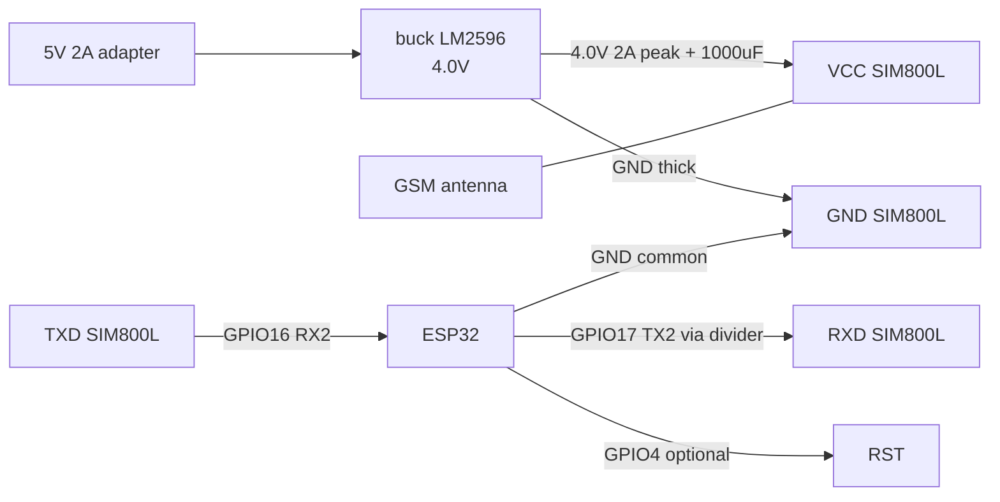
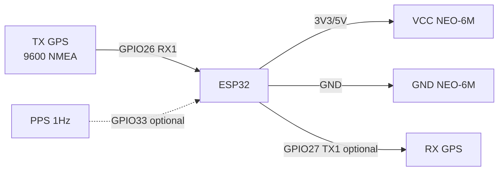
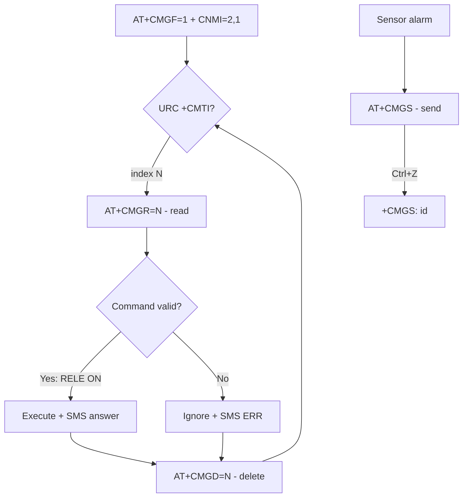
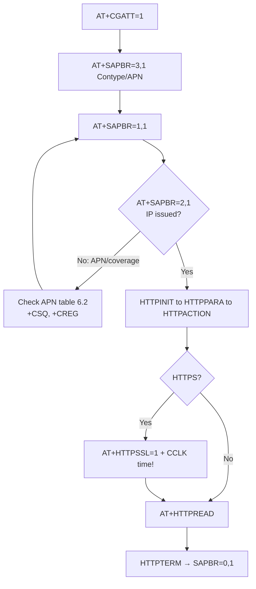
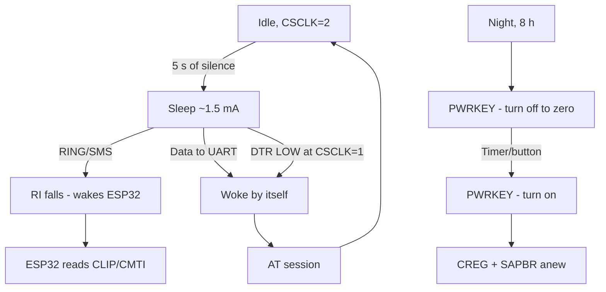

# SIM800L GSM + NEO-6M GPS

> [!danger] Do not power SIM800L from 5V and not from ESP32 3.3V! Norm: 3.7-4.2V, 2A peak in TX burst. Without strong power - eternal reboots and the network never registers.

Context: UART see [[EN/04-Interfaces/01-UART.en|UART]], power supply [[EN/02-Power-Supply/01-Power-Rails.en]] and [[EN/13-Power-Modules/01-Buck-Boost-Solar.en]], levels [[EN/13-Power-Modules/02-Level-Shifters.en]], pins [[EN/99-Additions/01-Pinout-tablici.en]], diagnostics [[EN/99-Additions/02-Troubleshooting-FAQ.en]], start [[EN/Home.en]].

## Purpose

SIM800L GSM + NEO-6M GPS - SIM800L power supply (most important); SIM800L module pin legend; ASCII schematic (SIM800L). Do not power SIM800L from 5V and not from ESP32 3.3V! Norm: 3.7-4.2V, 2A peak in TX burst. Without strong power - eternal reboots and the network never registers. Average current 200-500 mA, TX peak up to 2A (577 us slot).

## 1. SIM800L power supply (most important)

- SIM800L chip: 3.4-4.4V (nominal 4.0V). 5V is death. 3.3V is instability.
- Average current 200-500 mA, TX peak up to 2A (577 us slot).
- Recommended schematic: 5V 2A adapter -> LM2596 buck set to 4.0V -> 1000 uF low-ESR electrolytic + 100 nF ceramic near SIM800L. Schottky diode against reverse polarity.
- Power wires thick and short (<10 cm). Ground common with ESP32.
- NET LED: blinks 1 time/sec - no network, 1 time/3 sec - registered.

![[assets/img/sim800l-power-4v.png|500]]
*Fig. SIM800L - 4.0V 2A power via LM2596 buck + 1000 uF, UART crossed to ESP32.*

### Module pin legend SIM800L

The small blue SIM800L board has a header: VCC, RST, RXD, TXD, GND + separate NET (indication), MIC/SPK (audio), ANT (U.FL for GSM antenna) pins.

| Pin | Marking | Type | Where on ESP32 / power | Note |
| --- | --- | --- | --- | --- |
| 1 | VCC | 3.4-4.4V power, 2A peak | LM2596 buck output set to 4.0V | not 5V (breakdown!) and not ESP32 3.3V (sags, reboots); + 1000 uF low-ESR electrolytic + 100 nF near the pin |
| 2 | RST | Reset input, active low | GPIO4 or button to GND | LOW pulse >100 ms = restart; in operation pulled to HIGH |
| 3 | RXD | UART input | GPIO17 (ESP32 TX2) via divider | ESP32 TX to SIM800L RX: 1k/2k or 2k/3.3k divider, or level-shifter, see [[EN/13-Power-Modules/02-Level-Shifters.en]] |
| 4 | TXD | UART output | GPIO16 (ESP32 RX2) directly | SIM800L TX to ESP32 RX crossed; ~2.8V level - ESP32 reads as HIGH without issues |
| 5 | GND | Ground | ESP32 GND + buck GND | Common thick ground, wires <10 cm, ground star |
| 6 | NET | Indication output | LED on board / GPIO input (optional) | Blinking: 1 Hz = network search, 1 time/3 s = registered |
| 7 | MIC_P / MIC_N | Analog input | Electret microphone | for calls, usually NC in IoT |
| 8 | SPK_P / SPK_N | Analog output | 8 Ohm speaker | for calls, usually NC in IoT |
| 9 | ANT | RF | GSM antenna (U.FL or terminal) | without antenna it never registers, TX at full power heats up |

Why not 5V and not 3.3V:

1. **Not 5V:** absolute chip maximum 4.4V. Applying 5V breaks the RF amplifier - the module heats and dies in seconds. Exception - only the red EVB board with its own regulator and micro-USB: it can take 5V, because a buck sits on the board. Check your version visually!
2. **Not ESP32 3.3V:** chip lower limit 3.4V, but in a 2A TX burst the sag on thin DevKit traces reaches 0.3-0.5V, giving 2.8V on the chip, causing brownout and restart exactly at network registration. Classic symptom: "AT OK, but AT+CREG never 0,1".
3. **Correct:** a separate LM2596 buck (or MP1584) from a 5V 2A adapter, exactly 4.0V output under load, 1000 uF low-ESR electrolytic + 100 nF ceramic near SIM800L, thick short wires, see [[EN/02-Power-Supply/01-Power-Rails.en]] and [[EN/13-Power-Modules/01-Buck-Boost-Solar.en]].
4. **UART crossed:** module TX to ESP32 RX, module RX to ESP32 TX. Default speed 115200, see [[EN/04-Interfaces/01-UART.en|UART]]. SIM800L RX is not 5V-tolerant - divider mandatory.
5. **AT messages:** after `AT+CMGF=1` and `AT+CMGS` the module answers `>` and waits for text + Ctrl+Z (0x1A). Run long AT sessions via a Serial to Serial2 bridge for debugging.

| ESP32 | SIM800L | Note |
| --- | --- | --- |
| - (LM2596 4.0V) | VCC | 4.0V 2A + 1000 uF, not 5V/3.3V |
| GND | GND | common thick ground |
| GPIO16 (RX2) | TX | SIM800L TX -> ESP32 RX, divider/level-shift if 5V board version |
| GPIO17 (TX2) | RX | ESP32 TX -> SIM800L RX via 2k/3.3k or 1k/2k divider |
| GPIO4 | RST | optional, active low |
| - | ANT | GSM antenna, without it never registers |

> The red SIM800L EVB board with micro-USB has its own regulator, it can take 5V. The small blue board without regulator - only 4V! Check your version.

### ASCII schematic (SIM800L)

```text
Живлення SIM800L (обов'язково окремо!):
  5V 2A адаптер ──► [buck LM2596] ──(4.0V)──► VCC SIM800L
                                          ├─► 1000мкФ low-ESR (+) до VCC, (-) до GND
                                          └── 100нФ кераміка прямо на пінах

ESP32 DevKit          SIM800L (синя плата)
────────────          ───────────────────
GND ────────────────  GND (товстий провід <10 см, спільна з buck!)
GPIO16 (RX2) ◄──────  TXD (безпосередньо)
GPIO17 (TX2) ──[1к]──► RXD
                      [2к] від RXD до GND (дільник 5V→3.3V)
GPIO4 ─────────────►  RST (опційно)
                      ANT ──► GSM-антена (обов'язково!)
                      NET ──► LED блимає 1/3с = OK

Serial2.begin(115200, SERIAL_8N1, 16, 17);
```

### Mermaid (SIM800L)



## 2. Basic AT commands

```text
AT                  -> OK (зв'язок)
AT+CPIN?            -> READY (SIM-карта)
AT+CSQ              -> рівень сигналу 0-31 (норма >10)
AT+CREG?            -> 0,1 зареєстровано home; 0,5 роумінг
AT+COPS?            -> оператор
AT+CBC              -> напруга живлення SIM800L
AT+CMGF=1           -> текстовий режим SMS
AT+CMGS="+380..."   -> відправка SMS (далі текст + Ctrl+Z)
AT+SAPBR=3,1,"APN","internet" -> налаштування GPRS
AT+HTTPINIT / AT+HTTPPARA / AT+HTTPACTION=0 -> HTTP GET
```

### Summary cheat sheet (single base format: command → answer → meaning → error)

Details of each group are in sections 4-9; the full 35-command cheat sheet (EC200U/A7670) is in [[EN/12-Comm-Modules/18-Cellular-LoRa-2.en]], the basic 4G table - in [[EN/12-Comm-Modules/07-SIM7600-W5500-MCP2515.en]].

| Command | OK answer | What it means | Typical error |
| --- | --- | --- | --- |
| `AT` | `OK` | UART link | Silence: baud 115200? RX/TX crossed? |
| `AT+CPIN?` | `+CPIN: READY` | SIM ready | `SIM PIN`: `AT+CPIN="1234"`; IoT - remove CLCK (sec. 1 of note 26) |
| `AT+CSQ` | `+CSQ: 18,0` | Level, norm >10 | 99,99: antenna/screen/basement |
| `AT+CREG?` | `+CREG: 0,1` | Home registration | 0,2: power/antenna/PIN; NET blinking 1/s |
| `AT+CBC` | `+CBC: 0,95,4100` | VBAT ~4100 mV | <3600: wires/buck/capacitor (sec. 5 of note 26) |
| `AT+CMGF=1` | `OK` | SMS text mode | without it `CMGS` gives ERROR (sec. 4) |
| `AT+CMGS="..."` + text + `0x1A` | `+CMGS: id` | SMS sent | `+CMS ERROR 305`: memory/network; Cyrillic - PDU (sec. 4) |
| `ATD+380...;` | `OK` | Voice call | without `;` - data call/silence (sec. 5) |
| `AT+CUSD=1,"*101#"` | URC `+CUSD` in 2-10 s | USSD balance | Empty: repeat; Cyrillic - UCS2-hex (sec. 6) |
| `AT+SAPBR=1,1` | `OK` | Bearer open | ERROR: APN literally from table 6.2; first `CGATT=1` (sec. 7) |
| `AT+HTTPACTION=0` | `+HTTPACTION: 0,200,N` | HTTP OK, N bytes | 601: URL/SSL/`CCLK` time (sec. 7) |
| `AT+CSCLK=2` | `OK` | Autosleep | does not wake: pull DTR (sec. 9) |

## 3. NEO-6M GPS

Specifications: u-blox NEO-6M, UART 9600 NMEA, cold start ~30 s, hot ~5 s, ceramic antenna + optional active. Power 3.3-5V (the board has an LDO), logic 3.3V tolerant to ESP32 directly.

![[assets/img/neo6m-uart.png|500]]
*Fig. NEO-6M - UART to ESP32 crossed (module TX to controller RX), PPS optional.*

### Module pin legend NEO-6M GPS

| Pin | Label | Type | To ESP32 | Note |
| --- | --- | --- | --- | --- |
| 1 | VCC | 3.3-5V power | 3V3 or 5V per board marking | the GY-GPS6MV2 board has an LDO - it can take 5V; logic is still 3.3V |
| 2 | GND | Ground | GND | Common ground with ESP32 |
| 3 | TX | UART 9600 NMEA output | GPIO26 (ESP32 RX1) | Module TX to ESP32 RX crossed! NMEA $GPGGA/$GPRMC stream |
| 4 | RX | UART input | GPIO27 (ESP32 TX1) or NC | ESP32 TX to GPS RX; needed only for u-blox configuration (can be left unconnected) |
| 5 | PPS | 1 Hz digital output | Any GPIO with interrupt (optional) | Exact second pulse for time sync, ~100 ms wide |

Explanation:

- **Module TX to ESP32 RX:** the main UART rule, see [[EN/04-Interfaces/01-UART.en|UART]]. GPS only transmits NMEA, so the minimal schematic is 4 wires: VCC, GND, TX to RX. GPS RX can be left free.
- **PPS:** exact-second pulse from satellites (jitter ~tens of ns). Used for RTC sync or timestamps. Without PPS time is taken from the `$GPRMC` NMEA sentence.
- **Antenna:** the ceramic square on the board works only with sky view; indoors - an outdoor active antenna with 3.3V power over coax. Cold start with sky view 30 s - 15 min.
- **Two UARTs at once:** SIM800L on Serial2 (16/17), GPS on Serial1 (26/27). Do not hang both on one UART - NMEA drowns AT answers.

| ESP32 | NEO-6M | Note |
| --- | --- | --- |
| 3V3 or 5V | VCC | per board marking (usually 3.3-5V) |
| GND | GND | common ground |
| GPIO16 (RX2) | TX | GPS TX -> ESP32 RX |
| GPIO17 (TX2) | RX | for u-blox configuration, can be left unconnected |
| - | PPS | optional, exact 1 Hz pulse |

> Two UART devices at once: SIM800L on Serial2 (16/17), GPS on Serial1 (e.g. RX=26 TX=27) or software. Do not hang both on one UART.

### ASCII schematic (NEO-6M)

```text
ESP32 DevKit          NEO-6M GPS
────────────          ──────────
3V3 (або 5V) ──────►  VCC (за маркуванням плати)
GND ────────────────  GND
GPIO26 (RX1) ◄──────  TX (9600 NMEA, перехресно!)
GPIO27 (TX1) ──────►  RX (опційно, для конфігу u-blox)
GPIO33 ────────────◄  PPS (опційно, 1 Гц)

gpsSer.begin(9600, SERIAL_8N1, 26, 27);
Вид неба обов'язковий! У приміщенні — активна антена.
```

### Mermaid (NEO-6M)



### Comparing NEO-6M vs 7/8/M10: what to take in 2026

| Module | Satellites | Cold start | Current | Price (landmark) | Verdict |
| --- | --- | --- | --- | --- | --- |
| NEO-6M | GPS+SBAS (72 channels) | ~30 s (with sky) | ~40 mA | $5-8 | Classic for learning; for a product - outdated |
| NEO-7M | GPS+GLONASS | ~25 s | ~35 mA | $7-10 | GLONASS helps in the city, but rare |
| NEO-8M (M8N) | GPS+GLONASS+BeiDou+Galileo | ~20 s | ~30 mA | $10-15 | **Golden middle**: 3 constellations, PPS, same footprint |
| NEO-M10 (M10Q) | 4 constellations, L1 | ~15 s + low consumption | ~20 mA | $15-25 | Battery trackers; I2C+UART, tiny 9.7x10.1 mm |
| ZED-F9P | L1+L2, RTK | centimeters with corrections | ~70 mA | $150+ | Geodesy, see [[EN/12-Comm-Modules/17-GNSS-RTK.en]] |

> NEO-6M/7M/8M pins on GY-GPSxx boards are compatible (VCC/GND/TX/RX/PPS) - upgrade by re-soldering without firmware change. M10Q is a different footprint (Qwiic), but eats half.

### Cold / warm / hot start + V_BCKP battery

| Start | What is kept | Time to fix | When |
| --- | --- | --- | --- |
| Cold | Nothing (first power-on, move >500 km) | 30 s - 15 min | out of the box, after a month without power |
| Warm | Almanac + approximate time | 5-30 s | V_BCKP alive, a day without sky |
| Hot | Ephemeris + time + position | 1-5 s | Short sleep, 5 min tunnel |

```text
V_BCKP (резервне живлення RTC+SRAM приймача):
  NEO-6M плата GY-GPS6MV2 ──► пін V_BCKP (якщо виведений) ──► CR1220/ML414 через діод
  або суперкап 0.22 Ф: тримає теплий start ~2–7 діб без основного живлення.
  Без V_BCKP кожне ввімкнення = холодний start = 30+ с очікування в полі!
```

### AssistNow (AGPS): ephemeris over internet

Instead of waiting for ephemeris from the sky (full almanac 12.5 min!) - pour over UART:

```text
1. Скачати AssistNow Online (u-blox сервер) або Offline (3–14 діб прогнозу).
2. Залити бінарник у приймач UBX-пакетом (115200 бод, RX GPS підключений!).
3. Холодний start стискається до 3–10 с.
For ESP32 practice: ESP32 downloads the file over WiFi/GPRS (sections 7-8) and pours it into GPS.
Payback: a tracker that wakes once an hour - only with AssistNow or M10.
```

### PPS time sync (accuracy without NTP)

PPS is a second pulse with tens-of-ns jitter (vs milliseconds in NTP over WiFi!):

```cpp
// Arduino: мітка точної секунди за PPS + добивка часу з RMC
volatile unsigned long ppsMicros = 0;
void IRAM_ATTR onPPS() { ppsMicros = micros(); }
void setup() {
  pinMode(33, INPUT);
  attachInterrupt(33, onPPS, RISING);  // PPS від NEO-6M/M8N
}
// У loop: коли TinyGPS++ розпарсив RMC (година:хв:сек) — прив'язати до ppsMicros.
// Точність міток: ±1 мс без зусиль (обмеження — джиттер loop, не PPS).
// Для TLS/HTTPS через модем цього досить; для науки — input capture таймера.
```

## 4. SMS in detail: Text vs PDU, reading, deletion, URC

### 4.1. Two modes: Text (Latin) vs PDU (Cyrillic)

| Mode | Command | What it can | Limit |
| --- | --- | --- | --- |
| Text | `AT+CMGF=1` | Simple ASCII SMS, readable commands | Only GSM 7-bit (Latin, digits); Cyrillic - mojibake |
| PDU | `AT+CMGF=0` | Any alphabet via UCS2-hex, long/concatenated | Must encode/decode PDU (online encoders or a library) |
| Encoding | `AT+CSCS?` | `"GSM"` by default; `"UCS2"` for hex text in Text mode | After `AT+CSCS="UCS2"` the number is also hex: `AT+CMGS="002B0033..."` |

Practical rule: Latin/translit notifications - Text mode; Cyrillic to the client - PDU or UCS2-hex. Translit in emergency SMS is normal engineering practice (delivery matters more than beauty).

### 4.2. Sending SMS step by step (Text mode)

```text
AT+CMGF=1            -> OK (текстовий режим)
AT+CSCS="GSM"        -> OK (кодування)
AT+CMGS="+380971234567"
>                    <- module чекає текст (запрошення ">")
ALARM: temp 85C!     <- текст, БЕЗ Enter зайвого
<Ctrl+Z 0x1A>        -> +CMGS: 12 / OK (надіслано, номер в архіві)
<Esc 0x1B>           -> скасувати набір (якщо передумав після ">")
```

> After `>` wait no more than 10-15 s: the module returns to command mode by itself. Long pauses between text characters - the module decides this is the end and sends it truncated.

### 4.3. Reading, deletion, memory, new messages

```text
AT+CPMS?             -> +CPMS: "SM",3,50,"SM",3,50,"SM",3,50 (зайнято/всього)
AT+CPMS="SM","SM","SM" -> OK (сховище: SIM; альтернатива "ME" — пам'ять модуля)
AT+CMGL="ALL"        -> список усіх (повільно при 50 шт — краще "REC UNREAD")
AT+CMGR=2            -> прочитати №2 з індексом
AT+CMGD=2            -> видалити №2
AT+CMGD=1,4          -> видалити ВСІ (індекс ігнорується, прапор 4)
AT+CNMI=2,1,0,0,0    -> URC +CMTI при новій SMS (індекс одразу в події!)
```

> A SIM card usually holds 30-50 SMS. Overflow = new ones silently never arrive. In an autonomous device: after processing each incoming - `AT+CMGD`, plus once a day `AT+CMGD=1,4` as insurance.

### 4.4. Mermaid: SMS lifecycle



## 5. Voice calls: ATD/ATA/ATH, caller ID, auto-answer, audio

### 5.1. Call commands

```text
ATD+380971234567;    -> OK → дзвінок (крапка з комою ОБОВ'ЯЗКОВА = Voice режим!)
ATD+380971234567     -> без ";" = DATA-дзвінок (не те, буде помилка/тиша)
ATA                  -> підняти вхідний (після URC RING)
ATH                  -> покласти трубку (свою або чужу)
AT+CLIP=1            -> АОН: вхідний RING йде з +CLIP: "+380...",145
ATS0=2               -> автовідповідь після 2 гудків (0 = вимкнено)
AT+CHUP              -> альтернатива ATH (покласти)
```

Incoming parsing with caller ID:

```text
RING                          <- гудок 1
+CLIP: "+380971234567",145    <- хто дзвонить (при AT+CLIP=1)
RING                          <- гудок 2 …
```

> Number whitelist - in firmware: compare the `+CLIP` number with the NVS list, hang up strangers with `ATH` at once. A call as a free control channel: "a call from the owner number = open the gate, no need to call back" (detect on 1-2 RINGs and hang up ourselves - 0 UAH).

### 5.2. Audio: blue-board microphone/speaker

| Pin/command | Purpose | Setting |
| --- | --- | --- |
| MIC_P / MIC_N | Electret microphone | Capsule directly, the module gives power itself |
| SPK_P / SPK_N | 8 Ohm speaker | Differentially, do not seat one end on GND! |
| `AT+CMIC=0,10` | Microphone sensitivity (channel 0, level 0-15) | Pick: background/echo |
| `AT+CLVL=60` | Speaker volume 0-100 | 60 - initial value |
| `AT+CHFA=1` | Audio channel switch (headset/loudspeaker on EVB) | on the blue board usually one channel |

## 6. USSD and APN of Ukrainian operators

### 6.1. USSD requests

```text
AT+CUSD=1,"*101#"     -> OK, відповідь приходить URC:
+CUSD: 0,"Balans 45.20 UAH",15   <- текст (може бути UCS2-hex при AT+CSCS="UCS2")
AT+CUSD=1,"*101#",15  -> той самий запит з явним кодуванням GSM 7-bit (15)
AT+CUSD=2             -> скасувати активну USSD-сесію
```

> A USSD answer is not synchronous: it comes as a separate `+CUSD` in 2-10 s. The AT parser must handle URC in the middle of any wait. A Cyrillic answer in UCS2-hex - decode hex to UTF-16.

### 6.2. Operators of Ukraine: USSD portals and APN

| Operator | Balance/menu (USSD) | APN (GPRS) | Login/password | Note |
| --- | --- | --- | --- | --- |
| Kyivstar | `*111#` ("My Kyivstar" menu, balance there too) | `kyivstar` | empty | Old `www.kyivstar.net` is legacy, do not use |
| Vodafone UA | `*101#` (balance at once) | `internet` | empty | - |
| Lifecell | `*111#` (balance/menu) | `internet` | empty | - |

> APN is case- and space-sensitive: `"Internet"` is not `"internet"` - the network rejects the PDP context with an `AT+SAPBR=1,1` error. Copy from the table literally.

## 7. GPRS to HTTP/HTTPS: SAPBR sequence and SSL

### 7.1. Raising a GPRS session (order is strict!)

```text
AT+CGATT=1                              -> OK (attach до GPRS-мережі)
AT+SAPBR=3,1,"Contype","GPRS"            -> OK
AT+SAPBR=3,1,"APN","kyivstar"            -> OK (свій APN з таблиці 6.2!)
AT+SAPBR=1,1                             -> OK (відкрити bearer; чекати до 30 с)
AT+SAPBR=2,1                             -> +SAPBR: 1,1,"10.20.30.40" (IP видано!)
```

### 7.2. HTTP GET / POST with the built-in stack

```text
AT+HTTPINIT                              -> OK
AT+HTTPPARA="CID",1                      -> OK (прив'язка до bearer 1)
AT+HTTPPARA="URL","http://api.example.com/data?id=esp32_01" -> OK
AT+HTTPACTION=0                          -> OK, далі URC: +HTTPACTION: 0,200,142
AT+HTTPREAD                              -> +HTTPREAD: 142 <тіло відповіді>
AT+HTTPTERM                              -> OK (закрити HTTP)
AT+SAPBR=0,1                             -> OK (закрити bearer — економить трафік!)
```

POST with JSON:

```text
AT+HTTPPARA="URL","http://api.example.com/post" -> OK
AT+HTTPPARA="CONTENT","application/json"        -> OK
AT+HTTPDATA=48,10000                             -> DOWNLOAD (запрошення "DOWNLOAD")
{"id":"esp32_01","t":23.5}                       -> OK (48 байт тіла)
AT+HTTPACTION=1                                  -> +HTTPACTION: 1,200,16
```

### 7.3. HTTPS (SSL) - honestly about limits

```text
AT+HTTPSSL=1                             -> OK (увімкнути TLS для наступних HTTPACTION)
AT+HTTPPARA="URL","https://api.example.com/data" -> OK
AT+HTTPACTION=0                          -> +HTTPACTION: 0,200,...
```

| Question | Answer |
| --- | --- |
| Can SIM800 do HTTPS? | Yes, `AT+HTTPSSL=1`. TLS 1.0-1.2, old cipher set - some modern servers refuse the handshake |
| Own CA certificate | Download into the module file system (`AT+FSWRITE`), bind via SSL commands; procedure is bulky |
| Hostname check | Weak/absent - for critical data better your own gateway: ESP32 to HTTP to own server to HTTPS further |
| Time for TLS | Certificates validate by time: first `AT+CCLK?` must show real time (NITZ from network or `AT+CCLK="26/09/30,08:00:00+12"`) |

### 7.4. Mermaid: GPRS session



## 8. E-mail over GPRS (overview - better via gateway)

SIM800 has a built-in SMTP client (`AT+EMAILCID`, `AT+EMAILTO`, `AT+SMTPSRV`, `AT+SMTPAUTH`, `AT+SMTPSEND`). The sequence works, but:

1. Modern mailer auth (OAuth2, app-passwords) over an AT terminal is pain and tears.
2. Cyrillic in subject/body - manual encoding.
3. Any Gmail policy change - and the firmware in the field breaks.

> Engineering solution: ESP32 sends HTTP POST to its OWN server (section 7.2), and the server sends letters with a plain library (Python `smtplib`, Node `nodemailer`). The modem stays a dumb transport - an order more reliable.

## 9. Power consumption and sleep: CSCLK, DTR, PWRKEY

### 9.1. SIM800L modes

| Mode | Current (landmark) | How to enter | How to exit | When |
| --- | --- | --- | --- | --- |
| Active (TX burst) | up to 2000 mA peak | Call/GPRS traffic | End of traffic | Transfer |
| Idle registered | ~20 mA | Just wait | - | Duty |
| Sleep `AT+CSCLK=1` | ~1-2 mA | DTR HIGH + 5 s of silence | DTR LOW | Battery sensors |
| Sleep `AT+CSCLK=2` | ~1-2 mA | Automatically after 5 s of silence | Call/SMS/data over UART | Same without the DTR wire |
| Off | ~0 (tens of uA) | PWRKEY LOW 1-2 s | PWRKEY LOW 1-2 s | Deep duty |

```text
AT+CSCLK=0     -> OK (сон заборонено, за замовчуванням)
AT+CSCLK=1     -> OK (сон за рівнем DTR: HIGH = спати)
AT+CSCLK=2     -> OK (автосон: засне сам, прокинеться сам)
```

### 9.2. Sleep schematic with DTR and RI

```text
ESP32 DevKit          SIM800L
───────────          ───────
GPIO18 ────────────►  DTR (HIGH = "можна спати" при CSCLK=1)
GPIO19 ◄────────────  RI (прокидається LOW на 120 мс при дзвінку/SMS!)
GND ────────────────  GND
```

> There is NO PSM like in NB-IoT in SIM800 - do not look for it. Economy is built like this: `CSCLK=2` between sessions + full PWRKEY shutdown for hours (with a MOSFET power switch, see [[EN/13-Power-Modules/04-LDO-Buck-XL4015-Protect.en]]). The RI pin is the ESP32 alarm: woke up, read `+CLIP`/`+CMTI`.

### 9.3. Mermaid: sleep and wake-up



![[assets/img/sim800l-sms-call-scheme.png|600]]
*Fig. SIM800L as a notification terminal: SMS (Text/PDU), voice with whitelist, USSD balance, SAPBR GPRS session, sleep via DTR/RI.*

## Code (3 frameworks)

### Arduino - SIM800L AT + NEO-6M TinyGPS++

```cpp
#include <TinyGPS++.h>
TinyGPSPlus gps;
HardwareSerial sim(2); // RX=16 TX=17
HardwareSerial gpsSer(1); // RX=26 TX=27
void sendAT(const char* cmd, int wait=1000){
  sim.println(cmd); delay(wait);
  while(sim.available()) Serial.write(sim.read());
}
// Відправка SMS (Text-режим, латиниця/трансліт), розділ 4.2
bool smsSend(const char* num, const char* text){
  sim.println("AT+CMGF=1"); delay(300);
  sim.print("AT+CMGS=\""); sim.print(num); sim.println("\"");
  delay(500);
  if(!sim.find(">")) return false;   // немає запрошення — вихід
  sim.print(text); delay(300);
  sim.write(0x1A);                    // Ctrl+Z = відправити
  return sim.find("+CMGS:");          // чекаємо підтвердження
}
// Дзвінок-тривога з білим списком (розділ 5.1): дзвонимо самі
void alarmCall(const char* num){
  sim.print("ATD"); sim.print(num); sim.println(";"); // ";" = голос!
  delay(25000);                       // 25 с гудків
  sim.println("ATH");                 // покласти
}
void setup(){
  Serial.begin(115200); sim.begin(115200, SERIAL_8N1, 16, 17); gpsSer.begin(9600, SERIAL_8N1, 26, 27);
  delay(3000); sendAT("AT"); sendAT("AT+CSQ"); sendAT("AT+CREG?");
  sendAT("AT+CLIP=1");                // АОН для білого списку
  sendAT("AT+CNMI=2,1,0,0,0");        // URC нових SMS
}
void setup(){
  Serial.begin(115200); sim.begin(115200, SERIAL_8N1, 16, 17); gpsSer.begin(9600, SERIAL_8N1, 26, 27);
  delay(3000); sendAT("AT"); sendAT("AT+CSQ"); sendAT("AT+CREG?");
}
void loop(){
  while(gpsSer.available()) if(gps.encode(gpsSer.read())){
    if(gps.location.isValid()){ Serial.printf("LAT %.6f LON %.6f SAT %d\n", gps.location.lat(), gps.location.lng(), gps.satellites.value()); }
  }
  if(Serial.available()) sim.write(Serial.read()); // AT-міст з монітора
  if(sim.available()) Serial.write(sim.read());
}
```

### MicroPython - AT via UART + micropyGPS

```python
from machine import UART
import time
sim = UART(2, baudrate=115200, rx=16, tx=17)
gps = UART(1, baudrate=9600, rx=26, tx=27)
def at(cmd, wait=1):
    sim.write(cmd + "\r\n")
    time.sleep(wait)
    print(sim.read())
def sms_send(num, text):
    sim.write('AT+CMGF=1\r\n'); time.sleep(0.3)
    sim.write('AT+CMGS="%s"\r\n' % num); time.sleep(0.5)
    sim.write(text); time.sleep(0.3)
    sim.write(bytes([0x1A]))  # Ctrl+Z
    time.sleep(3)
    print(sim.read())
def ussd(code="*101#"):
    sim.write('AT+CUSD=1,"%s"\r\n' % code)
    time.sleep(8)  # відповідь приходить URC +CUSD із затримкою!
    print(sim.read())
at("AT"); at("AT+CSQ"); at("AT+CREG?")
at('AT+CLIP=1'); at('AT+CNMI=2,1,0,0,0')
while True:
    if gps.any(): print(gps.readline())
```

### ESP-IDF

```c
// uart_driver_install(UART_NUM_2, 2048, 2048, 0, NULL, 0);
// uart_set_pin(UART_NUM_2, 17, 16, UART_PIN_NO_CHANGE, UART_PIN_NO_CHANGE);
// AT через uart_write_bytes + парсинг OK/CSQ/CREG; GPS NMEA через minmea lib на UART_NUM_1 (26/27)
```

### SIM800L power supply - step-by-step check

1. Set the LM2596 buck to 4.0V without load, then connect SIM800L via 1000 uF.
2. `AT+CBC` must show 3900-4200 mV; if less - thicker wires, shorter, GND star.
3. `AT+CSQ` > 10, otherwise move the GSM antenna to the window.
4. `AT+CREG?` wait for `0,1` up to 60 s; NET blinking 1 time/3 s = success.
5. GPRS: `AT+SAPBR`, HTTP or MQTT - only after stable registration, see [[EN/05-Radio/01-WiFi-STA-AP.en]] for comparison with WiFi.

| Symptom | Cause | Solution |
| --- | --- | --- |
| SIM800L reboots, NET blinks | power sag, 2A peak | LM2596 at 4.0V + 1000 uF, thick wires |
| AT+CREG 0,2 for long | no antenna / weak signal / SIM without PIN removed | antenna, AT+CPIN, move to window |
| GPS zeros 00.0000 | cold start indoors | wait 5-15 min with sky view, active antenna |
| Garbage in UART | different baud / shared UART on two modules | SIM 115200 on Serial2, GPS 9600 on Serial1 |
| SIM800L heats up | 5V applied to the blue board | turn off immediately, verify 4.0V |
| `AT+CMGS` gives `ERROR` / `+CMS ERROR: 305` | not Text mode or no memory/network | `AT+CMGF=1` before sending; `AT+CPMS?` - clean; `AT+CREG?` must be 0,1 |
| Cyrillic SMS - mojibake | Text mode is GSM 7-bit only | PDU mode or `AT+CSCS="UCS2"` with hex, or translit (section 4.1) |
| After `>` nothing is sent | forgotten Ctrl+Z / pause >15 s | `sim.write(0x1A)` right after text; Esc cancels |
| New SMS never arrive | SIM full (30-50 pcs) | `AT+CMGD=1,4` once a day + delete after reading |
| USSD empty answer / `+CUSD: 2` | session dropped by operator | repeat in 10 s; `AT+CUSD=2` before a new request |
| `AT+SAPBR=1,1` gives ERROR | wrong APN / no GPRS coverage | APN literally from table 6.2; `AT+CGATT=1` before SAPBR |
| HTTPS `+HTTPACTION: 0,601` | no route/certificate rejected (601 = network error) | verify URL, `AT+HTTPSSL=1`, `AT+CCLK?` - real time! |
| does not wake with `CSCLK=2` | data sent to a sleeping UART | pull DTR LOW or send a wake char and wait 100 ms |
| `ATD` without `;` - silence | DATA call went instead of voice | always `ATD+380...;` with semicolon |

## Official sources

- [SIM800 - datasheets and AT Manual (SIMCom)](https://www.simcom.com/product/SIM800.html) - Hardware Design, 3.4-4.4V power.
- [NEO-6 - datasheet (u-blox)](https://www.u-blox.com/en/product/neo-6-series) - NMEA, antennas, photo.
- [ESP32 SIM800L SMS - tutorial with code (RNT)](https://randomnerdtutorials.com/esp32-sim800l-send-text-messages-sms/) - TinyGSM, thresholds.
- [ESP32 + NEO-6M - tutorial with code (RNT)](https://randomnerdtutorials.com/esp32-neo-6m-gps-module-arduino/) - TinyGPS++, latitude/longitude.
- [SIM800 Series AT Command Manual (SIMCom)](https://www.simcom.com/product/SIM800.html) - full reference: CMGF/CMGS/CUSD/SAPBR/HTTP/CSCLK/CSCS.
- [u-blox NEO-6M Hardware Integration Manual](https://www.u-blox.com/en/product/neo-6-series) - PPS, V_BCKP, active antennas.

## See also

- [[EN/Home.en]]
- [[EN/04-Interfaces/01-UART.en|UART]]
- [[EN/04-Interfaces/02-SPI.en|SPI]]
- [[EN/02-Power-Supply/01-Power-Rails.en]]
- [[EN/03-GPIO/01-GPIO-Overview.en]]
- [[EN/13-Power-Modules/01-Buck-Boost-Solar.en]]
- [[EN/13-Power-Modules/02-Level-Shifters.en]]
- [[EN/12-Comm-Modules/01-RC522-RFID.en]]
- [[EN/12-Comm-Modules/02-NRF24-LoRa.en]]
- [[EN/12-Comm-Modules/03-SIM800L-GPS.en]]
- [[EN/12-Comm-Modules/04-RS485-CAN-Ethernet-Kamera.en]]
- [[EN/99-Additions/01-Pinout-tablici.en]]
- [[EN/99-Additions/02-Troubleshooting-FAQ.en]]
