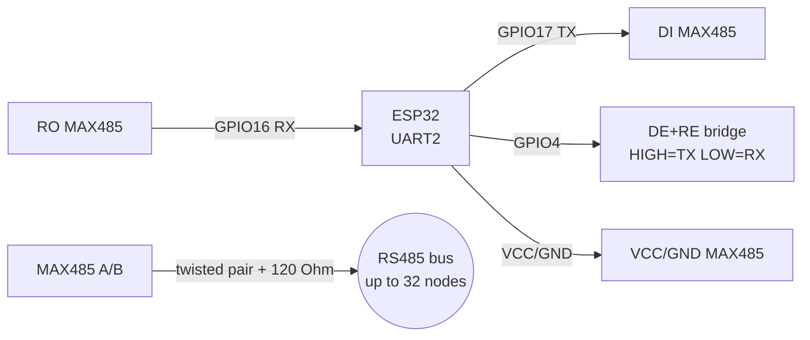
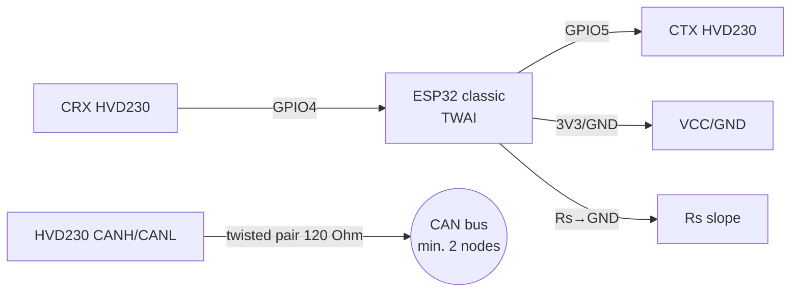
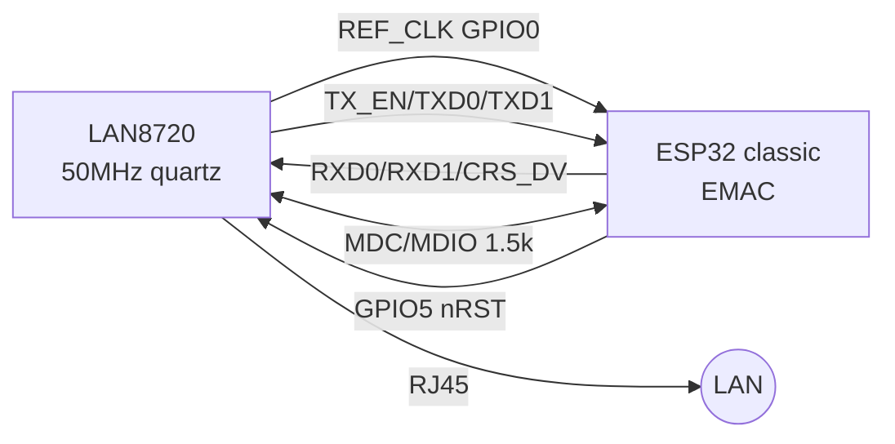
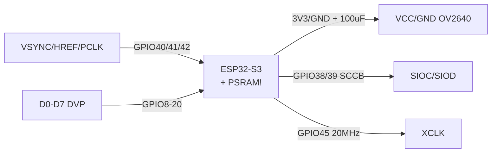

# RS485 / CAN / Ethernet / Camera

Navigation: UART [[EN/04-Interfaces/01-UART.en|UART]], SPI [[EN/04-Interfaces/02-SPI.en|SPI]], power supply [[EN/02-Power-Supply/01-Power-Rails.en]], pins [[EN/99-Additions/01-Pinout-tablici.en]], diagnostics [[EN/99-Additions/02-Troubleshooting-FAQ.en]], start [[EN/Home.en]], levels [[EN/13-Power-Modules/02-Level-Shifters.en]].

## Purpose

RS485 / CAN / Ethernet / Camera - RS485 - MAX485 (DE/RE); MAX485 module pin legend; ASCII schematic (MAX485). Navigation: UART [[EN/04-Interfaces/01-UART.en|UART]], SPI [[EN/04-Interfaces/02-SPI.en|SPI]], power supply [[EN/02-Power-Supply/01-Power-Rails.en]], pins [[EN/99-Additions/01-Pinout-tablici.en]], diagnostics [[EN/99-Additions/02-Troubleshooting-FAQ.en]], start Home, levels 13-Power-Modules/02-Level-Shifters. MAX485: half-duplex, DE=Driver Enable HIGH=transmit, RE=Receiver Enable LOW=receive. Usually DE+RE joined and driven by one GPIO. 120 Ohm terminator on line A-B ends. Fail-safe bias 680 Ohm if needed.

## 1. RS485 - MAX485 (DE/RE)

MAX485: half-duplex, DE=Driver Enable HIGH=transmit, RE=Receiver Enable LOW=receive. Usually DE+RE joined and driven by one GPIO. 120 Ohm terminator on line A-B ends. Fail-safe bias 680 Ohm if needed.

![[assets/img/max485-de-re.png|500]]
*Fig. MAX485 - DE+RE bridge to one GPIO, 120 Ohm terminator on A/B line ends.*

### Module pin legend MAX485

| Pin | Label | Type | To ESP32 | Note |
| --- | --- | --- | --- | --- |
| 1 | VCC | Power supply | 3V3 or 5V per board version | MAX485 - 5V, MAX3485 - 3.3V; verify marking! |
| 2 | GND | Ground | GND | Common ground, for long lines - a third GND wire between nodes |
| 3 | DI | Digital input | GPIO17 (TX2) | Driver In: ESP32 TX to DI |
| 4 | RO | Digital output | GPIO16 (RX2) | Receiver Out: RO to ESP32 RX crossed |
| 5 | DE | Enable input | GPIO4 (shared with RE) | Driver Enable: HIGH = transmit |
| 6 | RE | Enable input, active low | GPIO4 (shared with DE) | Receiver Enable: LOW = receive; join with DE by a bridge |
| 7 | A | Differential line | Twisted pair to A of all nodes | Non-inverting pin, 120 Ohm terminator on ends |
| 8 | B | Differential line | Twisted pair to B of all nodes | Inverting pin, 120 Ohm terminator on ends |

Explanation of the DE+RE bridge and terminator:

- **DE+RE bridge:** DE is active HIGH, RE is active LOW - so they are joined together to one GPIO: `HIGH` = transmitter on / receiver off (TX), `LOW` = vice versa (RX). Saves a pin and excludes the "both on" collision. In code: raise GPIO, then `write()`, then `flush()`, then 100 us delay, then lower GPIO.
- **120 Ohm terminator:** a resistor between A and B on the two edge line nodes damps signal reflections. On middle nodes - do not place! Without terminators on 100+ m at 115200 baud - "silence" or garbage.
- **Fail-safe bias:** a 680 Ohm pair (A to VCC, B to GND) holds the line in MARK when all transmitters are silent. On short lines usually not needed.
- **Twisted pair:** route A/B as twisted pair (UTP), GND by a separate wire. Length up to 1200 m at 9600 baud, see [[EN/04-Interfaces/01-UART.en|UART]].

| ESP32 | MAX485 | Note |
| --- | --- | --- |
| GPIO16 (RX2) | RO | Receiver Out -> ESP32 RX |
| GPIO17 (TX2) | DI | ESP32 TX -> Driver In |
| GPIO4 | DE + RE | HIGH=TX, LOW=RX (join DE to RE) |
| 3V3/5V | VCC | per board version (MAX485 5V, MAX3485 3.3V) |
| GND | GND | common ground |
| - | A / B | differential pair, twisted pair, 120 Ohm on ends |

### ASCII schematic (MAX485)

```text
ESP32 DevKit          MAX485 module              Лінія RS485
────────────          ────────────              ───────────
GPIO17 (TX2) ──────►  DI
GPIO16 (RX2) ◄──────  RO
GPIO4 ─────────────►  DE ─┐
                      RE ─┘ (bridge: з'єднати DE і RE разом!)
3V3/5V ────────────►  VCC (за версією плати)
GND ────────────────  GND ──────────────────── GND лінії (3-й провід)
                      A ──────────────────────► A (вита пара) ── [120 Ом] на кінцях
                      B ──────────────────────► B (вита пара) ── [120 Ом] на кінцях

TX: GPIO4=HIGH → write → flush → 100мкс → GPIO4=LOW
```

### Mermaid (MAX485)



### Arduino Modbus/RS485

```cpp
#define DE_RE 4
HardwareSerial rs(2);
void setup(){ pinMode(DE_RE, OUTPUT); digitalWrite(DE_RE, LOW); rs.begin(9600, SERIAL_8N1, 16, 17); }
void rsWrite(const uint8_t* d, int n){ digitalWrite(DE_RE, HIGH); delayMicroseconds(100); rs.write(d, n); rs.flush(); delayMicroseconds(100); digitalWrite(DE_RE, LOW); }
```

### MicroPython RS485

```python
from machine import Pin, UART
de = Pin(4, Pin.OUT, value=0)
rs = UART(2, baudrate=9600, rx=16, tx=17)
def rs_write(data):
    de.on(); rs.write(data); de.off()
```

### ESP-IDF RS485

```c
// uart_set_mode(UART_NUM_2, UART_MODE_RS485_HALF_DUPLEX); // DE/RE керує драйвер автоматично
```

### Isolated options: MAX485-ISO / ADM2483 / ADM3057E

| Item | What it is | When to take |
| --- | --- | --- |
| MAX485-ISO (ready module) | MAX485 + ADuM1201 + isolated DC-DC on one board | Long lines between buildings, different grounds - without thinking |
| ADM2483 | RS485 transceiver with 2.5 kV isolation (one chip!) | Own board instead of a module |
| ADM3057E | Isolated CAN transceiver (ISO1050 analog) | CAN between cabinets/buildings |

```text
Логічна сторона (ESP32 GND) ║ ISO-бар'єр ║ Польова сторона (своя GND!)
ESP32 TX/RX/DE ──► ISO-трансивер ──► A/B в поле; живлення поля — окремий ізольований DC-DC (B0505S)
```

> Without isolation a ground difference >5 V between nodes = current over the shield = burnt transceivers. Rule: different buildings/cabinets - only isolated modules.

## 2. CAN - SN65HVD230 / TJA1050

ESP32 classic has built-in CAN (SJA1000-compatible, now TWAI). SN65HVD230 is a 3.3V transceiver (better choice), TJA1050 is 5V. Speed up to 1 Mbps, 120 Ohm terminators on both ends. CAN pins: any GPIO via matrix, typically RX=GPIO4 TX=GPIO5 or RX=21 TX=22.

![[assets/img/can-hvd230-bus.png|500]]
*Fig. SN65HVD230 - CAN bus with 120 Ohm terminators, Rs to ground for high speed.*

### Module pin legend SN65HVD230

| Pin | Label | Type | To ESP32 | Note |
| --- | --- | --- | --- | --- |
| 1 | VCC | 3.3V power | 3V3 ESP32 | 3.3V only! Advantage over TJA1050 (5V) - direct coupling with ESP32 |
| 2 | GND | Ground | GND | Common ground |
| 3 | CTX | Digital input | GPIO5 (CAN TX) | ESP32 TX to CTX |
| 4 | CRX | Digital output | GPIO4 (CAN RX) | CRX to ESP32 RX |
| 5 | Rs | Mode input | GND via 10k or directly | Speed/slope resistor: LOW (to GND) = high-speed up to 1 Mbps; 10k to GND = slope mode; HIGH = standby |
| 6 | CANH | Differential bus | CANH twisted pair | High line, 120 Ohm on bus ends |
| 7 | CANL | Differential bus | CANL twisted pair | Low line, 120 Ohm on bus ends |

Explanation of Rs and the bus:

- **Rs (slope resistor):** controls edges: Rs pulled to GND (0 Ohm or 10k to ground) = steep edges, speed up to 1 Mbps; Rs to VCC = standby/sleep. Typically for tests - Rs to GND jumper (high-speed). For EMC on long lines - a 10k-50k resistor to GND (gentle edges, less emission).
- **CANH/CANL:** 120 Ohm wave-impedance differential pair, two 120 Ohm terminators on ends (in parallel they give 60 Ohm - that is how you check a powered-off bus with a multimeter).
- **Minimum 2 nodes:** one transceiver does not talk to itself - for a test you need two ESP32+transceivers or one + a CAN analyzer. Otherwise `bus-off`, see [[EN/99-Additions/02-Troubleshooting-FAQ.en]].

| ESP32 | SN65HVD230 | Note |
| --- | --- | --- |
| 3V3 | VCC | 3.3V |
| GND | GND | ground |
| GPIO5 | CTX | CAN TX |
| GPIO4 | CRX | CAN RX |
| 3V3 (Rs) | Rs | LOW=high-speed, 10k to ground = slope |
| - | CANH/CANL | twisted pair to bus, 120 Ohm |

### ASCII schematic (CAN)

```text
ESP32 DevKit          SN65HVD230                 CAN-bus
────────────          ──────────                 ────────
3V3 ───────────────►  VCC (3.3V!)
GND ────────────────  GND
GPIO5 (TX) ────────►  CTX
GPIO4 (RX) ◄────────  CRX
GND ───[10к або 0]──  Rs (до GND = high-speed 1 Мбіт)
                      CANH ──► вита пара ──► CANH всіх вузлів ── [120 Ом] на кінцях
                      CANL ──► вита пара ──► CANL всіх вузлів ── [120 Ом] на кінцях

Вимкнена bus: між CANH-CANL ≈ 60 Ом (2×120 паралельно)
```

### Mermaid (CAN)



### Arduino TWAI

```cpp
#include "driver/twai.h"
void setup(){ twai_general_config_t g = TWAI_GENERAL_CONFIG_DEFAULT((gpio_num_t)5, (gpio_num_t)4, TWAI_MODE_NORMAL); twai_timing_config_t t = TWAI_TIMING_CONFIG_500KBITS(); twai_filter_config_t f = TWAI_FILTER_CONFIG_ACCEPT_ALL(); twai_driver_install(&g, &t, &f); twai_start(); }
```

### MicroPython / ESP-IDF: see the TWAI example in ESP-IDF examples/peripherals/twai

## 3. Ethernet LAN8720 RMII (classic only!)

> [!important] Only ESP32 classic (D0WD) supports Ethernet RMII. ESP32-S3/C3/C6/H2 either lack an Ethernet MAC or need the W5500 SPI module. Do not buy LAN8720 for S3!

![[assets/img/lan8720-rmii.png|500]]
*Fig. LAN8720 - RMII to ESP32 classic, 50 MHz REF_CLK, SMI MDC/MDIO.*

### Module pin legend LAN8720

| Pin | Label | Type | To ESP32 | Note |
| --- | --- | --- | --- | --- |
| 1 | VCC | 3.3V power | Stable 3V3 300 mA | Clean power, ripple <50 mV, otherwise the link drops |
| 2 | GND | Ground | GND | Short ground, RJ45 shield to enclosure |
| 3 | TX0 (TXD0) | RMII output | GPIO19 | Transmit data bit 0, synchronous with REF_CLK |
| 4 | TX1 (TXD1) | RMII output | GPIO22 | Transmit data bit 1 |
| 5 | TX_EN | RMII output | GPIO21 | Transmit enable |
| 6 | RX0 (RXD0) | RMII input | GPIO25 | Receive data bit 0 |
| 7 | RX1 (RXD1) | RMII input | GPIO26 | Receive data bit 1 |
| 8 | CRS_DV | RMII input | GPIO27 | Carrier sense / Data valid |
| 9 | MDC | SMI input | GPIO23 | SMI PHY configuration clock |
| 10 | MDIO | Bidirectional SMI | GPIO18 + 1.5k pull-up | SMI data, pull-up mandatory |
| 11 | nRST | Reset input | GPIO5 | PHY reset, active low |
| 12 | REF_CLK | 50 MHz output | GPIO0 | 50 MHz quartz on PHY board clocks the MAC; GPIO0 strap - careful during flashing! |
| 13 | RJ45 | Network | Patch cord | Link/activity LEDs on connector |

RMII explanation:

- **RMII vs MII:** RMII is a reduced version with a 50 MHz clock and 2-bit TX/RX buses instead of 4-bit ones. Fewer pins, but tighter timing - Dupont wires are not suitable, only a WT32-ETH01 style board or short PCB routing.
- **50 MHz REF_CLK:** generated by the PHY from its own quartz and given to ESP32 on GPIO0. Without this clock the MAC is silent. Checked with an oscilloscope/logic analyzer at 50 MHz.
- **MDC/MDIO (SMI):** two-wire management for PHY speed/duplex setup. MDIO without a 1.5k pull-up does not work.
- **Classic only:** ESP32-S3/C3 have no hardware EMAC for RMII - for them take SPI-Ethernet W5500. Buy LAN8720 only for classic D0WD / WT32-ETH01.

| ESP32 | LAN8720 | Note |
| --- | --- | --- |
| GPIO0 | REF_CLK | 50 MHz from LAN8720 (nINT/REFCLK strap) |
| GPIO21 | TX_EN | RMII |
| GPIO19 | TXD0 | RMII |
| GPIO22 | TXD1 | RMII |
| GPIO25 | RXD0 | RMII |
| GPIO26 | RXD1 | RMII |
| GPIO27 | CRS_DV | RMII |
| GPIO23 | MDC | SMI clock |
| GPIO18 | MDIO | SMI data, 1.5k pull-up |
| GPIO5 | RST | reset PHY |
| 3V3/GND | VCC/GND | Stable 3.3V |

### ASCII schematic (LAN8720)

```text
ESP32 classic           LAN8720 PHY
─────────────           ───────────
GPIO0 ◄──────────────  REF_CLK (50 МГц кварц на PHY!)
GPIO21 ◄─────────────  TX_EN
GPIO19 ◄─────────────  TXD0
GPIO22 ◄─────────────  TXD1
GPIO25 ─────────────►  RXD0
GPIO26 ─────────────►  RXD1
GPIO27 ─────────────►  CRS_DV
GPIO23 ─────────────►  MDC
GPIO18 ◄────────────►  MDIO (+ pull-up 1.5к до 3V3)
GPIO5 ──────────────►  nRST
3V3 ───────────────►  VCC
GND ────────────────  GND
                      RJ45 ──► патч-корд (LED link/act)

Тільки ESP32 classic! S3/C3 → W5500 по SPI.
```

### Mermaid (LAN8720)



ESP-IDF: `eth` + `esp_eth` ethernet/basic example. Arduino: ETH.begin() with the WT32-ETH01 profile.

## 4. OV2640 camera (ESP32-S3 + PSRAM)

ESP32-CAM (classic) is outdated. New standard: ESP32-S3 with PSRAM (Freenove, Waveshare, Espressif S3-EYE). Without PSRAM - only QQVGA, with PSRAM - UXGA + JPEG + WiFi stream. The camera eats 150-250 mA in operation - a separate 47-100 uF capacitor.

![[assets/img/ov2640-s3-dvp.png|500]]
*Fig. OV2640 - DVP to ESP32-S3, XCLK 20 MHz, without PSRAM UXGA does not work.*

### Module pin legend OV2640 (DVP)

| Pin | Marking | Type | Where on ESP32-S3 | Note |
| --- | --- | --- | --- | --- |
| 1 | VCC | 3.3V power | 3V3 + 47-100 uF cap | 150-250 mA current in stream, thin power = brownout |
| 2 | GND | Ground | GND | Short ground |
| 3 | SIOC | SCCB clock input | GPIO38 (I2C SCL) | SCCB is I2C-compatible, sensor configuration |
| 4 | SIOD | Bidirectional SCCB data | GPIO39 (I2C SDA) | Exposure/white-balance registers |
| 5 | VSYNC | Frame output | GPIO40 | Frame sync |
| 6 | HREF | Line output | GPIO41 | Line sync |
| 7 | PCLK | Pixel clock output | GPIO42 | Pixel clock, short traces |
| 8-15 | D0-D7 (Y2-Y9) | Data output | GPIO8-GPIO20 per board map | 8-bit DVP bus, map depends on board (Freenove/Waveshare!) |
| 16 | XCLK | Master-clock input | GPIO45 | 20 MHz from S3 generates the sensor clock |
| 17 | PWDN | Power-down input | GPIO or GND | HIGH = sleep; for work pull to GND |
| 18 | RESET | Reset input | GPIO or 3V3 | Active low; HIGH in operation |

Explanation:

- **SCCB SIOC/SIOD:** Omnivision configuration bus, electrically I2C. It sets resolution (QQVGA to UXGA), JPEG/RAW, exposure. Without SCCB the sensor is silent.
- **VSYNC/HREF/PCLK + D0-D7:** parallel DVP bus: PCLK clocks each pixel, HREF frames the line, VSYNC the frame. Long "snot" on DVP = stripes/artifacts.
- **20 MHz XCLK:** ESP32-S3 generates the sensor master clock. Unstable XCLK = floating colors.
- **PWDN/RESET:** PWDN to sleep (HIGH), RESET reset (LOW). On boards usually pulled correctly, but verify.
- **Without PSRAM UXGA does not work:** a UXGA 1600x1200 JPEG frame ~300-500 KB does not fit in 320 KB S3 SRAM. Without PSRAM - only QQVGA/QVGA or a fall with `fb alloc failed`. Buy an S3R8+ board (8 MB PSRAM), see [[EN/99-Additions/02-Troubleshooting-FAQ.en]].

| ESP32-S3 | OV2640 | Note |
| --- | --- | --- |
| GPIO8-20 | D0-D7/Y2-Y9 | DVP data, per board map |
| GPIO38 | SCCB SCL | I2C configuration |
| GPIO39 | SCCB SDA | I2C |
| GPIO40 | VSYNC | frame sync |
| GPIO41 | HREF | line sync |
| GPIO42 | PCLK | pixel clock |
| GPIO45 | XCLK | 20 MHz from S3 |
| 3V3/GND | VCC/GND | + separate cap |

### ASCII schematic (OV2640 + S3)

```text
ESP32-S3 (з PSRAM!)     OV2640 DVP
───────────────────     ──────────
3V3 ─────────────────►  VCC (+ 47-100мкФ до GND!)
GND ──────────────────  GND
GPIO38 ──────────────►  SIOC (SCCB SCL)
GPIO39 ◄────────────►  SIOD (SCCB SDA)
GPIO40 ◄─────────────  VSYNC
GPIO41 ◄─────────────  HREF
GPIO42 ◄─────────────  PCLK
GPIO8..20 ◄──────────  D0-D7 (за мапою плати!)
GPIO45 ─────────────►  XCLK (20 МГц)
GND ─────────────────  PWDN (у роботі LOW)
3V3 ─────────────────  RESET (у роботі HIGH)

Без PSRAM: лише QQVGA! Для UXGA+JPEG: плата S3R8/R16.
```

### Mermaid (OV2640)



Arduino: CameraWebServer example (pick CAMERA_MODEL_... + PSRAM). ESP-IDF: esp32-camera component. MicroPython: ov2640 driver limited, better Arduino/IDF.

| Symptom | Cause | Solution |
| --- | --- | --- |
| RS485 silence | DE/RE not switching | one GPIO on DE+RE, flush delays |
| CAN bus-off | no second node/terminator | minimum 2 nodes + 2x120 Ohm |
| LAN8720 not linking | S3 instead of classic / REF_CLK | classic only, verify 50 MHz |
| Camera brownout | no PSRAM / weak power | S3R8+ board, 100 uF cap |
| Camera fb alloc failed | no PSRAM / UXGA without memory | enable PSRAM, lower to QVGA |
| RS485 garbage on 115200 | no terminator / long line | 120 Ohm on ends, lower to 9600 |

## Official sources

- [SN65HVD230 - datasheet (TI)](https://www.ti.com/product/SN65HVD230) - 3.3V CAN transceiver, standby mode.
- [W5500 - docs and code examples (WIZnet)](https://docs.wiznet.io/Product/Chip/Ethernet/W5500) - datasheet, ioLibrary (TCP/UDP/MQTT).
- [W5500 - product page with photo (WIZnet)](https://wiznet.io/products/ethernet-chips/w5500) - modules, boards.
- [ESP32-CAM - tutorial with code (RNT)](https://randomnerdtutorials.com/esp32-cam-video-streaming-face-recognition-arduino-ide/) - OV2640, CameraWebServer.

## See also

- [[EN/Home.en]]
- [[EN/04-Interfaces/01-UART.en|UART]]
- [[EN/04-Interfaces/02-SPI.en|SPI]]
- [[EN/02-Power-Supply/01-Power-Rails.en]]
- [[EN/03-GPIO/01-GPIO-Overview.en]]
- [[EN/05-Radio/01-WiFi-STA-AP.en]]
- [[EN/12-Comm-Modules/01-RC522-RFID.en]]
- [[EN/12-Comm-Modules/02-NRF24-LoRa.en]]
- [[EN/12-Comm-Modules/03-SIM800L-GPS.en]]
- [[EN/12-Comm-Modules/04-RS485-CAN-Ethernet-Kamera.en]]
- [[EN/13-Power-Modules/02-Level-Shifters.en]]
- [[EN/99-Additions/01-Pinout-tablici.en]]
- [[EN/99-Additions/02-Troubleshooting-FAQ.en]]
