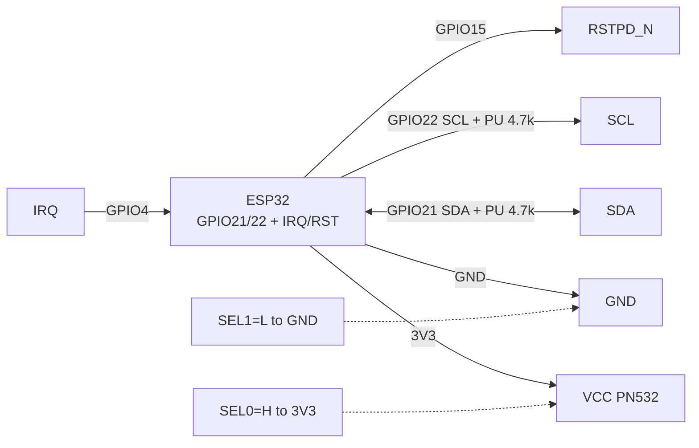
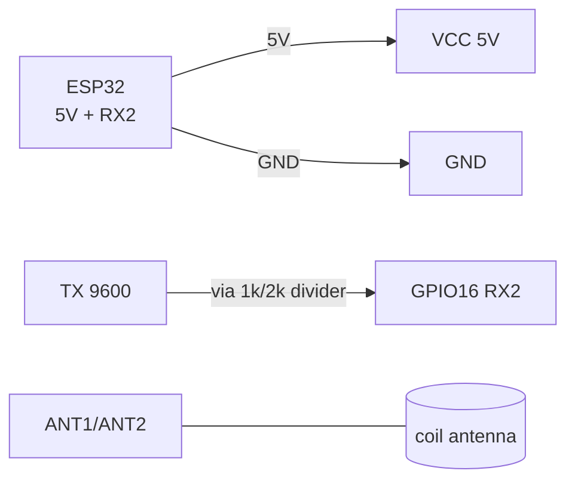
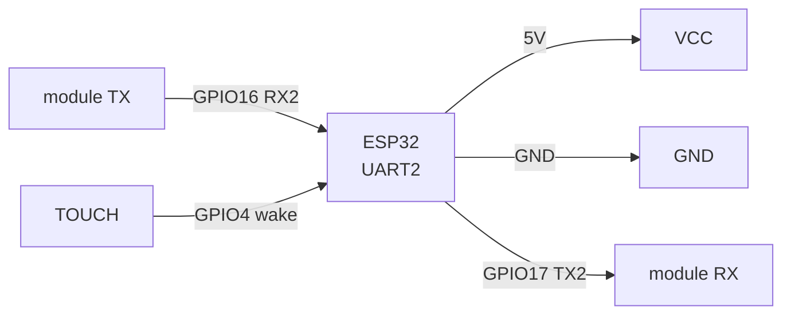
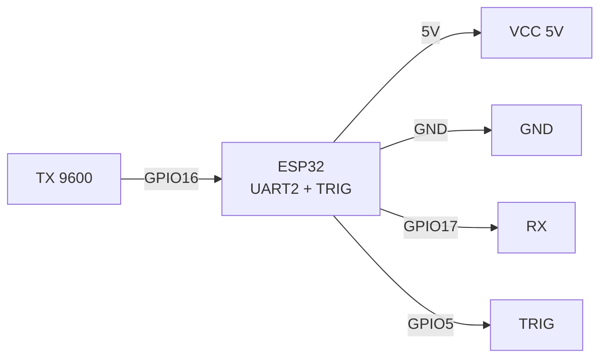

# PN532 NFC / RDM6300 125 kHz / R307 Fingerprint / GM65 scanner

> [!info] Purpose
> This note covers identification modules: **PN532** (NFC 13.56 MHz, NDEF/UID, three interfaces), **RDM6300** (cheap 125 kHz EM4100 RFID, read-only), **R307 / AS608** (optical fingerprint scanner, UART), **GM65** (barcode and QR scanner, UART/USB-HID). Common: all give an "ID" over UART/I2C/SPI, ESP32 logic - compare with a whitelist and open the lock / log the event.

Characteristics (comparison table):

| Module | Frequency / type | Interface | Power supply | Range | What it can |
| --- | --- | --- | --- | --- | --- |
| PN532 | 13.56 MHz ISO14443A/B, FeliCa | I2C / SPI / HSU-UART (SEL0/SEL1 switches) | 3.3V (VCC 3.3V, 5V board versions have an LDO) | 3-7 cm | Mifare read/write, NDEF, P2P, card emulation |
| RDM6300 | 125 kHz EM4100 | UART 9600 8N1 (TX) | 5V (stable! 3.3V does not work) | 2-5 cm (with stock antenna) | UID read-only, 10 hex chars + checksum |
| R307 / AS608 | 500 dpi optical sensor | UART 57600 (factory) / 9600-115200 possible | 3.3-6V (3.3V LDO inside) | Finger on glass | Up to 1000 templates stored, 1:N match on module |
| GM65 | CMOS 640x480 + red backlight | UART 9600 / USB-HID (switchable) | 5V (backlight current peaks ~200 mA) | 5-30 cm from code | EAN-13, Code128, QR, DataMatrix; trigger / autoscan mode |

Links to buses: I2C [[EN/04-Interfaces/03-I2C.en|I2C]], SPI [[EN/04-Interfaces/02-SPI.en|SPI]], UART [[EN/04-Interfaces/01-UART.en|UART]], power supply [[EN/02-Power-Supply/01-Power-Rails.en]], basic RFID [[EN/12-Comm-Modules/01-RC522-RFID.en]], start [[EN/Home.en]].

## Purpose

PN532 NFC / RDM6300 125 kHz / R307 Fingerprint / GM65 scanner - PN532 NFC (I2C / SPI / UART); PN532 module pin legend; connection schematic (I2C mode recommended). Links to buses: I2C [[EN/04-Interfaces/03-I2C.en|I2C]], SPI [[EN/04-Interfaces/02-SPI.en|SPI]], UART [[EN/04-Interfaces/01-UART.en|UART]], power supply [[EN/02-Power-Supply/01-Power-Rails.en]], basic RFID 12-Comm-Modules/01-RC522-RFID, start Home. 1. PN532 NFC (I2C / SPI / UART).

## 1. PN532 NFC (I2C / SPI / UART)

Mode switches **SEL0 / SEL1** (DIP or L/H jumpers on the Elechouse board):

| SEL0 | SEL1 | Mode |
| --- | --- | --- |
| L | L | HSU (UART) |
| L | H | SPI |
| H | L | I2C (factory typically) |

> [!warning] After changing SEL - reconnect power (Power-On Reset), otherwise the mode is not applied.

![[assets/img/pn532-scheme.png|500]]
*Fig. PN532 - I2C mode by default, SEL0=H, SEL1=L switches.*

### Module pin legend PN532

| Pin | Type | Where | Note |
| --- | --- | --- | --- |
| VCC | Power input | 3V3 ESP32 | 3.3V only for the bare board; blue Elechouse boards have an LDO and tolerate 5V, but logic is still 3.3V - see [[EN/02-Power-Supply/01-Power-Rails.en]] |
| GND | Ground | GND | Common ground, short wire |
| SDA / SCL (I2C) | Bidirectional OD | GPIO21 (SDA), GPIO22 (SCL) | I2C address 0x24 (7-bit); 4.7k pull-ups to 3.3V needed, see [[EN/04-Interfaces/03-I2C.en|I2C]] |
| SCK / MISO / MOSI / SS (SPI) | SPI | GPIO18/19/23, SS GPIO5 | SPI mode requires SEL0=L, SEL1=H; speed up to 5 MHz |
| TX / RX (HSU-UART) | UART | GPIO16 (RX2) from TX, GPIO17 (TX2) to RX crossed | 115200 speed by default; SEL0=L, SEL1=L mode |
| IRQ | Output, active low | GPIO4 (any) | "Card in field" interrupt; in I2C mode polled by the library |
| RSTO / RSTPD_N | Reset input | GPIO15 or 3V3 via 10k | RSTPD_N = HIGH work, LOW = power-down; LOW pulse 100 ms = reset |
| SEL0 / SEL1 | Bus-select input | L/H jumpers (GND or VCC) | H = HIGH (to VCC), L = LOW (to GND); do not leave floating |

### Connection schematic (I2C mode recommended)

| ESP32 | PN532 | Note |
| --- | --- | --- |
| 3V3 | VCC | 3.3V |
| GND | GND | common ground |
| GPIO21 | SDA | 4.7k pull-up |
| GPIO22 | SCL | 4.7k pull-up |
| GPIO4 | IRQ | interrupt |
| GPIO15 | RSTPD_N | reset |
| VCC (3V3) | SEL0 | H |
| GND | SEL1 | L |

### ASCII schematic

```text
ESP32 DevKit              PN532 (I2C, SEL0=H SEL1=L)
─────────────              ─────────────────────────
3V3 ────────────────────►  VCC (3.3V!)
GND ────────────────────   GND
GPIO21 (SDA) ◄──────────►  SDA  (pull-up 4.7к до 3V3)
GPIO22 (SCL) ──────────►   SCL  (pull-up 4.7к до 3V3)
GPIO4  ◄────────────────   IRQ  (картка в полі)
GPIO15 ─────────────────►  RSTPD_N (HIGH=робота)
3V3 ───────────────────►   SEL0 (=H)
GND ────────────────────   SEL1 (=L)

Notes:
- I2C-адреса 0x24. Довжина SDA/SCL < 30 см.
- Після зміни SEL0/SEL1 — відключити/підключити живлення!
```

### Mermaid



## 2. RDM6300 125 kHz (UART 9600)

Cheap EM4100-card receiver ("thick" fobs). Outputs 14 bytes: `0x02 + 10 ASCII hex + 2 checksum + 0x03`.

![[assets/img/rdm6300-scheme.png|500]]
*Fig. RDM6300 - 5V power, TX to ESP32 via divider, outdoor coil antenna.*

### Module pin legend RDM6300

| Pin | Type | Where | Note |
| --- | --- | --- | --- |
| VCC (+5V) | Power input | 5V (VIN/VU DevKit or separate 5V PSU) | Strictly 5V +-5%! From 3.3V it does not start / tears packets; ~50 mA current |
| GND | Ground | GND | Common with ESP32 |
| TX (TXD, pin 1 on header) | 5V-level UART output | GPIO16 (RX2) via 1k/2k divider | 9600 8N1 speed; 5V level - ESP32 tolerates briefly, but correct is a divider or transistor; see [[EN/04-Interfaces/01-UART.en|UART]] |
| ANT1 / ANT2 | Analog to coil | Stock square antenna from the kit | without antenna range is 0! Do not place the antenna on metal; metal doors - move the antenna outside |
| LED | Indication output | leave unconnected / LED | Blinks on read |

### ASCII schematic

```text
ESP32 DevKit              RDM6300
─────────────              ───────
5V (VIN) ───────────────►  VCC 5V (НЕ 3V3!)
GND ────────────────────   GND
GPIO16 (RX2) ◄──[1к/2к]──  TX (5V рівень → дільник!)
                 ANT1/ANT2 ══► котушка-антена з комплекту

Дільник: TX --1к--+-- GPIO16, + --2к-- GND. Отримуємо ~3.3V.
```

### Mermaid



## 3. R307 / AS608 fingerprint scanner (UART)

Optical module with DSP: enrollment and match run inside, ESP32 only sends commands and receives ID. Arduino library - `Adafruit_Fingerprint`.

### Module pin legend R307

| Pin | Type | Where | Note |
| --- | --- | --- | --- |
| VCC (3.3-6V) | Power input | 5V or 3V3 (by version; red wire of ribbon) | 3.3V LDO inside; at 5V backlight is more stable; current up to 120 mA at scan moment |
| GND | Ground | GND | Black wire |
| TX (yellow) | UART output | GPIO16 (RX2) | Factory speed 57600 8N1; default password 0x00000000 |
| RX (white) | UART input | GPIO17 (TX2) | Crossed: module TX to ESP32 RX |
| TOUCH / WAKE (green, optional) | Output, HIGH on touch | GPIO4 | Wake signal "finger applied"; can wake ESP32 from light-sleep |
| NC | - | leave unconnected | Reserved |

### ASCII schematic

```text
ESP32 DevKit              R307 (шлейф 6pin)
─────────────              ────────────────
5V ─────────────────────►  VCC (червоний)
GND ────────────────────   GND (чорний)
GPIO16 (RX2) ◄──────────   TX (жовтий)
GPIO17 (TX2) ──────────►   RX (білий)
GPIO4 ◄─────────────────   TOUCH (зелений, опційно)
```

### Mermaid



## 4. GM65 barcode scanner (UART / USB)

CMOS scanner with red backlight. For ESP32 use **UART 9600 mode** (factory is USB-HID; switched by scanning special codes from the "UART Mode" manual). Output is an ASCII code string + `\r\n`.

### Module pin legend GM65

| Pin | Type | Where | Note |
| --- | --- | --- | --- |
| VCC 5V | Power input | Separate 5V / VIN | Backlight peaks ~200 mA - from a weak USB-UART may blink; 470 uF electrolytic near the module |
| GND | Ground | GND | Common ground |
| TX | UART output | GPIO16 (RX2) | 9600 8N1, format: `<code>\r\n` |
| RX | UART input | GPIO17 (TX2) | Configuration commands from the manual |
| TRIG | Input, active low | GPIO5 (button to GND) | LOW pulse >=100 ms = one scan; in "Auto/Continuous" mode can be left NC |
| USB D+/D- | USB-HID | do not use with ESP32 | UART alternative; for ESP32-S2/S3 with USB host - possible but unstable |

### ASCII schematic

```text
ESP32 DevKit              GM65
─────────────              ────
5V ─────────────────────►  VCC 5V (+470мкФ до GND!)
GND ────────────────────   GND
GPIO16 (RX2) ◄──────────   TX (9600)
GPIO17 (TX2) ──────────►   RX
GPIO5 ──[кнопка]────────►  TRIG (LOW=скан)
```

### Mermaid



### SE3307 / GM65-reader - ready OEM readers

| Parameter | SE3307 (scan engine) | GM65-reader (ready device) |
| --- | --- | --- |
| Format | Engine board without enclosure (embedded) | Enclosure + button + cable |
| Interface | UART/TTL (same ASCII protocol `<code>\r\n`) | UART or USB-HID (switchable) |
| Power supply | 3.3 V | 5 V (backlight!) |
| When to take | Own enclosure/terminal | Ready USB scanner to cashier + UART branch to ESP32 |

> Protocol is the same as the GM65 module: code above fully applies, difference only in strapping and power.

## Code - UID / event reading

### Arduino (PN532 I2C - Adafruit_PN532)

```cpp
#include <Wire.h>
#include <Adafruit_PN532.h>
#define IRQ 4
#define RESET 15
Adafruit_PN532 nfc(IRQ, RESET);
void setup() {
  Serial.begin(115200);
  Wire.begin(21, 22);
  nfc.begin();
  uint32_t v = nfc.getFirmwareVersion();
  if (!v) { Serial.println("PN532 не знайдено (0x24?)"); while (1) delay(100); }
  nfc.SAMConfig();
  Serial.println("Піднесіть картку...");
}
void loop() {
  uint8_t uid[7]; uint8_t len;
  if (nfc.readPassiveTargetID(PN532_MIFARE_ISO14443A, uid, &len)) {
    Serial.print("UID:");
    for (int i = 0; i < len; i++) Serial.printf(" %02X", uid[i]);
    Serial.println();
    delay(1000);
  }
}
```

### Arduino (RDM6300 - UID reading)

```cpp
// RDM6300: TX -> GPIO16, 9600 8N1, пакет 14 байт: 02 + 10 ASCII + 2 CS + 03
void setup() {
  Serial.begin(115200);
  Serial2.begin(9600, SERIAL_8N1, 16, -1); // RX=16, TX не потрібен
}
void loop() {
  if (Serial2.available() >= 14) {
    if (Serial2.read() == 0x02) {
      char tag[11]; Serial2.readBytes(tag, 10); tag[10] = 0;
      uint8_t cs[2]; Serial2.readBytes(cs, 2);
      uint8_t end = Serial2.read();
      if (end == 0x03) { Serial.print("RDM6300 UID: "); Serial.println(tag); }
    }
  }
}
```

### Arduino (R307 - Adafruit_Fingerprint)

```cpp
#include <Adafruit_Fingerprint.h>
HardwareSerial fpSerial(2);
Adafruit_Fingerprint finger(&fpSerial);
void setup() {
  Serial.begin(115200);
  fpSerial.begin(57600, SERIAL_8N1, 16, 17);
  finger.begin(57600);
  Serial.printf("Шаблонів: %d\n", finger.getTemplateCount());
}
void loop() {
  if (finger.getImage() != FINGERPRINT_OK) { delay(100); return; }
  if (finger.image2Tz() != FINGERPRINT_OK) return;
  if (finger.fingerFastSearch() == FINGERPRINT_OK) {
    Serial.printf("Збіг! ID=%d точність=%d\n", finger.fingerID, finger.confidence);
  } else Serial.println("Невідомий палець");
  delay(500);
}
```

### ESP-IDF (PN532 I2C, polling UID)

```c
#include "driver/i2c.h"
#define PN532_ADDR 0x24
// Спрощено: ініціалізація I2C + SAMConfig + InListPassiveTarget.
// Повний драйвер див. esp-idf-lib / adafruit port.
void app_main(void) {
    i2c_config_t c = {.mode = I2C_MODE_MASTER, .sda_io_num = 21, .scl_io_num = 22,
        .master.clk_speed = 100000};
    i2c_param_config(I2C_NUM_0, &c);
    i2c_driver_install(I2C_NUM_0, c.mode, 0, 0, 0);
    // TODO: wakeup (0x00), SAMConfiguration (0x14 0x01 0x14 0x01),
    // InListPassiveTarget (0x4A 0x01 0x00) з IRQ-очікуванням на GPIO4.
}
```

### MicroPython (PN532 I2C - minimal)

```python
from machine import I2C, Pin
import time
i2c = I2C(0, sda=Pin(21), scl=Pin(22), freq=100000)
print("I2C scan:", [hex(a) for a in i2c.scan()])  # чекаємо 0x24
# Повний обмін PN532 вимагає IRQ-хендшейку; для продакшену візьміть
# бібліотеку micropython-pn532 (pnguyen/pn532) з прикладом read_uid().
```

### MicroPython (RDM6300 / GM65 - UART line reading)

```python
from machine import UART
u = UART(2, baudrate=9600, rx=16, tx=17)  # RDM6300: tx не використовується
buf = b""
while True:
    if u.any():
        b = u.read(1)
        if b == b"\x02":  # RDM6300 STX
            tag = u.read(12)  # 10 ASCII + 2 CS (+ETX наступним)
            print("UID:", tag[:10])
        else:
            buf += b  # GM65: накопичуємо до \r\n
            if buf.endswith(b"\n"):
                print("Штрих-код:", buf.decode().strip())
                buf = b""
```

## typical errors

| # | Symptom | Cause | Fix |
| --- | --- | --- | --- |
| 1 | PN532 not visible on `i2c.scan()` | SEL in SPI/UART mode; no pull-up; 5V power sagged | Set SEL0=H SEL1=L, repower; 4.7k pull-up; verify 3.3V under load |
| 2 | PN532 answers but sees no cards | Antenna covered by metal / phone nearby; NDEF example without `SAMConfig()` | Move >=5 cm from metal; call `SAMConfig()` after `begin()` |
| 3 | RDM6300 silent | 3.3V power instead of 5V; antenna unconnected; speed not 9600 | Give 5V; connect the stock coil; `Serial2.begin(9600, SERIAL_8N1, 16, -1)` |
| 4 | RDM6300 outputs garbage | 5V-level TX without divider; long wires; common ground missing | 1k/2k divider on ESP32 RX; wires <30 cm; common GND |
| 5 | R307 `Did not find fingerprint sensor` | Speed not 57600; TX/RX swapped; password changed | Try 9600/57600/115200; swap; reset password via SFGDemo |
| 6 | R307 does not recognize the finger | Dry/wet finger; enrollment with 1 sample | Enrollment with 2-3 samples; wipe glass; `finger.setSecurityLevel()` threshold |
| 7 | SE3307/GM65-reader silent over UART | Factory USB-HID mode | Scan the "UART Mode" code from the manual; verify 9600 8N1 |
| 7 | GM65 silent over UART | module in factory USB-HID mode | Scan the "Enter Setup to UART Output to 9600 to Exit" code from the manual |
| 8 | GM65 reboots on scan | Backlight current peak sags 5V | Separate 5V 1A PSU + 470 uF electrolytic near VCC |

![[assets/img/nfc-rfid-biometry-scheme.png|500]]
*Fig. Overall schematic: all identification modules on one ESP32 (different UARTs + I2C).*

## Official sources

- [PN532 - datasheet (PDF, NXP)](https://www.nxp.com/docs/en/nxp/data-sheets/PN532_C1.pdf) - reader/writer modes, card emulation.
- [PN532 - product page with photo (NXP)](https://www.nxp.com/products/rfid-nfc/nfc-hf/nfc-readers/nfc-integrated-solution:PN5321A3HN) - documents, antennas.
- [ESP32 + MFRC522 - tutorial with code (RNT)](https://randomnerdtutorials.com/esp32-mfrc522-rfid-reader-arduino/) - adjacent RFID code for comparison.
- [RC522 - breakdown with photo (LME)](https://lastminuteengineers.com/how-rfid-works-rc522-arduino-tutorial/) - RFID base, UID structure.

## See also

- [[EN/04-Interfaces/01-UART.en|UART]] - UART2 setup, TX/RX crossing
- [[EN/04-Interfaces/02-SPI.en|SPI]] - PN532 in SPI mode
- [[EN/04-Interfaces/03-I2C.en|I2C]] - pull-ups, 0x24 address, bus scan
- [[EN/02-Power-Supply/01-Power-Rails.en]] - 3.3V/5V power, LDO, electrolytics
- [[EN/12-Comm-Modules/01-RC522-RFID.en]] - basic RC522 RFID (compare with PN532/RDM6300)
- [[EN/12-Comm-Modules/02-NRF24-LoRa.en]] - radio modules (radio identification alternative)
- [[EN/03-GPIO/01-GPIO-Overview.en]] - IRQ/TOUCH/TRIG as wake inputs
- [[EN/Home.en]] - reference start page
