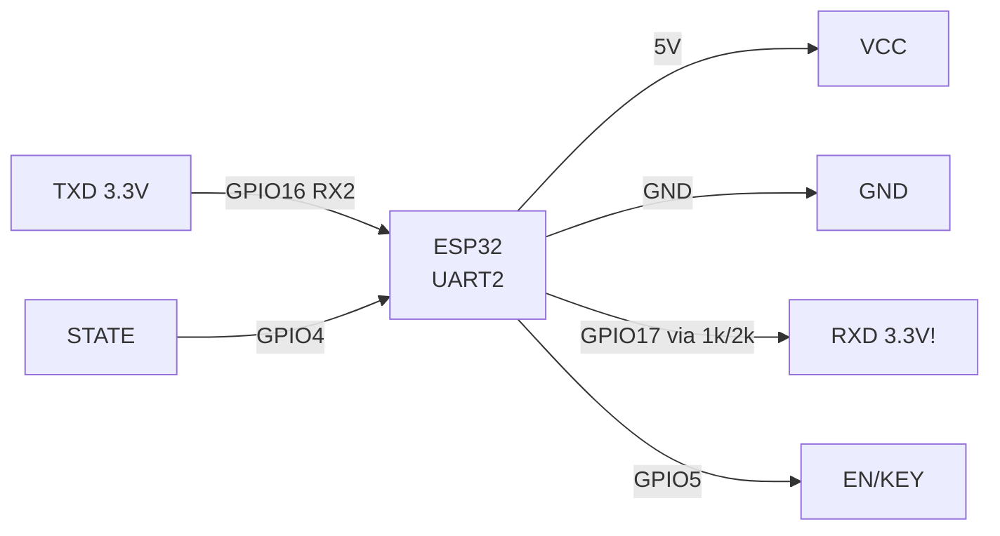
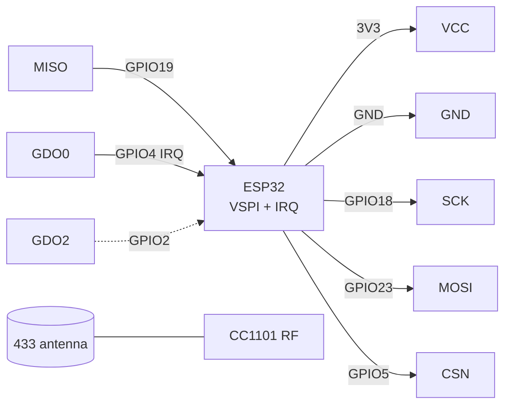
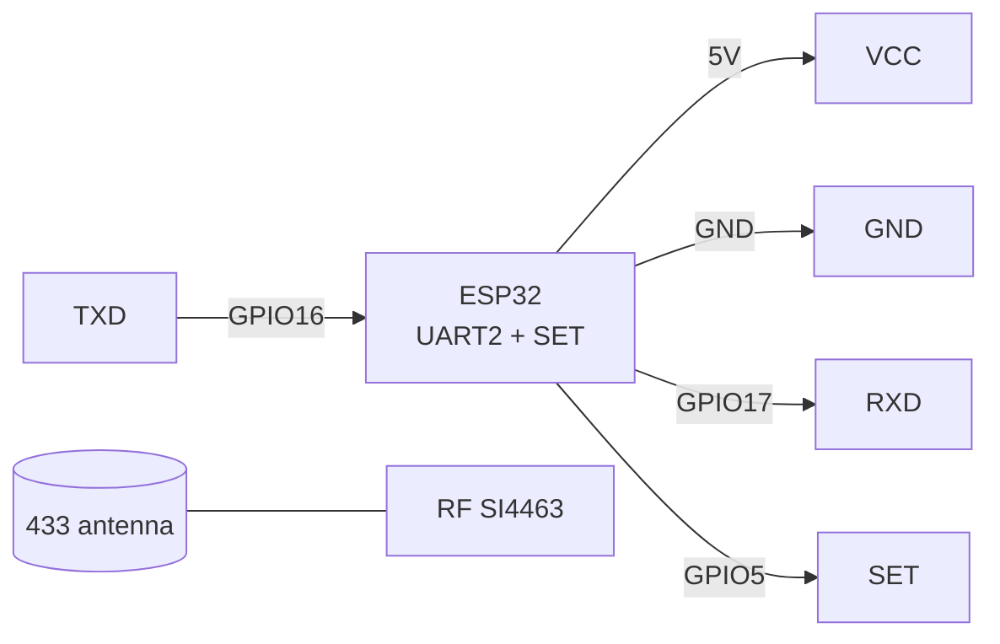

# HC-05 / HM-10 BLE / CC1101 / HC-12 - UART+SPI radio modules

> [!info] Purpose
> A note on "long" radio channels: **HC-05** (Bluetooth Classic SPP - serial port over radio), **HM-10** (BLE 4.0 on CC2541 - economical bridge for the phone), **CC1101** (Sub-GHz 315/433/868/915 MHz transceiver over SPI - packets, own addressing), **HC-12** (ready 433 MHz UART bridge on SI4463 - a "transparent" serial port for 1 km). All four remove the "no Wi-Fi in the field" problem.

Characteristics (comparison table):

| Module | Standard | Interface | Power / logic | Range | Speed |
| --- | --- | --- | --- | --- | --- |
| HC-05 (CSR BC417) | BT Classic 2.0 SPP | UART (factory 9600, AT 38400) | VCC 5V (LDO on board), 3.3V logic! | 10 m (with trace antenna) | up to 1382400 baud UART, really 100-200 kbps |
| HM-10 (CC2541) | BLE 4.0 | UART 9600 | VCC 3.3V (5V kills!) | 30-60 m | ~5-10 KB/s (GATT notify) |
| CC1101 | Sub-GHz 315/433/868/915 | SPI + GDO0/GDO2 | 3.3V | 100-300 m (depends on antenna) | 0.6-600 kbps, tunable |
| HC-12 (SI4463) | 433 MHz FSK (proprietary) | UART 9600 (1200-115200) | 3.3-5V, TX up to 100 mW (FU4) | 100-1000 m | 5 kbps over air typically (FU3) |

Navigation: UART [[EN/04-Interfaces/01-UART.en|UART]], SPI [[EN/04-Interfaces/02-SPI.en|SPI]], power supply [[EN/02-Power-Supply/01-Power-Rails.en]], basic radio overview [[EN/12-Comm-Modules/02-NRF24-LoRa.en]], start [[EN/Home.en]].

## Purpose

HC-05 / HM-10 BLE / CC1101 / HC-12 - UART+SPI radio modules - HC-05 Bluetooth Classic (SPP UART bridge); HC-05 module pin legend; HC-05 AT commands (basic, ending. HC-05 / HM-10 BLE / CC1101 / HC-12 - UART+SPI radio modules. Navigation: UART [[EN/04-Interfaces/01-UART.en|UART]], SPI [[EN/04-Interfaces/02-SPI.en|SPI]], power supply [[EN/02-Power-Supply/01-Power-Rails.en]], basic radio overview 12-Comm-Modules/02-NRF24-LoRa, start Home.

## 1. HC-05 Bluetooth Classic (SPP UART bridge)

A "modem" module: after pairing with a phone/PC everything that comes into UART flies over radio. Two modes: **DATA** (transparent bridge) and **AT** (configuration: name, PIN, speed, master/slave role).

Entering AT mode: hold the button / apply HIGH to **EN (KEY)** BEFORE powering up, then the LED blinks slowly (2 s), AT speed 38400. If you apply HIGH to EN during operation - "mini-AT" at the working speed.

![[assets/img/hc05-scheme.png|500]]
*Fig. HC-05 - 5V power, 3.3V logic via divider on RX, EN for AT mode.*

### Module pin legend HC-05

| Pin | Type | Where | Note |
| --- | --- | --- | --- |
| VCC (5V) | Power input | 5V (VIN) | LDO 3.3V on board; current in pairing up to 80 mA; see [[EN/02-Power-Supply/01-Power-Rails.en]] |
| GND | Ground | GND | Common ground |
| TXD | UART output, 3.3V level | GPIO16 (ESP32 RX2) | Directly, without divider (3.3V OK) |
| RXD | UART input, 3.3V level! | GPIO17 (ESP32 TX2) via 1k/2k divider | do not feed 5V TX directly - CSR chip degradation; divider mandatory |
| EN / KEY | Mode input | GPIO5 (or button to 3V3) + power | HIGH before power-on = AT 38400; HIGH during operation = mini-AT; LOW/NC = DATA mode |
| STATE | Status output | GPIO4 (optional) | HIGH = connected (paired), LOW = waiting; handy for LED/wake-up |

### HC-05 AT commands (basic, `\r\n` ending, `OK` answer)

| Command | Purpose | Answer example |
| --- | --- | --- |
| `AT` | link check | `OK` |
| `AT+VERSION?` | Firmware version | `+VERSION:2.0-20100601` |
| `AT+NAME?` / `AT+NAME=MyESP` | Device name | `OK` |
| `AT+PSWD?` / `AT+PSWD=1234` | PIN pairing | `OK` |
| `AT+UART?` / `AT+UART=115200,0,0` | Speed, stop, parity | `OK` |
| `AT+ROLE?` / `AT+ROLE=0` | 0=slave, 1=master, 2=slave-loop | `OK` |
| `AT+CMODE=1` | Connect to any address (master) | `OK` |
| `AT+RESET` | Restart with new settings | `OK` |

### ASCII schematic

```text
ESP32 DevKit              HC-05 (ZS-040)
─────────────              ─────────────
5V (VIN) ───────────────►  VCC 5V
GND ────────────────────   GND
GPIO16 (RX2) ◄──────────   TXD (3.3V, безпосередньо)
GPIO17 (TX2) ──[1к/2к]─►   RXD (3.3V! дільник обов'язково)
GPIO5 ─────────────────►   EN/KEY (HIGH перед живленням = AT 38400)
GPIO4 ◄─────────────────   STATE (HIGH=paired, опційно)

Дільник на RXD: GPIO17 --1к--+-- RXD, + --2к-- GND.
AT-режим: EN=HIGH → подати живлення → Serial2 38400 → "AT\r\n" → OK.
```

### Mermaid



## 2. HM-10 BLE 4.0 (CC2541)

A BLE bridge for the phone (nRF Connect, BLE Terminal). Cheap clones are often on CC2541 with HM-10/HM-11 firmware. Note: **CC41-A** clones answer `AT` but ignore some commands - verify with `AT+VERS?`.

> [!warning] HM-10 is powered ONLY by 3.3V! The 5V VCC pin on some boards is absent - applying 5V kills CC2541 instantly.

![[assets/img/hm10-scheme.png|500]]
*Fig. HM-10 - 3.3V power directly, UART crossed, BRK for wake-up.*

### Module pin legend HM-10

| Pin | Type | Where | Note |
| --- | --- | --- | --- |
| VCC (3.3V) | Power input | 3V3 ESP32 | 3.3V only! 5V = death; current ~10 mA, 20 mA peaks |
| GND | Ground | GND | Common ground |
| TXD | 3.3V UART output | GPIO16 (RX2) | Directly |
| RXD | 3.3V UART input | GPIO17 (TX2) | Directly (both 3.3V - no divider needed) |
| BRK / PIO0 | State input/output | GPIO5 (optional) | on original - connection break (LOW >=100 ms); on clones the function may be absent |
| STATE | Status output | GPIO4 (optional) | HIGH = connected |

### HM-10 AT commands (without `?` for reading in clones - format varies!)

| Command | Purpose | Note |
| --- | --- | --- |
| `AT` | Ping | `OK` answer |
| `AT+VERS?` / `AT+VERR?` | Version | in CC41-A clones the command is `AT+VERR?` |
| `AT+NAME?` / `AT+NAMEesp32` | Name (without `=` in original!) | Original: `AT+NAMEesp32`; clones: `AT+NAMExyz` |
| `AT+BAUD?` / `AT+BAUD4` | Speed: 0=9600 to 4=115200 | After change reconnect UART |
| `AT+ROLE?` / `AT+ROLE0` | 0=peripheral, 1=central | for a phone bridge - 0 |
| `AT+RESET` | Apply settings | Mandatory after BAUD/NAME |

## 3. CC1101 Sub-GHz (SPI, 433 MHz)

Flexible TI transceiver: frequency, modulation (2-FSK/GFSK/ASK/OOK), power - all by registers. Arduino libraries: `ELECHOUSE_CC1101`, `RadioLib`. Needs an outdoor 433 MHz antenna (spring or 17.3 cm whip at 433 MHz).

### Module pin legend CC1101

| Pin | Type | Where | Note |
| --- | --- | --- | --- |
| VCC | Power input | 3V3 | 3.3V, TX current up to 30 mA; 5V kills |
| GND | Ground | GND | Common ground, short |
| CSN (CS) | SPI input | GPIO5 | Chip select, active low |
| SCK | SPI input | GPIO18 | VSPI SCK |
| MOSI (SI) | SPI input | GPIO23 | VSPI MOSI |
| MISO (SO/GDO1) | SPI output | GPIO19 | VSPI MISO; GDO1 at the same time |
| GDO0 | Digital output | GPIO4 | Packet interrupt (sync word received / TX done); key pin for RX |
| GDO2 | Digital output | GPIO2 (optional) | RSSI / carrier sense; can be NC |
| ANT | RF | 433 MHz antenna | without antenna do not turn TX on at full power - reflected power damages the output stage |

### ASCII schematic

```text
ESP32 DevKit              CC1101 (433МГц)
─────────────              ──────────────
3V3 ────────────────────►  VCC 3.3V
GND ────────────────────   GND
GPIO18 (SCK) ───────────►  SCK
GPIO23 (MOSI) ──────────►  MOSI/SI
GPIO19 (MISO) ◄──────────  MISO/SO
GPIO5 (CS) ─────────────►  CSN
GPIO4 ◄─────────────────   GDO0 (IRQ пакета!)
GPIO2 ◄─────────────────   GDO2 (опційно)
                           ANT ══► антена 433МГц (пружина/штир 17.3см)
```

### Mermaid



## 4. HC-12 SI4463 (433 MHz UART bridge, up to 1 km)

The simplest long channel: two HC-12 with the same channel (FU3, 9600, CH001) form a transparent bridge. Setup - AT commands in **SET=LOW** mode (the module sleeps for UART data, listens to AT at the same 9600 speed).

> [!warning] Antenna mandatory before power! TX without antenna on FU4 (100 mW) overheats SI4463.

### Module pin legend HC-12

| Pin | Type | Where | Note |
| --- | --- | --- | --- |
| VCC (3.3-5V) | Power input | 5V (recommended) or 3V3 | 5V gives full TX power; TX current up to 200 mA (FU4) - 470 uF electrolytic! |
| GND | Ground | GND | Common ground |
| TXD | UART output | GPIO16 (RX2) | 3.3V level; if VCC=5V - still 3.3V output logic, directly OK |
| RXD | 3.3V UART input | GPIO17 (TX2) | via 1k/2k divider if we power the module from 5V; ESP32 3.3V TX - usually OK directly, but a divider is safer for 5V boards |
| SET | Mode input | GPIO5 | LOW (GND) = AT mode; HIGH/NC = transparent bridge; switch on stopped UART |
| ANT | RF | Kit spring antenna | Screw on BEFORE power-on; for 1 km - directional/whip antennas on both ends |

### HC-12 AT commands (enter with SET=LOW, 9600 8N1, `OK+...` answer)

| Command | Purpose | Example |
| --- | --- | --- |
| `AT` | Ping | `OK` |
| `AT+V` | Version | `OK+HC-12_V2.4` |
| `AT+FU3` | Mode: FU1..FU4 (range/speed) | FU3 = golden middle (9600 air) |
| `AT+B9600` | UART speed | `OK+B9600` |
| `AT+C001` | Channel 001-127 (433.4 + Cx0.4 MHz) | Both modules - one channel! |
| `AT+P8` | Power 1-8 (min-max 100 mW) | P8 for maximum |
| `AT+U` | Read all settings | `OK+FU3...` |
| `AT+DEFAULT` | Factory reset | `OK+DEFAULT` |

### ASCII schematic

```text
ESP32 DevKit              HC-12
─────────────              ─────
5V ─────────────────────►  VCC (3.3-5V, +470мкФ!)
GND ────────────────────   GND
GPIO16 (RX2) ◄──────────   TXD
GPIO17 (TX2) ──────────►   RXD
GPIO5 ─────────────────►   SET (LOW=AT, HIGH/NC=міст)
                           ANT ══► пружина 433МГц (ДО живлення!)
```

### Mermaid



## Code - UART bridge (shared HC-05 / HM-10 / HC-12)

### Arduino (transparent USB to radio bridge + AT mode)

```cpp
// Міст: Serial (USB) <-> Serial2 (радіомодуль). Для AT HC-05: EN=HIGH, Serial2 38400.
// Для HC-12 AT: SET=LOW, Serial2 9600.
#define R_RX 16
#define R_TX 17
#define R_MODE 5  // EN (HC-05) або SET (HC-12)
void setup() {
  pinMode(R_MODE, OUTPUT);
  digitalWrite(R_MODE, HIGH); // для HC-05 AT; для HC-12 AT поставити LOW
  Serial.begin(115200);
  Serial2.begin(38400, SERIAL_8N1, R_RX, R_TX); // HC-05 AT=38400; HM-10/HC-12=9600
  Serial.println("Міст готовий. Вводьте AT-команди:");
}
void loop() {
  while (Serial.available()) Serial2.write(Serial.read());
  while (Serial2.available()) Serial.write(Serial2.read());
}
```

### ESP-IDF (UART2 bridge with events)

```c
#include "driver/uart.h"
#define RX 16
#define TX 17
void app_main(void) {
    uart_config_t c = {.baud_rate = 9600, .data_bits = UART_DATA_8_BITS,
        .parity = UART_PARITY_DISABLE, .stop_bits = UART_STOP_BITS_1,
        .flow_ctrl = UART_HW_FLOWCTRL_DISABLE, .source_clk = UART_SCLK_DEFAULT};
    uart_param_config(UART_NUM_2, &c);
    uart_set_pin(UART_NUM_2, TX, RX, -1, -1);
    uart_driver_install(UART_NUM_2, 1024, 1024, 0, NULL, 0);
    uint8_t b;
    while (1) {
        int n = uart_read_bytes(UART_NUM_2, &b, 1, pdMS_TO_TICKS(100));
        if (n > 0) uart_write_bytes(UART_NUM_1, (char*)&b, 1); // ехо в USB-UART
    }
}
```

### MicroPython (UART bridge + AT ping)

```python
from machine import UART, Pin
import time
mode = Pin(5, Pin.OUT)
mode.value(0)  # HC-12: SET LOW = AT-режим (для HC-05: 1)
u = UART(2, baudrate=9600, rx=16, tx=17, timeout=200)
time.sleep_ms(200)
u.write("AT\r\n")
time.sleep_ms(200)
print("Відповідь:", u.read())
# Прозорий режим: читаємо радіо і друкуємо
mode.value(1)
while True:
    if u.any():
        print("RX:", u.readline())
```

### Arduino (CC1101 TX/RX - RadioLib, simplified)

```cpp
// Потрібна бібліотека RadioLib. GDO0=4, CS=5, SCK=18, MISO=19, MOSI=23.
#include <RadioLib.h>
CC1101 radio = new Module(5, 4, RADIOLIB_NC, RADIOLIB_NC, SPI);
void setup() {
  Serial.begin(115200);
  SPI.begin(18, 19, 23, 5);
  int s = radio.begin(433.92, 4.8, 5.0, 135.0, 10, 16); // MHz, br, dev, rxBW, power, preamble
  Serial.println(s == RADIOLIB_ERR_NONE ? "CC1101 OK" : "CC1101 FAIL");
}
void loop() {
  radio.transmit("hello esp32");
  delay(1000);
  String s; int st = radio.receive(s);
  if (st == RADIOLIB_ERR_NONE) Serial.println("RX: " + s);
}
```

## typical errors

| # | Symptom | Cause | Fix |
| --- | --- | --- | --- |
| 1 | HC-05 does not answer to AT | DATA mode instead of AT; speed not 38400 | EN=HIGH, repower, 38400 8N1, `\r\n` ending |
| 2 | HC-05 burnt / heats | RXD wired to 5V TX directly | 1k/2k divider on RXD; module logic 3.3V |
| 3 | HM-10 silent | 5V power (burnt) or TX/RX swapped | 3.3V only; swap TX/RX; `AT` without `\r\n` in some clones |
| 4 | HM-10 does not see the phone | ROLE=1 (central) or did not exit AT | `AT+ROLE0` + `AT+RESET`; search via nRF Connect |
| 5 | CC1101 `FAIL` on init | No 3.3V power / bad CSN / long SPI wires | verify 3.3V, CSN=GPIO5, SPI <15 cm, `SPI.begin(18,19,23,5)` |
| 6 | CC1101/HC-12 short range | without antenna / different channels / metal nearby / FU1 with high speed | Screw on the 433 MHz antenna; one channel; move out of the metal enclosure; HC-12 to FU3/P8 |
| 7 | HC-12 outputs garbage | Different UART speeds on two ends; SET floating | Same `AT+B` and `AT+FU` on both; pull SET to HIGH (10k) in working mode |
| 8 | HC-12 does not enter AT | SET switched on a live UART without pause | SET=LOW, 100 ms delay, open 9600, `AT` |

![[assets/img/bt-subghz-scheme.png|500]]
*Fig. Overall schematic: HC-05/HM-10/HC-12 on different UARTs, CC1101 on VSPI with GDO0.*

## Official sources

- [HC-05 - breakdown with photo and code (LME)](https://lastminuteengineers.com/hc05-bluetooth-arduino-tutorial/) - AT mode 38400, master/slave, divider on RX.
- [ESP32 BLE - tutorial with code (RNT)](https://randomnerdtutorials.com/esp32-bluetooth-low-energy-ble-arduino-ide/) - GATT server/scanner, base for HM-10.
- [nRF24L01 - radio practices with photo (LME)](https://lastminuteengineers.com/nrf24l01-arduino-wireless-communication/) - SPI radio, antennas, power (for CC1101/HC-12).
- CC2541 (HM-10) / CC1101 - ti.com, HC-12 (SI4463) - silabs.com: *verify manually*.
- CC41 BLE-module (Jiangsu, search PDF): [CC41 search](https://www.alldatasheet.com/view.jsp?Searchword=CC41) - cheap BLE-UART bridge.

## See also

- [[EN/04-Interfaces/01-UART.en|UART]] - UART2, speeds, TX/RX crossing
- [[EN/04-Interfaces/02-SPI.en|SPI]] - VSPI for CC1101
- [[EN/02-Power-Supply/01-Power-Rails.en]] - 5V/3.3V power, LDO, electrolytics on TX peaks
- [[EN/12-Comm-Modules/01-RC522-RFID.en]] - neighboring radio module (antenna practices)
- [[EN/12-Comm-Modules/02-NRF24-LoRa.en]] - NRF24/LoRa as CC1101/HC-12 alternative
- [[EN/13-Power-Modules/02-Level-Shifters.en]] - dividers and 5V to 3.3V level converters
- [[EN/Home.en]] - reference start page
