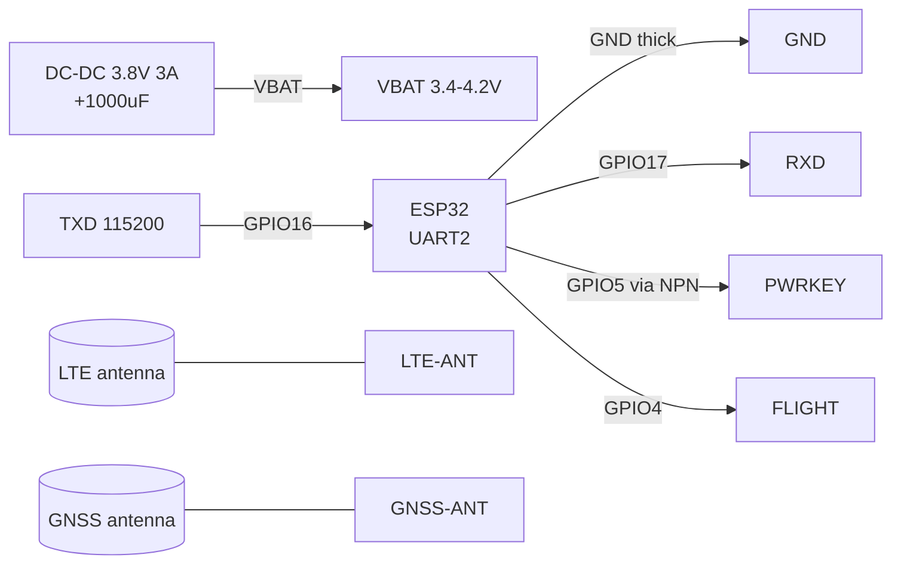
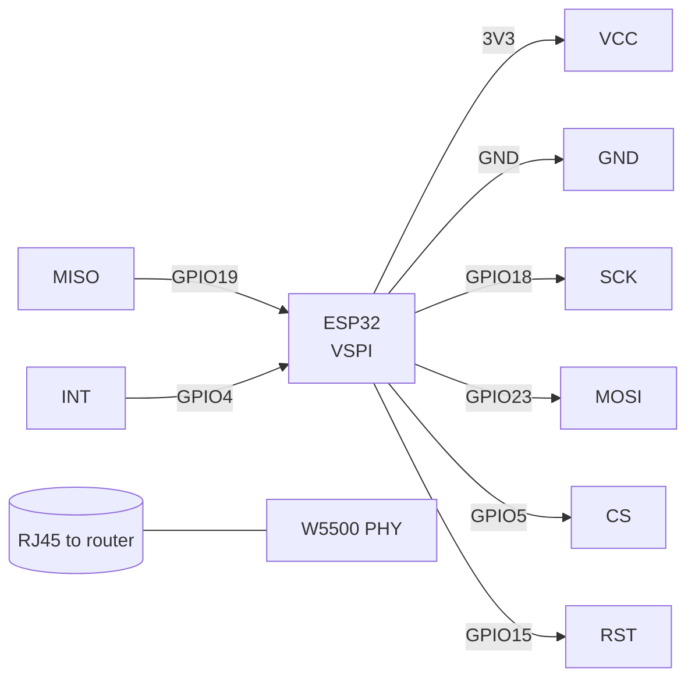
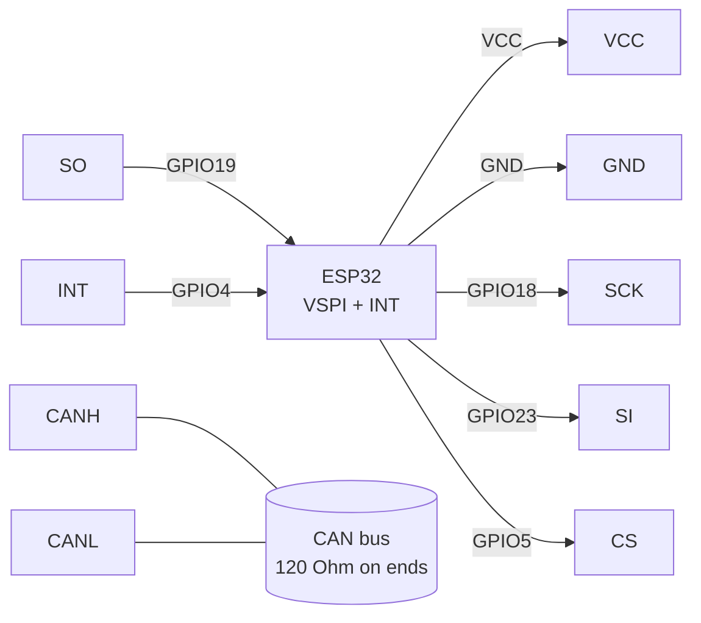

# SIM7600E 4G LTE / W5500 Ethernet / MCP2515 CAN - heavy connection artillery

> [!info] Purpose
> A note on "high-level" channels: **SIM7600E** (4G LTE + GNSS, MQTT/HTTP directly with ESP32 over UART), **W5500** (hardware TCP/IP Ethernet over SPI - more stable than ENC28J60), **MCP2515 + TJA1050** (CAN 2.0B over SPI for auto/industry). Common: all require careful power supply and give a reliable channel where there is no Wi-Fi or it is forbidden.

Characteristics (comparison table):

| Module | Standard | Interface | Power supply | Features |
| --- | --- | --- | --- | --- |
| SIM7600E-H | LTE Cat-1 / 4G + GNSS | UART 115200 (USB diagnostics) | VBAT 3.4-4.2V, 3A peaks! | MQTT/HTTP/FTP AT commands, nano-SIM slot, LTE + GNSS antennas |
| W5500 | 10/100 Ethernet, hardware TCP/IP | SPI up to 80 MHz (really 20-30) | 3.3V, ~150 mA | 8 sockets, Ethernet library (Arduino), RST + INT |
| MCP2515 + TJA1050 | CAN 2.0B 5 kbps-1 Mbps | SPI + INT | 5V module (MISO logic 3.3V OK) or 3.3V version | 8 MHz quartz, 120 Ohm terminator, H/L differential pair |

Navigation: UART [[EN/04-Interfaces/01-UART.en|UART]], SPI [[EN/04-Interfaces/02-SPI.en|SPI]], power supply [[EN/02-Power-Supply/01-Power-Rails.en]], SIM800L/GPS [[EN/12-Comm-Modules/03-SIM800L-GPS.en]], start [[EN/Home.en]].

## Purpose

SIM7600E 4G LTE / W5500 Ethernet / MCP2515 CAN - heavy connection artillery - SIM7600E 4G LTE (UART, VBAT 3A!); SIM7600E module pin legend; SIM7600E AT commands (basic,. SIM7600E 4G LTE / W5500 Ethernet / MCP2515 CAN - heavy connection artillery. Navigation: UART [[EN/04-Interfaces/01-UART.en|UART]], SPI [[EN/04-Interfaces/02-SPI.en|SPI]], power supply [[EN/02-Power-Supply/01-Power-Rails.en]], SIM800L/GPS 12-Comm-Modules/03-SIM800L-GPS, start Home.

## 1. SIM7600E 4G LTE (UART, VBAT 3A!)

The elder brother of SIM800L: real 4G + GPS on board. The main difference from SIM800L is power **3.4-4.2V** (typically 3.8V) and peaks **up to 3A** at network registration. Powering from a USB-UART DevKit is FORBIDDEN - a separate 5V to 3.8V 3A DC-DC + 1000 uF electrolytic.

Power-on: a **PWRKEY LOW >=1 s** pulse (button on board or GPIO via transistor). Status: **NETLIGHT** blinks (slow = registered), **FLIGHT** (flight mode).

![[assets/img/sim7600-scheme.png|500]]
*Fig. SIM7600E - separate 3.8V 3A PSU, PWRKEY pulse, LTE+GNSS antennas.*

### Module pin legend SIM7600E

| Pin | Type | Where | Note |
| --- | --- | --- | --- |
| VBAT (3.4-4.2V) | Power input | Separate 3.8V 3A DC-DC! | not 5V and not 3.3V: 5V kills, 3.3V gives reboots on registration; 1000 uF electrolytic + 100 nF ceramic near VBAT |
| GND | Ground | GND (thick wire!) | Common ground with ESP32; 3A current - wire >=0.5 mm2, short |
| TXD | UART output | GPIO16 (RX2) | 115200 8N1; 3.3V/1.8V level depends on board - via divider/level converter if needed |
| RXD | UART input | GPIO17 (TX2) | Crossed; some boards are 1.8V logic - need a level-shifter |
| PWRKEY | Input, active low | GPIO5 (via NPN/button) | LOW pulse 1-2 s = on/off; do not hold permanently LOW |
| FLIGHT | Input, active high | GPIO4 or NC | HIGH = flight mode (radio off); for work - LOW/GND |
| NETLIGHT / STATUS | Indication output | LED / GPIO (optional) | Blinks 1 Hz = network search, 1 time/3 s = registered |
| LTE-ANT / GNSS-ANT | RF (IPEX) | Antennas from the kit | without LTE antenna there is no registration; GNSS antenna is active, move to window |

### SIM7600E AT commands (basic, `\r\n`)

Cheat-sheet format is single in the base: `Command to OK answer to what it means to typical error` (see also the summary cheat sheet in [[EN/12-Comm-Modules/03-SIM800L-GPS.en]] and the full 35-command one in [[EN/12-Comm-Modules/18-Cellular-LoRa-2.en]]).

| Command | OK answer | What it means | Typical error |
| --- | --- | --- | --- |
| `AT` | `OK` | Modem ping | Silence: baud/port/power |
| `AT+CPIN?` | `+CPIN: READY` | SIM ready | `SIM PIN`: enter PIN or remove CLCK |
| `AT+CSQ` | `+CSQ: 20,99` | Level (>=10 OK) | 99,99: no antenna/network |
| `AT+CREG?` / `AT+CEREG?` | `+CEREG: 0,1` | Registered | 0,2 for long: antenna/SIM/band |
| `AT+CGATT=1` | `OK` | Data attached | ERROR: no registration - CREG first |
| `AT+CSTT="apn"` | `OK` | Operator APN | Capital-letter APN - rejection |
| `AT+CIICR` | `OK` | Data connection active | Wait up to 30 s; no - APN/coverage |
| `AT+CIFSR` | `10.x.x.x` | IP issued | ERROR: CIICR first |
| `AT+CIPSTART="TCP","broker",1883` | `CONNECT OK` | TCP open | `CONNECT FAIL`: broker/port/firewall |
| `AT+CGPS=1` | `OK` | GNSS on | Coordinates: `AT+CGPSINFO`; without antenna - zeros |

### ASCII schematic

```text
ESP32 DevKit              SIM7600E
─────────────              ────────
DC-DC 3.8V 3A ──────────►  VBAT (3.4-4.2V! +1000мкФ біля піна)
GND (товстий!) ═════════   GND
GPIO16 (RX2) ◄──────────   TXD (115200)
GPIO17 (TX2) ──────────►   RXD
GPIO5 ──[NPN]──────────►   PWRKEY (LOW 1-2с = on/off)
GPIO4 ─────────────────►   FLIGHT (LOW=робота)
                           LTE-ANT ══► антена (ОБОВ'ЯЗКОВО!)
                           GNSS-ANT ═► GPS-антена до вікна
                           nano-SIM в слот (зняти PIN на телефоні!)

ЗАБОРОНЕНО: живити VBAT від 5V / 3V3 DevKit / USB-UART!
```

### Mermaid



## 2. W5500 Ethernet (SPI, hardware TCP/IP)

Wiznet chip with a hardware stack: TCP/UDP/DHCP/DNS without load on ESP32. Unlike ENC28J60 - stable at 100 Mbps, Arduino `Ethernet` library (W5500 supported with v2.0). Mode: SPI Mode 0, up to 33 MHz (recommended 14-28 MHz).

![[assets/img/w5500-scheme.png|500]]
*Fig. W5500 - SPI on VSPI, RST and INT mandatory, RJ45 with transformer on board.*

### Module pin legend W5500

| Pin | Type | Where | Note |
| --- | --- | --- | --- |
| VCC 3.3V | Power input | 3V3 | 3.3V only, ~150 mA; peaks at link - 100 uF electrolytic; see [[EN/02-Power-Supply/01-Power-Rails.en]] |
| GND | Ground | GND | Common ground |
| SCK | SPI input | GPIO18 | VSPI SCK, up to 33 MHz |
| MISO | SPI output | GPIO19 | VSPI MISO |
| MOSI | SPI input | GPIO23 | VSPI MOSI |
| CS / SCS | SPI input | GPIO5 | Chip select |
| RST | Input, active low | GPIO15 | Hardware reset: LOW 10 ms at start; without it hangs after brownout |
| INT | Output, active low | GPIO4 | Socket interrupts; can be NC (polling), but with INT CPU saves |
| RJ45 | Ethernet | Twisted pair to router | Link/Activity LEDs on connector: green=link, yellow=activity |

### ASCII schematic

```text
ESP32 DevKit              W5500
─────────────              ─────
3V3 ────────────────────►  VCC 3.3V (+100мкФ!)
GND ────────────────────   GND
GPIO18 (SCK) ───────────►  SCK
GPIO23 (MOSI) ──────────►  MOSI
GPIO19 (MISO) ◄──────────  MISO
GPIO5 (CS) ─────────────►  CS/SCS
GPIO15 ─────────────────►  RST (LOW 10мс при startі)
GPIO4 ◄─────────────────   INT (опційно, але рекомендовано)
                           RJ45 ══► роутер (вита пара)
```

### Mermaid



## 3. MCP2515 CAN (SPI) + TJA1050

The MCP2515 CAN controller (SPI) + TJA1050 transceiver (differential CANH/CANL bus). Speed typically 125/250/500 kbps (cars - 500 kbps for treaty OBD-II requests, 250 - trucks/J1939). Quartz on the module is **8 MHz** (rarely 16 MHz - check against `MCP_8MHZ` / `MCP_16MHZ` in code!). **120 Ohm** terminator with the `J1` jumper - close on the two edge nodes.

### Module pin legend MCP2515

| Pin | Type | Where | Note |
| --- | --- | --- | --- |
| VCC | Power input | 5V (blue modules) or 3V3 (green 3.3V versions) | Blue 5V module: MISO output is 3.3V-compatible (divider inside) - directly OK; better buy the 3.3V version to not heat your head |
| GND | Ground | GND | Common ground |
| CS | SPI input | GPIO5 | Chip select |
| SO (MISO) | SPI output | GPIO19 | Data to ESP32 |
| SI (MOSI) | SPI input | GPIO23 | Data from ESP32 |
| SCK | SPI input | GPIO18 | SPI up to 10 MHz |
| INT | Output, active low | GPIO4 | Frame-receive interrupt - mandatory for lossless reception |
| CANH / CANL | Differential pair | Twisted pair to CAN bus | Do not swap H/L! 120 Ohm terminator (J1) on edge nodes |
| J1 (120R) | Jumper | Close/open | Close ONLY on the 2 edge bus nodes |

### ASCII schematic

```text
ESP32 DevKit              MCP2515+TJA1050
─────────────              ──────────────
5V або 3V3 ─────────────►  VCC (за версією плати!)
GND ────────────────────   GND
GPIO18 (SCK) ───────────►  SCK
GPIO23 (MOSI) ──────────►  SI
GPIO19 (MISO) ◄──────────  SO
GPIO5 (CS) ─────────────►  CS
GPIO4 ◄─────────────────   INT (обов'язково для RX!)
                           CANH ══► вита пара ══► CANH шини
                           CANL ══► вита пара ══► CANL шини
                           J1 [замкнути] якщо вузол крайній (120 Ом)

Увага: кварц 8МГц → MCP_8MHZ у коді! Якщо 16МГц → MCP_16MHZ.
```

### Mermaid



## Code

### Arduino (SIM7600E - MQTT publish via AT, simplified)

```cpp
// SIM7600: TX->16, RX->17, PWRKEY->5, 115200. APN замінити на свій!
#define PWRKEY 5
void modemSend(const char* cmd, uint32_t wait = 1000) {
  Serial2.println(cmd);
  delay(wait);
  while (Serial2.available()) Serial.write(Serial2.read());
}
void setup() {
  Serial.begin(115200);
  Serial2.begin(115200, SERIAL_8N1, 16, 17);
  pinMode(PWRKEY, OUTPUT); digitalWrite(PWRKEY, HIGH);
  digitalWrite(PWRKEY, LOW); delay(1500); digitalWrite(PWRKEY, HIGH); // on
  delay(5000);
  modemSend("AT", 500);
  modemSend("AT+CPIN?", 500);
  modemSend("AT+CEREG?", 1000);
  modemSend("AT+CSTT=\"internet\"", 1000); // APN!
  modemSend("AT+CIICR", 3000);
  modemSend("AT+CIFSR", 1000);
  modemSend("AT+CIPSTART=\"TCP\",\"test.mosquitto.org\",1883", 3000);
  // Далі: CIP SEND з MQTT CONNECT/PUBLISH байтами (див. приклад TinyGSM).
}
void loop() {}
```

> [!tip] For production use **TinyGSM** (`#define TINY_GSM_MODEM_SIM7600`): `modem.gprsConnect("internet")`, `mqtt.publish()` - without manual AT assembly.

### Arduino (W5500 WebClient - Ethernet library)

```cpp
#include <SPI.h>
#include <Ethernet.h>
byte mac[] = {0xDE, 0xAD, 0xBE, 0xEF, 0xFE, 0x01};
#define W5500_CS 5
#define W5500_RST 15
EthernetClient client;
void setup() {
  Serial.begin(115200);
  pinMode(W5500_RST, OUTPUT);
  digitalWrite(W5500_RST, LOW); delay(10); digitalWrite(W5500_RST, HIGH); delay(500);
  Ethernet.init(W5500_CS);
  SPI.begin(18, 19, 23, W5500_CS);
  if (Ethernet.begin(mac) == 0) { Serial.println("DHCP fail"); Ethernet.begin(mac, IPAddress(192,168,1,50)); }
  Serial.print("IP: "); Serial.println(Ethernet.localIP());
  if (client.connect("example.com", 80)) {
    client.println("GET / HTTP/1.0"); client.println("Host: example.com"); client.println();
    while (client.connected()) { while (client.available()) Serial.write(client.read()); }
    client.stop();
  }
}
void loop() { Ethernet.maintain(); delay(1000); }
```

### Arduino (MCP2515 CAN-send - mcp_can library)

```cpp
#include <SPI.h>
#include <mcp_can.h>
#define CAN_CS 5
#define CAN_INT 4
MCP_CAN CAN(CAN_CS);
void setup() {
  Serial.begin(115200);
  pinMode(CAN_INT, INPUT);
  SPI.begin(18, 19, 23, CAN_CS);
  // УВАГА: MCP_8MHZ або MCP_16MHZ — за кварцом на ТВОЇЙ платі!
  while (CAN.begin(MCP_ANY, CAN_500KBPS, MCP_8MHZ) != CAN_OK) { Serial.println("CAN init fail"); delay(500); }
  CAN.setMode(MCP_NORMAL);
  Serial.println("CAN OK 500kbps");
}
void loop() {
  byte d[8] = {0x01, 0x02, 0x03, 0x04, 0, 0, 0, 0};
  CAN.sendMsgBuf(0x100, 0, 8, d); // ID 0x100, стандартний кадр, 8 байт
  delay(500);
  if (!digitalRead(CAN_INT)) {
    long unsigned id; byte len; byte rx[8];
    CAN.readMsgBuf(&id, &len, rx);
    Serial.printf("RX ID=0x%lX len=%d\n", id, len);
  }
}
```

### ESP-IDF (W5500 via esp_eth, esp-idf ≥4.4)

```c
#include "esp_eth.h"
#include "esp_eth_mac_spi.h"
#include "esp_eth_phy_w5500.h"
// W5500 як esp_eth netif: mac_spi + phy_w5500, CS=5, INT=4, RST=15.
// Повний приклад: examples/ethernet/basic в ESP-IDF.
// Ключові кроки: spi_bus_add_device(VSPI) → eth_w5500_config_t → esp_eth_new_mac_spi()
// → esp_eth_new_phy_w5500() → esp_eth_driver_install() → esp_netif_attach().
void app_main(void) {
    // TODO: скопіювати examples/ethernet/basic, замінити піни:
    // .cs_gpio_num = 5, .int_gpio_num = 4, .sck=18, .miso=19, .mosi=23.
}
```

### MicroPython (W5500 - network driver, firmware with w5500)

```python
import network, time
# Потрібна прошивка з підтримкою W5500 (network.WIZNET5K) + SPI.
from machine import SPI, Pin
spi = SPI(1, baudrate=28000000, sck=Pin(18), mosi=Pin(23), miso=Pin(19))
nic = network.WIZNET5K(spi, Pin(5), Pin(15))  # cs, rst
nic.active(True)
nic.ifconfig("dhcp")
time.sleep(2)
print("IP:", nic.ifconfig())
```

### MicroPython (MCP2515 - mcp2515.py library)

```python
from machine import SPI, Pin
import mcp2515  # community driver (rose/mcp2515-micropython)
spi = SPI(1, baudrate=10000000, sck=Pin(18), mosi=Pin(23), miso=Pin(19))
can = mcp2515.MCP2515(spi, cs=Pin(5, Pin.OUT), osc=8000000)  # 8МГц кварц!
can.set_bitrate(500000)
can.send(id=0x100, data=b"\x01\x02\x03\x04")
print("CAN TX OK")
```

## typical errors

| # | Symptom | Cause | Fix |
| --- | --- | --- | --- |
| 1 | SIM7600 reboots at `CEREG`/`CIICR` | Power from DevKit/USB, 3A peaks sag VBAT | Separate 3.8V 3A DC-DC + 1000 uF near VBAT, thick GND |
| 2 | `+CPIN: NOT READY` / `SIM not inserted` | Nano-SIM without adapter contact / PIN-code on SIM | Remove PIN on the phone; wipe contacts; insert until click |
| 3 | `+CSQ: 0,0` / no registration | without LTE antenna; antenna indoors without windows | Screw on the antenna; move to window; verify operator bands (E version = Europe) |
| 4 | W5500 `DHCP fail` / `0.0.0.0` | No RST pulse; CS conflict with another SPI device; cable without link | RST LOW 10 ms at start; separate CS; Link LED must light; try static IP |
| 5 | W5500 hangs after brownout | RST not pulled on sag | RC chain on RST or GPIO-reset before `Ethernet.begin()`; watchdog |
| 6 | CAN `init fail` | wrong quartz in code (8 vs 16 MHz); bad SPI | Read the quartz marking; `MCP_8MHZ`/`MCP_16MHZ`; SPI <20 cm |
| 7 | CAN TX exists, no RX | J1 terminator open alone / closed in the middle; different speed | Close J1 on 2 edge nodes; same speed (500k) on all nodes; CANH/CANL not swapped |
| 8 | CAN heats TJA1050 | CANH/CANL short to 12V car; VCC 5V/3.3V mixed up | verify bus with multimeter (60 Ohm between H/L with 2 terminators); correct VCC per board version |

![[assets/img/lte-eth-can-scheme.png|500]]
*Fig. Overall schematic: SIM7600 on UART2, W5500 and MCP2515 on shared VSPI with different CS.*

## Official sources

- [SIM7600X-H - datasheets (SIMCom)](https://www.simcom.com/product/SIM7600X-H.html) - AT Manual, Hardware Design, VBAT 3.4-4.2V, photo.
- [W5500 - product page with photo (WIZnet)](https://wiznet.io/products/ethernet-chips/w5500) - modules, boards.
- [W5500 - docs with code (WIZnet)](https://docs.wiznet.io/Product/Chip/Ethernet/W5500) - ioLibrary examples.
- [MCP2515 - datasheet (PDF, Microchip)](https://ww1.microchip.com/downloads/en/DeviceDoc/MCP2515-Stand-Alone-CAN-Controller-with-SPI-20001801J.pdf) - CAN registers, masks/filters.

## See also

- [[EN/04-Interfaces/01-UART.en|UART]] - UART2 for SIM7600, 115200 speed
- [[EN/04-Interfaces/02-SPI.en|SPI]] - shared VSPI for W5500 + MCP2515 (different CS)
- [[EN/02-Power-Supply/01-Power-Rails.en]] - 3.8V 3A DC-DC, electrolytics, thick GND
- [[EN/12-Comm-Modules/03-SIM800L-GPS.en]] - younger brother of SIM7600 (2G, 4V 2A power)
- [[EN/12-Comm-Modules/01-RC522-RFID.en]] - SPI practices (length, CS)
- [[EN/12-Comm-Modules/04-RS485-CAN-Ethernet-Kamera.en]] - RS485/CAN frame, terminators
- [[EN/Home.en]] - reference start page
