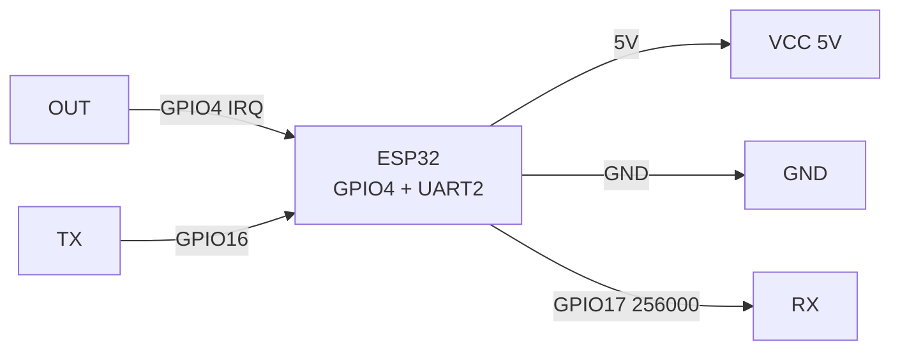
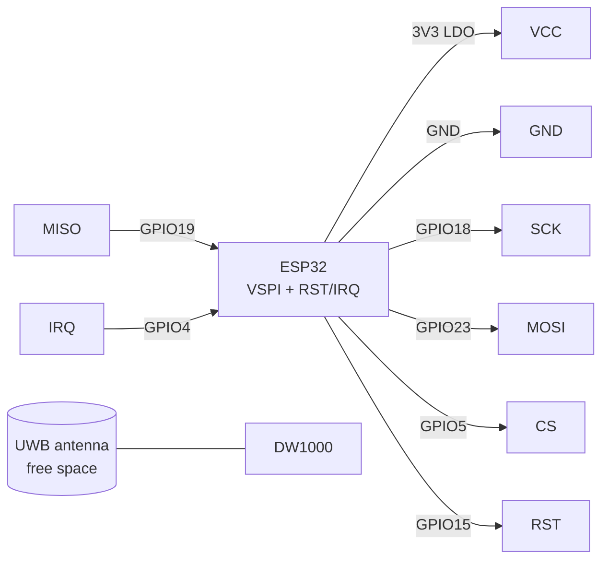
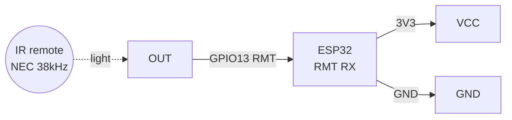
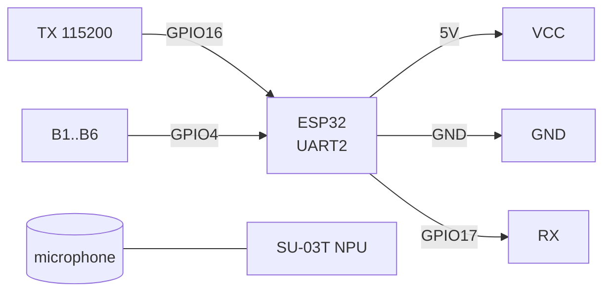

# LD2410 radar / DWM1000 UWB / VS1838 IR / SU-03T voice - presence and control sensors

> [!info] Purpose
> A note on "invisible" channels: **LD2410** (24 GHz mmWave radar - sees human presence even without motion, unlike PIR), **DWM1000** (UWB - exact range/positioning to +-10 cm), **VS1838** (38 kHz IR receiver - remote via RMT), **SU-03T** (offline voice control - commands without internet). Common: they detect a person/command and wake or command ESP32.

Characteristics (comparison table):

| Module | Principle | Interface | Power supply | Range | Features |
| --- | --- | --- | --- | --- | --- |
| LD2410 (HLK) | 24 GHz FMCW radar | UART 256000 (config) + OUT (presence) | 5V (3.3V LDO inside) | 0.75-6 m, gates per 0.75 m | Distinguishes motion/static, per-gate 0-100 sensitivity |
| DWM1000 (Decawave) | UWB 3.5-6.5 GHz, TWR | SPI + RST/IRQ | 3.3V | up to 100 m (line of sight), +-10 cm accuracy | Needs 2+ modules (tag + anchor), onboard antenna |
| VS1838B | 38 kHz IR photoreceiver | Digital OUT | 3.3V (or 5V with OUT divider) | 5-10 m (with remote) | Demodulator inside; ESP32 RMT decodes NEC/RC5 |
| SU-03T | Voice AI (offline NPU) | UART 115200 + GPIO outputs | 5V | 3-5 m microphone | Command firmware via WiseLight; synthesis/pin answer |

Navigation: UART [[EN/04-Interfaces/01-UART.en|UART]], SPI [[EN/04-Interfaces/02-SPI.en|SPI]], I2C [[EN/04-Interfaces/03-I2C.en|I2C]], power supply [[EN/02-Power-Supply/01-Power-Rails.en]], radio modules [[EN/12-Comm-Modules/02-NRF24-LoRa.en]], start [[EN/Home.en]].

## Purpose

LD2410 radar / DWM1000 UWB / VS1838 IR / SU-03T voice - presence and control sensors - LD2410 mmWave presence radar (UART + OUT); LD2410 module pin legend; ASCII schematic. LD2410 radar / DWM1000 UWB / VS1838 IR / SU-03T voice - presence and control sensors. Navigation: UART [[EN/04-Interfaces/01-UART.en|UART]], SPI [[EN/04-Interfaces/02-SPI.en|SPI]], I2C [[EN/04-Interfaces/03-I2C.en|I2C]], power supply [[EN/02-Power-Supply/01-Power-Rails.en]], radio modules 12-Comm-Modules/02-NRF24-LoRa, start Home.

## 1. LD2410 mmWave presence radar (UART + OUT)

Main trick: sees a **motionless** person (breathing) where PIR goes blind. **OUT** output = HIGH when someone is in the zone (can work without UART at all - like PIR). Fine tuning is over UART 256000 with the HLK protocol (mobile app via LD2410B BLE version or the `ld2410` tool): gates 0-8 (each 0.75 m), motion/static sensitivity 0-100, hold delay.

![[assets/img/ld2410-scheme.png|500]]
*Fig. LD2410 - 5V power, OUT to GPIO like PIR, UART for gate configuration.*

### Module pin legend LD2410

| Pin | Type | Where | Note |
| --- | --- | --- | --- |
| VCC 5V | Power input | 5V | Stable 5V; ~80 mA current; ripple sags sensitivity - 220 uF electrolytic near VCC |
| GND | Ground | GND | Common ground |
| OUT (OT1) | 3.3V digital output | GPIO4 (any, with interrupt) | HIGH = presence; can work without UART at all - like a PIR sensor |
| RX | UART input | GPIO17 (TX2) | 256000 speed for configuration; in working mode can be NC |
| TX | UART output | GPIO16 (RX2) | HLK-frame protocol (see code); in simple mode NC |
| SDA / SCL | I2C (reserve) | NC | not used on stock firmware |

Gate setup (example for a 4 m room): gates 0-1 (0-1.5 m) motion 80/static 60 sensitivity; gates 5-8 (far behind the wall) - 0 (cut neighbors off!). Unmanned-delay 30-60 s against blinking.

### ASCII schematic

```text
ESP32 DevKit              LD2410
─────────────              ──────
5V ─────────────────────►  VCC 5V (+220мкФ!)
GND ────────────────────   GND
GPIO4 ◄─────────────────   OUT (HIGH=присутність, як PIR)
GPIO17 (TX2) ──────────►   RX (256000, тільки для конфігу)
GPIO16 (RX2) ◄──────────   TX (256000, тільки для конфігу)

Мінімум (без конфігу): VCC + GND + OUT → GPIO4. Готово!
Радар вішати вертикально, чіпом від стіни, метал позаду — екран.
```

### Mermaid



## 2. DWM1000 UWB positioning (SPI, TWR)

Decawave DW1000 UWB module: measures radio-pulse **flight time** (Two-Way Ranging) and gives range with ~10 cm accuracy. Minimal system: 1 tag (on object) + 1 anchor (base) = range; 3-4 anchors = 2D/3D position (trilateration). Arduino libraries: `thotro/arduino-dw1000`, `Makerfabs DW1000_Ranging`.

> [!warning] UWB is power-sensitive: 3.3V ripple >50 mV degrades accuracy. Separate LDO + ferrite + 100 nF near VCC.

### Module pin legend DWM1000

| Pin | Type | Where | Note |
| --- | --- | --- | --- |
| VCC 3.3V | Power input | 3V3 (separate LDO recommended) | 3.3V only; TX current up to 150 mA pulsed; ferrite + 100 nF |
| GND | Ground | GND | Short, thick; common plane with antenna - do not cut the polygon |
| SCK | SPI input | GPIO18 | SPI up to 20 MHz; wires <10 cm (UWB is jitter-sensitive!) |
| MOSI | SPI input | GPIO23 | VSPI MOSI |
| MISO | SPI output | GPIO19 | VSPI MISO |
| CS | SPI input | GPIO5 | Chip select |
| RST (RSTn) | Input, active low | GPIO15 | Hardware reset: LOW 10 ms at start |
| IRQ | Output | GPIO4 | RX/TX done interrupt - mandatory for TWR timings |
| WAKEUP | Input | NC / 3V3 | for sleep; NC in the basic example |
| ANT | Built-in antenna | Free space! | do not cover with metal/hand; same module orientation; >=5 cm from ESP32 antenna |

### ASCII schematic

```text
ESP32 DevKit              DWM1000
─────────────              ───────
3V3 (LDO!) ─────────────►  VCC 3.3V (+100нФ + ферит!)
GND ────────────────────   GND
GPIO18 (SCK) ───────────►  SCK (SPI <10см!)
GPIO23 (MOSI) ──────────►  MOSI
GPIO19 (MISO) ◄──────────  MISO
GPIO5 (CS) ─────────────►  CS
GPIO15 ─────────────────►  RST (LOW 10мс при startі)
GPIO4 ◄─────────────────   IRQ (обов'язково!)
                           [вбудована UWB-антена → вільний простір]
```

### Mermaid



## 3. VS1838 IR receiver (38 kHz, RMT)

Three pins: power, ground, demodulated OUT (active low). ESP32 receives NEC frames via the **RMT peripheral** (`IRremoteESP8266` or `Arduino-IRremote` with RMT library). Range depends on the remote and angle (+-45 deg).

### Module pin legend VS1838

| Pin | Type | Where | Note |
| --- | --- | --- | --- |
| VCC | Power input | 3V3 (recommended) or 5V | from 3.3V the OUT level is safe directly; at 5V - 5V OUT to GPIO 1k/2k divider! |
| GND | Ground | GND | Common ground |
| OUT (S) | Digital output, active low | GPIO13 (RMT input, any) | HIGH at rest, bursts are 38 kHz LOW packs; 10k pull-up to VCC (often already on board) |

> [!tip] VS1838 goes blind from daylight lamps and sun (100 Hz IR noise). Place in shade, add software debounce of NEC repeats (address+command+inversion).

### ASCII schematic

```text
ESP32 DevKit              VS1838
─────────────              ──────
3V3 ────────────────────►  VCC (3.3V — OUT безпечний!)
GND ────────────────────   GND (середня нога!)
GPIO13 ◄────────────────   OUT (RMT-вхід, pull-up 10к)
                           "віконце" → у бік пульта, не на сонце!

Цоколівка фронтально (кулькою до себе): зліва OUT, середина GND, справа VCC!
У модулів-Keyes порядок на платі підписаний: VCC-GND-OUT (перевірити шовкографію!).
```

### Mermaid



## 4. SU-03T voice control (UART, offline)

Module with NPU: recognizes flashed commands without internet ("turn on light", "open gate"). Command firmware is in the **WiseLight** environment (keywords + answers + GPIO actions). With ESP32 it talks over UART (recognized-command line) or ready GPIO outputs (B1-B6 HIGH pulse).

### Module pin legend SU-03T

| Pin | Type | Where | Note |
| --- | --- | --- | --- |
| VCC 5V | Power input | 5V | 5V, ~150 mA; sensitive to PSU noise - separate LDO/470 uF electrolytic |
| GND | Ground | GND | Common ground |
| TX | UART output | GPIO16 (RX2) | 115200 8N1; format: `+ASR: command\r\n` (depends on WiseLight firmware) |
| RX | UART input | GPIO17 (TX2) | Answer-synthesis / control commands from ESP32 |
| B1-B6 (GPIO) | Outputs, HIGH pulse | GPIO4/13/... (optional) | Direct relay control without ESP32 parsing: each command gets its pin |
| MIC+/MIC- | Analog | Stock MEMS microphone | do not extend microphone wires! Module closer to voice source |

### ASCII schematic

```text
ESP32 DevKit              SU-03T
─────────────              ──────
5V ─────────────────────►  VCC 5V (+470мкФ!)
GND ────────────────────   GND
GPIO16 (RX2) ◄──────────   TX (115200, "+ASR: ...")
GPIO17 (TX2) ──────────►   RX
GPIO4 ◄─────────────────   B1 (HIGH-імпульс команди 1, опційно)
                           MIC → штатний мікрофон (не подовжувати!)
```

### Mermaid



## Code - presence / range / IR / voice

### Arduino (LD2410 - OUT like PIR + UART config frame reading)

```cpp
// Простий режим: OUT -> GPIO4
#define RADAR_OUT 4
void setup() {
  Serial.begin(115200);
  pinMode(RADAR_OUT, INPUT);
}
void loop() {
  Serial.println(digitalRead(RADAR_OUT) ? "Присутність!" : "Порожньо");
  delay(500);
}
```

```cpp
// Розширений: читання HLK-кадрів LD2410 (256000 бод, інженерний режим)
void setup() {
  Serial.begin(115200);
  Serial2.begin(256000, SERIAL_8N1, 16, 17); // RX=16 TX=17
  // Увімкнути інженерний режим: F4 F3 F2 F1 0E 00 62 00 ... (див. мануал HLK)
}
void loop() {
  // Кадр: F4 F3 F2 F1 LEN(2) TYPE(2) DATA... CRC F8 F7 F6 F5
  // Інженерний тип 0x01: рух-дальність, статика-дальність, енергії гейтів.
  // Для продакшену візьміть бібліотеку ld2410 (ncmreynolds) — парсинг готовий.
  while (Serial2.available()) Serial.printf("%02X ", Serial2.read());
  Serial.println(); delay(200);
}
```

### Arduino (VS1838 - IRremoteESP8266 + RMT)

```cpp
#include <IRremoteESP8266.h>
#include <IRrecv.h>
#include <IRutils.h>
#define IR_PIN 13
IRrecv ir(IR_PIN);
decode_results res;
void setup() {
  Serial.begin(115200);
  ir.enableIRIn(); // RMT під капотом на ESP32
}
void loop() {
  if (ir.decode(&res)) {
    Serial.println(resultToHumanReadableBasic(&res)); // протокол + код NEC
    ir.resume();
  }
}
```

### Arduino (DWM1000 - ranging, arduino-dw1000 library)

```cpp
// Потрібна бібліотека thotro/arduino-dw1000. Піни: CS=5, RST=15, IRQ=4.
#include <DW1000.h>
void setup() {
  Serial.begin(115200);
  SPI.begin(18, 19, 23, 5);
  DW1000.begin(5, 15, 4);
  DW1000.configureAsTag(); // повний конфіг (адреса, канал, PRF) — див. RangingTag
  Serial.println("DWM1000 tag ready");
}
```

> [!warning] Code above is a frame: take the full TWR example from `examples/RangingTag` / `RangingAnchor` of the library (channel 5 config there, 64 MHz PRF, 128 preamble). Tag and Anchor are different firmware on two ESP32s!

### ESP-IDF (LD2410 OUT + RMT NEC decoder, concept)

```c
#include "driver/gpio.h"
#include "driver/rmt_rx.h"
#define RADAR_OUT 4
#define IR_PIN 13
void app_main(void) {
    gpio_set_direction(RADAR_OUT, GPIO_MODE_INPUT);
    // RMT RX-канал для NEC: resolution 1 МГц, min duration фільтр 100 нс.
    // rmt_new_rx_channel() + rmt_new_copy_encoder... повний приклад:
    // examples/peripherals/rmt/rmt_rx_nec в ESP-IDF.
    while (1) {
        int present = gpio_get_level(RADAR_OUT);
        // TODO: опублікувати present по MQTT / увімкнути світло.
        vTaskDelay(pdMS_TO_TICKS(500));
    }
}
```

### MicroPython (LD2410 OUT + VS1838 polling + SU-03T UART)

```python
from machine import Pin, UART
import time
radar = Pin(4, Pin.IN)          # LD2410 OUT
ir = Pin(13, Pin.IN)            # VS1838 OUT (спрощено: детект посилки)
voice = UART(2, baudrate=115200, rx=16, tx=17)  # SU-03T
last = 0
while True:
    if radar.value():
        print("Радар: присутність")
    if ir.value() == 0 and time.ticks_ms() - last > 300:
        last = time.ticks_ms()
        print("ІЧ: посилка (декодування — по RMT/IR-библіотеці)")
    if voice.any():
        print("Голос:", voice.readline().decode(errors="ignore").strip())
    time.sleep_ms(200)
```

### HB100: 10 GHz Doppler for $3 (grandfather of all radars)

| Parameter | HB100 | RCWL-0516 | LD2410 |
| --- | --- | --- | --- |
| Frequency | 10.525 GHz (Doppler!) | ~3 GHz Doppler | 24 GHz FMCW |
| Output | Analog IF (microvolts!) | Digital trigger | UART + gates |
| Gain | Needs op-amp (LM358 x1000) | Built in | Built in |
| What it can | Motion ONLY (speed!), no distance | Motion through walls | Motion + distance + motionless |
| When | Radio amateurism, Doppler learning | Cheap trigger | Everything else |

```text
HB100 + LM358: IF → компаратор → GPIO-переривання ESP32.
Чутливість гвинтом на модулі; дощ/гойдання дерев — хибні спрацювання (як у всіх доплерів!).
Для продакшену — LD2410: той самий цінник, але з відстанню і фільтрами.
```

### LD2410C / HLK-LD2420 - younger brothers

| Parameter | LD2410 | LD2410C | HLK-LD2420 |
| --- | --- | --- | --- |
| Format | module with onboard antennas | Compact version, smaller board | Minimalist, cheaper |
| Control | OUT + UART 256000 | OUT + UART (simplified protocol) | OUT + UART |
| Gates | 0-8 with motion/static sensitivity | Shortened set | Basic threshold + delay |
| When to take | Full zone control | Tight enclosures, price | Simple presence trigger |

```text
ESP32 GPIO4 ◄── OUT LD2410C/LD2420 (HIGH=присутність, як PIR)
5V ──► VCC (+100мкФ), GND спільна
```

> All three are one HLK family: OUT logic is compatible, UART protocols differ in details - take the config utility for the specific model.

![[assets/img/ld2410c-out-scheme.png|500]]
*Fig. LD2410C/LD2420: minimum VCC+GND+OUT, UART only for configuration.*

## typical errors

| # | Symptom | Cause | Fix |
| --- | --- | --- | --- |
| 1 | LD2410 sees neighbors behind the wall | Factory sensitivity 100 on all gates | Zero far gates (5-8 to 0), set max distance 3-4 m, unmanned delay 30 s |
| 2 | LD2410 blinks presence/empty | Fan/curtain swings; PSU ripple | Remove moving objects from the beam; 220 uF electrolytic; increase delay |
| 3 | LD2410 does not answer over UART | Speed not 256000; RX/TX swapped | `Serial2.begin(256000, SERIAL_8N1, 16, 17)`; swap; OUT works without UART here |
| 4 | DWM1000 `init fail` / range jumps +-2 m | Long SPI wires; power ripple; antenna closed | SPI <10 cm; separate LDO + ferrite; free space around antenna; same pair orientation |
| 5 | DWM1000 always gives 0 m | Tag talks to Tag (no Anchor) / different channel configs | Flash a Tag+Anchor pair from examples; identical channel/PRF/preamble on both |
| 6 | VS1838 catches phantoms / does not see remote | Fluorescent lamps/sun; gray OUT without pull-up; remote not NEC | Shade the sensor; 10k pull-up; print `resultToHumanReadableBasic` to learn the remote protocol |
| 7 | VS1838 silent | Pinout mixed up (OUT/GND/VCC) | Check Keyes board silkscreen (VCC-GND-OUT), not the "bare" datasheet |
| 8 | SU-03T does not recognize | Noisy PSU; microphone far/extended; no command firmware | Separate power + 470 uF; module closer to user; flash WiseLight dictionary in Ukrainian |
| 9 | LD2410C/LD2420 configured with LD2410 utility | Protocols similar but not identical | Utility/library strictly for own model; OUT mode is universal |

![[assets/img/radar-uwb-ir-voice-scheme.png|500]]
*Fig. Overall schematic: LD2410 OUT + VS1838 RMT + SU-03T UART + DWM1000 SPI on one ESP32.*

## Official sources

- [HLK-LD2410 - manufacturer (Hi-Link)](https://www.hlktech.net/index.php?id=988) - manual, photo, gates 0-8.
- [LD2410 + ESP32 - tutorial with code](https://how2electronics.com/ld2410-sensor-with-esp32-human-presence-detection/) - ld2410.h library, distance/energy.
- [LD2410 - ESPHome](https://esphome.io/components/sensor/ld2410.html) - YAML config, gate-threshold calibration.
- DWM1000 (Qorvo/Decawave), VS1838, SU-03T - *verify manually* (no single vendor pages for the modules).

- LD2410B Datasheet (Hi-Link, search PDF): [LD2410B search](https://www.alldatasheet.com/view.jsp?Searchword=LD2410B) - radar + BLE.

## See also

- [[EN/04-Interfaces/01-UART.en|UART]] - UART2 for LD2410/SU-03T, 256000/115200 speeds
- [[EN/04-Interfaces/02-SPI.en|SPI]] - VSPI for DWM1000, length requirements
- [[EN/04-Interfaces/03-I2C.en|I2C]] - sensor buses (reserve interfaces)
- [[EN/02-Power-Supply/01-Power-Rails.en]] - LDO, ferrites, electrolytics for radio
- [[EN/12-Comm-Modules/01-RC522-RFID.en]] - antenna practices (metal, orientation)
- [[EN/12-Comm-Modules/02-NRF24-LoRa.en]] - radio range, comparison with UWB
- [[EN/Home.en]] - reference start page
