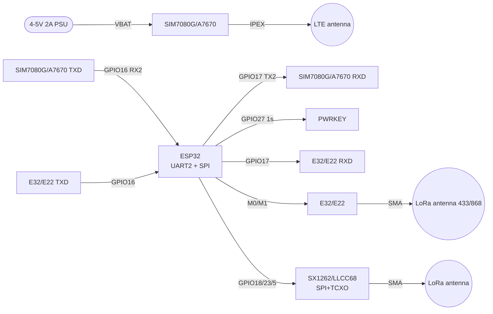

# Cellular and UART radio - SIM7080G, A7670, LoRa-UART E32, SX1262, HC-11

## Purpose

Long-range link for ESP32 without WiFi: SIM7080G NB-IoT/Cat-M module with GNSS,
4G successor of SIM800 - A7670 (Cat-1, voice/SMS/data),
UART LoRa modems E32-TTL-100 / E22 / RYLR998 (AT commands, M0/M1 modes, AT+ADDRESS addressing),
SX1262/LLCC68 SPI transceivers with TCXO for exact LoRa,
but also HC-11 / JDY-40 / CC1310 / nRF52840 overview.
Base: SIM800L/GPS - [[EN/12-Comm-Modules/03-SIM800L-GPS.en]], NRF24/LoRa SPI - [[EN/12-Comm-Modules/02-NRF24-LoRa.en]],
SIM7600/4G - [[EN/12-Comm-Modules/07-SIM7600-W5500-MCP2515.en]], BT/Sub-GHz - [[EN/12-Comm-Modules/06-HC05-HM10-CC1101-HC12.en]].

> ANTENNA WARNING: LTE antennas (700-2700 MHz, IPEX/SMA connector) and LoRa antennas (433/868 MHz)
> are not interchangeable! Transmitting into a foreign antenna = VSWR > 3, PA overheating, failure.
> Do not turn LoRa/SIM modules on in TX without antennas!

## Characteristics

| Module | Network / band | Interface | Power supply | Feature |
| --- | --- | --- | --- | --- |
| SIM7080G | Cat-M1 + NB-IoT + GNSS, multiband LTE | UART (AT), USB | 2.7-4.8 V, typically 4 V! Peak 2 A | PSM/eDRX - 10 years on battery; PWRKEY for startup |
| A7670 (A7670E/G/SA) | 4G LTE Cat-1 + 2G fallback, voice/SMS/GNSS (depends on subversion) | UART (AT), USB | 3.4-4.2 V, 2 A peak | SIM800 successor: same AT commands, modern networks (2G is turned off!) |
| E32-TTL-100 (SX1276) | LoRa 410-441 MHz, 20 dBm | UART 1200-115200 + M0/M1 | 2.3-5.5 V (3.3/5 V versions) | Transparent/fixed modes, address and channel over the air |
| E22 (SX1262) | LoRa 410-493 / 850-930 MHz, 22 dBm | UART + M0/M1 + AUX | 2.3-5.5 V | Newer than E32: less consumption, longer link |
| RYLR998 (RYLR896) | LoRa 868/915 MHz, AT commands | UART 115200, AT+ADDRESS/AT+SEND | 3.3 V | Simplest start: addressed delivery out of the box |
| SX1262 / LLCC68 | LoRa 150-960 MHz, +22 dBm, -148 dBm | SPI + DIO1/BUSY/RESET | 3.3 V, TCXO on module | Exact frequency (TCXO), LoRaWAN stack, RadioLib library needed |
| HC-11 (CC1101) | FSK 433 MHz, -112 dBm | UART 9600-115200, AT | 3.3-5 V | Cheap transparent bridge, without LoRa modulation |
| JDY-40 | 2.4 GHz, proprietary | UART, AT | 3.3 V | Wire replacement for short distances |
| CC1310 / nRF52840 | Sub-1 GHz (CC1310) / 2.4 GHz + BLE + 802.15.4 (nRF52840) | SPI / UART, SoC | 3.3 V | SoC with radio: firmware instead of AT modem |

## Module pin legend

### SIM7080G (developer board / breakout)

| Pin | Label | Type | To ESP32 | Note |
| --- | --- | --- | --- | --- |
| 1 | VBAT | Power input | 4 V 2 A PSU (DC-DC!) | not DevKit 3V3! 2 A peak at network registration |
| 2 | GND | Ground | GND | Thick wire, common ground |
| 3 | TXD (of module) | UART output | GPIO16 (ESP32 RX2) | Crossed TX to RX, 115200 |
| 4 | RXD (of module) | UART input | GPIO17 (ESP32 TX2) | Crossed RX from TX |
| 5 | PWRKEY | Input, active low | GPIO27 | LOW pulse >=1 s = on/off! |
| 6 | RESET | Input, active low | GPIO14 or NC | Emergency reset >=100 ms |
| 7 | STATUS | Digital output | GPIO34 (input only!) | HIGH = module on |
| 8 | NETLIGHT | Output | LED or NC | Blinking = network status (64 ms ON/300 ms = search) |
| 9 | SIM_DATA/RST/CLK | SIM card | Nano-SIM holder on board | NB-IoT SIM with Cat-M/NB support! |
| 10 | ANT_LTE | RF output | LTE IPEX/SMA antenna | LTE antenna ONLY, not LoRa! |
| 11 | ANT_GNSS | RF output | GNSS antenna (active 3 V) | Separate/combo antenna, sky view |

### A7670 (developer board)

| Pin | Label | Type | To ESP32 | Note |
| --- | --- | --- | --- | --- |
| 1 | VBAT | Power input | 5 V 2 A (own DC-DC to 4 V) or 4 V | 2 A peak! DevKit USB does not pull |
| 2 | GND | Ground | GND | Common ground |
| 3 | TXD | UART output | GPIO16 (RX2) | Crossed, 115200 |
| 4 | RXD | UART input | GPIO17 (TX2) | Crossed |
| 5 | PWRKEY | Input | GPIO27 | LOW pulse ~1 s for startup (like SIM800!) |
| 6 | RESET | Input | GPIO14 or NC | Emergency reset |
| 7 | STATUS | Output | GPIO34 | HIGH = on |
| 8 | SIM card | Holder | Nano-SIM 4G | Plain IoT/mobile SIM |
| 9 | ANT | RF output | LTE 700-2700 MHz antenna | not a LoRa antenna! |
| 10 | SPK/MIC | Audio | Speaker/microphone | Only voice versions (A7670E/SA) |

> A7670 is the SIM800 heir: `AT+CPIN`, `AT+CSQ`, `AT+CGATT`, `AT+HTTP*` AT commands are the same,
> but the network is 4G Cat-1 (2G in Ukraine/EU is turned off - SIM800 dies, A7670 lives).

### E32-TTL-100 / E22 (LoRa-UART, M0/M1 modes)

| Pin | Label | Type | To ESP32 | Note |
| --- | --- | --- | --- | --- |
| 1 | VCC | Power input | 3V3 or 5V (by version!) | verify board marking |
| 2 | GND | Ground | GND | Common ground |
| 3 | TXD (of module) | UART output | GPIO16 (RX2) | Crossed |
| 4 | RXD (of module) | UART input | GPIO17 (TX2) | Crossed |
| 5 | M0 | Mode input | GPIO27 | M0/M1: 00 normal, 11 sleep, 10 WOR, 01 config |
| 6 | M1 | Mode input | GPIO14 | Switch only in sleep! |
| 7 | AUX | Open-drain output | GPIO34 + pull-up | HIGH = ready; LOW = busy TX/RX |
| 8 | ANT | RF output | LoRa 433/868 MHz antenna | Own frequency! Not an LTE antenna! |

M0/M1 modes:

| M1 | M0 | Mode | Purpose |
| --- | --- | --- | --- |
| 0 | 0 | Normal | Transparent UART to LoRa transfer |
| 0 | 1 | WOR (wake-up) | Economy: periodic wake-ups |
| 1 | 0 | Power-saving | Only WOR-frame reception |
| 1 | 1 | Sleep/config | AT setup of address/channel/power |

`AT+ADDRESS`, `AT+NETWORKID`, `AT+BAND` - over UART in Sleep mode; wait for AUX=HIGH after each command!

### RYLR998 (LoRa AT modem)

| Pin | Label | Type | To ESP32 | Note |
| --- | --- | --- | --- | --- |
| 1 | VCC | Power input | 3V3 | 3.3 V only! |
| 2 | GND | Ground | GND | Common ground |
| 3 | TX | UART output | GPIO16 (RX2) | 115200 by default |
| 4 | RX | UART input | GPIO17 (TX2) | `AT+SEND=<addr>,<len>,<data>` |
| 5 | RESET | Input | GPIO14 or NC | Reset |
| 6 | ANT | RF output | 868/915 MHz antenna | Own frequency! |

`AT+ADDRESS=1`, `AT+NETWORKID=5`, `AT+BAND=868000000` - a pair of modules with the same NETWORKID see each other.

### SX1262 / LLCC68 (SPI, TCXO)

| Pin | Label | Type | To ESP32 | Note |
| --- | --- | --- | --- | --- |
| 1 | VCC | Power input | 3V3 | 3.3 V only, TX ~120 mA |
| 2 | GND | Ground | GND | Ground + antenna shield |
| 3 | SCK | SPI input | GPIO18 | Up to 8 MHz |
| 4 | MOSI | SPI input | GPIO23 | ESP32 to radio |
| 5 | MISO | SPI output | GPIO19 | Radio to ESP32 |
| 6 | NSS | CS input | GPIO5 | Chip Select |
| 7 | RESET | Reset input | GPIO25 | Active low, pulse at init |
| 8 | BUSY | Output | GPIO26 | HIGH = chip busy, wait! |
| 9 | DIO1 | Interrupt output | GPIO32 | RX Done / TX Done / CAD |
| 10 | ANT | RF output | Own-frequency LoRa antenna | without ANTENNA do not TURN ON TX! |

> LLCC68 is a cheapened SX1262 without LoRaWAN certification (same registers, same RadioLib library).
> TCXO on the module is mandatory for LoRaWAN (drift without TCXO breaks join).

## Connection schematic

| ESP32 | SIM7080G / A7670 | E32/E22/RYLR998 | SX1262/LLCC68 |
| --- | --- | --- | --- |
| GND | GND (thick wire!) | GND | GND |
| GPIO16 (RX2) | Module TXD | Module TXD | - |
| GPIO17 (TX2) | Module RXD | Module RXD | - |
| GPIO27 | PWRKEY (1 s pulse!) | M0 | - |
| GPIO14 | RESET (optional) | M1 | - |
| GPIO34 (input) | STATUS | AUX (+pull-up) | - |
| GPIO18/23/19/5 | - | - | SCK/MOSI/MISO/NSS |
| GPIO25 | - | - | RESET |
| GPIO26 | - | - | BUSY |
| GPIO32 | - | - | DIO1 |
| 4 V 2 A PSU | VBAT SIM7080G | - | - |
| 5 V 2 A PSU / 4 V | VBAT A7670 | - | - |
| 3V3/5V | - | VCC E32/E22 | - |
| 3V3 | - | VCC RYLR998 | VCC SX1262 |

Cellular power is a separate DC-DC with 2 A margin, see [[EN/02-Power-Supply/01-Power-Rails.en]].
UART - [[EN/04-Interfaces/01-UART.en|UART]], SPI - [[EN/04-Interfaces/02-SPI.en|SPI]]. Baud of cellular and RYLR998: 115200 8N1.

### ASCII schematic

```text
ESP32 DevKit              SIM7080G (Cat-M/NB-IoT+GNSS, 4В!)
------------              -------------------------------
GND ═════════════════════ GND (товстий провід!)
GPIO16 (RX2) ◄──────────── TXD (115200)
GPIO17 (TX2) ────────────► RXD
GPIO27 ─────────────────► PWRKEY (LOW 1с = start!)
GPIO14 ─────────────────► RESET (опційно)
GPIO34 ◄───────────────── STATUS (HIGH=ON)
[БЖ 4В 2А] ─────────────► VBAT (НЕ 3V3 DevKit! пік 2А!)
ANT_LTE ──► LTE-антена (НЕ LoRa!)  ANT_GNSS ──► GNSS-антена
SIM: NB-IoT/Cat-M тариф! AT: CPIN→CSQ→CGATT→CNACT→HTTP

ESP32 DevKit              A7670 (4G-наступник SIM800)
------------              --------------------------
GND ═════════════════════ GND
GPIO16 ◄────────────────── TXD
GPIO17 ──────────────────► RXD
GPIO27 ─────────────────► PWRKEY (LOW ~1с)
[БЖ 5В 2А] ─────────────► VBAT (пік 2А при дзвінку/attach!)
ANT ──► LTE-антена 700-2700 МГц (НЕ LoRa!)
AT ті ж, що SIM800: AT+CPIN, AT+CSQ, AT+CGATT, AT+CMGS (SMS)

ESP32 DevKit              E32-TTL-100 / E22 (LoRa-UART)
------------              ---------------------------
GND ────────────────────► GND
GPIO16 ◄───────────────── TXD
GPIO17 ─────────────────► RXD
GPIO27 ─────────────────► M0
GPIO14 ─────────────────► M1 (режими: 00 норма, 11 конфіг!)
GPIO34 ◄───────────────── AUX (HIGH=готовий, чекати після AT!)
3V3/5V ─────────────────► VCC (за версією плати!)
ANT ──► LoRa-антена 433/868 МГц (НЕ LTE!) БЕЗ АНТЕНИ НЕ TX!

ESP32 DevKit              SX1262 / LLCC68 (SPI + TCXO)
------------              ---------------------------
3V3 ────────────────────► VCC (тільки 3.3В!)
GND ────────────────────► GND
GPIO18 ─────────────────► SCK
GPIO23 ─────────────────► MOSI
GPIO19 ◄───────────────── MISO
GPIO5 ──────────────────► NSS
GPIO25 ─────────────────► RESET
GPIO26 ◄───────────────── BUSY (чекати LOW перед командою!)
GPIO32 ◄───────────────── DIO1 (переривання)
ANT ──► LoRa-антена своєї частоти! TCXO на модулі для LoRaWAN.
```

### Mermaid



![[assets/img/cellular-nbiot-uartlora-scheme.png|600]]
*Fig. SIM7080G/A7670 over UART with separate power, E32/E22 with M0/M1/AUX, SX1262 over SPI. Space for schematic - see [[assets/README]].*

## Code ESP-IDF

```c
#include "driver/uart.h"
#include "driver/gpio.h"
#include "freertos/FreeRTOS.h"
#include "freertos/task.h"
#include <string.h>

#define MODEM_UART UART_NUM_2
#define PIN_PWRKEY 27

static void at_send(const char *cmd)
{
    uart_write_bytes(MODEM_UART, cmd, strlen(cmd));
    uart_write_bytes(MODEM_UART, "\r\n", 2);
}

static void at_read(int ms)
{
    uint8_t buf[256];
    int n = uart_read_bytes(MODEM_UART, buf, sizeof(buf) - 1, ms / portTICK_PERIOD_MS);
    if (n > 0) { buf[n] = 0; printf("MODEM: %s\n", buf); }
}

void app_main(void)
{
    uart_config_t u = {.baud_rate = 115200, .data_bits = UART_DATA_8_BITS,
                       .parity = UART_PARITY_DISABLE, .stop_bits = UART_STOP_BITS_1,
                       .flow_ctrl = UART_HW_FLOWCTRL_DISABLE};
    uart_param_config(MODEM_UART, &u);
    uart_set_pin(MODEM_UART, 17, 16, UART_PIN_NO_CHANGE, UART_PIN_NO_CHANGE);
    uart_driver_install(MODEM_UART, 2048, 2048, 0, NULL, 0);

    // PWRKEY: імпульс LOW 1 с (SIM7080G/A7670)
    gpio_config_t g = {.pin_bit_mask = 1ULL << PIN_PWRKEY, .mode = GPIO_MODE_OUTPUT};
    gpio_config(&g);
    gpio_set_level(PIN_PWRKEY, 1); vTaskDelay(500 / portTICK_PERIOD_MS);
    gpio_set_level(PIN_PWRKEY, 0); vTaskDelay(1200 / portTICK_PERIOD_MS);
    gpio_set_level(PIN_PWRKEY, 1); vTaskDelay(3000 / portTICK_PERIOD_MS);

    // SIM7080G: перевірка → рівень → attach → PDP → HTTP GET
    at_send("AT"); vTaskDelay(500 / portTICK_PERIOD_MS); at_read(500);
    at_send("AT+CPIN?"); at_read(500);
    at_send("AT+CSQ"); at_read(500);
    at_send("AT+CGATT=1"); at_read(2000);
    at_send("AT+CNACT=0,1"); at_read(3000);  // PDP-контекст
    // RYLR998/E32 у Sleep-режимі: AT+ADDRESS=1, AT+NETWORKID=5, чекати AUX=HIGH!
}
```

## Code Arduino

```cpp
#include <HardwareSerial.h>
HardwareSerial Modem(2);  // UART2: RX=16, TX=17
#define PIN_PWRKEY 27
#define PIN_STATUS 34

void at(const String &cmd, int wait_ms = 800) {
  Modem.println(cmd);
  unsigned long t = millis();
  while (millis() - t < (unsigned long)wait_ms) {
    if (Modem.available()) Serial.write(Modem.read());
  }
  Serial.println();
}

void modem_powerkey() {
  pinMode(PIN_PWRKEY, OUTPUT);
  digitalWrite(PIN_PWRKEY, HIGH); delay(500);
  digitalWrite(PIN_PWRKEY, LOW); delay(1200);  // імпульс 1 с!
  digitalWrite(PIN_PWRKEY, HIGH); delay(3000);
}

void setup() {
  Serial.begin(115200);
  Modem.begin(115200, SERIAL_8N1, 16, 17);
  pinMode(PIN_STATUS, INPUT);
  modem_powerkey();
  Serial.printf("STATUS=%d (1=ON)\n", digitalRead(PIN_STATUS));

  // --- SIM7080G NB-IoT ---
  at("AT"); at("AT+CPIN?"); at("AT+CSQ");
  at("AT+COPS?", 2000);
  at("AT+CGATT=1", 3000);
  at("AT+CNACT=0,1", 3000);

  // --- A7670 HTTP GET (після attach) ---
  // at("AT+HTTPINIT"); at("AT+HTTPPARA=\"URL\",\"http://example.com\"");
  // at("AT+HTTPACTION=0", 5000); at("AT+HTTPTERM");

  // --- RYLR998: адресована доставка ---
  // at("AT+ADDRESS=1"); at("AT+NETWORKID=5"); at("AT+BAND=868000000");
  // at("AT+SEND=2,5,HELLO");  // вузлу з ADDRESS=2, 5 байт
}

void loop() {
  // Міст USB↔модем для ручних AT-команд:
  while (Serial.available()) Modem.write(Serial.read());
  while (Modem.available()) Serial.write(Modem.read());
}
```

## Code MicroPython

```python
from machine import UART, Pin
import time

modem = UART(2, baudrate=115200, tx=17, rx=16, timeout=500)
pwrkey = Pin(27, Pin.OUT, value=1)
status = Pin(34, Pin.IN)

def at(cmd, wait=1.0):
    modem.write(cmd + "\r\n")
    time.sleep(wait)
    r = modem.read()
    print(cmd, "->", r.decode(errors="ignore") if r else "<тиша>")
    return r

# Старт модуля імпульсом PWRKEY
pwrkey.value(0); time.sleep(1.2); pwrkey.value(1); time.sleep(3)
print("STATUS:", status.value())

at("AT")
at("AT+CPIN?")
at("AT+CSQ")
at("AT+CGATT=1", 3)

# E32 у режимі Sleep (M0=1,M1=1): configuration адреси
m0, m1 = Pin(27, Pin.OUT), Pin(14, Pin.OUT)
aux = Pin(34, Pin.IN)
m0.value(1); m1.value(1); time.sleep_ms(100)
at("AT+ADDRESS=1")
while aux.value() == 0:  # чекати готовності!
    time.sleep_ms(50)
m0.value(0); m1.value(0)  # назад у Normal

# SX1262 по SPI — через RadioLib-порт або sx126x-драйвер:
# from sx1262 import SX1262
# sx = SX1262(spi_bus=2, clk=18, mosi=23, miso=19, cs=5, irq=32, rst=25, gpio=26)
# sx.begin(freq=868.0, bw=125.0, sf=9)  # БЕЗ АНТЕНИ НЕ ВИКЛИКАТИ!
```

## typical errors

Single-format AT cheat sheets (command to answer to meaning to error): summary SIM800 - [[EN/12-Comm-Modules/03-SIM800L-GPS.en]], basic 4G - [[EN/12-Comm-Modules/07-SIM7600-W5500-MCP2515.en]], full 35 commands - [[EN/12-Comm-Modules/18-Cellular-LoRa-2.en]]. Below - the specific rakes of this note:

1. **SIM7080G from DevKit 3V3** → eternal reboots at attach. 2 A peak! Separate 4 V 2 A DC-DC + 470+ uF electrolytic.
2. **Without PWRKEY pulse** → silence on UART. SIM7080G/A7670 start only with a LOW pulse ~1 s, not on power-up.
3. **Plain SIM without NB-IoT** → `+CGATT: 0`. For SIM7080G you need a tariff/operator with Cat-M/NB-IoT coverage.
4. **LTE antenna on LoRa and vice versa** → VSWR > 3, PA death. Antennas are marked by frequency: LTE 700-2700 MHz, LoRa 433/868 MHz.
5. **TX without antenna** → output stage overheating. Rule: screwed the antenna → power → AT → TX.
6. **TX-TX / RX-RX** → silence. UART crossed: module TX to ESP32 RX (GPIO16).
7. **E32 configured in Normal mode** → AT ignored. M0=1/M1=1 (Sleep), wait for AUX=HIGH after each command.
8. **AUX not checked** → truncated frames. AUX=LOW means "busy": do not send the next command/packet.
9. **SIM800 code unchanged on A7670** → partly works, but HTTP/SMS commands differ by version. Check the AT Manual of A7670 exactly.
10. **SX1262 without BUSY wait** → broken commands. Before each SPI command wait for BUSY=LOW.
11. **LLCC68 with SX1262 LoRaWAN stack unpatched** → join does not pass. Verify the frequency/TCXO table in the radio config.

## Common issues

| Symptom | Cause | Fix |
| --- | --- | --- |
| Reboots at network attach | 2 A TX peak sags 3V3 DevKit rail | Separate 4 V buck plus 470 uF cap, short thick VBAT wires |
| Silent UART after power-on | No PWRKEY low pulse for 1 s | Drive PWRKEY low 1 s, wait for RDY or 3 s before AT |
| CGATT 0, no attach | SIM without NB-IoT tariff or wrong APN | Check operator Cat-M/NB-IoT coverage, set APN with CGDCONT |
| E32 ignores commands | Module in Normal mode, not Sleep | Set M0/M1 high, wait AUX high after each command |
| SX1262 garbage replies | SPI command while BUSY high | Poll BUSY low before every command, slow SPI to 1 MHz first |
## Official sources

- [SIM7080G - product page with photo (SIMCom)](https://www.simcom.com/product/SIM7080G.html) - Cat-M/NB-IoT/GNSS, PSM/eDRX, AT Manual.
- [SIM7600X-H - 4G-family datasheets (SIMCom)](https://www.simcom.com/product/SIM7600X-H.html) - AT Manual, VBAT 3.4-4.2 V, same AT approach as in A7670.
- [SX1262 - product page (Semtech)](https://www.semtech.com/products/wireless-rf/lora-connect/sx1262) - +22 dBm, -148 dBm, datasheet.
- [ESP32 + LoRa - tutorial with code (RNT)](https://randomnerdtutorials.com/esp32-lora-rfm95-transceiver-arduino-ide/) - Sender/Receiver, antenna mandatory.
- [ESP-IDF UART - docs with code (Espressif)](https://docs.espressif.com/projects/esp-idf/en/latest/esp32/api-reference/peripherals/uart.html) - uart_param_config, AT exchange.

## See also

- [[EN/Home.en]]
- [[EN/12-Comm-Modules/02-NRF24-LoRa.en]]
- [[EN/12-Comm-Modules/03-SIM800L-GPS.en]]
- [[EN/12-Comm-Modules/06-HC05-HM10-CC1101-HC12.en]]
- [[EN/12-Comm-Modules/07-SIM7600-W5500-MCP2515.en]]
- [[EN/04-Interfaces/01-UART.en|UART]]
- [[EN/04-Interfaces/02-SPI.en|SPI]]
- [[EN/02-Power-Supply/01-Power-Rails.en]]
- [[EN/02-Power-Supply/02-LDO-DC-DC.en]]
- [[EN/99-Additions/02-Troubleshooting-FAQ.en]]
