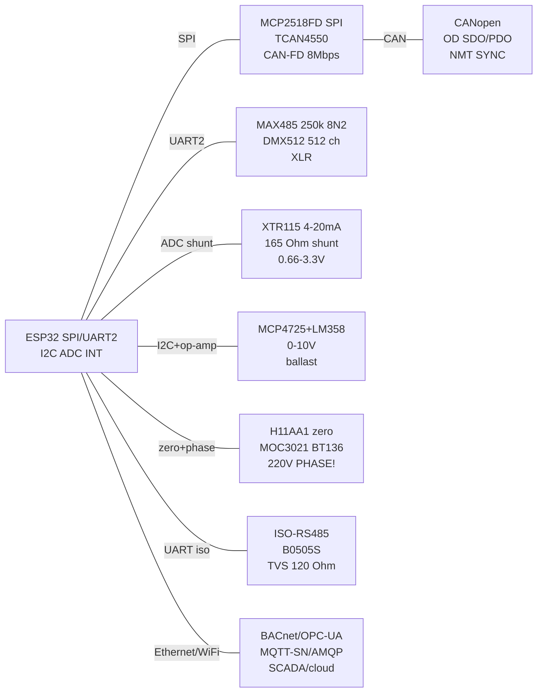

# Industrial fieldbus: CANopen / DMX512 / KNX / DALI / 4-20 mA / 0-10 V / TRIAC / BACnet / CAN-FD

![[assets/img/industrial-fieldbus-scheme.png|600]]
*Fig. 1. Workshop ESP32 node: CANopen/CAN-FD, DMX light, 4-20 mA loop, 0-10 V dimmer, TRIAC with zero-cross, isolated RS485 - with galvanic isolation from 220 V.*

> [!danger] 220 V - LETHALLY DANGEROUS!
> TRIAC dimmer, zero-cross detector and 220 V PSU - this is mains voltage! Install only with the breaker off, check with an indicator, IP54+ enclosure, fuse + varistor on input. Neutral (N) and ground (PE) are not the same thing! Without mains experience - do not repeat, give to an electrician. The ESP32 side always via optocouplers (MOC3021/PC817/H11AA1) + isolated DC-DC.
>
> [!warning] Isolation mandatory!
> Workshop = long lines + noise + different ground potentials. RS485/CAN without isolation burn first. Rule: ESP32 logic to (ADuM/ISO + isolated DC-DC) to field side. Broken isolation = broken ESP32 and fire in the cabinet.

## Purpose

A workshop bridge note from [[EN/12-Comm-Modules/04-RS485-CAN-Ethernet-Kamera.en|RS485/CAN cameras]] and [[EN/04-Interfaces/05-CAN-TWAI-RS485.en]] to industrial buses: CANopen (object dictionary, SDO/PDO overview), DMX512 (stage light over MAX485 at 250 kbaud!), KNX/DALI overview (what lives in buildings), 4-20 mA current loop (XTR115 transmitter + shunt 165 Ohm reception to 3.3 V!), 0-10 V dimmer (DAC + op-amp), TRIAC dimmer with zero-cross detector (MOC3021 + H11AA1!, ISOLATION), overview table BACnet/OPC-UA/MQTT-SN/AMQP "what for the workshop", CAN-FD MCP2518FD/TCAN4550 controllers and isolated RS485 modules. Power supply - only via [[EN/02-Power-Supply/01-Power-Rails.en]] with protection.

> Where it lives: machine/robot - CANopen; stage/club - DMX512; building/office - KNX/DALI/BACnet; pressure/level sensors over 100+ m - 4-20 mA; old lamps/fans - 0-10 V; incandescent lamps/heaters - TRIAC with zero-cross; clouds/SCADA - OPC-UA/MQTT.

## Characteristics

| Parameter | CANopen (CC/FD) | DMX512 | KNX / DALI (overview) |
| --- | --- | --- | --- |
| Physical level | CAN ISO 11898-2, 10 kbps-1 Mbps (CC) / up to 8 Mbps data (FD) | RS485 + UART 250 kbaud 8N2! | KNX: twisted pair 9600 + 30 V; DALI: 2 wires 1200 baud, 16 V |
| Data model | Object dictionary (OD): indexes 0x1000-0x9FFF | 512 channel slots, BREAK+MAB frame | KNX: group addresses; DALI: 64 addresses + 16 groups |
| Services | SDO (configuration) / PDO (real time) / NMT / SYNC / EMCY / Heartbeat | Constant frame stream ~44 Hz, without acks | KNX: telegrams; DALI: lamp/ballast commands |
| Addressing | Node-ID 1-127, COB-ID | Universe 1-512, fixture start address | KNX: area.line.device; DALI: short address |
| Length | Up to 1000 m (at low bauds), 120 Ohm terminators | Up to 300-1200 m, 120 Ohm, 32 devices per segment! | KNX up to 1000 m/segment; DALI up to 300 m |
| ESP32 | TWAI (CC) + MCP2518FD/TCAN4550 (FD!) | UART + MAX485 (DE always TX!) | Gateways/bridges (not GPIO directly!) |

| Parameter | 4-20 mA loop (XTR115) | 4-20 mA reception (shunt!) | 0-10 V dimmer |
| --- | --- | --- | --- |
| Transmitter | XTR115: 2-wire, Vref 2.5 V, loop power 7.5-36 V | Shunt 165 Ohm to 0.66-3.3 V for ESP32 ADC! | MCP4725 DAC to LM358 op-amp to 0-10 V |
| Current / accuracy | 4 mA = 0%, 20 mA = 100%, break = 0 mA (diagnostics!) | 4 mA x 165 Ohm = 0.66 V; 20 mA x 165 Ohm = 3.30 V | 0 V = min, 10 V = max, ballast input resistance ~100 kOhm |
| Isolation | ISO124/AMC1301 recommended | TVS + RC + op-amp buffer | Op-amp with 12 V supply + optoisolation of PWM alternative |
| Protection | Current limit, reverse polarity | PTC + 5 V TVS on ADC! | Schottky diode, 11 V limit |
| Application | Pressure/temperature/level sensors in the workshop | ESP32 receives workshop sensors | LED drivers/fans/dampers |

| Parameter | TRIAC dimmer + zero-cross (MOC3021!) | CAN-FD MCP2518FD / TCAN4550 | Isolated RS485 |
| --- | --- | --- | --- |
| Key | BT136/BTA16 + MOC3021 (random-phase!) / MOC3041 (built-in zero-cross); BTA24 - up to 25 A in isolated package for lamps/heaters over 2 kW | SPI to CAN-FD up to 8 Mbps data, 32 FIFOs | ISO1410 / ADM2587E / MAX14850 + iso-DC-DC |
| Zero detector | H11AA1/PC814 + 2x100 kOhm to 220 V! | 20/40 MHz quartz, INT | ADuM1201 + isolated 5 V |
| Control | Phase cut: 0-10 ms delay after zero | SPI 10-20 MHz, interrupts | DE/RE + 120 Ohm terminator |
| Load | R (lamps/heaters); L/C - only with snubber! | CANH/CANL twisted pair | A/B twisted pair + GND shield |
| Protection | Fuse + varistor + 100 Ohm+100 nF snubber | CAN TVS, common bus GND | TVS A/B, gas arresters outdoors |

| "What for the workshop" protocol | Level | Transport | When to take |
| --- | --- | --- | --- |
| Modbus RTU/TCP | Field/workshop | RS485 / Ethernet | Pumps, meters, PLC - first choice |
| CANopen | Field/bus | CAN | Drives, encoders, input modules |
| DMX512 | Stage | RS485-250k | Light, smoke, stage winches |
| KNX | Building | 30 V twisted pair | Office lighting/blinds/climate |
| DALI-2 | Building/light | 2-wire 16 V | Addressable lamps, emergency light |
| BACnet MS/TP-IP | Building/BMS | RS485 / IP | Ventilation, chillers, energy metering |
| OPC-UA | Workshop/SCADA | TCP | History, alarms, MES/cloud gateway |
| MQTT / MQTT-SN | IoT/workshop | TCP / UDP | ESP32 telemetry to broker to SCADA |
| AMQP | IT/queues | TCP | Reliable queues between services (not the field!) |

## Module pin legend

| MAX485 to DMX512 (reflash!) | Purpose | Where |
| --- | --- | --- |
| VCC / GND | 5 in (MAX485) / 3.3 in (MAX3485!) | 5V / GND |
| DI / RO | UART TX / RX | GPIO17 / GPIO16 (UART2 250 kbaud 8N2!) |
| DE + RE (bridge!) | TX mode always for DMX transmitter | VCC via 1 kOhm (transmitter!) / GPIO4 (receiver) |
| A / B | DMX+ / DMX- (XLR-3: 1=GND, 2=-, 3=+) | Twisted pair, 120 Ohm on ends! |

| XTR115 (loop) | Purpose | Where |
| --- | --- | --- |
| LOOP+ / LOOP- | 7.5-36 V loop from workshop PSU! | Workshop PSU + sensor |
| VIN / IRET | Voltage input / current return | Divider from sensor + loop GND |
| VREF 2.5 V | Reference/bridge excitation | Strain-gauge bridge |
| VREG 5 V | External op-amp power | Op-amp/sensor (~10 mA limit!) |

| 4-20 mA reception (165 Ohm shunt!) | Purpose | Where |
| --- | --- | --- |
| LOOP+ to R165 to LOOP- | 4 mA to 0.66 V, 20 mA to 3.30 V | R165 precision 0.1%! |
| R middle to RC to ADC | 1 kOhm + 100 nF + 3.6 V TVS | GPIO36 (ADC1!) via follower |
| Loop GND to ESP32 GND | Only via isolation/diff! | Better AMC1301/ISO124! |

| 0-10 V dimmer | Purpose | Where |
| --- | --- | --- |
| MCP4725 VOUT 0-3.3 V | I2C DAC 0x60 | GPIO21 / GPIO22 |
| LM358 x3 | Gain 0-3.3 to 0-10 V | Op-amp supply 12-15 V! |
| OUT 0-10 V / GND | To ballast/driver | Shield, 12 V TVS |

| TRIAC + zero-cross (220 V!) | Purpose | Where |
| --- | --- | --- |
| H11AA1 AC1/AC2 | 220 V via 2x100 kOhm 0.5 W! | Mains L/N + fuse! |
| H11AA1 OUT | 100 Hz pulse (each zero!) | GPIO34 (input!) + pull-up |
| MOC3021 LED | Control (10-15 mA!) | GPIO25 via 330 Ohm |
| MOC3021 TRIAC | BT136 firing | BT136 gate + snubber! |
| BT136 A1/A2 | 220 V power switch | L to load to N, heatsink! |

| MCP2518FD / TCAN4550 (CAN-FD) | Purpose | Where |
| --- | --- | --- |
| VCC / GND | 3.3 V | 3V3 / GND + 2x 100 nF |
| SCK/SI/SO/CS | SPI 10-20 MHz | GPIO18/23/19/5 ([[EN/04-Interfaces/02-SPI.en|SPI]]) |
| INT | Frame interrupts | GPIO27 |
| CANH / CANL | FD bus, 120 Ohm! | Twisted pair, TVS |
| STBY (TCAN4550) | Transceiver mode | GPIO (HIGH = standby) |

| Isolated RS485 | Purpose | Where |
| --- | --- | --- |
| VCC-logic / GND-logic | 3.3 in ESP32 | 3V3 / GND |
| DI / RO / DE/RE | UART + control | GPIO17 / GPIO16 / GPIO4 |
| VCC-iso / GND-iso | Isolated 5 V (B0505S!) | Field side, separate GND! |
| A / B | Field pair + TVS | Twisted pair + 120 Ohm |

## Connection schematic

| ESP32 | CAN/CAN-FD | DMX/RS485-iso | 4-20 mA / 0-10 V | TRIAC/zero | Note |
| --- | --- | --- | --- | --- | --- |
| 3V3 | MCP2518FD VCC | Logic VCC | MCP4725 VCC | MOC LED via 330 Ohm | 3.3 V logic |
| 5V-iso | - | ISO VCC (B0505S!) | ADS/op-amp digital | - | Isolated 5 V! |
| GND | GND | Logic GND | GND | Logic GND | Field GND separate! |
| GPIO18/19/23/5 | SPI CAN-FD | - | SPI ADS1256 | - | SPI bus |
| GPIO27 | CAN-FD INT | - | ADS DRDY | - | Interrupts |
| GPIO16/17 | - | RO/DI UART2 | - | - | UART2: DMX 250k 8N2! |
| GPIO4 | - | DE+RE | - | - | HIGH=TX |
| GPIO21/22 | - | - | MCP4725 I2C | - | 0-10 V DAC |
| GPIO36 | - | - | 165 Ohm shunt to ADC! | - | 0.66-3.3 V |
| GPIO34 | - | - | - | H11AA1 zero | 100 Hz input |
| GPIO25 | - | - | - | MOC3021 LED | Phase 0-10 ms! |
| CANH/L, A/B | 120 Ohm twisted pair | 120 Ohm twisted pair | Workshop loop | 220 V L/N | TVS + fuses! |

### ASCII schematic

```text
  ESP32-DevKitC              Цехові модулі                  Поле
 +---------------+     +----------------------+     ------------------
 | GPIO18/23/19/5|---->SCK/SI/SO/CS (MCP2518FD SPI 20МГц, INT->G27)
 |               |     CANH/CANL --вита пара--> CANopen bus [120 Ом x2]
 | GPIO16/17 (U2)|---->RO/DI (ISO-RS485 / DMX MAX485, 250к 8N2 для DMX!)
 | GPIO4         |---->DE+RE (HIGH=TX)   A/B --вита пара--> DMX-прилади
 | 3V3/GND       |---->logic VCC/GND     B0505S -> iso-5V (ІЗОЛЯЦІЯ!)
 | GPIO21/22     |---->MCP4725 -> LM358 x3 -> 0-10V -> баласт
 | GPIO36 (ADC1) |<---- шунт 165 Ом (4мА=0.66V,20мА=3.3V!) <- петля XTR115
 | GPIO34        |<---- H11AA1 (220V через 2x100k!) ZERO-CROSS 100Гц
 | GPIO25 --330R |---->MOC3021 -> Gate BT136 -> ЛАМПА/ТЕН 220V!
 +---------------+     +----------------------+     ------------------
  220V: запобіжник + варистор + снабер! Корпус закритий! N і PE не плутати!
  Петля 4-20мА живиться від ЦЕХОВОГО БЖ 24V, не від ESP32!
```

### Mermaid



## Code ESP-IDF

```c
#include "driver/uart.h"
#include "driver/twai.h"
#include "driver/adc.h"
#include "driver/gpio.h"
#include "esp_log.h"
static const char *TAG = "ind";

// DMX512-передавач: UART2 250000 8N2 + BREAK (>88 мкс LOW!)
static void dmx_send(uint8_t *slots, int n) {
    uart_set_line_inverse(UART_NUM_2, UART_SIGNAL_TXD_INV);
    // BREAK: тримати TX LOW ~100 мкс, MAB ~12 мкс, далі start-код 0x00 + 512 слотів
    uart_write_bytes(UART_NUM_2, "\x00", 1);
    uart_write_bytes(UART_NUM_2, (char*)slots, n);
}
// CANopen heartbeat (TWAI classic): COB-ID 0x700+ID, 1 байт state
static void canopen_hb(uint8_t node, uint8_t state) {
    twai_message_t m = {.identifier=0x700+node,.data_length_code=1,.data={state}};
    twai_transmit(&m, 100);
}
// 4-20 мА прийом: шунт 165 Ом -> 0.66..3.30 В -> ADC -> мА -> %
static float loop_pct(void) {
    int raw = adc1_get_raw(ADC1_CHANNEL_0); // GPIO36
    float v = raw * 3.3 / 4095.0;
    float ma = v / 165.0 * 1000.0; // шунт 165 Ом!
    return (ma - 4.0) / 16.0 * 100.0;
}
// TRIAC: zero-cross на GPIO34 (100 Гц), затримка фази 0-10000 мкс
static volatile int phase_us = 5000;
static void IRAM_ATTR zero_isr(void *a) {
    esp_rom_delay_us(phase_us);
    gpio_set_level(25, 1); esp_rom_delay_us(50); gpio_set_level(25, 0);
}

void app_main(void) {
    // UART2 DMX
    uart_config_t u = {.baud_rate=250000,.data_bits=UART_DATA_8_BITS,
        .parity=UART_PARITY_DISABLE,.stop_bits=UART_STOP_BITS_2,
        .flow_ctrl=UART_HW_FLOWCTRL_DISABLE,.source_clk=UART_SCLK_DEFAULT};
    uart_param_config(UART_NUM_2,&u);
    uart_set_pin(UART_NUM_2,17,16,-1,4); // TX,RX,DE
    uart_driver_install(UART_NUM_2,1024,0,0,NULL,0);
    // TWAI CANopen 250 кбіт
    twai_general_config_t g = TWAI_GENERAL_CONFIG_DEFAULT(5, 4, TWAI_MODE_NORMAL);
    twai_timing_config_t t = TWAI_TIMING_CONFIG_250KBITS();
    twai_filter_config_t f = TWAI_FILTER_CONFIG_ACCEPT_ALL();
    twai_driver_install(&g,&t,&f); twai_start();
    adc1_config_width(ADC_WIDTH_BIT_12);
    adc1_config_channel_atten(ADC1_CHANNEL_0, ADC_ATTEN_DB_11);
    gpio_set_direction(25, GPIO_MODE_OUTPUT); // MOC3021
    gpio_set_direction(34, GPIO_MODE_INPUT);
    gpio_set_intr_type(34, GPIO_INTR_POSEDGE);
    gpio_install_isr_service(0);
    gpio_isr_handler_add(34, zero_isr, NULL);
    uint8_t dmx[8] = {0,128,255,64,0,0,0,0};
    for (;;) {
        dmx_send(dmx, 8);
        canopen_hb(0x05, 0x05); // operational
        ESP_LOGI(TAG, "loop=%.1f%% phase=%d", loop_pct(), phase_us);
        vTaskDelay(pdMS_TO_TICKS(500));
    }
}
// MCP2518FD/TCAN4550: SPI-драйвер (coryjfowler/mcp2518fd), 20 МГц, INT-обробка FIFO.
// BACnet/OPC-UA/MQTT-SN: через Ethernet/W5500 або Wi-Fi, див. таблицю «що для цеху».
```

## Code Arduino

```cpp
#include <Wire.h>
#include <driver/twai.h>
#include <Adafruit_MCP4725.h>

Adafruit_MCP4725 dac;
#define DE_RE 4
#define ZERO 34
#define TRIAC 25
#define ECHO_ADC 36
volatile int phaseUs = 5000;

void IRAM_ATTR onZero() {
  delayMicroseconds(phaseUs); // фаза 0-10000 мкс!
  digitalWrite(TRIAC, HIGH); delayMicroseconds(50); digitalWrite(TRIAC, LOW);
}

void setup() {
  Serial.begin(115200);
  // DMX512-передавач: 250 кбод 8N2, DE завжди TX
  Serial2.begin(250000, SERIAL_8N2, 16, 17);
  pinMode(DE_RE, OUTPUT); digitalWrite(DE_RE, HIGH);
  pinMode(TRIAC, OUTPUT);
  pinMode(ZERO, INPUT);
  attachInterrupt(ZERO, onZero, RISING); // H11AA1: 100 Гц!

  // CANopen heartbeat через TWAI classic 250 кбіт
  twai_general_config_t g = TWAI_GENERAL_CONFIG_DEFAULT((gpio_num_t)5, (gpio_num_t)4, TWAI_MODE_NORMAL);
  twai_timing_config_t t = TWAI_TIMING_CONFIG_250KBITS();
  twai_filter_config_t f = TWAI_FILTER_CONFIG_ACCEPT_ALL();
  twai_driver_install(&g, &t, &f); twai_start();

  Wire.begin(21, 22);
  dac.begin(0x60); // 0-10 В через LM358 x3
  dac.setVoltage(2048, false); // ~5 В на виході димера
  analogReadResolution(12);
}

void loop() {
  // DMX кадр: BREAK + MAB + start 0x00 + слоти (спрощено через Serial2)
  Serial2.write(0x00); // start-код
  for (int i = 0; i < 8; i++) Serial2.write(i * 32);

  // 4-20 мА: шунт 165 Ом!
  int raw = analogRead(ECHO_ADC);
  float v = raw * 3.3 / 4095.0;
  float ma = v / 165.0 * 1000.0;
  float pct = (ma - 4.0) / 16.0 * 100.0;
  Serial.printf("loop=%.2fmA (%.0f%%) phase=%d\n", ma, pct, phaseUs);

  // CANopen heartbeat node 5 operational
  twai_message_t m; m.identifier = 0x705; m.data_length_code = 1; m.data[0] = 0x05;
  twai_transmit(&m, 10);
  // MCP2518FD (CAN-FD): бібліотека mcp2518fd, SPI 20 МГц, читати FIFO по INT
  delay(500);
}
```

## Code MicroPython

```python
from machine import Pin, UART, I2C, ADC
import time

# DMX512: UART 250 кбод 8N2, передавач (DE=HIGH)
de = Pin(4, Pin.OUT, value=1)
dmx = UART(2, 250000, bits=8, parity=None, stop=2, rx=16, tx=17)
i2c = I2C(0, scl=Pin(22), sda=Pin(21), freq=100000)
adc = ADC(Pin(36)); adc.atten(ADC.ATTEN_11DB)
triac = Pin(25, Pin.OUT, value=0)
zero = Pin(34, Pin.IN)
phase_us = 5000

def dac(v12, addr=0x60):
    i2c.writeto(addr, bytes([0x40, (v12 >> 4) & 0xFF, (v12 << 4) & 0xF0]))

def loop_pct():
    raw = adc.read()
    v = raw * 3.3 / 4095.0
    ma = v / 165.0 * 1000.0  # шунт 165 Ом -> 3.3V!
    return ma, (ma - 4.0) / 16.0 * 100.0

def zero_cb(p):
    # УВАГА: у перериванні мінімум коду! Фаза — блокуюча, для продакшену — RMT/timer!
    time.sleep_us(phase_us)
    triac.on(); time.sleep_us(50); triac.off()

zero.irq(trigger=Pin.IRQ_RISING, handler=zero_cb)
dac(2048)  # ~5 В на 0-10В димері

while True:
    dmx.write(b"\x00" + bytes([i * 32 for i in range(8)]))  # start + 8 слотів
    ma, pct = loop_pct()
    print("loop={:.2f}mA {:.0f}% phase={}".format(ma, pct, phase_us))
    # CANopen SDO/PDO на MicroPython — через TWAI немає API: тільки шлюз UART->Linux/CAN!
    # MCP2518FD — тільки C/Arduino; у MicroPython — сирий SPI-драйвер власноруч.
    time.sleep_ms(500)
```

### EtherCAT / PROFINET: why ESP32 is a guest there

| Parameter | EtherCAT | PROFINET IRT |
| --- | --- | --- |
| Cycle | Up to 100 us, frames "on the fly" | 250 us - 1 ms, synchronized |
| PHY | Plain Ethernet, but a special controller (LAN9252!) | Plain Ethernet + stack |
| ESP32 role | ONLY gateway: LAN9252 over SPI to Modbus/MQTT further | Gateway/diagnostics, not a real-time party |
| Practice | ESP32 + LAN9252 = EtherCAT slave for telemetry (not for axis control!) |

```text
Чесна межа: мікросекундні цикли вимагають апаратного контролера і RTOS-стека
з сертифікацією; ESP32 без спец-PHY встигає тільки «слухати і переказувати».
Для керування приводами з ESP32 — CANopen (див. вище) або Modbus TCP.
```

### EL817 - second optocoupler after PC817

| Parameter | PC817 (Sharp) | EL817 (Everlight) |
| --- | --- | --- |
| Purpose | Universal digital/analog optoisolation | Pin-to-pin PC817 analog |
| CTR | 50-600% (ranks A-D) | 50-600% (ranks A-D) |
| Isolation voltage | 5 kV | 5 kV |
| When to take | whatever is available - interchangeable; check CTR rank in marking (C/D for small currents) |

```text
ESP32 GPIO ──[R 220–1к]──► LED оптопари ──► GND
Вихід: фототранзистор з pull-up до 3.3V (або 5V-сторона для TRIAC-драйвера MOC3021)
R розрахувати: If = 5–10 мА (не 20 «за звичкою» — CTR вистачить, а LED житиме довше)
```

## typical errors

| № | error | Symptom | Solution |
| --- | --- | --- | --- |
| 1 | Work with 220 V without isolation/breaker | Shock, fire | Breaker + indicator + optocouplers + closed enclosure; do not mix N/PE! |
| 2 | MOC3041 for dimming | "Only on/off" | MOC3041 is zero-cross (relay!), for phase dimmer - only MOC3021 (random-phase!) |
| 3 | TRIAC without snubber on a fan | Self-firing, hum | 100 Ohm + 100 nF snubber + varistor; L-load - TDA1085C or VFD! |
| 4 | Zero on each half-period without filter | 100 Hz flicker | Filter + phase hysteresis; delay strictly 0-10 ms; RMT timer instead of delay in ISR! |
| 5 | DMX on 115200 8N1 | Devices silent | DMX strictly 250 kbaud 8N2 + BREAK! Transmitter DE always HIGH! |
| 6 | DMX without terminator / 64 devices | Channel flicker | 120 Ohm on ends, max 32 devices per segment, then - splitter/amplifier! |
| 7 | 250 Ohm shunt for 5 V ADC | ESP32 ADC dead | for 3.3 V - strictly 165 Ohm (20 mA to 3.3 V)! 3.6 V TVS + RC on input! |
| 8 | Loop powered from ESP32 | 0 mA, sensor silent | Loop - from workshop 24 V! ESP32 only receives via shunt/isolation! |
| 9 | 0-10 V from GPIO directly | Ballast does not react/smells | GPIO 3.3 V is not 10 V! DAC + op-amp with 12 V supply, common GND! |
| 10 | CAN without second node/terminator | bus-off | Minimum 2 nodes + 2x120 Ohm; powered-off bus CANH-CANL ~= 60 Ohm! |
| 11 | CAN-FD on ESP32 TWAI | No FD frames | ESP32-TWAI is classic only! FD - only MCP2518FD/TCAN4550 over SPI! |
| 12 | Non-isolated RS485 in the workshop | Burnt MAX485 + ESP32 | ISO1410/ADM2587E + B0505S + TVS; shield to PE in one point! |
| 13 | KNX/DALI straight to GPIO | Everything burnt | KNX 30 V / DALI 16 V - only certified transceivers/gateways! |
| 14 | OPC-UA straight on ESP32 without TLS | Break-ins/falls | OPC-UA - on the gateway (RPi/PC), ESP32 - MQTT/Modbus to gateway! |
| 15 | PC817/EL817 without If calculation | 20 mA "by habit", LED degradation | If 5-10 mA by CTR rank; check rank in marking |

## Common issues

| Symptom | Cause | Fix |
| --- | --- | --- |
| CANopen nodes drop out | Missing 120 Ohm terminators or wrong bitrate | Terminate both bus ends, set all nodes to same bitrate |
| DMX flicker on fixtures | Break timing wrong or missing 120 Ohm term | Check 88 us break, terminate chain end, shielded pair |
| 4-20 mA reads wrong | Wrong burden resistor or loop not powered | Use 250 Ohm precision burden, power loop 24 V, check wiring |
| TRIAC fires randomly | No zero-cross sync or no opto-isolation | Add ZC detector interrupt, MOC3021 isolation, snubber on load |
| Mains work is unsafe | No breaker, no isolation, N/PE mixed | Breaker plus indicator, optocouplers, closed box, qualified person only |
## Official sources

- [CANopen - knowledge base and specs (CAN in Automation, CiA)](https://www.can-cia.org/can-knowledge/canopen) - object dictionary, SDO/PDO, NMT, profiles.
- [XTR115 - 4-20 mA transmitter datasheet (Texas Instruments)](https://www.ti.com/product/XTR115) - 7.5-36 V loop, Vref 2.5 V, IRET.
- [CAN Bus BFF - guide with MCP2515 code (Adafruit Learn)](https://learn.adafruit.com/adafruit-can-bus-bff) - SPI to CAN, 120 Ohm terminator, 1 Mbps.
- [W5500 - Ethernet chip docs for gateways (WIZnet Docs)](https://docs.wiznet.io/Product/Chip/Ethernet/W5500) - TCP/IP stack for BACnet/OPC-UA/MQTT gateways.

### Isolated high-voltage measurement: AMC1301 (example)

```text
Задача: міряти 0–400V DC шину без гальванічного зв'язку з ESP32.
  Шина 400V ──[дільник 390к/10к]──► AMC1301 (ізольований підсилювач, gain 8) ──►
  ──► диференційно в ADS1115/ESP32-ADC.
  Ізоляція 5 кВ всередині чипа; сторони живляться ОКРЕМО (ізольований DC-DC!).
  Альтернатива дешевше: ZMPT101B (AC) / PZEM (готовий) — див. 10-15 і 10-21.
  Без ізоляції високовольтний вимір = шлях до спаленого ESP32 і удару струмом!
```

## See also

- [[Home.en|Home reference map]]
- [[EN/12-Comm-Modules/04-RS485-CAN-Ethernet-Kamera.en|RS485/CAN/Ethernet/Camera]]
- [[EN/04-Interfaces/05-CAN-TWAI-RS485.en|CAN/TWAI/RS485 buses]]
- [[EN/02-Power-Supply/01-Power-Rails.en|Power rails]]
- [[EN/04-Interfaces/01-UART.en|UART bus]]
- [[EN/04-Interfaces/02-SPI.en|SPI bus]]
- [[EN/10-Sensors/25-Mag-IMU-2.en|Magnetometers/IMU-2]]
- [[EN/10-Sensors/26-Light-UV-IRArray-ToF.en|Light/UV/therm imagers/ToF]]
- [[EN/10-Sensors/27-Time-Mem-IO-DAC.en|RTC/memory/IO/DAC]]
- [[EN/12-Comm-Modules/10-Industrial.en|This note (graph anchor)]]
- [[EN/13-Power-Modules/02-Level-Shifters.en|Level-shifters]]
- [[EN/99-Additions/02-Troubleshooting-FAQ.en|FAQ]]
