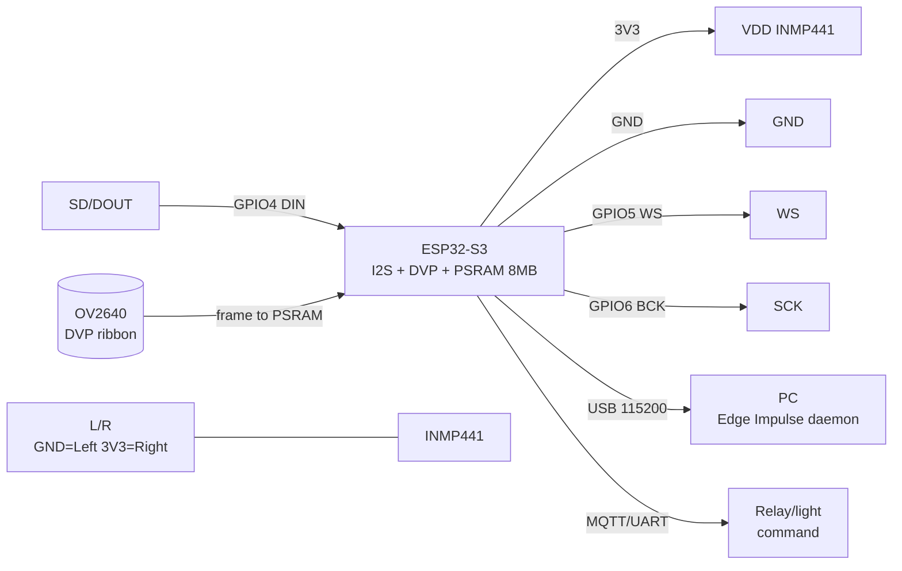

# TinyML and voice on ESP32 - Edge Impulse, TFLite-Micro, ESP-DL, ESP-WHO, ESP-SR

> [!info] Purpose
> A note on machine learning right on ESP32: **Edge Impulse** (data collection to impulse to deploy), **TFLite-Micro** (person detection, micro_speech, memory arena), **ESP-DL** (EfficientNet recognition), **ESP-WHO** (face detection on camera), **ESP-SR** (wake word "Hi ESP" + offline commands, INMP441 mic matrix, AEC/VAD). Everything works offline, without cloud - critical for privacy and latency.

## Purpose

In short: run neural networks on a microcontroller - sound (keywords, commands), vision (person, face), sensors (vibration/current anomalies). Typical tasks: a voice switch "Hi ESP - turn on the light", a doorbell camera with person detection, predictive pump maintenance by vibration.

| Parameter | Value |
| --- | --- |
| Interface | I2S (INMP441 microphone), DVP/SPI (OV2640 camera), UART - result |
| Module power | 3.3V (microphone, camera), ESP32-S3 board via USB 5V |
| Signal level | 3.3V (mandatory for ESP32) |
| Compatibility | ESP32 / S3 / P4 (S3 is the main one for TinyML: vector instructions, PSRAM) |

Navigation: I2S [[EN/04-Interfaces/04-I2S.en|I2S]], ADC [[EN/06-Analog/01-ADC.en|ADC]], S3 hardware [[EN/01-Hardware/03-ESP32-S3.en]], voice module [[EN/12-Comm-Modules/08-LD2410-UWB-IR-Voice.en]], start [[EN/Home.en]].

## Characteristics

| Framework / model | What it does | Memory (typically) | Hardware | Note |
| --- | --- | --- | --- | --- |
| Edge Impulse (impulse) | Pipeline: data to DSP block to neuro block to deploy | Depends on impulse (100-500 KB flash) | ESP32 / S3 + PSRAM | Deploy as Arduino-lib or IDF component |
| TFLite-Micro micro_speech | Keywords "yes/no" by MFCC | Arena ~50-100 KB, model ~20-40 KB int8 | Any ESP32 | reference TinyML example |
| TFLite-Micro person detection | Person in 96x96 grayscale frame | Arena ~200-300 KB, model ~250 KB int8 | ESP32-S3 + camera + PSRAM | OV2640/GC0308 camera needed |
| ESP-DL EfficientNet recognition | Classification/detection (cat, YOLO) | 300 KB - 2 MB (PSRAM) | S3 / P4 | w8a8/w8a16 quantization, SIMD acceleration |
| ESP-WHO | Face detection + recognition on camera | ~500 KB - 1.5 MB (PSRAM mandatory) | S3 / S3-EYE / P4 | Camera + display, async pipeline |
| ESP-SR WakeNet (Hi ESP) | Wake word "Hi ESP" always listens | ~200-400 KB (PSRAM recommended) | S3 / P4 (partly C3/C6 simplified) | WakeNet9/10, `_hiesp` models |
| ESP-SR MultiNet | Up to 300 offline commands (EN/CN) | ~500 KB - 1 MB | S3 / P4 | without retraining - command list |
| ESP-SR AFE (AEC/VAD) | Echo cancellation, voice detector, noise suppression | +100-200 KB | S3 / P4, 1-2 microphones | AFE mandatory with a speaker nearby |

> [!warning] PSRAM requirements
> Without PSRAM TinyML vision is almost impossible: a 640x480 frame takes ~300 KB, the model arena another 200-500 KB, but the internal ~320 KB SRAM is not enough. Take an **ESP32-S3 with 8 MB Octal PSRAM** (S3-EYE, S3-Korvo-2, DevKitC-S3 + PSRAM). In `menuconfig` enable `PSRAM to Octal`, `Tensor arena in PSRAM`, `Camera frame buffer in PSRAM`. Check: `heap_caps_get_free_size(MALLOC_CAP_SPIRAM)` must show megabytes.

![[assets/img/tinyml-voice-scheme.png|600]]
*Fig. TinyML bench: INMP441 microphone over I2S + OV2640 camera + ESP32-S3 with PSRAM gives wake word / commands / person detection.*

## 1. Edge Impulse workflow (data collection to impulse to deploy)

Edge Impulse is a web platform that hides training complexity: you upload samples, build an impulse (DSP + NN), press Deploy.

Steps:

1. **Data collection:** by phone (1 s audio @16 kHz) or the same ESP32 (`edge-impulse-daemon`, `esp32-microphone-continuous` example). Classes: `hiesp`, `noise`, `unknown`. Minimum 20-30 min total, different speakers, different rooms + noise!
2. **Impulse:** Input (MFCC/MFE: frame 0.02/0.01, 40 filters) to Neural Network (2xconv1d 8/16 neurons + dropout 0.25) to Output (classes). For ESP32 keep the model <100 KB.
3. **EON Tuner:** automatic accuracy/RAM/latency tradeoff search for S3.
4. **Deploy:** `Arduino library` (ZIP to `ei-<project>-arduino-1.0.zip`) or `Espressif ESP-IDF component` (clone + `idf.py add-dependency`). You get `run_classifier()` + `esp32_microphone` example.

> [!tip] Dataset is 80% of success
> Noise kills accuracy faster than any architecture: record the negative `noise` class (kitchen, street, TV, baby crying), otherwise every rustle is "Hi ESP". Add an unknown class with 10+ similar words ("hi nest", "his"). Class balance +-20%.

## 2. TFLite-Micro (person detection, micro_speech, arena memory!)

TFLite-Micro (now LiteRT for Microcontrollers) is inference without an OS: the model as a C array, one static arena buffer for everything.

The key concept is the **arena**: `constexpr int kArenaSize = 100 * 1024; uint8_t arena[kArenaSize];`. Input/output/intermediate tensors live inside. Too small - `AllocateTensors() failed / Didn't find op`. Too big - no room for the camera. Rule: start with the example (micro_speech 50 KB, person_detection 300 KB), add 20% margin, put the arena in PSRAM (`EXT_RAM_ATTR` or `heap_caps_malloc(MALLOC_CAP_SPIRAM)`).

Examples out of the box (`tensorflow/lite/micro/examples`):

- **micro_speech** - microphone to MFCC to "yes/no" detect, output - class probabilities;
- **person_detection** - 96x96 grayscale camera to person_score 0-255, threshold ~200;
- **hello_world** - sine by neural network (toolchain check).

Quantization is mandatory: a 1 MB float32 model becomes ~250 KB int8 + x2-4 speedup on S3 (SIMD). TFLiteConverter conversion with `optimizations = [Optimize.DEFAULT]`, a representative dataset of 100+ samples.

## 3. ESP-DL (EfficientNet recognition)

ESP-DL is the native Espressif framework: download/quantize/launch models in `.espdl` format (FlatBuffers, zero-copy). Supports mixed w8a8/w16a16/w8a16 quantization (combine layers - accuracy + speed), a static memory planner (lays layers out over internal/PSRAM itself), dual-core Conv2D.

Model Zoo (`esp-dl/models`): MobileNetV2, EfficientNet, YOLO11n/YOLO26, ESPDet-Pico (cat detection 224x224 - starter example!), PP-OCRv6. Each model is a ready IDF component.

Own-model pipeline: PyTorch/TF to ONNX to `esp-ppq` quantization (verify operator support in `operator_support_state.md`!) to `.espdl` to `dl::Model` + `dl::Tensor` to `model->run()`.

> [!tip] ESP-DL vs TFLite-Micro
> New development for S3/P4 - take ESP-DL (faster, less RAM, Espressif support). TFLite-Micro - for portability (Arduino examples, cross-platform) and learning.

## 4. ESP-WHO (face detection on camera)

ESP-WHO is an application platform over ESP-DL: face detection, face recognition, pedestrian detection, QR. The camera and neural network work **asynchronously** (while the model counts frame N, the driver already shoots N+1) - hence x1.5-2 fps vs sequential code.

Boards: ESP32-S3-EYE (camera + microphone + ST7789 display), S3-Korvo-2 (mic matrix + speaker), P4-Function-EV (LCD + SD). Build: `export IDF_EXTRA_ACTIONS_PATH=.../esp-who/tools`, `idf.py -DSDKCONFIG_DEFAULTS=sdkconfig.bsp.esp32_s3_eye set-target esp32s3`, `flash monitor`.

Practical scenario: person detection to save JPEG to SD to MQTT notification; face recognition - register 3-5 angles per person in even light, otherwise false reject.

## 5. ESP-SR (wake word "Hi ESP" + offline commands, INMP441, AEC/VAD)

ESP-SR is a speech stack: Audio Front-End (AFE) to WakeNet to MultiNet to (optionally) answer synthesis.

- **WakeNet:** always listens for "Hi ESP" (`wn9_hiesp` / `wn10_hiesp`). WakeNet9s is a light version without PSRAM (C3/C5). Custom wake word - via TTS Pipeline v3 (speak 100+ temp/voice/noise variants) or order from Espressif.
- **MultiNet:** after wake-up listens for a command from the list (up to 300: "turn on the light", "open the gate"). `mn7_en` / `mn7_cn` models for S3/P4.
- **AFE:** AEC (acoustic echo cancellation - subtracts its own speaker, critical for full-duplex), VAD/VADNet (voice activity detector - cuts silence/noise), BSS (source separation for 2 microphones), NS/NSNet (neural noise suppression). Without AFE in a room with a TV accuracy drops 2-3x.
- **INMP441 mic matrix:** digital MEMS with I2S output (not analog MAX9814 - less noise!). One - commands up to 3-5 m; two - beamforming + DOA (direction to the speaker). WS/LRCLK/BCK line - short (<10 cm), ground - star.

## INMP441 module pin legend (I2S microphone)

| INMP441 pin | Type | Where on ESP32-S3 | Note |
| --- | --- | --- | --- |
| VDD | Power input | 3V3 | 3.3V only! Current ~2 mA; 100 nF to GND near the module |
| GND | Ground | GND | Short, common with ESP32; do not route past DC-DC |
| SD (DOUT) | I2S data output | GPIO4 (I2S DIN) | Digital stream 16 kHz/24 bit; no pull-up needed |
| WS (LRCL) | Frame input | GPIO5 (I2S WS) | 16 kHz; length <10 cm |
| SCK (BCK) | Bit-clock input | GPIO6 (I2S BCK) | ~1 MHz; twisted pair with GND at length >5 cm |
| L/R | Channel select | GND = Left, 3V3 = Right | Two microphones: one to GND, other to 3V3 for a stereo matrix |

The OV2640 camera (for ESP-WHO/person detection) connects over a separate DVP ribbon (XCLK GPIO10, PCLK GPIO13, D0-D7, SIOD/SIOC) - see the camera note [[EN/12-Comm-Modules/04-RS485-CAN-Ethernet-Kamera.en]].

## Connection schematic

| ESP32-S3 DevKit | INMP441 | OV2640 camera | Note |
| --- | --- | --- | --- |
| 3V3 | VDD | DVDD (via camera LDO) | Total current <500 mA with USB |
| GND | GND | GND | Common ground, star |
| GPIO4 | SD | - | I2S DIN |
| GPIO5 | WS | - | I2S WS |
| GPIO6 | SCK | - | I2S BCK |
| DVP connector | - | XCLK/PCLK/D0-D7 | Ribbon short, without bends |
| GPIO16 (RX2) | - | - | UART log for Edge Impulse `daemon` |

> [!warning] 3.3V logic!
> INMP441 is powered only from 3.3V. L/R to 3V3 - via a 10k resistor (not directly to 5V!). I2S lines do not survive a 5V input.

### ASCII schematic

```text
ESP32-S3 DevKit                 INMP441 (I2S-мікрофон)
─────────────                 ───────────────────────
3V3 ────────────────────────►  VDD (+100нФ до GND!)
GND ─────────────────────────  GND (коротко, зірка)
GPIO4 (I2S DIN) ◄────────────  SD (DOUT, 16кГц/24біт)
GPIO5 (I2S WS) ─────────────►  WS
GPIO6 (I2S BCK) ─────────────► SCK (~1МГц, <10см!)
GND ─────────────────────────  L/R (GND=Left; 2-й мік: 3V3=Right)

ESP32-S3 ──DVP-шлейф──► OV2640 (XCLK/PCLK/D0-D7, кадр у PSRAM!)
ESP32-S3 USB ──► ПК (Edge Impulse daemon / лог, 115200)

Два мікрофони (матриця): SD обох паралельно на GPIO4,
L/R: мік1→GND (Left), мік2→3V3 (Right) → beamforming+DOA.
```

### Mermaid



## Code ESP-IDF (ESP-SR wake word + command, concept)

```c
#include "esp_err.h"
#include "esp_sr.h"
// Приклад ESP-SR v2: AFE + WakeNet(Hi ESP) + MultiNet(EN). Повний код:
// esp-sr/examples/speech_recognition/.
#define I2S_WS 5
#define I2S_BCK 6
#define I2S_DIN 4
void app_main(void) {
    // 1. AFE: 1 мікрофон, 16 кГц, AEC+VAD+NS увімкнено.
    //    afe_config (sample_rate 16000, mic_num 1, afe_periph_task_core 1).
    // 2. WakeNet: модель wn10_hiesp (w8a16), поріг ~0.7.
    // 3. Цикл: afe_fetch() -> wakenet_detect() -> якщо Hi ESP:
    //    multinet_recognize() -> команда ("turn on light") -> GPIO/реле.
    // PSRAM: sdkconfig → SPIRAM Octal, arena/models у PSRAM!
    // Деталі структур: esp-sr/docs + приклад speech_recognition.
}
```

## Code Arduino (Edge Impulse deploy + TFLite-Micro micro_speech)

```cpp
// Варіант A: Edge Impulse Arduino-lib (після Deploy → ZIP → Add .ZIP Library).
#include "ei-project-library.h"  // замініть на ім'я свого проєкту
#include <driver/i2s.h>
#define I2S_WS 5
#define I2S_BCK 6
#define I2S_DIN 4
void setup() {
  Serial.begin(115200);
  // I2S 16 кГц/16 біт/моно для INMP441; буфер 1 с = 16000 семплів.
  // ei_microphone_init(); // з прикладу esp32_microphone (Edge Impulse).
}
void loop() {
  // signal_t s; ei_microphone_get_data(...,&s);
  // ei_impulse_result_t res; run_classifier(&s, &res, false);
  // if (res.classification[0].value > 0.8) Serial.println("Hi ESP!");
  delay(50);
}
```

```cpp
// Варіант B: TFLite-Micro micro_speech — увага на АРЕНУ!
#include "tensorflow/lite/micro/micro_interpreter.h"
#include "tensorflow/lite/micro/micro_mutable_op_resolver.h"
// Модель згенерувати: xxd -i model.tflite > model_data.cc (g_model_data[]).
extern const unsigned char g_model_data[];
constexpr int kArenaSize = 100 * 1024;  // micro_speech: 50-100КБ!
// Арену в PSRAM: EXT_RAM_ATTR static uint8_t arena[kArenaSize];
static uint8_t arena[kArenaSize];
void setup() {
  Serial.begin(115200);
  // tflite::MicroMutableOpResolver<8> resolver; + AddDepthwiseConv2D...
  // tflite::MicroInterpreter interp(model, resolver, arena, kArenaSize);
  // if (interp.AllocateTensors() != kTfLiteOk) Serial.println("Арена мала!");
}
void loop() {
  // MFCC з I2S-буфера -> interp.input(0) -> Invoke() -> output "yes/no".
}
```

## Code MicroPython (16 kHz sample collection + inference stub)

```python
# MicroPython: повноцінний інференс НЕ тягне — збираємо датасет для Edge Impulse
# і шлемо на ПК, або викликаємо заморожену модель через ulab (спрощено).
from machine import I2S, Pin
import time
# INMP441: WS=5, BCK=6, DIN=4, 16 кГц, 16 біт, моно
i2s = I2S(0, sck=Pin(6), ws=Pin(5), sd=Pin(4),
          mode=I2S.RX, bits=16, format=I2S.MONO, rate=16000, ibuf=4096)
buf = bytearray(32000)  # 1 с @16кГц/16біт
for i in range(10):
    n = i2s.readinto(buf)
    with open("/sample_%d.raw" % i, "wb") as f:
        f.write(buf[:n])
    print("Семпл", i, "байт:", n)
    time.sleep_ms(500)
print("Готово: скопіюйте .raw на ПК → Edge Impulse Data Acquisition → Upload")
```

More on environments: [[EN/00-Start/05-Environment-Choice.en|Environment choice]].

## typical errors

| # | Symptom | Cause | Fix |
| --- | --- | --- | --- |
| 1 | `AllocateTensors() failed` / `Didn't find op` | Arena did not fit (model bigger than buffer); PSRAM not connected | Increase `kArenaSize` (+20%), put the arena in PSRAM (`EXT_RAM_ATTR`), enable Octal PSRAM in menuconfig |
| 2 | Model learns 99%, garbage in the room | No noise class; quantization without representative set | Add `noise` 30% of dataset; int8 quantization with 100+ real samples (not a sine!) |
| 3 | Wake word triggers on TV | AFE off, one microphone without AEC, low WakeNet threshold | Enable AEC+VAD+NS; threshold 0.7+; second microphone for beamforming; turn off the speaker during test |
| 4 | ESP-WHO crashes with `out of memory` on frame | Frame buffer in internal SRAM instead of PSRAM | `Camera frame buffer in PSRAM`, QVGA resolution for start, `heap_caps_get_free_size(MALLOC_CAP_SPIRAM)` before launch |
| 5 | Noise kills accuracy (microphone) | Long I2S wires near DC-DC, shared ribbon with camera, L/R floating | I2S <10 cm, 100 nF near VDD, L/R firmly to GND/3V3, star ground; quiet-vs-noise test - difference must be <15% |
| 6 | Edge Impulse deploy does not compile in IDF | Old IDF (<5.3), wrong deploy target | IDF >=5.3, deploy exactly `ESP-IDF component` (not Arduino-lib!), `idf.py add-dependency` + clean build |
| 7 | Person detection sees a person in wallpaper | Low score threshold, camera without IR filter at night | Threshold >=200/255, QVGA + grayscale 96x96, 850 nm IR backlight + filter at night |
| 8 | Brakes: 2-3 s inference, WDT reboots | Model on one core, frame copied back and forth | ESP-DL dual-core Conv2D, async WHO pipeline, inference in a separate task on core 1, WDT timeout 10 s+ |

## Official sources

- [Edge Impulse - docs (dataset to impulse to deploy)](https://docs.edgeimpulse.com/docs/) - data collection guides, EON Tuner, deploy as Arduino-lib/IDF component.
- [LiteRT for Microcontrollers (ex-TFLite-Micro) - micro_speech / person detection](https://www.tensorflow.org/lite/microcontrollers) - memory arena, int8 quantization, examples.
- [ESP-DL - Espressif neuroinference (EfficientNet, YOLO,.espdl)](https://github.com/espressif/esp-dl) - esp-ppq quantization, Model Zoo, dual-core.
- [ESP-WHO - face detection/recognition on camera](https://github.com/espressif/esp-who) - async pipeline, S3-EYE/Korvo-2 boards.
- [ESP-SR - WakeNet "Hi ESP", MultiNet commands, AFE (AEC/VAD)](https://github.com/espressif/esp-sr) - wn10_hiesp/mn7 models, mic matrices.

- GC0308 Datasheet (GalaxyCore, search PDF): [GC0308 search](https://www.alldatasheet.com/view.jsp?Searchword=GC0308) - VGA camera.

## See also

- [[EN/Home.en]] - start page of the reference
- [[EN/01-Hardware/03-ESP32-S3.en]] - ESP32-S3, PSRAM, vector instructions for ML
- [[EN/04-Interfaces/04-I2S.en|I2S]] - I2S bus for INMP441 microphones
- [[EN/06-Analog/01-ADC.en|ADC]] - ADC for dataset analog sensors
- [[EN/12-Comm-Modules/08-LD2410-UWB-IR-Voice.en]] - radar/IR/SU-03T: voice control alternatives
