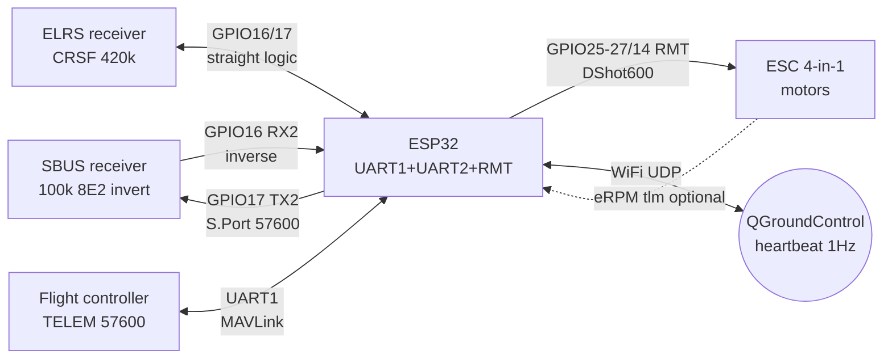

# RC protocols - SBUS / CRSF-ELRS / IBUS / MAVLink / DShot

## Purpose

ESP32 often works as a second onboard controller next to an RC receiver or flight controller:
reading control channels (SBUS/CRSF/IBUS), listening to telemetry (S.Port/F.Port/CRSF-tlm/MAVLink),
generating signals for regulators (DShot via RMT) or acting as a MAVLink node
(telemetry bridge to QGroundControl). Note brings together frame formats, UART speeds,
signal inversion requirements and ready SBUS and MAVLink-heartbeat parsers.

## Characteristics

| Protocol | Purpose | UART | Frame | Channels | Inversion | Who talks |
| --- | --- | --- | --- | --- | --- | --- |
| SBUS (Futaba/FrSky) | channels RX to FC | 100000 8E2 | 25 bytes, ~7-14 ms | 16 + 2 digital | YES, inverted | receiver to ESP32 |
| Fast SBUS | channels, fast mode | 200000 8E2 | 25 bytes | 16 + 2 | YES | receiver to ESP32 |
| CRSF (Crossfire/ELRS) | channels + telemetry | 420000 8N1 | up to 64 bytes, CRC8-DVB-S2 | 16 | NO | both directions |
| IBUS (FlySky) | channels RX to FC | 115200 8N1 | 32 bytes, checksum | 14 | NO | receiver to ESP32 |
| IBUS telemetry | sensors to RX | 115200 8N1 | request/response | - | NO | ESP32 to receiver |
| MAVLink v1/v2 | commands + telemetry | any (typ. 57600) | 8/12+ bytes overhead | - | NO | craft to GCS |
| DShot150/300/600/1200 | FC to ESC | digital, not UART! | 16 bits + CRC4 | 1 thr/line | NO | ESP32 to regulator |
| S.Port (FrSky) | telemetry | 57600 inverted | polling by ID | - | YES | ESP32 to receiver |
| F.Port / F.Port2 | channels + telemetry | 115200 inverted | one wire | 16 | YES | both directions |

> DShot is not a UART protocol: this is a synchronous digital sequence with its own timing
> (bit = 1.67 us at DShot600). On ESP32 it is generated via RMT or MCPWM,
> see [[EN/07-Timers/01-Timers-MCPWM-PCNT-RMT.en]].

## SBUS - inverted UART 100k 8E2

SBUS is the de-facto channel transfer standard: one wire carries 16 proportional channels
(11 bits each: range 0-2047, center ~1024; FrSky outputs 172-1811 at +-100%) plus
2 digital channels (CH17/CH18), a frame-loss bit and a failsafe bit. Frame is 25 bytes:

- Byte[0]: header `0x0F`.
- Bytes[1-22]: 16 channels x 11 bits, packed LSB first.
- Byte[23]: bits 0-1 = CH17/CH18, bit 2 = frame lost (`0x04`), bit 3 = failsafe (`0x08`).
- Byte[24]: footer `0x00` (in SBUS2 - `0x04`, ignore).

Line parameters: **100000 baud, 8 data bits, EVEN parity, 2 stop bits (8E2)**,
logic **inverted** (idle = LOW). Frames come every ~7-14 ms.

### Inverter - mandatory

ESP32-UART by default expects non-inverted idle-HIGH, but the SBUS receiver outputs
inversion. Options:

1. **ESP32 hardware inversion** (recommended): `uart_set_line_inverse_mask()` in ESP-IDF
   or `Serial2.begin(100000, SERIAL_8E2, rx, tx, true)` in Arduino - the last argument
   enables inversion on the GPIO matrix, no transistor needed.
2. **External inverter**: one NPN (2N3904/BC547 with two resistors) or a gate
   74HC14/74HCT14 (Schmitt - cleaner edges on a long wire). One stage inverts,
   two stages return straight logic - SBUS needs ONE stage.
3. **Non-inverted receiver output**: some FrSky receivers have a separate pad
   with straight logic (e.g. non-inverted S.Port/SBUS on the board) - then inversion
   is disabled, see the schematic of the specific board.

> SBUS failsafe (`0x08` in byte 23) is not the loss of one frame, but a command
> "receiver in emergency mode": kill motors / hold last channels depending
> on the radio logic. Always handle this bit separately from `frame lost`.

### Module pin legend of SBUS receiver (typically FrSky R-XSR / XM+)

| Pin | Label | Type | To ESP32 | Note |
| --- | --- | --- | --- | --- |
| 1 | 5V (VIN) | 5 V power | 5V (VUSB) of the board | Receiver wants 4-10 V; do not power from 3V3 - sag and failsafe! |
| 2 | GND | Ground | GND | Common ground mandatory |
| 3 | SBUS_out | Output, inverted UART | GPIO16 (RX2) via inversion | 100000 8E2; in IDF - inverse mask, in Arduino - `inverted=true` |
| 4 | S.Port | Input/output, inverted | GPIO17 (TX2) if needed | Telemetry 57600 inverted; if not needed - leave unconnected |
| 5 | CH1-CH3 (PWM) | PWM outputs | - | Plain receiver servo outputs; ESP32 does not read them |

Explanation:

- **5 V power:** the receiver is powered from the 5 V bus (regulator BEC or USB-5V).
  SBUS logic level is 3.3 V tolerant to the ESP32 input, no divider needed.
- **One wire of channels:** all 16 channels multiplexed in one frame -
  that is why SBUS is more profitable than 16 PWM wires, see [[EN/11-Vivid/06-PCA9685-MG996R-28BYJ48-TMC2209.en]].
- **S.Port separate:** the receiver telemetry port - half-duplex with polling,
  described in the S.Port/F.Port section below.

## CRSF / ELRS - 420k + telemetry

CRSF (TBS Crossfire) is a full-duplex protocol: channels RX to FC and telemetry FC to RX
in one UART at **420000 baud 8N1, without inversion**. ExpressLRS speaks the same
CRSF "over wires" between receiver and flight controller, but its radio air is its own
(LoRa/FLRC/FSK, packet rate up to 1000 Hz). CRSF frame:

- Byte[0]: device address (`0xC8` - flight controller, `0xEE` - transmitter).
- Byte[1]: length (type + payload + CRC).
- Byte[2]: type (`0x16` - RC channels, `0x08` - link statistics, `0x02` - GPS,
  `0x08/0x21` - battery/attitude etc).
- Payload: RC channels - 16 x 11 bits (like SBUS), range 172-1811, center 992.
- Last byte: CRC8-DVB-S2 of the "type + payload" field.

Telemetry frames are sent by ESP32/flight controller BACK to the receiver over the same UART (TX line):
voltage/current (`0x08`), GPS (`0x02`), attitude (`0x1E`), flight mode (`0x21`).
ELRS extra: MAVLink telemetry over the same link (Airport/MAVLink mode).

### Pin legend of ELRS receiver (typically Happymodel EP / BetaFPV Nano)

| Pin | Label | Type | To ESP32 | Note |
| --- | --- | --- | --- | --- |
| 1 | 5V | 5 V power | 5V of the board | Some nano receivers have an LDO and tolerate 5 V; verify the marking on the board! |
| 2 | GND | Ground | GND | Common ground |
| 3 | TX (RX on FC) | 420k output | GPIO16 (RX2) | Channels + telemetry from receiver; 3.3 V logic |
| 4 | RX (TX on FC) | 420k input | GPIO17 (TX2) | ESP32 to receiver telemetry; cross TX to RX |
| 5 | Boot/Bind | Button | - | Hold at power-on = binding / WiFi-update mode |

Explanation:

- **Cross:** receiver TX to ESP32 RX, receiver RX to ESP32 TX (like a plain UART,
  see [[EN/04-Interfaces/01-UART.en|UART]]). Both directions work simultaneously - no half-duplex needed.
- **Without inversion:** CRSF is straight logic, inverse flags OFF.
- **420000 speed:** non-standard baud - ESP32 (hardware UART) holds it exactly;
  software Serial does not, only `HardwareSerial`.

## IBUS - FlySky, 115200 without inversion

IBUS (FlySky FS-i6/FS-iA6B): **115200 8N1, straight logic**, 32-byte frame every ~7 ms:

- Bytes[0-1]: `0x20 0x40` (length 0x20 = 32, command 0x40 = channels).
- Bytes[2-29]: 14 channels x uint16 little-endian (1000-2000, center 1500).
- Bytes[30-31]: checksum `0xFFFF` minus the sum of all previous bytes.

IBUS telemetry is separate request frames (`0x04 0x81/0x90...`) on the same or a second
line; sensors answer with their ID. For simple stick reading the RX line is enough.

## MAVLink - heartbeat, GPS_RAW, commands, QGroundControl

MAVLink v1 (8 bytes overhead: `FE len seq sysid compid msgid payload[0..n] cksum[2]`)
and v2 (12 bytes overhead + optional signature) - the autopilot telemetry standard
(ArduPilot/PX4) and GCS like QGroundControl. Minimum for "I am alive":

1. **HEARTBEAT (#0):** sent ~1 Hz; fields: custom_mode (uint32), type (e.g. 6 =
   GCS, 2 = quad), autopilot (8 = invalid for a non-autopilot), base_mode,
   system_status (4 = active), mavlink_version (3). Without heartbeat QGC will not show the node.
2. **GPS_RAW_INT (#24):** lat/lon (int32, degE7), alt (mm), eph/epv, vel, cog, sats.
3. **SYS_STATUS (#1) / ATTITUDE (#30) / VFR_HUD (#74):** battery, angles, speed.
4. **Commands:** COMMAND_LONG (#76) - arm/disarm (cmd 400), takeoff; MISSION_ITEM (#39).

Checksum: CRC-16/X.25 of `len..payload` + extra bytes (seed by msgid:
for HEARTBEAT extra = 50). Without the correct extra QGC silently drops the packet -
the most common error of hand-written implementations.

ESP32 role: UART to WiFi bridge (MAVLink from flight controller to UDP to QGC on a tablet) or
a sensor node (free sysid, e.g. 51, compid 158) that sends GPS_RAW/BATTERY.

## DShot - digital ESC protocol (why not PWM)

Classic PWM (1000-2000 us, 50-490 Hz) requires end calibration, drifts with
temperature and carries ~1-2 us of jitter. DShot transmits a **number 0-2047** as a digital frame
of 16 bits: 11 thrust bits + 1 telemetry request bit + 4 CRC bits (x^4+x^3+x^2+x+1).
Speeds: DShot150/300/600/1200 (baud bitrate), frame ~27 us regardless of value.

- **Without calibration:** 0 = stop, 2047 = full thrust always; values 1-47 reserved
  (beacon, 3D reverse, settings).
- **CRC on each frame:** a damaged frame is dropped instead of jerking the motor.
- **Bidirectional DShot:** telemetry from ESC (eRPM, errors) over the same line in the window
  after the frame - needs a capture input (PCNT/RMT), see [[EN/07-Timers/01-Timers-MCPWM-PCNT-RMT.en]].
- **Why not PWM on ESP32:** LEDC-PWM has APB-clock jitter and resolution tied
  to frequency; DShot via RMT gives bit-exact timing without CPU involvement.

### Pin legend of DShot ESC (typically BLHeli_32 4-in-1)

| Pin | Label | Type | To ESP32 | Note |
| --- | --- | --- | --- | --- |
| 1 | BAT+ / VCC | Power 7-25 V | LiPo / PDB | not the 5V of the board! Common ground with ESP32 mandatory |
| 2 | GND | Power ground | GND (star to PDB) | Thick wire; signal ground by a separate lead to ESP32-GND |
| 3 | S1-S4 (DShot) | Digital input | GPIO25/26/27/14 (RMT TX) | 3.3 V logic; length <15 cm, without "snot" along power lines |
| 4 | TLM (bidir.) | Bidirectional | free GPIO (RMT RX) | Optional: eRPM telemetry; without it - leave unconnected |
| 5 | 5V/BEC | 5 V output | 5V of ESP32 board (optional) | 4-in-1 BEC is often weak - better power the receiver separately |

## S.Port / F.Port - telemetry overview

- **S.Port (Smart Port):** inverted 57600, half-duplex, polling: the receiver polls
  sensor IDs (0x1B - roles), the sensor answers with an 8-byte frame + AppID
  (e.g. 0x0200 - voltage, 0x0800 - GPS). One ESP32 can emulate several sensors.
- **F.Port:** channels + telemetry in ONE wire, 115200 inverted;
  control frame like SBUS + telemetry answer window (S.Port frames inside).
- **F.Port2:** faster bidirectional version for new Archer receivers.
- Practice: for DIY battery/GPS telemetry it is simpler to take CRSF telemetry or
  MAVLink than to implement S.Port polling from zero.

## Schematic

![[assets/img/rc-protocols-sbus-mavlink-scheme.png|600]]
*Fig. SBUS via UART2 inversion, CRSF in full duplex, DShot via RMT to ESC.
Space for schematic - see [[assets/README]].*

### ASCII schematic

```text
SBUS-приймач (інверсія!)         ESP32 DevKit
────────────────────────         ────────────
5V  ──────────────────────────►  5V (VUSB)
GND ───────────────────────────  GND
SBUS_out ──[інверсія]─────────►  GPIO16 (RX2, 100000 8E2)
        варіант А: inverse_mask / inverted=true (без деталей!)
        варіант Б: 1×NPN або 1×74HC14 (ОДИН каскад!)
S.Port ──[інверсія, опційно]──►  GPIO17 (TX2, 57600 інверт.)

ELRS-приймач (пряма логіка!)     ESP32 DevKit
────────────────────────────     ────────────
5V  ──────────────────────────►  5V
GND ───────────────────────────  GND
TX ───────────────────────────►  GPIO16 (RX2, 420000 8N1, БЕЗ інверсії)
RX ◄───────────────────────────  GPIO17 (TX2, телеметрія назад)

ESC 4-в-1 (DShot via RMT)        ESP32 DevKit
─────────────────────────        ────────────
BAT+ ──► LiPo (НЕ плата!)
GND ───► PDB-зірка ───► GND плати
S1..S4 ◄── GPIO25/26/27/14 (RMT TX, DShot600)
TLM ◄──► вільний GPIO (RMT RX, опційно eRPM)

MAVLink-міст                     ESP32
───────────                      ─────
Польотник TELEM2 (57600) ──► UART1 ──► WiFi UDP ──► QGC (планшет/ПК)
sysid вільний (напр. 51), HEARTBEAT 1 Гц обов'язково!
```

### Mermaid



## Code ESP-IDF - SBUS parser + MAVLink heartbeat

```c
#include "driver/uart.h"
#include "esp_timer.h"
#include <string.h>

// --- SBUS: UART2, 100000 8E2, інвертований RX ---
#define SBUS_UART UART_NUM_2
#define SBUS_RX 16
#define SBUS_LEN 25

static void sbus_init(void) {
    uart_config_t cfg = {
        .baud_rate = 100000,
        .data_bits = UART_DATA_8_BITS,
        .parity = UART_PARITY_EVEN,
        .stop_bits = UART_STOP_BITS_2,
        .flow_ctrl = UART_HW_FLOWCTRL_DISABLE,
        .source_clk = UART_SCLK_DEFAULT,
    };
    uart_param_config(SBUS_UART, &cfg);
    uart_set_pin(SBUS_UART, UART_PIN_NO_CHANGE, SBUS_RX,
                 UART_PIN_NO_CHANGE, UART_PIN_NO_CHANGE);
    // Ключове: інверсія RX на матриці GPIO — без зовнішнього транзистора
    uart_set_line_inverse_mask(SBUS_UART, UART_SIGNAL_RXD_INV);
    uart_driver_install(SBUS_UART, 512, 0, 0, NULL, 0);
}

// Розпакування 16×11 біт, повертає false якщо нема заголовка/футера
static bool sbus_decode(const uint8_t *f, uint16_t ch[16],
                        bool *lost, bool *failsafe, bool *ch17, bool *ch18) {
    if (f[0] != 0x0F || (f[24] != 0x00 && f[24] != 0x04)) return false;
    for (int i = 0; i < 16; i++) {
        int bit = i * 11, val = 0;
        for (int b = 0; b < 11; b++)
            if (f[1 + ((bit + b) >> 3)] & (1 << ((bit + b) & 7)))
                val |= (1 << b);
        ch[i] = val; // 0..2047
    }
    *ch17 = f[23] & 0x01; *ch18 = f[23] & 0x02;
    *lost = f[23] & 0x04; *failsafe = f[23] & 0x08;
    return true;
}

// --- MAVLink v1 HEARTBEAT: CRC-X.25 + extra 50 ---
static uint16_t crc_x25(const uint8_t *d, int n, uint16_t crc) {
    for (int i = 0; i < n; i++) {
        crc ^= d[i];
        for (int b = 0; b < 8; b++)
            crc = (crc & 1) ? (crc >> 1) ^ 0x8408 : (crc >> 1);
    }
    return crc;
}

static int mav_heartbeat(uint8_t *out, uint8_t seq, uint8_t sysid) {
    uint8_t payload[9] = {0,0,0,0, 2, 8, 0, 4, 3}; // quad, invalid AP, active, v3
    out[0] = 0xFE; out[1] = 9; out[2] = seq;
    out[3] = sysid; out[4] = 158; out[5] = 0;      // msgid 0 = HEARTBEAT
    memcpy(&out[6], payload, 9);
    uint16_t crc = crc_x25(&out[1], 14, 0xFFFF);
    uint8_t extra = 50;
    crc = crc_x25(&extra, 1, crc);
    out[15] = crc & 0xFF; out[16] = crc >> 8;
    return 17;
}
```

## Code Arduino - SBUS + MAVLink-heartbeat

```cpp
#include <HardwareSerial.h>
HardwareSerial sbusSer(2); // UART2
uint8_t sbus[25]; int sIdx = 0;
uint16_t ch[16];

void setup() {
    Serial.begin(115200);
    // true = інверсія: SBUS без зовнішніх деталей
    sbusSer.begin(100000, SERIAL_8E2, 16, -1, true);
    // MAVLink-вихід до QGC/радіомодема:
    Serial1.begin(57600, SERIAL_8N1, 18, 19);
}

void loop() {
    while (sbusSer.available()) {
        uint8_t b = sbusSer.read();
        if (sIdx == 0 && b != 0x0F) continue; // ресинхронізація
        sbus[sIdx++] = b;
        if (sIdx == 25) {
            sIdx = 0;
            if (sbus[24] == 0x00 || sbus[24] == 0x04) {
                for (int i = 0; i < 16; i++) {
                    int bit = i * 11, v = 0;
                    for (int k = 0; k < 11; k++)
                        if (sbus[1 + ((bit + k) >> 3)] & (1 << ((bit + k) & 7)))
                            v |= (1 << k);
                    ch[i] = v;
                }
                bool fs = sbus[23] & 0x08;
                Serial.printf("CH1=%d CH2=%d FS=%d\n", ch[0], ch[1], fs);
            }
        }
    }
    static uint32_t t = 0;
    if (millis() - t > 1000) { t = millis(); mavSendHeartbeat(); }
}

// CRC-X.25, extra 50 для msgid 0
uint16_t crcX25(const uint8_t *d, int n, uint16_t crc) {
    for (int i = 0; i < n; i++) {
        crc ^= d[i];
        for (int b = 0; b < 8; b++) crc = (crc & 1) ? (crc >> 1) ^ 0x8408 : crc >> 1;
    }
    return crc;
}
void mavSendHeartbeat() {
    uint8_t p[17];
    uint8_t pay[9] = {0,0,0,0, 2, 8, 0, 4, 3};
    static uint8_t seq = 0;
    p[0]=0xFE; p[1]=9; p[2]=seq++; p[3]=51; p[4]=158; p[5]=0;
    memcpy(&p[6], pay, 9);
    uint16_t c = crcX25(&p[1], 14, 0xFFFF);
    uint8_t e = 50; c = crcX25(&e, 1, c);
    p[15]=c&0xFF; p[16]=c>>8;
    Serial1.write(p, 17);
}
```

## Code MicroPython - SBUS parser

```python
from machine import UART
import time

# invert=UART.INV_RX вмикає інверсію RX на ESP32 — транзистор не потрібен
sbus = UART(2, baudrate=100000, bits=8, parity=0, stop=2, rx=16, invert=UART.INV_RX)
mav = UART(1, baudrate=57600, rx=18, tx=19)

def sbus_read():
    if sbus.any() < 25:
        return None
    f = sbus.read(25)
    if not f or f[0] != 0x0F or f[24] not in (0x00, 0x04):
        sbus.read()  # викинути байт, ресинхронізація
        return None
    ch = []
    for i in range(16):
        bit = i * 11
        v = 0
        for k in range(11):
            if f[1 + ((bit + k) >> 3)] & (1 << ((bit + k) & 7)):
                v |= (1 << k)
        ch.append(v)
    flags = f[23]
    return ch, bool(flags & 0x04), bool(flags & 0x08)

def crc_x25(data, crc=0xFFFF):
    for b in data:
        crc ^= b
        for _ in range(8):
            crc = (crc >> 1) ^ 0x8408 if crc & 1 else crc >> 1
    return crc & 0xFFFF

_seq = 0
def mav_heartbeat(sysid=51):
    global _seq
    pay = bytes([0, 0, 0, 0, 2, 8, 0, 4, 3])
    hdr = bytes([0xFE, 9, _seq & 0xFF, sysid, 158, 0])
    _seq += 1
    c = crc_x25(hdr[1:] + pay)
    c = crc_x25(bytes([50]), c)
    mav.write(hdr + pay + bytes([c & 0xFF, c >> 8]))

while True:
    r = sbus_read()
    if r:
        ch, lost, fs = r
        print("CH1", ch[0], "CH2", ch[1], "LOST", lost, "FS", fs)
    mav_heartbeat()
    time.sleep(1)  # heartbeat 1 Гц; SBUS читати частіше в реальному коді!
```

## typical errors

1. **SBUS garbage/silence** → forgotten inversion. Enable inverse mask / `inverted=true` /
   `invert=INV_RX` or solder ONE inverter stage; two stages = inversion again!
2. **Wrong SBUS stop bits/parity** → `SERIAL_8N1` instead of `SERIAL_8E2`: frames seem
   to exist, but CRC logic drifts and channels jump. Verify 100000-8E2.
3. **Receiver power from 3V3** → sag, cyclic failsafe. Only 5 V.
4. **CRSF on software Serial** → only hardware UART (UART1/UART2) holds 420000 baud.
5. **MAVLink without extra-CRC** → QGC ignores heartbeat. Extra for #0 = 50, count X.25.
6. **MAVLink without 1 Hz heartbeat** → QGC does not show the node at all, even if GPS_RAW goes.
7. **DShot bit-bang via delayMicroseconds** → jitter, motor teardown. Only RMT/MCPWM.
8. **Long signal wires to ESC along power lines** → coupling, false frames.
   Signal <15 cm, twisted pair with ground.
9. **Ignoring the SBUS failsafe bit** → copter flies on last channels on link
   loss. Bit `0x08` = kill/land immediately.
10. **Shared UART for SBUS and logs** → keep `Serial` (USB) for debug, RC -
     strictly on UART1/UART2, see [[EN/04-Interfaces/01-UART.en|UART]].

## Common issues

| Symptom | Cause | Fix |
| --- | --- | --- |
| SBUS garbage or silence | Missing inversion, 8N1 instead of 8E2 at 100k | Enable inverse mask or one transistor stage, set 100k 8E2 |
| CRSF link but no telemetry | Wrong 420k baud or TX/RX swapped | Set 420k baud both sides, cross TX to RX, check ELRS version |
| IBUS reads zeros | FlySky needs plain 115200 without inversion | Use non-inverted UART at 115200, bind receiver first |
| Motors spin at boot | No failsafe set, DShot armed by noise | Set failsafe hold/off, calibrate endpoints, arm switch only |
| ESC beeps, no spin | PWM protocol on DShot-only ESC or vice versa | Match protocol to ESC type, check 3.3V signal level shift |
## Official sources

- [MAVLink Developer Guide](https://mavlink.io/en/) - v1/v2 frame format, HEARTBEAT, GPS_RAW, extra-CRC.
- [ExpressLRS getting started](https://www.expresslrs.org/quick-start/getting-started/) - CRSF protocol, packet rate, telemetry, MAVLink mode.
- [QGroundControl docs](https://docs.qgroundcontrol.com/master/en/) - GCS for heartbeat/telemetry checks.
- [bolderflight/sbus - library and frame description](https://github.com/bolderflight/sbus) - SBUS 100000 8E2, inversion on ESP32.
- [Betaflight setup guide](https://betaflight.com/docs/wiki/getting-started/setup-guide) - DShot/ESC practice, flight-controller failsafe logic.

- BC547 Datasheet (onsemi, search PDF): [BC547 search](https://www.alldatasheet.com/view.jsp?Searchword=BC547) - NPN for switches/PPM inverters.

## See also

- [[EN/Home.en]]
- [[EN/04-Interfaces/01-UART.en|UART]]
- [[EN/07-Timers/01-Timers-MCPWM-PCNT-RMT.en]]
- [[EN/11-Vivid/06-PCA9685-MG996R-28BYJ48-TMC2209.en]]
- [[EN/12-Comm-Modules/13-Camera-Streaming.en]]
- [[EN/11-Vivid/12-LVGL-SquareLine.en]]
- [[EN/12-Comm-Modules/04-RS485-CAN-Ethernet-Kamera.en]]
- [[EN/05-Radio/01-WiFi-STA-AP.en]]
- [[EN/99-Additions/01-Pinout-tablici.en]]
- [[EN/99-Additions/02-Troubleshooting-FAQ.en]]
