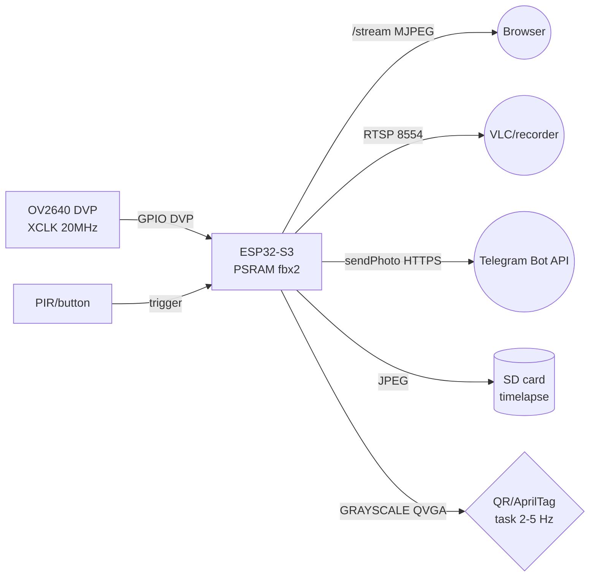

# OV2640 camera - MJPEG stream, RTSP, QR/AprilTag, Timelapse, Telegram

## Purpose

ESP32-S3 with PSRAM + OV2640 is the cheapest WiFi camera: MJPEG stream in the browser,
single frames `/capture`, RTSP for recorders, QR and AprilTag recognition
right on board, timelapse to SD card and sending photos to Telegram. Note covers
the `esp32-camera` setup, the `/capture` vs `/stream` difference, light requirements
and focus plus ready streamer codes in three languages.

## Characteristics

| Mode | Path | Format | PSRAM | FPS | Application |
| --- | --- | --- | --- | --- | --- |
| Photo | `/capture` | JPEG | desirable | on request | Telegram, timelapse, detection |
| Stream | `/stream` | MJPEG multipart | mandatory | 5-25 | viewing in browser |
| RTSP | `:8554/mjpeg/1` | RTP/JPEG | mandatory | 5-15 | VLC, recorder, Home Assistant |
| QR scan | frame in memory | GRAYSCALE | desirable | 2-5 | access codes, marking |
| AprilTag | frame in memory | GRAYSCALE | desirable | 1-5 | robot navigation |
| Timelapse | JPEG to SD | JPEG | mandatory | 1 / N s | construction, plants |

Hardware minimum: an ESP32-S3 board with PSRAM (S3R8 and bigger), OV2640 (2 MP, 1600x1200),
5 V / 1 A power supply (stream + WiFi eat 300-500 mA in peaks), a 47-100 uF capacitor
for camera power. Without PSRAM - only QQVGA and no streaming, pin details -
see [[EN/12-Comm-Modules/04-RS485-CAN-Ethernet-Kamera.en]].

> OV2640 has factory fixed focus: sharpness at ~50 cm to infinity.
> For close-up QR the lens must be UNSCREWED (counterclockwise by 1/4-1/2 turn)
> and fixed with a drop of lacquer. Without this, codes from 10 cm are not read at all.
> OV5640 (5 MP, autofocus versions) is an OV2640 upgrade on the same DVP socket,
> but requires more PSRAM and gives a bigger frame (lower FPS on the same WiFi).

## MJPEG stream with OV2640

`esp32-camera` + `esp_httpd` architecture:

- **part-async:** the HTTP server serves `multipart/x-mixed-replace;boundary=...`,
  each part is a JPEG frame with a `Content-Length` header. The browser draws frames
  as they arrive, no separate thread needed.
- **PSRAM buffer:** `fb_count = 2` (double buffering: while one frame flies
  to WiFi, the sensor writes the next). `jpeg_quality = 10-12` (lower number = better
  quality = bigger frame = less FPS). Stream resolution SVGA (800x600) -
  the golden middle between detail and FPS; UXGA chokes WiFi.
- **`/capture` vs `/stream`:** `/capture` = one `esp_camera_fb_get()` + an
  `image/jpeg` response (for Telegram/timelapse/detection); `/stream` = an endless loop
  in the handler (for eyes). Do not pull `/capture` during an active `/stream` on
  one fb - you get `fb alloc failed`, take `fb_count = 2`.
- **PSRAM DMA (S3):** `CONFIG_CAMERA_PSRAM_DMA` - speeds frame writes to PSRAM;
  without it SVGA JPEG still works, but RGB/GRAYSCALE of big sizes tears.

### Pin legend of camera board (ESP32-S3 + OV2640, typically Freenove)

| Board pin | Purpose | Type | Where / note |
| --- | --- | --- | --- |
| 5V / 3V3 | Camera power | Power | 5 V from USB/BEC + 47-100 uF capacitor; the 3V3 pin of the board does not pull the stream |
| GND | Ground | Ground | Short ground, common with WiFi antenna (do not cut the polygon!) |
| GPIO38/39 | SCCB SCL/SDA | I2C config | Sensor registers; 100 kHz speed is enough |
| GPIO40/41/42 | VSYNC/HREF/PCLK | DVP sync | Short traces, do not route near the antenna |
| GPIO8-GPIO20 | D0-D7 DVP data | Parallel bus | Map depends on the board - check against `camera_pins.h`! |
| GPIO45 | XCLK 20 MHz | Master clock | S3 generates; jitter = floating colors |
| BOOT/USB | Firmware | USB-Serial | Hold BOOT during flashing if there is no auto-reset |
| SD (SPI/SDIO) | Memory card | SD 1-bit/4-bit | Timelapse and photo buffer; see [[EN/08-Memory/02-Filesystem.en|File systems]] |

Explanation:

- **Power capacitor:** sensor current peak + WiFi TX sags the bus -
  brown `brownout` and reboot exactly at `/capture`. 100 uF near the camera connector.
- **DVP map:** different vendors (Freenove/Waveshare/Espressif) seat D0-D7 on
  different GPIOs - take `CAMERA_MODEL_...` from the CameraWebServer example for YOUR board.
- **Antenna zone:** do not place the camera/wires over the S3 ceramic antenna -
  RSSI drops and the stream tears.

## RTSP overview (Micro-RTSP)

MJPEG in the browser is for people; for machines (VLC, motionEye, recorder) - RTSP.
The Micro-RTSP library (geeksville) is an RTSP server for ESP32: listens on TCP 8554,
on `broadcastCurrentFrame()` serves a JPEG frame like an RTP packet stream.

- One client at a time (library limit) - OK for one recorder.
- VLC delay by default ~1 s (the `--network-caching` buffer); for "live"
  lower the client cache, but do not chase FPS.
- RTSP and HTTP stream at once - only with `fb_count = 2` and SVGA or lower,
  otherwise the watchdog (`task watchdog`) kills the loop.
- URL typically `rtsp://<ip>:8554/mjpeg/1`.

## QR / qrcode + AprilTag - GRAYSCALE frames

Detection works not with JPEG, but with an unpacked grayscale frame:

1. `esp_camera_fb_get()` with `pixel_format = PIXFORMAT_GRAYSCALE`, resolution
   QVGA (320x240) - fast and enough for codes up to 1-2 m.
2. QR decoder (quirc port / Nayuki generator for PRINTING codes, decoder is quirc)
   eats the buffer directly; a JPEG frame first needs `frame2jpg` to jpg2gray - slow, avoid.
3. AprilTag (AprilTag library, `tag36h11` family): exact 3D position of the tag
   relative to the camera - robot navigation, drone landing. Works on S3 at ~1-5 FPS
   in QVGA; bigger resolution = quadratic time growth.
4. Light: detectors need even illumination without glare;
   in darkness turn on the board backlight LED (GPIO, PWM dimming) or IR backlight.

> Do not chase detection on every stream frame: a separate FreeRTOS task with a
> 200-500 ms period + the latest available fb (`CAMERA_GRAB_LATEST`). Otherwise the stream
> turns into a slideshow.

## Timelapse on SD

Loop: deep sleep (or `delay`) N seconds → wake up → `/capture` →
write `/timelapse/IMG_xxxx.jpg` to SD → back to sleep. Nuances:

- File names with increment in NVS/EEPROM to not overwrite after reboot.
- SD in 1-bit mode is enough (JPEG ~50-150 KB), card power - stable 3.3 V.
- Long timelapse (day+) - power from a powerbank via the 5V pin, a computer
  USB port will not pull WiFi peaks (though timelapse is usually without WiFi).
- Video assembly: `ffmpeg -framerate 30 -i IMG_%04d.jpg out.mp4` on the PC.
- File system and card wear - see [[EN/08-Memory/02-Filesystem.en|File systems]].

## Telegram photo

ESP32 sends photos via Bot API `sendPhoto` (multipart/form-data, ~10 MB limit,
our JPEGs are hundreds of KB): trigger (PIR/button/`/photo` command via `getUpdates`)
→ `/capture` → HTTPS POST on `https://api.telegram.org/bot<token>/sendPhoto`.
Nuances: correct time needed (NTP, otherwise TLS breaks), store the token in NVS,
but not in code; for video - `sendVideo` does not pull MJPEG, only MP4 (ESP32 does not encode -
do not use). Notifications/voice - see [[EN/15-Protocols/02-Notify-Voice.en]].

## Lighting and focus requirements

- **Light:** OV2640 without an IR filter "sees" poorly in darkness; minimum for color -
  plain room lighting. Outdoors at night - 850 nm IR spotlight + remove
  the IR filter (irreversible!) or a more sensitive OV5640.
- **Exposure:** `sensor->set_exposure_ctrl(1)`, night mode `set_night_mode(1)`;
  auto exposure "breathes" in timelapse - for even frames fix
  `set_aec_value()` after a 2 s warm-up.
- **Focus:** factory - far; QR/macro - unscrew the lens and fix it.
  Check: print a 5x5 cm QR, 20 cm distance, must read instantly.
- **White balance:** auto (+sunny/cloudy presets) - for timelapse fix
  `set_whitebal(1)` + `set_wb_mode()`, otherwise frames "jump" in color.

## Schematic

![[assets/img/camera-streaming-mjpeg-scheme.png|600]]
*Fig. S3 camera: MJPEG stream to browser, RTSP to recorder, photos to Telegram and SD.
Space for schematic - see [[assets/README]].*

### ASCII schematic

```text
ESP32-S3-CAM (PSRAM!)          Периферія / мережа
─────────────────────          ─────────────────
5V ──────────────────►  живлення (+100мкФ до GND біля камери!)
GND ──────────────────  GND
OV2640 DVP ──► GPIO8-20/38-42/45 (VSYNC/HREF/PCLK/D0-D7/XCLK 20МГц)
SD-карта ──► SPI/SDIO (timelapse IMG_xxxx.jpg, 1-біт вистачає)
PIR/кнопка ──► GPIO (тригер Telegram-фото)
Підсвітний LED ──► GPIO (PWM-диммінг для нічного QR)

WiFi STA ──► /capture (JPEG, один кадр)
         ──► /stream (MJPEG multipart, браузер)
         ──► :8554/mjpeg/1 (RTSP, VLC/реєстратор)
         ──► HTTPS api.telegram.org (sendPhoto, NTP обов'язково!)
```

### Mermaid



## Code ESP-IDF - MJPEG streamer

```c
#include "esp_camera.h"
#include "esp_http_server.h"

#define PART_BOUNDARY "123456789000000000000987654321"
static const char *_CT = "multipart/x-mixed-replace;boundary=" PART_BOUNDARY;
static const char *_BDR = "\r\n--" PART_BOUNDARY "\r\n";
static const char *_PART = "Content-Type: image/jpeg\r\nContent-Length: %u\r\n\r\n";

// Плата Freenove S3: звірити D0-D7 з camera_pins.h СВОЄЇ плати!
#define CAM_D0 11
#define CAM_D1 9
// ... (повна мапа — див. приклад camera_example esp32-camera)

static camera_config_t cam_cfg = {
    .pin_xclk = 45, .pin_sccb_sda = 39, .pin_sccb_scl = 38,
    .pin_vsync = 40, .pin_href = 41, .pin_pclk = 42,
    .xclk_freq_hz = 20000000,
    .ledc_timer = LEDC_TIMER_0, .ledc_channel = LEDC_CHANNEL_0,
    .pixel_format = PIXFORMAT_JPEG,
    .frame_size = FRAMESIZE_SVGA, // 800x600 — баланс FPS/деталізація
    .jpeg_quality = 11,
    .fb_count = 2,                // подвійна буферизація для стріму
    .grab_mode = CAMERA_GRAB_LATEST,
};

static esp_err_t stream_handler(httpd_req_t *req) {
    httpd_resp_set_type(req, _CT);
    char part[64];
    while (true) {
        camera_fb_t *fb = esp_camera_fb_get();
        if (!fb) break;
        int hlen = snprintf(part, sizeof(part), _PART, fb->len);
        if (httpd_resp_send_chunk(req, _BDR, strlen(_BDR)) != ESP_OK ||
            httpd_resp_send_chunk(req, part, hlen) != ESP_OK ||
            httpd_resp_send_chunk(req, (char*)fb->buf, fb->len) != ESP_OK) {
            esp_camera_fb_return(fb);
            break; // клієнт відключився
        }
        esp_camera_fb_return(fb);
    }
    return ESP_OK;
}

static esp_err_t capture_handler(httpd_req_t *req) {
    camera_fb_t *fb = esp_camera_fb_get();
    if (!fb) { httpd_resp_send_500(req); return ESP_FAIL; }
    httpd_resp_set_type(req, "image/jpeg");
    esp_err_t r = httpd_resp_send(req, (char*)fb->buf, fb->len);
    esp_camera_fb_return(fb);
    return r;
}

void app_main(void) {
    ESP_ERROR_CHECK(esp_camera_init(&cam_cfg));
    httpd_handle_t srv = NULL;
    httpd_config_t hcfg = HTTPD_DEFAULT_CONFIG();
    httpd_start(&srv, &hcfg);
    httpd_uri_t u_cap = {.uri="/capture", .method=HTTP_GET,
                         .handler=capture_handler};
    httpd_uri_t u_stm = {.uri="/stream", .method=HTTP_GET,
                         .handler=stream_handler};
    httpd_register_uri_handler(srv, &u_cap);
    httpd_register_uri_handler(srv, &u_stm);
}
```

## Code Arduino - streamer + Telegram photo

```cpp
#include "esp_camera.h"
#include <WiFi.h>
#include <WiFiClientSecure.h>
// Мапа пінів Freenove S3 — ВЗЯТИ З ПРИКЛАДУ ПІД СВОЮ ПЛАТУ!
#define PWDN -1
#include "camera_pins.h" // CAMERA_MODEL_... з CameraWebServer

void camInit() {
  camera_config_t c;
  c.pin_pwdn = CAM_PIN_PWDN; c.pin_reset = CAM_PIN_RESET;
  c.pin_xclk = CAM_PIN_XCLK; c.pin_sccb_sda = CAM_PIN_SIOD;
  c.pin_sccb_scl = CAM_PIN_SIOC;
  c.pin_d7 = CAM_PIN_D7; c.pin_d6 = CAM_PIN_D6; c.pin_d5 = CAM_PIN_D5;
  c.pin_d4 = CAM_PIN_D4; c.pin_d3 = CAM_PIN_D3; c.pin_d2 = CAM_PIN_D2;
  c.pin_d1 = CAM_PIN_D1; c.pin_d0 = CAM_PIN_D0;
  c.pin_vsync = CAM_PIN_VSYNC; c.pin_href = CAM_PIN_HREF;
  c.pin_pclk = CAM_PIN_PCLK;
  c.xclk_freq_hz = 20000000;
  c.ledc_timer = LEDC_TIMER_0; c.ledc_channel = LEDC_CHANNEL_0;
  c.pixel_format = PIXFORMAT_JPEG;
  c.frame_size = FRAMESIZE_SVGA;
  c.jpeg_quality = 11; c.fb_count = 2;
  c.grab_mode = CAMERA_GRAB_LATEST;
  esp_camera_init(&c);
  sensor_t *s = esp_camera_sensor_get();
  s->set_brightness(s, 0); s->set_saturation(s, 0);
}

// Відправка кадру в Telegram sendPhoto (токен — з NVS, не в код!)
void sendPhoto(const char *token, const char *chatId) {
  camera_fb_t *fb = esp_camera_fb_get();
  if (!fb) return;
  WiFiClientSecure cli; cli.setInsecure(); // для продакшн — setCACert!
  if (!cli.connect("api.telegram.org", 443)) {
    esp_camera_fb_return(fb); return;
  }
  String head = "--p\r\nContent-Disposition: form-data; name=\"chat_id\"\r\n\r\n"
                + String(chatId) + "\r\n--p\r\nContent-Disposition: form-data;"
                + " name=\"photo\"; filename=\"esp.jpg\"\r\nContent-Type: image/jpeg\r\n\r\n";
  String tail = "\r\n--p--\r\n";
  uint32_t len = head.length() + fb->len + tail.length();
  cli.print("POST /bot" + String(token) + "/sendPhoto HTTP/1.1\r\nHost: api.telegram.org\r\n"
            "Content-Type: multipart/form-data; boundary=p\r\nContent-Length: "
            + String(len) + "\r\nConnection: close\r\n\r\n");
  cli.print(head);
  cli.write(fb->buf, fb->len);
  cli.print(tail);
  esp_camera_fb_return(fb);
  while (cli.available()) Serial.write(cli.read());
}
void setup() { Serial.begin(115200); camInit(); /* + WiFi + NTP! */ }
void loop() { /* /capture /stream хендлери як у CameraWebServer */ }
```

## Code MicroPython - capture + timelapse

```python
# MicroPython: драйвер камери обмежений — для стріму краще Arduino/IDF.
# Тут: одиночні кадри + timelapse на SD + тригер Telegram (через urequests).
import camera, machine, time, os, urequests

# Ініціалізація OV2640 (піни — ПІД СВОЮ S3-ПЛАТУ!)
camera.init(0, d0=11, d1=9, d2=8, d3=10, d4=12, d5=18, d6=17, d7=16,
            format=camera.JPEG, framesize=camera.FRAME_SVGA,
            xclk_freq=camera.XCLK_20MHz, href=41, vsync=40,
            reset=-1, pwdn=-1, sioc=38, siod=39, xclk=45, pclk=42)
camera.quality(11)

pir = machine.Pin(13, machine.Pin.IN)

def capture(path):
    buf = camera.capture()  # JPEG-байтстрінг
    with open(path, "wb") as f:
        f.write(buf)
    print("saved", path, len(buf))

# Timelapse: кадр кожні 30 с з інкрементом імені
n = 0
try:
    n = max([int(f[4:8]) for f in os.listdir("/sd/tl")]) + 1
except Exception:
    pass
while True:
    if pir.value():  # рух — позаплановий кадр + Telegram
        capture("/sd/tl/evt_%04d.jpg" % n)
        # urequests.post("https://api.telegram.org/bot<token>/sendPhoto", ...)
    capture("/sd/tl/img_%04d.jpg" % n)
    n += 1
    time.sleep(30)
```

### GC0328 - budget VGA camera

| Parameter | GC0328 |
| --- | --- |
| Sensor | GalaxyCore, 640x480 VGA, rolling shutter |
| Interface | DVP (like OV2640, same ESP32-CAM pins) |
| Power supply | 2.8 V core (own LDO on board), I/O 1.8/2.8 V |
| When to take | OV2640 replacement where price matters more than picture quality; before buying verify sensor support in the current esp32-camera driver version |

> GC0328 vs OV2640: cheaper, worse sensitivity in darkness, same connector - 1-to-1 re-soldering on ESP32-CAM clone boards.

## typical errors

1. **`fb alloc failed` / reboot on UXGA** → no PSRAM or it is off in menuconfig.
   Only an S3R8+ board, 80 MHz PSRAM + power capacitor.
2. **Brown brownout on `/capture`** → WiFi+sensor peak. 100 uF capacitor,
   5 V / 1 A power supply, short wires.
3. **White/pink frame, stripes** → wrong D0-D7 map (foreign board in `CAMERA_MODEL`)
   or long DVP "snot". Take the vendor map of the board.
4. **GC0328 instead of OV2640 without driver change** → black frame. Sensors are not firmware-interchangeable: SCCB profile and pin map for the specific sensor.
5. **1 FPS stream** → UXGA + quality 5 + one fb. SVGA, quality 10-12, `fb_count = 2`.
6. **`/capture` during `/stream` hangs** → one fb for two consumers. `fb_count = 2`
   - `CAMERA_GRAB_LATEST`.
7. **QR not read up close** → factory focus at far. Unscrew the lens,
   fix with lacquer; frames for detection - GRAYSCALE QVGA, not JPEG!
8. **Telegram: TLS handshake failed** → time not set. First NTP sync,
   then HTTPS.
9. **RTSP seconds of delay** → VLC buffer, not ESP32. Lower the client network-caching.
10. **Timelapse "jumps" in color** → auto-WB/exposure. Fix WB and AEC
    after warm-up.
11. **Watchdog task watchdog in the stream loop** → no scheduler yields with RTSP +
     detection in one core. Detection - a separate task with a pause, see example above.

## Common issues

| Symptom | Cause | Fix |
| --- | --- | --- |
| fb alloc failed or reboot on UXGA | No PSRAM or PSRAM off in menuconfig | Use S3R8+ board, enable octal PSRAM 80 MHz, add bulk cap |
| Brownout at capture | WiFi plus sensor peak sags rail | 100 uF cap on 3V3, short thick power wires, lower TX power |
| Blurry dark frames | Bad focus or weak light, wrong exposure | Refocus lens, add light, fix exposure and white balance |
| MJPEG stream stalls | WiFi bandwidth below frame rate needs | Lower resolution or fps, use wired-adjacent AP, check RSSI |
| Telegram photo rejected | File over bot size limit or wrong format | Downscale to 1280 max, send JPEG under 10 MB |
## Official sources

- [OV2640 - OmniVision](https://www.ovt.com/sensors/OV2640) - 2 MP, DVP, output formats.
- [OV5640 - OmniVision](https://www.ovt.com/sensors/OV5640) - 5 MP, autofocus versions.
- [esp32-camera - driver and examples (Espressif)](https://github.com/espressif/esp32-camera) - init, fb_count, PSRAM DMA, MJPEG handlers.
- [Micro-RTSP - RTSP server for ESP32](https://github.com/geeksville/Micro-RTSP) - OV2640Streamer, broadcastCurrentFrame.
- [Telegram Bot API - sendPhoto](https://core.telegram.org/bots/api) - multipart photo sending, limits.
- [AprilTag - visual tags (UMich)](https://april.eecs.umich.edu/software/apriltag) - tag families, 3D pose.
- [QR-Code-generator - QR generation (Nayuki)](https://github.com/nayuki/QR-Code-generator) - print own codes (C/C++, MIT).

## See also

- [[EN/Home.en]]
- [[EN/12-Comm-Modules/04-RS485-CAN-Ethernet-Kamera.en]]
- [[EN/08-Memory/02-Filesystem.en|File systems]]
- [[EN/15-Protocols/02-Notify-Voice.en]]
- [[EN/12-Comm-Modules/12-RC-Protocols.en]]
- [[EN/11-Vivid/12-LVGL-SquareLine.en]]
- [[EN/05-Radio/01-WiFi-STA-AP.en]]
- [[EN/04-Interfaces/07-SD-SDIO.en]]
- [[EN/99-Additions/02-Troubleshooting-FAQ.en]]
