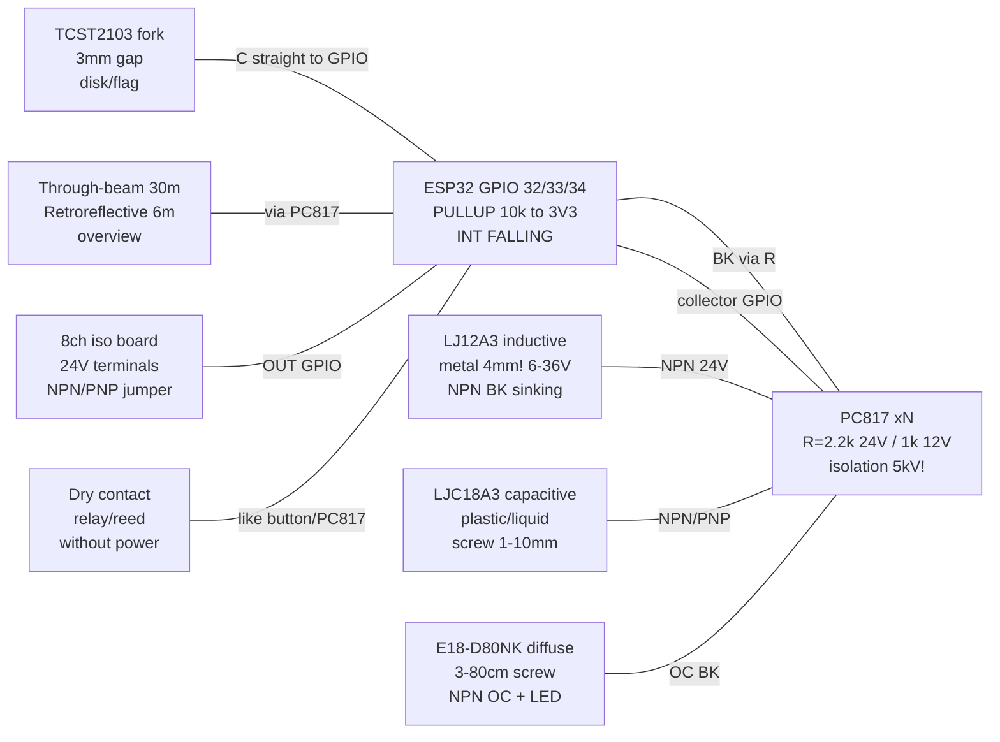

# Industrial discrete inputs: inductive LJ12A3, capacitive, photoelectric E18-D80NK, NPN/PNP, PC817 for 12/24 V, dry contact, isolated 8ch

![[assets/img/proximity-industrial-inputs-scheme.png|600]]
*Fig. 1. Industrial ESP32 inputs: inductive LJ12A3 for metal, diffuse E18-D80NK, fork TCST2103, NPN/PNP via PC817 from 24 V to 3.3 V GPIO.*

> [!danger] 12/24 in - not in GPIO!
> Inductive/capacitive/photoelectric sensors are powered from **6-36 V** and output the same on the output. Direct connection kills ESP32. Rule: **divider for the lab, PC817 optocoupler for the workshop**. See [[EN/13-Power-Modules/02-Level-Shifters.en|Level-shifters]] and [[EN/12-Comm-Modules/10-Industrial.en|Industrial fieldbus]].
>
> [!tip] Where this lives
> CNC axis limit switch (LJ12A3 sees the carriage nut), part-presence check (capacitive LJC sees plastic/liquid), bottle counter on a conveyor (E18-D80NK), printer encoder/rev counter (TCST2103), 24 V panel buttons in a control cabinet (PC817), relay/reed "dry contact", 8-channel isolated PLC-style input board.

## Purpose

This note is a bridge from "lab" buttons ([[EN/10-Sensors/34-Buttons-Switches-Pots.en]]) to workshop discrete inputs: contactless proximity sensors powered from 12/24 V that switch the output themselves, and ways to safely bring them into 3.3 V ESP32 GPIO. Unlike a dry button (passive contact), a proximity sensor is an **active 3-wire device**: brown `BN = +V`, blue `BU = GND`, black `BK = output`.

Covered: inductive LJ12A3 (metal, 4 mm!), capacitive LJC18 (metal/plastic/liquid), diffuse photoelectric E18-D80NK with distance trim, through-beam (emitter + receiver) and retroreflective (sensor + reflector) overview, slot/fork TCST2103 (printer encoders, rev counters!), NPN vs PNP outputs + sinking/sourcing with both schematics, voltage divider vs PC817 optoisolation for 12/24 V with LED resistor calculation, the "dry contact" concept, overview isolated PLC-style 8-channel input boards.

The main formula of the note is the optocoupler LED resistor: `R = (Vin - Vf - Vce_sensor) / If`. The main rule: **common ground of 24 V and ESP32 - only via an optocoupler or an isolated board; otherwise ground loops and contactor throws reach the die**.

## Characteristics

### Contactless proximity sensors: comparison

| Parameter | Inductive LJ12A3-4-Z/BX | Capacitive LJC18A3 | Photoelectric E18-D80NK (diffuse) |
| --- | --- | --- | --- |
| What it sees | **Metal only!** (steel 4 mm, aluminium ~2 mm) | Metal/plastic/wood/liquid/bulk (through a wall!) | Any opaque surface (IR reflection) |
| Distance | 4 mm (M12), ~10% hysteresis | 1-10 mm (adjustable with screw!) | 3-80 cm (sensitivity screw!) |
| Power supply | 6-36 V DC (typically 12/24 V) | 6-36 V DC | 5 V (there are 6-36 V E18-D80NK versions!) |
| Output | NPN NO (BX) / NC (BY); PNP versions AX/AY | NPN/PNP NO/NC | NPN NO (transistor to GND) |
| Output current | Up to 300 mA (switches a relay directly!) | Up to 300 mA | Up to 100-300 mA (by version) |
| Indication | Red LED on the back (lights on trigger) | Red LED | Red LED + green "power" |
| Frequency | Up to ~500 Hz (metal!) | Up to ~100 Hz | Up to ~100 Hz (38 kHz IR modulation inside) |
| Price/availability | Cheap, CNC limit-switch standard | Cheap, level/presence control | Cheap, counters/robot bypasses |
| Pitfall | does not see plastic/hand! Reduced distance on colored metals | Reacts to hand/moisture/dust - false triggers | Blinded in sun/on black velvet; screw adjustment needed |

### Photoelectric topologies overview: diffuse vs through-beam vs retroreflective

| Topology | How built | Range | Pluses | Minuses |
| --- | --- | --- | --- | --- |
| Diffuse (E18-D80NK) | Emitter + receiver in one body, reflection from the object | 0.03-0.8 m | One body, cheap, nothing to place opposite | Depends on color/gloss; black matte is "invisible" |
| Through-beam | Separate TX (IR LED) opposite RX (photodiode), beam interrupted | 1-30 m! | Farthest, most reliable, catches transparent objects | Two bodies + two power supplies + axis alignment |
| Retroreflective (with reflector) | Sensor + corner reflector opposite | 0.5-6 m | One active body, longer range than diffuse | Flashing/transparent objects may "shine through"; reflector gets dirty |
| Slot/fork (TCST2103) | U-fork: LED + phototransistor, 3-5 mm gap | 3 mm (flag!) | Ideal for encoders/counters, sharp edge | Only a thin flag in the gap; dirt kills |

### Slot TCST2103 (printer encoders!)

| Parameter | Value | Note |
| --- | --- | --- |
| Construction | IR LED (anode/cathode) + phototransistor (collector/emitter), ~3 mm gap | 4 leads, 2.54 mm pitch |
| LED | Vf ~1.2 V, If 10-20 mA (150-220 Ohm resistor from 5 V!) | without resistor the LED burns instantly |
| Phototransistor | NPN, collector via 10 kOhm to 3V3, emitter to GND | Collector output to GPIO (LOW = beam blocked) |
| Application | Printer encoders (strip with marks!), disk rev counters with slots | Disk with N slots gives N pulses/rev |
| Speed | Edges ~10 us, up to tens of kHz | 100x better than mechanics; no debounce needed! |
| Dirt | Dust in the gap = "always blocked" | Blow out/cover with a hood |

### NPN vs PNP + sinking/sourcing (both schematics!)

An NPN-output sensor **sinks** current to ground; PNP **sources** current from plus. ESP32 with pull-up loves NPN; PNP requires pull-down or an optocoupler.

```text
 NPN NO (sinking), датчик живиться 24В:         PNP NO (sourcing), датчик живиться 24В:
   +24В ---[BN коричневий]                        +24В ---[BN коричневий]
   GND ----[BU синій]                             GND ----[BU синій]
   BK (чорний) -----+                              BK (чорний) -----+
        (транзистор NPN                            (транзистор PNP
         до GND всередині)                          до +24В всередині)
   При спрацюванні: BK замикається на GND!     При спрацюванні: BK видає +24В!
   => Навантаження/вхід між +24В та BK.        => Навантаження/вхід між BK та GND.
   => Для ESP32: BK через PC817 на GND         => Для ESP32: BK через PC817/дільник
      (ідеально: NPN + pull-up до 3V3).            з pull-down (див. схеми нижче).
```

| Sensor output | at rest (no object) | on trigger | ESP32 input (via PC817) |
| --- | --- | --- | --- |
| NPN NO | BK floats (transistor closed) | BK = GND (open) | Optocoupler LED lights on trigger |
| NPN NC | BK = GND | BK floats | Inversion: lights at rest (taken rarely) |
| PNP NO | BK floats | BK = +24 V | LED via resistor to GND lights on trigger |
| PNP NC | BK = +24 V | BK floats | Inversion |

> [!tip] How to recognize on the body
> Marking `BX` (LJ12A3-4-Z/BX) = NPN NO; `BY` = NPN NC; `AX` = PNP NO; `AY` = PNP NC. On E18-D80NK - NPN NO by default (there are PNP E18-D80PK versions). If in doubt - multimeter: black probe on BU, red on BK: on trigger NPN shows ~0 V, PNP shows ~+24 V.

### Divider vs optoisolation: when which

| Method | Schematic | When to take | When not to take |
| --- | --- | --- | --- |
| 24 to 3.3 divider (e.g. 22k/3.3k) | BK to 22k to GPIO to 3.3k to GND (GND common!) | Lab, shared PSU, short wires, NPN/PNP statics | Workshop, different cabinets, contactors/VFDs, long lines, storms |
| PC817 optocoupler | BK to R to LED to field-GND; phototransistor to GPIO + 3V3 pull-up | **Workshop by default**, 5 kV galvanics, different grounds | Speed >20 kHz without acceleration (PC817 is slow!) |
| Isolated 8ch board | Ready module: 12/24 V terminals + optocouplers + 3V3 outputs | 4+ inputs, control cabinet, PLC style | One sensor (overkill) |

### PC817 LED resistor calculation (mandatory!)

Formula: `R = (Vin - Vf - Vce_sensor) / If`, power `P = I²·R`.

PC817: `Vf ~= 1.2 V` (IR LED), needed `If = 5-10 mA` (CTR >=50% gives 2.5-5 mA on the transistor - enough for GPIO with 10k pull-up), 5 kV isolation, ~4-20 kHz speed.

| Input | Calculation (If=10 mA, Vce NPN~=0.3 V) | E12 standard | Power | check |
| --- | --- | --- | --- | --- |
| 12 V (button/PNP sensor) | R = (12-1.2-0.3)/0.01 = 1050 Ohm | **1 kOhm** | 0.1 W (take 0.25 W) | If = 10.5 mA OK |
| 24 V (workshop standard) | R = (24-1.2-0.3)/0.01 = 2250 Ohm | **2.2 kOhm** | 0.23 W (take 0.5 W!) | If = 10.2 mA OK |
| 24 V economy (If=5 mA) | R = 22.5/0.005 = 4500 Ohm | **4.7 kOhm** | 0.12 W (0.25 W) | If = 4.8 mA, verify minimum CTR! |
| 5 V (E18-D80NK 5V version) | R = (5-1.2)/0.01 = 380 Ohm | **390 Ohm** | 0.04 W | If ~= 9.7 mA OK |

Reverse 1N4148 diode antiparallel to the LED - if the input can get reverse polarity (terminals get mixed up!). Phototransistor pull-up resistor - 10 kOhm to 3V3 on the ESP32 side.

### "Dry contact" vs "wet" output

| Term | What it is | Examples | Connection to ESP32 |
| --- | --- | --- | --- |
| Dry contact | Passive contact without its own power: relay NO/NC, reed, button, microswitch | SRD-05 relay, glass reed, limit switch | like a button: one side to GND, other to GPIO + 10k pull-up |
| Wet/active output | Sensor outputs voltage itself (NPN/PNP, 0-10 V, 4-20 mA) | LJ12A3, E18-D80NK, XTR115 | Only via divider/optocoupler/shunt, never directly! |
| Open collector | NPN transistor without upper resistor (a dry-logic subtype) | E18-D80NK BK, OC encoders | External pull-up to 3V3 (10k) - works like a button to GND! |

## Module pin legend

### LJ12A3 / LJC18 (3 wires, colors per standard!)

| Wire | Color | Purpose | Where |
| --- | --- | --- | --- |
| BN | Brown | +V power 6-36 V | +12/+24 V of workshop PSU (!) |
| BU | Blue | Power GND | Workshop PSU GND → (isolated via optocoupler!) |
| BK | Black | NPN/PNP output | via R to PC817 LED (see schematic) |
| LED | Red on body | Trigger indication | Visually: lights = metal near (LJ12A3) |

### E18-D80NK (diffuse, 3 wires + screw)

| Wire | Color | Purpose | Where |
| --- | --- | --- | --- |
| Brown | Brown | +V (5 V or 6-36 V by version!) | verify the label! The 5V version burns from 24 V |
| Blue | Blue | GND | Sensor PSU GND |
| Black | Black | NPN NO output (open-collector) | Pull-up or PC817 |
| Screw | Plastic slot at back | Distance 3-80 cm (clockwise = farther) | Turn with the target installed! |

### TCST2103 (fork, 4 pins)

| Pin | Side | Purpose | Where |
| --- | --- | --- | --- |
| A | LED anode | + via 220 Ohm | 3V3/5V via resistor! (If ~15 mA) |
| K | LED cathode | GND | GND |
| C | Phototransistor collector | Output via 10 kOhm to 3V3 | GPIO (LOW = blocked) |
| E | Phototransistor emitter | GND | GND |

### PC817 (optocoupler, 4-pin DIP)

| Pin | Purpose | Side |
| --- | --- | --- |
| 1 (anode) | LED+ via R from BK/24V | Field (12/24 V!) |
| 2 (cathode) | LED- to field-GND | Field |
| 3 (emitter) | to ESP32 GND | Logic (3.3 V) |
| 4 (collector) | Output to GPIO + 10k pull-up to 3V3 | Logic |

### Isolated 8ch board (overview, typical)

| Terminal | Purpose | Where |
| --- | --- | --- |
| IN1-IN8 | 12/24 V inputs (each via own optron + R) | Sensor BK / 24 V buttons / relays |
| COM / field-GND | Field-side common ground | Workshop PSU GND |
| OUT1-OUT8 / logic-VCC | Open-collector outputs + 3.3/5 V logic supply | ESP32 GPIO (+ pull-up), ESP32 3V3/GND |
| NPN/PNP jumper | Input polarity selection (sinking/sourcing!) | per sensor type in the cabinet |

## Connection schematic

| ESP32 | LJ12A3/LJC (NPN) | E18-D80NK | TCST2103 | 24 V button / dry contact | Note |
| --- | --- | --- | --- | --- | --- |
| 3V3 | - (sensor from 24 V!) | - | A via 220 Ohm (LED) | - | Logic separate from field! |
| Logic-GND | PC817 pin 3 | PC817 pin 3 | E + K | - | ESP32 ground |
| GPIO32 | PC817 pin 4 + 10k to 3V3 | - | - | PC817 pin 4 | Input from optocoupler (LOW=active) |
| GPIO33 | - | PC817 pin 4 + 10k | - | - | Diffuse counter |
| GPIO34 | - | - | C (+10k to 3V3) | - | Fork encoder (input only!) |
| +24V_field | BN (brown) | BN (if 24V version!) | - | Button to R 2.2k to PC817 pin 1 | Field PSU separate! |
| Field-GND | BU (blue) | BU | - | PC817 pin 2 | Field ground |
| BK | to R 2.2k to PC817 pin 1 | to R to PC817 pin 1 (or 10k pull-up to 3V3 for the 5V version!) | - | - | NPN pulls the LED to ground |

### ASCII schematic

NPN 24 V sensor via PC817 (basic workshop schematic, sinking):

```text
 ПОЛЬОВА СТОРОНА (24В):              ГАЗОРОЗРЯДНИК НЕ ТРЕБА, АЛЕ TVS БАЖАНО
  +24В ---[BN] LJ12A3 [BU]--- GND_поле
                [BK]---+---[2.2к 0.5Вт]---(1)PC817(2)--- GND_поле
                       |    R=(24-1.2-0.3)/0.01=2.25к => 2.2к, If≈10мА
  Спрацював (метал 4мм!): BK=GND => LED горить (струм 10мА через R+LED+BK)
  Спокій: BK висить => LED не горить.
                       xxxxxxxxx ІЗОЛЯЦІЯ 5кВ xxxxxxxxx
 ЛОГІЧНА СТОРОНА (3.3В):
  3V3 ---[10к]---+--- GPIO32 (INPUT, переривання FALLING!)
                 |
              (4)PC817(3)--- GND_лог
  LED горить => фототранзистор відкритий => GPIO=LOW (АКТИВНО!)
  LED не горить => 10к тягне GPIO=HIGH.
```

PNP 24 V sensor via PC817 (sourcing):

```text
 ПОЛЬОВА СТОРОНА (24В):
  +24В ---[BN] датчик PNP [BU]--- GND_поле
                [BK]---+---[2.2к]---(1)PC817(2)--- GND_поле
  Спрацював: BK=+24В => струм через R+LED до GND_поле (If≈10мА) => LED горить.
  Спокій: BK висить (0В) => LED не горить.
  (Той самий R 2.2к! Різниця лише всередині датчика: PNP віддає +, NPN стягує.)
 ЛОГІКА: та сама — GPIO LOW = спрацювання.
 УВАГА: PNP NC-версія дає +24В у спокої => LED горить завжди, гасне при спрацюванні (інверсія!).
```

24 V dry contact (panel button/relay) via PC817:

```text
 +24В ---[кнопка/реле NO]---[2.2к 0.5Вт]---(1)PC817(2)--- GND_поле
 Натиснуто: ланцюг замкнувся => LED If≈10мА => GPIO LOW.
 Відпущено: ланцюг розімкнено => GPIO HIGH (10к до 3V3).
 Сухий контакт НЕ має полярності — R можна ставити з будь-якого боку LED.
 Діод 1N4148 антипаралельно LED — protection від переплутаних клем 24В.
```

24 to 3.3 divider (lab only, common GND!):

```text
 BK (NPN/PNP 24В) ---[22к]---+--- GPIO (INPUT, БЕЗ внутрішнього pull!)
                             |
                           [3.3к]
                             |
                            GND (СПІЛЬНА з БЖ 24В!)
 Vout = 24 * 3.3/(22+3.3) = 3.13В ✓ (HIGH), 0В при NPN-спрацюванні.
 Струм: 24/25.3к ≈ 0.95мА постійно. НЕ для цеху (немає ізоляції!).
```

E18-D80NK 5V version directly (open-collector, only if the sensor is 5V and the wire is short!):

```text
 E18 Brown --- 5V; Blue --- GND (спільна з ESP32!)
 E18 Black ---[10к pull-up до 3V3]--- GPIO33
             (НЕ до 5V! Інакше 5V на GPIO!)
 Об'єкт у 3-80см: BK стягується на GND => GPIO LOW.
```

TCST2103 fork (printer encoder, counter):

```text
 3V3 ---[220 Ом]---(A)LED(K)--- GND        If=(3.3-1.2)/220≈9.5мА
 3V3 ---[10к]---+---(C)фото(E)--- GND
                |
               GPIO34 (LOW = прапорець у зазорі!)
 Диск з 20 прорізами => 20 імпульсів/оберт => RPM = f*60/20.
 Дебаунс НЕ потрібен (оптика!), але потрібен кожух від пилу.
```

### Mermaid



## Code ESP-IDF

```c
#include "driver/gpio.h"
#include "esp_log.h"
#include "esp_timer.h"
#include "freertos/FreeRTOS.h"
#include "freertos/task.h"

#define IN_LJ  GPIO_NUM_32 // LJ12A3 через PC817 (LOW=метал!)
#define IN_E18 GPIO_NUM_33 // E18-D80NK через PC817 (LOW=об'єкт!)
#define IN_SLOT GPIO_NUM_34 // TCST2103 колектор безпосередньо (LOW=перекрито)
static const char *TAG = "prox";
static volatile uint32_t slot_cnt = 0;
static volatile int64_t slot_t = 0;
static volatile float slot_rpm = 0;

// Лічильник обертів: кожен проріз диска = імпульс FALLING
static void IRAM_ATTR slot_isr(void *a) {
    int64_t now = esp_timer_get_time();
    int64_t dt = now - slot_t; // період між прорізами, мкс
    slot_t = now; slot_cnt++;
    if (dt > 0) slot_rpm = 60.0e6 / (dt * 20); // 20 прорізів/оберт!
}

void app_main(void) {
    gpio_config_t c = {.pin_bit_mask = (1ULL<<IN_LJ)|(1ULL<<IN_E18)|(1ULL<<IN_SLOT),
        .mode = GPIO_MODE_INPUT, .pull_up_en = GPIO_PULLUP_ENABLE,
        .pull_down_en = GPIO_PULLDOWN_DISABLE,
        .intr_type = GPIO_INTR_NEGEDGE};
    gpio_config(&c);
    // LJ/E18: опитування в loop (повільні, 100Гц достатньо + SW-фільтр)
    // Слот: переривання (кГц, без дебаунсу — оптика!)
    gpio_install_isr_service(0);
    gpio_isr_handler_add(IN_SLOT, slot_isr, NULL);

    bool lj_last = true, e18_last = true;
    for (;;) {
        bool lj = gpio_get_level(IN_LJ);   // LOW = метал у 4мм!
        bool e18 = gpio_get_level(IN_E18); // LOW = об'єкт у 3-80см
        if (!lj && lj_last) ESP_LOGI(TAG, "LJ: МЕТАЛ (NPN спрацював)");
        if (!e18 && e18_last) ESP_LOGI(TAG, "E18: ОБ'ЄКТ (дифузне відбиття)");
        lj_last = lj; e18_last = e18;
        ESP_LOGI(TAG, "LJ=%d E18=%d slot=%lu rpm=%.0f", lj, e18, slot_cnt, slot_rpm);
        vTaskDelay(pdMS_TO_TICKS(200));
    }
}
// PNP NC-датчик дасть інверсію (LOW у спокої!) — інвертувати логіку або брати NO-версію.
// Ізольована плата 8ch: ті самі GPIO, тільки OUT плати замість колекторів PC817.
// Through-beam/retroreflective: підключення ідентичне E18 (той самий NPN BK через PC817).
```

## Code Arduino

```cpp
#define IN_LJ 32    // LJ12A3 NPN через PC817
#define IN_E18 33   // E18-D80NK через PC817
#define IN_SLOT 34  // TCST2103 колектор

volatile unsigned long slotCnt = 0;
volatile unsigned long slotT = 0;
volatile float rpm = 0;
void IRAM_ATTR onSlot() { // 20 прорізів/оберт
  unsigned long now = micros(), dt = now - slotT;
  slotT = now; slotCnt++;
  if (dt > 0) rpm = 60.0e6 / (dt * 20);
}

void setup() {
  Serial.begin(115200);
  pinMode(IN_LJ, INPUT_PULLUP);   // PC817 колектор: LOW=активно
  pinMode(IN_E18, INPUT_PULLUP);
  pinMode(IN_SLOT, INPUT_PULLUP); // TCST колектор: LOW=перекрито
  attachInterrupt(digitalPinToInterrupt(IN_SLOT), onSlot, FALLING);
}

void loop() {
  static int ljLast = HIGH, e18Last = HIGH;
  int lj = digitalRead(IN_LJ);   // LOW = метал 4мм!
  int e18 = digitalRead(IN_E18); // LOW = об'єкт!
  // SW-фільтр 20мс для LJ/E18 (механічна вібрація деталі дає дзвін!)
  if (lj != ljLast) { delay(20); lj = digitalRead(IN_LJ); }
  if (e18 != e18Last) { delay(20); e18 = digitalRead(IN_E18); }
  if (lj == LOW && ljLast == HIGH) Serial.println("LJ: МЕТАЛ");
  if (e18 == LOW && e18Last == HIGH) Serial.println("E18: ОБ'ЄКТ");
  ljLast = lj; e18Last = e18;
  Serial.printf("LJ=%d E18=%d slot=%lu rpm=%.0f\n", lj, e18, slotCnt, rpm);
  delay(200);
}
// Сухий контакт реле 24В: та сама схема PC817 (R 2.2к), код ідентичний IN_LJ.
// PNP-датчик: той самий код, але світить/спрацьовує навпаки для NC-версій.
```

## Code MicroPython

```python
from machine import Pin
import time

lj = Pin(32, Pin.IN, Pin.PULL_UP)    # LJ12A3 NPN/PC817: 0 = метал!
e18 = Pin(33, Pin.IN, Pin.PULL_UP)   # E18-D80NK/PC817: 0 = об'єкт!
slot = Pin(34, Pin.IN, Pin.PULL_UP)  # TCST2103: 0 = перекрито

cnt = [0]
last_t = [time.ticks_us()]
rpm = [0.0]
SLOTS = 20  # прорізів диска на оберт

def on_slot(p):
    now = time.ticks_us()
    dt = time.ticks_diff(now, last_t[0])
    last_t[0] = now; cnt[0] += 1
    if dt > 0:
        rpm[0] = 60.0e6 / (dt * SLOTS)

slot.irq(trigger=Pin.IRQ_FALLING, handler=on_slot)

lj_last, e18_last = 1, 1
while True:
    v_lj, v_e18 = lj.value(), e18.value()
    time.sleep_ms(20)  # SW-фільтр вібрації деталі
    v_lj, v_e18 = lj.value(), e18.value()
    if v_lj == 0 and lj_last == 1: print("LJ: МЕТАЛ")
    if v_e18 == 0 and e18_last == 1: print("E18: ОБ'ЄКТ")
    lj_last, e18_last = v_lj, v_e18
    print("LJ={} E18={} slot={} rpm={:.0f}".format(v_lj, v_e18, cnt[0], rpm[0]))
    time.sleep_ms(200)
```

## typical errors

| № | error | Symptom | Solution |
| --- | --- | --- | --- |
| 1 | BK 24 V directly to GPIO | Instant pin/die death | Only divider (lab) or PC817 (workshop); verify with multimeter before power-on! |
| 2 | Pull-up to 5V on BK of E18 5V version | 5 V on GPIO | Pull-up only to 3V3 (10 kOhm); never to 5V |
| 3 | LJ12A3 does not see plastic/hand | "Sensor faulty" | LJ - metal only 4 mm! Plastic/liquid - capacitive LJC; hand - E18 |
| 4 | Aluminium at 4 mm does not trigger | Triggers only point-blank | Reduction factor: Al ~0.5 of distance; take 2x margin or a steel target |
| 5 | E18 screw turned to maximum | Catches the wall beyond 80 cm / self-excitation | Adjust on the real target: from minimum to confident trigger + 1/4 turn |
| 6 | E18 blinded in sun / on black velvet | Misses / false | Sun visor; black matte - closer/bigger target or through-beam |
| 7 | NPN/PNP mixed up (sinking/sourcing) | Inversion or "always active" | Ring out BK with a multimeter; NC versions invert logic; NPN/PNP jumper on the 8ch board |
| 8 | PC817 LED R at random (10k on 24V) | If=2 mA, CTR does not open the transistor | Calculate: 24V to 2.2k (10mA), 12V to 1k; 0.5 W resistor on 24 V! |
| 9 | Shared 24V and ESP32 GND without isolation | Resets on contactor starts, burnout | PC817/8ch board: grounds separated; shield to PE in one point |
| 10 | TCST2103 LED without resistor | LED burned in a second | 150-220 Ohm in series with A; verify If ~10-15 mA |
| 11 | Dust in the TCST gap | "Always blocked" | Hood + blow-out; threshold by edge, not by level |
| 12 | Relay dry contact taken for a "5V output" | Ringing/coupling on a long stub | Dry contact = button: GND + 10k pull-up; long stub - 4.7k + RC or PC817 |
| 13 | PC817 on a fast encoder (>20 kHz) | Smeared edges, lost pulses | PC817 only to ~20 kHz; faster - 6N137/TLP2362 or direct TCST |
| 14 | E18 5V version powered from 24 V | Smoke, sensor death | Read the label! 5V version - separately; 6-36V version - to the workshop |

## Official sources

- [GPIO and RTC GPIO - ESP-IDF Programming Guide (Espressif)](https://docs.espressif.com/projects/esp-idf/en/stable/esp32/api-reference/peripherals/gpio.html) - inputs, pull-ups, interrupts for discrete signals with optocouplers.
- [ISO124 Precision Isolation Amplifier - Texas Instruments](https://www.ti.com/product/ISO124) - galvanic isolation principle of field and logic sides (concept for 24 V inputs).
- [XTR115 4-20 mA Transmitter - Texas Instruments](https://www.ti.com/product/XTR115) - workshop 24 V levels, loop, IRET/Vref (industrial signal context).
- [CAN Bus BFF Guide - Adafruit Learn](https://learn.adafruit.com/adafruit-can-bus-bff) - diff pairs in noise, 120 Ohm terminator, MCP2515/SPI (workshop practice next to discrete inputs).

## See also

- [[Home.en|Home reference map]]
- [[EN/03-GPIO/03-Pull-Ups-Levels.en|Pull-ups and 3.3V/5V levels]]
- [[EN/13-Power-Modules/02-Level-Shifters.en|Level-shifters and optoisolation]]
- [[EN/12-Comm-Modules/10-Industrial.en|Industrial fieldbus: CAN/DMX/4-20mA/TRIAC]]
- [[EN/10-Sensors/34-Buttons-Switches-Pots.en|Buttons, toggles, E-Stop, potentiometers]]
