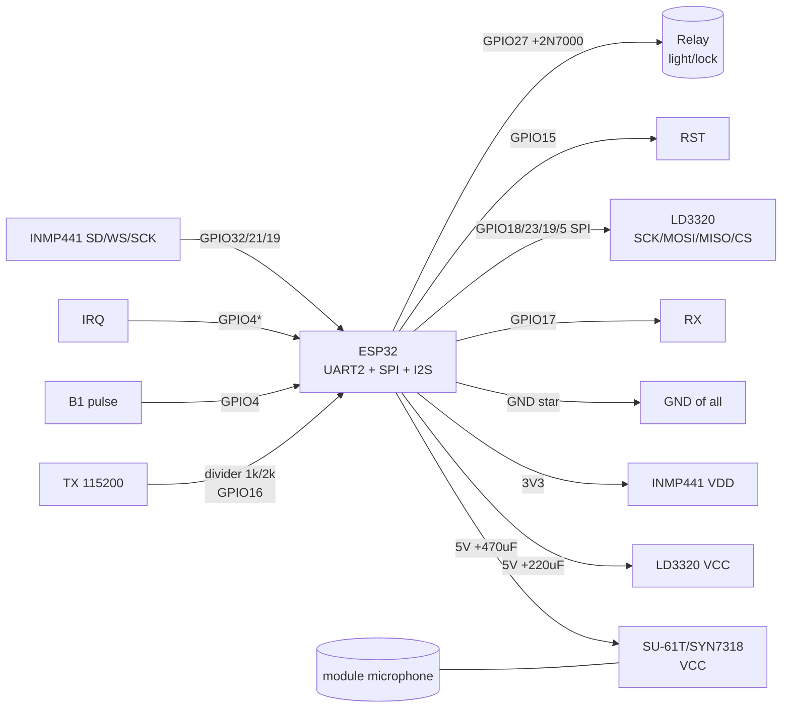

# Offline voice on ESP32 - LD3320, SU-61T/SU-20T, CI-03T/CI-40T/UNI3588/SYN7318

> [!info] Purpose
> A note on voice modules that recognize commands **without internet and without a neural network on ESP32 itself**: **LD3320** (recognition without training, SPI, fixed keyword list), **SU-61T / SU-20T** (cheap UART/GPIO triggers with PWM outputs), **CI-03T / CI-40T / UNI3588 / SYN7318** (smart UART modules with a frame protocol that drive relays themselves by command). Common: ESP32 here is only the executor (reads UART/SPI/GPIO and clicks relays), while the "ears" are a separate chip. For neural-network voice on ESP32 itself see [[EN/12-Comm-Modules/11-TinyML-Voice.en]].

Bus overview: [[EN/04-Interfaces/01-UART.en|UART]], sound [[EN/04-Interfaces/04-I2S.en|I2S]], radar/voice [[EN/12-Comm-Modules/08-LD2410-UWB-IR-Voice.en]], full cloud-local assistant [[EN/15-Protocols/10-Voice-Assistant.en]], start [[EN/Home.en]].

## Purpose

In short: give the device voice control where there is no WiFi, no server and no room for TinyML - garage, basement, dacha, toy. The module listens to the microphone itself and tells ESP32 the ready result: a keyword number (LD3320 over SPI), a command byte (SU-61T over UART), a text frame (SYN7318 over UART) or a ready HIGH pulse on a pin (SU-20T, CI-03T GPIO).

| Parameter | Value |
| --- | --- |
| Interface | UART (SU-61T/SU-20T/CI-03T/CI-40T/UNI3588/SYN7318), SPI (LD3320), GPIO/PWM (all as triggers) |
| Module power | 5V (LD3320, SU series, most CI/SYN boards) or 3.3V (bare CI-03T, SYN7318 chips) |
| Signal level | 3.3V (mandatory for ESP32; 5V module TX to divider or level-shifter!) |
| Compatibility | ESP32 / S2 / S3 / C3 / C6 (any - zero load, UART parsing) |
| Microphone | Stock electret/MEMS on module + optional outdoor INMP441 for the ESP32 side |

When to take an offline module, not ESP-SR/TinyML:

- no PSRAM and no S3 (plain ESP32-WROOM, ESP32-C3) - the module removes the load;
- need 2-5 "on/off" commands with <1 s reaction without WiFi;
- battery powered and ESP32 sleeps - the module wakes it by pin (B1-B6, IO1...);
- command language is Chinese/English out of the box (native module dictionaries).

When not to take:

- free speech needed ("set a timer for dinner") - that is [[EN/15-Protocols/10-Voice-Assistant.en]] (Assist + Whisper);
- Ukrainian out of the box needed - these modules either lack it or you must flash your own dictionary (see section 5);
- reaction to a specific voice (speaker ID) needed - none of the modules distinguishes speakers.

## Characteristics

| Module / chip | Principle | Dictionary | Interface to ESP32 | Power supply | Microphone range | Language out of the box |
| --- | --- | --- | --- | --- | --- | --- |
| LD3320 | Speaker-independent, without training, MFCC+DTW on chip | ~10-50 keywords (flashed as a list, EN/CN pinyin) | SPI (commands+result reading) + IRQ | 5V (board) / 3.3V (chip) | 2-4 m (board electret) | EN, CN (pinyin) |
| SU-61T | Offline NPU, WiseLight firmware | ~50-100 commands + TTS auto-answer | UART 115200 (text `+ASR:`) + B1-B6 GPIO | 5V, ~150 mA | 3-5 m | CN, EN (limited) |
| SU-20T | Younger brother of SU-61T, less flash | ~15-30 commands | UART 115200 + GPIO pulses | 5V, ~120 mA | 3-5 m | CN, EN (limited) |
| CI-03T | ASR chip + TTS answer, relay scenarios on board | ~15 keywords + direct relay actions | UART 9600/115200 (`AA 55 ...` frames) + IO1-IO4 | 3.3V (chip) / 5V (board) | 3-8 m (with MEMS) | CN, EN |
| CI-40T | Elder CI: more GPIO, PWM, scenarios | ~30-50 commands, "on/off/brightness" scenes | UART + 8xGPIO + PWM | 5V (board) | 3-8 m | CN, EN |
| UNI3588 (Unisound) | Full Voice SoC, UART protocol with checksum | 100+ commands, dialogs, TTS | UART 115200 (frames with length+CRC) | 5V, ~200 mA | 5-8 m (up to 2-mic array) | CN, EN |
| SYN7318 (Synochip) | ASR+TTS, most detailed UART protocol | 100+ commands, interrupts, status frames | UART 115200 8N1 (`FD ...` frames, `FC ...` status) | 3.3-5V, ~170 mA | 5-10 m | CN, EN |

> [!warning] 3.3V logic!
> All ESP32 GPIOs are 3.3V, **not 5V-tolerant**. Voice-module TX on 5V boards often outputs a 5V level: put a 1k/2k divider or TXS0108E between module TX and ESP32 RX. Check HIGH with a multimeter before first power-on. 5V power - only to module VCC, never to GPIO.

![[assets/img/offline-voice-uart-scheme.png|600]]
*Fig. Typical bench: voice module (5V, UART 115200) to divider to ESP32 RX2 to frame parser to relay/light; LD3320 - separately over SPI.*

## Comparison "what each hears": 15 words vs 100+

| Class | Representatives | How many commands really | How set | Typical dictionary example | Error price |
| --- | --- | --- | --- | --- | --- |
| Minimum (~15 words) | SU-20T, CI-03T | 10-15 + wake-up | Firmware in WiseLight / CI AT commands | "xiao du xiao du" (wake) to "kai deng" (light on), "guan deng" (off), "da kai", "guan bi" | Mixes similar syllables ("kai" vs "gai") - spread commands phonetically |
| Middle (~50 words) | LD3320, SU-61T, CI-40T | 30-50 | Line list in code (LD3320) / WiseLight dictionary | LD3320: "turn on light", "turn off light", "open door", "play music", "volume up/down", "hello robot"... (see list below) | LD3320 without retraining - pronunciation cannot change, only replace the word |
| Maximum (100+ words) | UNI3588, SYN7318 | 100-300, nested menus ("AC mode to temperature to speed") | Manufacturer configurator / hex command table | SYN7318: codes 0x01-0x64 per command + status frames back ("done", "did not get it", "repeat") | Long dictionary = longer search time (~0.5-1 s) and more false triggers in noise |

Choice rule: count commands including the wake word. Up to 12 - take SU-20T/CI-03T (cheapest, GPIO without code). 12-50 - LD3320 (if SPI and own list needed) or SU-61T (if a UART line needed). Over 50, dialogs, statuses - SYN7318/UNI3588.

## 1. LD3320 - recognition without training (SPI, keyword list!)

LD3320 is a chip that does phoneme recognition right on the die: you lay a word list (pinyin for Chinese, letters for English), the chip listens and returns the word index. Training on the user voice is **not needed** (speaker-independent) - and that is the limit: your own accent or Ukrainian "from zero" cannot be added, only swapped with similar-phonetic words.

How the pipeline works:

1. ESP32 writes the keyword list into LD3320 over SPI (registers 0x05-0xBD, format: length + ASCII/pinyin + terminator);
2. command `0x87` - recognition start (MP3/microphone mode, the MIC register selects input);
3. the chip raises **IRQ** (active LOW) when it "heard" - ESP32 reads register `0xC5` (word index) and `0xC3` (confidence/status);
4. command `0x87` again - next listening cycle.

### LD3320 keyword list (EN-dictionary example, flashed in code)

```text
IDX  Ключове слово (як шити в регістри)   Дія в прошивці ESP32
---  ----------------------------------   --------------------
0    "XIAO DU" (wake, піньїнь)             Пробудження: LED blink, перехід у режим команд на 8 с
1    "KAI DENG" (піньїнь «увімкни світло») Реле ON (GPIO27 HIGH)
2    "GUAN DENG" (піньїнь «вимкни»)        Реле OFF (GPIO27 LOW)
3    "TURN ON LIGHT" (EN)                  Реле ON (дубль англійською)
4    "TURN OFF LIGHT" (EN)                 Реле OFF
5    "OPEN DOOR"                           Серво/замок імпульс 1 с
6    "CLOSE DOOR"                          Серво/замок назад
7    "PLAY MUSIC"                          DFPlayer play (див. 11-Vivid/08)
8    "STOP"                                DFPlayer stop / все викл
9    "VOLUME UP"                           Гучність + (DFPlayer/MAX98357)
10   "VOLUME DOWN"                         Гучність −
11   "HELLO ROBOT"                         TTS-вітання / LED-анимація
```

> [!tip] Phonetics matters more than meaning
> LD3320 distinguishes syllables, not meanings. Do not lay pairs like "kai deng / guan deng" next to "kai men" - first syllables merge. Spread commands: different first syllables, different length (1 syllable vs 3 syllables), wake word always the longest and most unique.

## LD3320 module pin legend (board with microphone)

| Module pin | Type | Where on ESP32 | Note |
| --- | --- | --- | --- |
| VCC 5V | Power input | 5V | 5V, ~120 mA peak at recognition; 220 uF electrolytic near VCC |
| GND | Ground | GND | Common ground, short |
| SCK | SPI input | GPIO18 | SPI up to 4 MHz; wires <10 cm |
| MOSI (SI) | SPI input | GPIO23 | Dictionary and command writes |
| MISO (SO) | SPI output | GPIO19 | Status/index reads; 3.3V level from the board - safe |
| CS (NSS) | SPI input | GPIO5 | Chip select, active low |
| IRQ | Output, active low | GPIO4 (interrupt!) | LOW = word recognized; 10k pull-up to 3.3V if the board lacks one |
| RST | Input, active low | GPIO15 | Reset: LOW 10 ms at startup, then HIGH |
| MIC+ / MIC- | Analog input | Stock board electret | **do not extend!** place the module closer to the user |
| SPK | Audio output | NC / 8 Ohm speaker (optional) | Sound ack "confirmed" without ESP32 |

## 2. SU-61T / SU-20T - PWM/GPIO triggers

The SU series (Ai-Thinker, main-controller chip + NPU) is flashed in the **WiseLight** visual environment: you pick commands from the dictionary, assign each an action - a UART line outside, a HIGH pulse on pin B1-B6 or PWM on LED pins. ESP32 in the simplest option does not parse text at all: each command is a separate pin.

SU-61T vs SU-20T difference:

| Parameter | SU-61T | SU-20T |
| --- | --- | --- |
| Flash for dictionary | ~2 MB (50-100 commands + TTS answers) | ~1 MB (15-30 commands, short answers) |
| Outputs | B1-B6 GPIO + PWM0/1 + UART | B1-B4 GPIO + UART (simplified PWM) |
| Consumption | ~150 mA | ~120 mA |
| When to take | Room, scenes, voice feedback | Corridor/garage: 2-4 commands, minimum code |

Two operation modes with ESP32:

- **GPIO mode (without parsing):** B1 to light relay, B2 to gate, B3 to siren. ESP32 reads `digitalRead` or is not needed at all - B pins pull relays via transistor directly.
- **UART mode (with parsing):** module TX sends `+ASR: <command>\r\n` at 115200; ESP32 parses the line (code in the "code" section) - more flexible, one data wire.

## SU-61T / SU-20T module pin legend

| Module pin | Type | Where on ESP32 | Note |
| --- | --- | --- | --- |
| VCC 5V | Power input | 5V | 5V; 470 uF electrolytic - the module is sensitive to WiFi-neighbor sags on the bus |
| GND | Ground | GND | Common ground |
| TX | UART output | GPIO16 (RX2) via 1k/2k divider! | 115200 8N1, `+ASR: kai deng\r\n` format; HIGH may be 5V - measure! |
| RX | UART input | GPIO17 (TX2) | Answer-synthesis commands from ESP32 (`{play:3}` - depends on WiseLight firmware) |
| B1-B6 (SU-61T) / B1-B4 (SU-20T) | GPIO outputs, ~500 ms HIGH pulse | GPIO4/13/14/... or directly to relay transistor | Each command gets its pin in WiseLight; pin current <10 mA - relay only via switch! |
| PWM0 / PWM1 | PWM output | LED strip via MOSFET / NC | Voice dimming ("brighter/darker") without ESP32 |
| MIC+ / MIC- | Analog | Stock microphone | do not extend; enclosure hole opposite the capsule |

## 3. CI-03T / CI-40T / UNI3588 / SYN7318 - UART protocols: frame format, baud, relay commands

These are "smart" modules: they lead the dialog themselves (ask back, confirm), while ESP32 gets ready command codes and sends action codes back. Protocol in all is UART 8N1, but the frame format differs. Each below.

### 3.1 CI-03T / CI-40T (`AA 55 ...` frames, 9600/115200)

| Frame parameter | Value |
| --- | --- |
| Baud | 9600 (factory) or 115200 (`AT+BAUD=115200` AT command) |
| Format | `AA 55 LEN CMD DATA... SUM` - 2-byte header, length, code, data, checksum (low byte of LEN+CMD+DATA sum) |
| Module to ESP32 | `CMD=0x01` result: `DATA[0]` = command ID (0x01 light on, 0x02 off, 0x03 gate...); `DATA[1]` = confidence 0-100 |
| ESP32 to module | `CMD=0x02` action: same IDs - force voice/act scene; `CMD=0x05` status request |
| Wake | `CMD=0x00 DATA=0x01` - wake word heard, then wait 6 s for command |

Byte example (CI-03T, "light on" command, ID=0x01, confidence 92=0x5C):

```text
module → ESP32:  AA 55 03 01 01 5C 60
                 ││ │  │  │  │  └─ SUM = (03+01+01+5C) & FF = 0x60
                 ││ │  │  │  └─ впевненість 0x5C = 92
                 ││ │  │  └─ ID команди 0x01
                 ││ │  └─ CMD 0x01 = результат розпізнавання
                 ││ └─ LEN = 3 (CMD+DATA…)
                 │└─ заголовок
                 └─ заголовок
ESP32 → реле:    digitalWrite(27, HIGH)
```

### 3.2 UNI3588 (Unisound, frames with length + CRC16, 115200)

| Frame parameter | Value |
| --- | --- |
| Baud | 115200 8N1 |
| Format | `FE F8 LEN_H LEN_L CMD SEQ DATA... CRC16_H CRC16_L` - CRC16-Modbus over CMD+SEQ+DATA |
| Module to ESP32 | `CMD=0x10` event: `DATA[0..1]` = command ID (up to 1000+), `DATA[2]` = scene/context |
| ESP32 to module | `CMD=0x20` do action + voice: ID + parameter (brightness 0-100, servo angle...) |
| Status back | module sends `CMD=0x11` ACK after each accepted ESP32 command - wait 200 ms for ACK, else repeat |

### 3.3 SYN7318 (Synochip, `FD ...` / `FC ...` status frames, 115200)

The most detailed protocol - separate command frames and separate status frames, plus a speech-interrupt command.

| Frame parameter | Value |
| --- | --- |
| Baud | 115200 8N1 (fixed) |
| Module to ESP32 command | `FD LEN CMD DATA... CS` - `CMD=0x01` recognized: `DATA[0]` = command code 0x01-0x64; `CS` = XOR of all bytes after FD |
| Module to ESP32 status | `FC LEN ST CS` - `ST`: `0x01` started listening, `0x02` heard speech, `0x03` executed, `0x04` did not get it (repeat), `0x05` wait timeout |
| ESP32 to module | `FD LEN 0x02 ID CS` - execute+voice command ID; `FD 01 0x09 F8` - stop/interrupt voicing (barge!); `FD 02 0x03 VOL CS` - volume 0-9 |
| Relay directly | Codes 0x01-0x08 can be mapped to module P0-P7 outputs in the configurator - the relay clicks without ESP32 at all |

SYN7318 session example (light on, ID=0x03):

```text
користувач:  «сяо чжі, кай ден»
module → ESP32:  FC 01 01 FB        (почав слухати, CS=XOR)
module → ESP32:  FC 01 02 F8        (почув мову)
module → ESP32:  FD 02 01 03 FF     (розпізнано ID 0x03, CS=02^01^03=0x00… див. точну формулу в мануалі!)
ESP32 → реле:    GPIO27 HIGH + відповідь модулю:
ESP32 → module:  FD 02 02 03 F9     (підтвердити+озвучити «світло увімкнено»)
module → ESP32:  FC 01 03 F9        (виконав)
```

> [!warning] Checksums differ in all!
> CI: sum; UNI3588: CRC16-Modbus; SYN7318: XOR. Do not copy a parser from one module to another - check against the manual of the specific board. Wrong CS = the module stays silent in answer, and this looks like "burnt" though one byte is guilty.

### Relay commands: summary ID table ("room" project example)

| ID | Command (CN pinyin / EN) | ESP32 action | Module |
| --- | --- | --- | --- |
| 0x01 | kai deng / turn on light | GPIO27 HIGH (light) | All |
| 0x02 | guan deng / turn off light | GPIO27 LOW | All |
| 0x03 | kai men / open door | Lock pulse 1 s (GPIO14) | CI-40T/SYN7318/UNI3588 |
| 0x04 | guan men / close door | Pulse back | CI-40T/SYN7318/UNI3588 |
| 0x05 | da kai feng shan / fan on | Fan relay (GPIO26) | SU-61T/SYN7318/UNI3588 |
| 0x06 | brighter (liang yi dian / brighter) | PWM +10% (LEDC) | CI-40T/SU-61T |
| 0x07 | dimmer (an yi dian / dimmer) | PWM -10% (LEDC) | CI-40T/SU-61T |
| 0x08 | bao jing / alarm | Siren + MQTT (see [[EN/15-Protocols/01-MQTT.en|MQTT]]) | SYN7318/UNI3588 |

## 4. Noise and microphone: why INMP441 is mentioned in a module note

A voice module has its own microphone - but the ESP32 side often listens too (command ack, room loudness, log recording). Rule: **digital I2S microphone INMP441 instead of analog MAX9814/electret into ADC** - 100 Hz WiFi coupling kills analog, while I2S gives clean 16 kHz/24 bit. Bus details - [[EN/04-Interfaces/04-I2S.en|I2S]], neural stack - [[EN/12-Comm-Modules/11-TinyML-Voice.en]].

Noise-fighting practice for offline modules:

1. Module - closer to the person (1-3 m), at least 2 m away from TV/extractor;
2. Module power - a separate LDO or LC filter: DC-DC hissing sounds like "sh-sh-sh" to ASR and masks hissing commands;
3. Enclosure: 2-3 mm hole opposite the capsule, do not seal foam dust-moisture protection with film;
4. Threshold/confidence: ignore results with confidence <70 (CI, SYN7318 send confidence in the frame!);
5. Mirror commands ("on/off") spread phonetically, not by logic.

## INMP441 module pin legend (ESP32-side I2S microphone)

| INMP441 pin | Type | Where on ESP32 | Note |
| --- | --- | --- | --- |
| VDD | Power input | 3V3 | 3.3V only! 100 nF to GND near the module |
| GND | Ground | GND | Short, common; do not route past DC-DC |
| SD (DOUT) | I2S data output | GPIO32 (I2S DIN) | 16 kHz/24 bit stream; no pull-up needed |
| WS | Frame input | GPIO21 (I2S WS) | 16 kHz; <10 cm |
| SCK (BCK) | Bit-clock input | GPIO19 (I2S BCK) | ~1 MHz |
| L/R | Channel select | GND = Left | Second microphone (stereo matrix) - to 3V3 = Right |

## Connection schematic

| ESP32 DevKit | SU-61T / SYN7318 (UART) | LD3320 (SPI) | INMP441 (I2S) | Note |
| --- | --- | --- | --- | --- |
| 5V (VIN) | VCC 5V (+470 uF!) | VCC 5V (+220 uF!) | - | Two electrolytics - one near each module |
| 3V3 | - | - | VDD (+100 nF) | 3.3V digital only |
| GND | GND | GND | GND | Common ground, star |
| GPIO16 (RX2) | TX via 1k/2k divider! | - | - | verify HIGH with multimeter |
| GPIO17 (TX2) | RX | - | - | 3.3V is enough for a 5V-module input |
| GPIO4 | B1 (command pulse) | IRQ (interrupt) | - | One or the other - not both on one pin! |
| GPIO18/23/19/5 | - | SCK/MOSI/MISO/CS | - | SPI <10 cm |
| GPIO15 | - | RST | - | LOW 10 ms at startup |
| GPIO21/19/32 | - | - | WS/SCK/SD | I2S; SCK can be shared by frequency |
| GPIO27 | Relay (via transistor!) | Relay (via transistor!) | - | Module/module relay pin: coil current not from GPIO |

> [!warning] Relay - only via switch
> ESP32 GPIO gives 12 mA, a 5V relay coil takes 70-90 mA. Between GPIO and relay - an N-MOSFET (2N7000/AO3400) or a ready relay module with optocoupler. Voice-module B pins are equally weak (<10 mA).

### ASCII schematic

```text
                    5V ──┬──[470мкФ]──► SU-61T/SYN7318 VCC
                         └──[220мкФ]──► LD3320 VCC
                    3V3 ──[100нФ]───► INMP441 VDD
                    GND ────────────► GND усіх модулів (зірка!)

SU-61T/SYN7318 TX (5V!) ──[1к]──┬──► ESP32 GPIO16 (RX2)
                                └──[2к]──► GND        (дільник 5V→3.3V!)
ESP32 GPIO17 (TX2) ────────────► SU-61T/SYN7318 RX
SU-61T B1 ─────────────────────► ESP32 GPIO4 (HIGH-імпульс команди)

LD3320 SCK/MOSI/MISO/CS ───────► ESP32 GPIO18/23/19/5 (SPI, <10см!)
LD3320 IRQ ────────────────────► ESP32 GPIO4* (АБО B1, не обидва!)
LD3320 RST ────────────────────► ESP32 GPIO15
LD3320 MIC → штатний електрет (не подовжувати!)

INMP441 SD/WS/SCK ─────────────► ESP32 GPIO32/21/19 (I2S 16кГц)
ESP32 GPIO27 ──[2N7000]──► Реле 5V ──► Світло/замок/вентилятор
```

### Mermaid



## Code ESP-IDF (UART parser: SU-61T lines + SYN7318 frames + CI frames)

```c
#include <string.h>
#include "driver/uart.h"
#include "driver/gpio.h"
#include "esp_log.h"
static const char *TAG = "VOICE";
#define UART_NUM UART_NUM_2
#define RX_PIN 16
#define TX_PIN 17
#define RELAY_PIN 27
#define BUF 512

static void do_cmd(int id) {
    // Таблиця ID → дія (див. розділ 3, таблиця ID).
    switch (id) {
    case 0x01: gpio_set_level(RELAY_PIN, 1); ESP_LOGI(TAG, "Світло ON"); break;
    case 0x02: gpio_set_level(RELAY_PIN, 0); ESP_LOGI(TAG, "Світло OFF"); break;
    case 0x03: ESP_LOGI(TAG, "Двері: імпульс замка"); break; // + gpio імпульс
    default: ESP_LOGW(TAG, "Невідомий ID 0x%02X", id); break;
    }
}

// SU-61T: рядок "+ASR: kai deng\r\n" → мапимо текст на ID.
static void parse_su_line(const char *line) {
    if (strncmp(line, "+ASR:", 5) != 0) return;
    const char *cmd = line + 5;
    while (*cmd == ' ') cmd++;
    ESP_LOGI(TAG, "SU: '%s'", cmd);
    if (strstr(cmd, "kai deng") || strstr(cmd, "turn on")) do_cmd(0x01);
    else if (strstr(cmd, "guan deng") || strstr(cmd, "turn off")) do_cmd(0x02);
    else ESP_LOGW(TAG, "SU: невідома команда");
}

// SYN7318: кадр FD LEN CMD DATA.. CS (CS = XOR байтів після FD).
static void parse_syn7318(const uint8_t *f, int n) {
    if (n < 4 || f[0] != 0xFD) return;
    uint8_t cs = 0;
    for (int i = 1; i < n - 1; i++) cs ^= f[i];
    if (cs != f[n - 1]) { ESP_LOGW(TAG, "SYN: погана CS"); return; }
    if (f[2] == 0x01) { // розпізнано
        ESP_LOGI(TAG, "SYN: ID 0x%02X", f[3]);
        do_cmd(f[3]);
    } else if (f[0] == 0xFC) {
        ESP_LOGI(TAG, "SYN: статус 0x%02X", f[2]);
    }
}

// CI-03T: кадр AA 55 LEN CMD DATA.. SUM (SUM = молодший байт суми).
static void parse_ci(const uint8_t *f, int n) {
    if (n < 6 || f[0] != 0xAA || f[1] != 0x55) return;
    uint8_t s = 0;
    for (int i = 2; i < n - 1; i++) s += f[i];
    if (s != f[n - 1]) { ESP_LOGW(TAG, "CI: погана SUM"); return; }
    if (f[3] == 0x01) {
        ESP_LOGI(TAG, "CI: ID 0x%02X conf %d", f[4], f[5]);
        if (f[5] < 70) { ESP_LOGW(TAG, "CI: низька впевненість, ігнор"); return; }
        do_cmd(f[4]);
    }
}

void app_main(void) {
    gpio_set_direction(RELAY_PIN, GPIO_MODE_OUTPUT);
    uart_config_t c = { .baud_rate = 115200, .data_bits = UART_DATA_8_BITS,
        .parity = UART_PARITY_DISABLE, .stop_bits = UART_STOP_BITS_1,
        .flow_ctrl = UART_HW_FLOWCTRL_DISABLE, .source_clk = UART_SCLK_DEFAULT };
    uart_param_config(UART_NUM, &c);
    uart_set_pin(UART_NUM, TX_PIN, RX_PIN, -1, -1);
    uart_driver_install(UART_NUM, BUF, BUF, 0, NULL, 0);
    uint8_t b[BUF]; char line[128]; int lp = 0;
    while (1) {
        int n = uart_read_bytes(UART_NUM, b, sizeof(b), pdMS_TO_TICKS(100));
        for (int i = 0; i < n; i++) {
            // Рядковий протокол SU: накопичуємо до \n.
            if (lp < (int)sizeof(line) - 1) line[lp++] = (char)b[i];
            if (b[i] == '\n' || lp >= (int)sizeof(line) - 1) {
                line[lp] = 0; parse_su_line(line); lp = 0;
            }
        }
        // Бінарні кадри SYN/CI: шукаємо заголовки в тому ж буфері.
        for (int i = 0; i + 5 < n; i++) {
            if (b[i] == 0xFD) parse_syn7318(&b[i], b[i+1] + 2);
            if (b[i] == 0xAA && b[i+1] == 0x55) parse_ci(&b[i], b[i+2] + 3);
        }
    }
}
```

## Code Arduino (same parser + LD3320-SPI frame + B pins)

```cpp
#include <SPI.h>
#define RX2 16
#define TX2 17
#define RELAY 27
#define LD_CS 5
#define LD_IRQ 4
#define LD_RST 15
#define B1_PIN 13  // SU B1 сюди (якщо GPIO-режим)

void doCmd(int id) {
  switch (id) {
    case 0x01: digitalWrite(RELAY, HIGH); Serial.println("Світло ON"); break;
    case 0x02: digitalWrite(RELAY, LOW);  Serial.println("Світло OFF"); break;
    case 0x03: Serial.println("Двері: імпульс"); break;
    default: Serial.printf("Невідомий ID 0x%02X\n", id); break;
  }
}

// --- LD3320 SPI: запис/читання регістра ---
void ldWrite(uint8_t reg, uint8_t val) {
  digitalWrite(LD_CS, LOW);
  SPI.transfer(0x04); SPI.transfer(reg); SPI.transfer(val);
  digitalWrite(LD_CS, HIGH);
}
uint8_t ldRead(uint8_t reg) {
  digitalWrite(LD_CS, LOW);
  SPI.transfer(0x05); SPI.transfer(reg);
  uint8_t v = SPI.transfer(0x00);
  digitalWrite(LD_CS, HIGH);
  return v;
}
// Закласти список слів: для кожного слова пишемо ASCII по регістрах 0x05..,
// деталі адрес — мануал LD3320 (V3.0), після списку — команда startу 0x87.
void ldStartRecognize() {
  ldWrite(0x37, 0x04); delay(5);
  ldWrite(0x1C, 0x09); // MIC-вхід
  ldWrite(0x87, 0x01); // start
}

void parseSU(const String &line) {
  if (!line.startsWith("+ASR:")) return;
  String cmd = line.substring(5); cmd.trim();
  Serial.println("SU: " + cmd);
  if (cmd.indexOf("kai deng") >= 0 || cmd.indexOf("turn on") >= 0) doCmd(0x01);
  else if (cmd.indexOf("guan deng") >= 0 || cmd.indexOf("turn off") >= 0) doCmd(0x02);
  else Serial.println("SU: невідома команда");
}

void parseSYN(const uint8_t *f, int n) {
  if (n < 4 || f[0] != 0xFD) return;
  uint8_t cs = 0;
  for (int i = 1; i < n - 1; i++) cs ^= f[i];
  if (cs != f[n - 1]) { Serial.println("SYN: погана CS"); return; }
  if (f[2] == 0x01) doCmd(f[3]);
}

void setup() {
  Serial.begin(115200);
  Serial2.begin(115200, SERIAL_8N1, RX2, TX2);
  pinMode(RELAY, OUTPUT);
  pinMode(B1_PIN, INPUT);
  // LD3320 SPI:
  pinMode(LD_CS, OUTPUT); digitalWrite(LD_CS, HIGH);
  pinMode(LD_RST, OUTPUT);
  digitalWrite(LD_RST, LOW); delay(10); digitalWrite(LD_RST, HIGH); delay(10);
  pinMode(LD_IRQ, INPUT_PULLUP);
  SPI.begin(18, 19, 23, LD_CS);
  SPI.setFrequency(2000000);
  // ldWrite(...словник...); ldStartRecognize(); // після закладки слів
  Serial.println("Voice ready: SU/SYN/CI + LD3320");
}

void loop() {
  // 1. SU-рядки з Serial2.
  static String line;
  while (Serial2.available()) {
    char c = (char)Serial2.read();
    if (c == '\n') { parseSU(line); line = ""; }
    else if (c != '\r') line += c;
  }
  // 2. LD3320 IRQ → читаємо індекс слова.
  if (digitalRead(LD_IRQ) == LOW) {
    uint8_t idx = ldRead(0xC5);
    Serial.printf("LD3320: слово #%d\n", idx);
    doCmd(idx + 1); // маппинг індекс→ID під свій словник!
    ldWrite(0x29, 0x00); ldWrite(0x02, 0x00); // скидання переривання
    ldStartRecognize(); // наступний цикл
    delay(50);
  }
  // 3. B1-імпульс (GPIO-режим SU без парсингу).
  static bool prev = false;
  bool cur = digitalRead(B1_PIN);
  if (cur && !prev) { Serial.println("B1: команда 1"); doCmd(0x01); }
  prev = cur;
  delay(5);
}
```

## Code MicroPython (UART parser + B pins + LD3320 IRQ stub)

```python
from machine import UART, Pin, SPI
import time

RELAY = Pin(27, Pin.OUT)
B1 = Pin(13, Pin.IN)  # SU B1 (GPIO-режим)

voice = UART(2, baudrate=115200, rx=16, tx=17, timeout=50)

def do_cmd(cid):
    if cid == 0x01:
        RELAY.on(); print("Світло ON")
    elif cid == 0x02:
        RELAY.off(); print("Світло OFF")
    elif cid == 0x03:
        print("Двері: імпульс")
    else:
        print("Невідомий ID 0x%02X" % cid)

def parse_su(line):
    # line: b'+ASR: kai deng'
    try:
        s = line.decode().strip()
    except UnicodeError:
        return
    if not s.startswith("+ASR:"):
        return
    cmd = s[5:].strip()
    print("SU:", cmd)
    if "kai deng" in cmd or "turn on" in cmd:
        do_cmd(0x01)
    elif "guan deng" in cmd or "turn off" in cmd:
        do_cmd(0x02)
    else:
        print("SU: невідома команда")

def parse_syn(frame):
    # frame: bytes починаючи з 0xFD, довжина frame[1]+2
    if len(frame) < 4 or frame[0] != 0xFD:
        return
    cs = 0
    for b in frame[1:-1]:
        cs ^= b
    if cs != frame[-1]:
        print("SYN: погана CS"); return
    if frame[2] == 0x01:
        print("SYN: ID 0x%02X" % frame[3])
        do_cmd(frame[3])

def parse_ci(frame):
    # frame: AA 55 LEN CMD DATA.. SUM
    if len(frame) < 6 or frame[0] != 0xAA or frame[1] != 0x55:
        return
    if (sum(frame[2:-1]) & 0xFF) != frame[-1]:
        print("CI: погана SUM"); return
    if frame[3] == 0x01:
        cid, conf = frame[4], frame[5]
        print("CI: ID 0x%02X conf %d" % (cid, conf))
        if conf < 70:
            print("CI: низька впевненість, ігнор"); return
        do_cmd(cid)

# LD3320 по SPI в MicroPython — лише каркас: повний драйвер словника
# це десятки регістрів, робіть на Arduino/IDF. Тут тільки детект IRQ.
LD_IRQ = Pin(4, Pin.IN, Pin.PULL_UP)
def on_ld(pin):
    print("LD3320: IRQ! Читайте 0xC5 по SPI (див. Arduino-приклад)")
LD_IRQ.irq(trigger=Pin.IRQ_FALLING, handler=on_ld)

prev_b1 = 0
print("Voice ready")
while True:
    if voice.any():
        raw = voice.readline()
        if raw:
            if raw[:5] == b"+ASR:":
                parse_su(raw)
            else:
                # Сирий бінарний потік: шукаємо заголовки FD / AA 55.
                for i in range(len(raw) - 5):
                    if raw[i] == 0xFD:
                        ln = raw[i + 1] + 2
                        parse_syn(raw[i:i + ln])
                    if raw[i] == 0xAA and raw[i + 1] == 0x55:
                        ln = raw[i + 2] + 3
                        parse_ci(raw[i:i + ln])
    cur = B1.value()
    if cur and not prev_b1:
        print("B1: команда 1"); do_cmd(0x01)
    prev_b1 = cur
    time.sleep_ms(5)
```

More on environments: [[EN/00-Start/05-Environment-Choice.en|Environment choice]].

## typical errors

| # | Symptom | Cause | Fix |
| --- | --- | --- | --- |
| 1 | Garbage instead of `+ASR:` in monitor | Different baud (module 9600, ESP32 115200) or RX/TX swapped | Equalize baud (`AT+BAUD` for CI; same Serial2.begin); swap RX/TX |
| 2 | ESP32 heats / port silent after module TX | 5V module TX directly into GPIO | 1k/2k divider or TXS0108E; verify HIGH with multimeter before connecting |
| 3 | SYN7318/UNI3588 silent after my command | Wrong checksum (XOR vs CRC16 vs sum) | Recount CS per the manual of exactly this board; print frame hex to log |
| 4 | CI-03T answers but commands "not those" | Factory Chinese dictionary, IDs mismatch the table | Read the board manual (manufacturer IDs!), remap `do_cmd` |
| 5 | LD3320: IRQ never falls | dictionary not written / no 0x87 start / MIC not that input | verify register writes by read-back; register 0x1C = MIC; give start |
| 6 | LD3320 hears only point-blank | Electret far, no enclosure hole, PSU noise | module closer than 2 m; 2-3 mm hole; separate LDO; speak first syllables clearly |
| 7 | SU-61T mixes "kai/guan" | Similar first syllables + noise | Spread commands phonetically; add wake word; 470 uF electrolytic |
| 8 | module reboots when ESP32 turns WiFi on | Shared weak 5V, sag at 500 mA TX peaks | Separate 5V 2A PSU; electrolytics near each VCC; star GND |
| 9 | B1 pulse jitters (double triggers) | Long wire picks coupling, no debounce | 300 ms debounce in code; B1+GND twisted pair; 10k pull-down |
| 10 | SYN7318 voicing not interrupted | no `FD 01 0x09` stop frame sent (barge) | Send stop before a new command; `0x03` volume not above 7 indoors |
| 11 | Works by day, "deaf" by evening | TV/extractor masks commands; confidence <70 | module 2 m+ away from speakers; ignore conf<70; shorter night dictionary |
| 12 | MicroPython loses frame start | `readline()` cuts binary frames by inner `\n` | Read `read()` blocks and search FD/AA55 headers by hand (like in example) |
| 13 | Relay clicks but light does not turn on | GPIO straight to relay coil, pin sagged | 2N7000/optocoupler switch between GPIO and relay; separate 5V to coil |
| 14 | Everything works on bench, not in enclosure | Microphone sealed with film/foam, nearby speaker gives howl | Hole opposite the capsule; response speaker away from microphone; test in assembled enclosure |

## Official sources

- [ESP-SR - Espressif speech recognition (WakeNet, MultiNet, AFE)](https://docs.espressif.com/projects/esp-sr/en/latest/) - when the offline module is not enough and a neural stack on S3 is needed.
- [ESP-Skainet - Espressif voice assistant (wake word + command examples)](https://github.com/espressif/esp-skainet) - reference `wake_word_detection`, `cn/en_speech_commands_recognition` examples.
- [Grove Speech Recognizer - Wiki (ISD9160, 9600 protocol, command table)](https://wiki.seeedstudio.com/Grove-Speech_Recognizer/) - closest documented analog of SU/CI modules: "byte = command" answer format.
- [TDK InvenSense - microphones (INMP441 and analog datasheets)](https://www.invensense.com/wp-content/uploads/2015/02/INMP441.pdf) - electrical parameters of the ESP32-side I2S microphone.
- [ESPHome micro_wake_word - on-device wake word](https://esphome.io/components/micro_wake_word.html) - alternative to hardware modules: wake word right on ESP32.
- [Home Assistant Assist - home voice control](https://www.home-assistant.io/voice_control/) - where to send commands next when you outgrow the offline dictionary.
- [Vosk - offline STT toolkit (20+ languages, Raspberry Pi)](https://alphacephei.com/vosk/) - server alternative for complex phrases without cloud.

> [!note] On LD3320 / SYN7318 / UNI3588 / CI-03T datasheets
> There are no single English manufacturer pages for these chips - search PDFs by exact board marking ("SYN7318 datasheet v1.4", "CI-03T AT command set", "UNI3588 UART protocol", "LD3320 datasheet V3.0") from the board supplier. Always check the frame format against the paper manual of exactly your board revision, not this note.

## See also

- [[EN/Home.en]]
- [[EN/04-Interfaces/01-UART.en|UART]] - speeds, frame parsers, level dividers
- [[EN/04-Interfaces/04-I2S.en|I2S]] - INMP441, clean digital sound instead of ADC
- [[EN/12-Comm-Modules/11-TinyML-Voice.en|TinyML/Voice]] - ESP-SR, WakeNet "Hi ESP", neural networks on S3
- [[EN/12-Comm-Modules/08-LD2410-UWB-IR-Voice.en|Radar/UWB/IR/SU-03T]] - SU-03T as SU-61T predecessor, radar presence
- [[EN/15-Protocols/10-Voice-Assistant.en|Voice-Assistant]] - full Assist pipeline: when the offline dictionary is too small
- [[EN/15-Protocols/01-MQTT.en|MQTT]] - sending recognized commands to the house
- [[EN/11-Vivid/08-DFPlayer-MAX98357-Nextion-LCD2004.en|Sound/HMI]] - DFPlayer feedback on command
