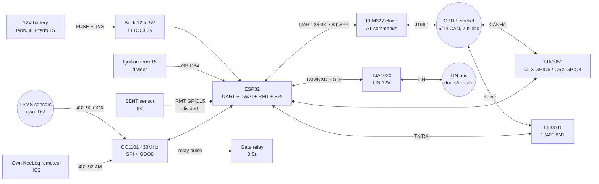

# Automotive - OBD-II (ELM327), LIN, SENT, FlexRay, 100BASE-T1, K-line, TPMS, KeeLoq, 12V power

## Purpose

This note is an ESP32 automotive node: **OBD-II** diagnostics via an **ELM327 clone**
(UART, AT commands), a **PID** table with formulas (including **010C RPM**),
**LIN bus** (master/slave, checksum, **TJA1020** transceiver),
the **SENT** sensor protocol (Single Edge Nibble),
**FlexRay** and **100BASE-T1** overviews (what an ESP32 integrator must know),
legacy **K-line / ISO 9141** (**L9637D** driver),
**TPMS 433 MHz** reception (pressure packet decoding),
**KeeLoq** fobs (rolling code - we work **only with our own** remotes!
plus a legal block), and **12V onboard power**
(spikes to **40V**, load dump - only **buck + TVS**).

![[assets/img/automotive-obd-lin-scheme.png|600]]
*Fig. ESP32 in a car: ELM327 clone in the OBD-II socket (UART/BT), LIN via TJA1020, K-line via L9637D, SENT sensor on GPIO/RMT, 433 MHz TPMS receiver, 12V power via buck + TVS.*

Links to [[EN/Home.en]], [[EN/04-Interfaces/05-CAN-TWAI-RS485.en]], [[EN/04-Interfaces/01-UART.en|UART]],
[[EN/12-Comm-Modules/19-Wired-2.en]], [[EN/12-Comm-Modules/17-GNSS-RTK.en]],
[[EN/12-Comm-Modules/23-Marine-Time.en]], [[EN/12-Comm-Modules/21-Motion-Control.en]],
[[EN/02-Power-Supply/01-Power-Rails.en]].

> [!warning] ESP32 is not a safety control unit!
> ESP32 has no automotive qualification (AEC-Q100), deterministic
> real time and ASIL level. Usage: diagnostics, telemetry,
> logger, bench, comfort electronics. Do not hang ESP32 on
> brake, airbag, steering, throttle control. Car CAN bus - only via
> a transceiver with filters, in listen-only mode until you understand the traffic.
> Writing to someone else's car bus without the owner consent is illegal interference.

## Characteristics

| Node | Role | Interface to ESP32 | Power supply | Speed / limit | When to take |
| --- | --- | --- | --- | --- | --- |
| ELM327 clone (BT/USB/UART) | OBD-II AT-command interpreter | UART 38400 or BT SPP | 5V (inside the car adapter) | 10.4 kbaud K-line / 500 kbps CAN | Fast PID access without writing a CAN stack |
| OBD-II PIDs (mode 01) | Standard parameters (RPM, speed, ECT) | via ELM327 or directly TWAI ISO 15765-4 | - | request/response ~20-50 ms | Diagnostics, trip computer, logger |
| LIN (TJA1020) | Cheap sub-bus for doors/seats/climate | UART + TX/RX to TJA1020 | 12V bus / 3.3-5V logic | 2.4-19.2 kbaud | LIN actuator control, master emulation |
| SENT (SAE J2716) | Sensors (pressure, position, pedal) | GPIO + RMT/PCNT input | 5V sensor power | 3-90 us tick, ~1-4 kHz frames | Reading stock SENT sensors |
| FlexRay | Deterministic chassis backbone | overview (ESP32 without controller!) | - | up to 10 Mbps, 2 channels | Understand topology, do not connect ESP32 directly |
| 100BASE-T1 | Automotive Ethernet (1 pair) | overview (DP83TC811-like PHY needed) | - | 100 Mbps, 1 twisted pair | Understand DoIP, diagnostics via gateway |
| K-line / ISO 9141 (L9637D) | Legacy diagnostics to ~2004-2008 | UART 10400 8N1 via L9637D | 12V bus / 5V logic | 10.4 kbaud | Old VAG, VAZ, Daewoo, Hyundai |
| TPMS 433 MHz (RX) | Tire pressure/temperature | SPI/CC1101 or OOK-RX + GPIO | 3.3V | 433.92 MHz, OOK/FSK 4-20 kbaud | Pressure monitor of own car/trailer |
| KeeLoq HCS301-like | 433 MHz rolling-code fobs | 433 MHz RX + decoder | 3.3V | 433.92 MHz AM | Only OWN fobs: own receiver + own remotes |
| 12V buck + TVS power | Survive the onboard grid | 12V VIN to 5V buck to 3.3V LDO | 9-36V input (40V+ spikes) | ESP32 current 0.2-0.5A | Any permanent car installation |

## 1. ELM327 clone - UART AT commands

**ELM327** (original Elm Electronics, production now wound down - see sources)
and its clones (v1.5 "full", v2.1 "cut") is a microcontroller interpreter:
it takes ASCII **AT commands** over UART/BT and talks to the car itself
(CAN ISO 15765-4, KWP2000, ISO 9141, J1850). For ESP32 this is the fastest path
to PIDs: no need to write a CAN stack, UART 38400 is enough.

### 1.1. Basic AT commands (must-have set)

| Command | What it does | Typical answer |
| --- | --- | --- |
| `ATZ` | Adapter reset | `ELM327 v1.5` |
| `ATE0` | Echo off | `OK` |
| `ATL0` | Line-feed off (short answers) | `OK` |
| `ATH1` / `ATH0` | Show/hide CAN headers | `OK` |
| `ATSP0` | Auto protocol | `OK` |
| `ATSP6` | Force ISO 15765-4 CAN 500 kbps 11-bit | `OK` |
| `ATSP3` | Force ISO 9141-2 | `OK` |
| `ATDP` / `ATDPN` | Show current protocol | `AUTO, ISO 15765-4 (CAN)` |
| `ATRV` | Onboard-grid voltage | `12.4V` |
| `010C` | RPM request (mode 01, PID 0C) - not AT but an OBD request | `41 0C 1A F8` |
| `03` | Read stored DTCs | `43 01 33 00 00` |
| `04` | Erase DTCs (CAREFUL - wipes MIL and freeze frame!) | `44` |

### 1.2. OBD request/response format via ELM327

```text
ESP32 -> ELM327 : "010C\r"            режим 01, PID 0C (RPM)
ELM327 -> авто  : 7DF#02 01 0C ...    CAN 11-біт ID 0x7DF, 2 байти запиту
авто   -> ELM327: 7E8#04 41 0C 1A F8  відповідь ECU (ID 0x7E8)
ELM327 -> ESP32 : "41 0C 1A F8\r>"    ASCII hex + промпт '>'
RPM formula     : ((A*256)+B)/4 = ((0x1A*256)+0xF8)/4 = 1726 rpm
```

> [!warning] v2.1 clones lie about the protocol
> Cheap v2.1 clones often answer `OK` to any `ATSP` but really
> know only CAN 11/29-bit. For K-line cars (old, pre-~2008) look for
> a **v1.5** clone with the full set or a separate **L9637D K-line adapter**.
> Check: `ATDPN` after connecting to the car + `0100` (supported PIDs).

### 1.3. Three ELM327 to ESP32 connections

| Option | Pluses | Minuses |
| --- | --- | --- |
| BT Classic SPP (HC-05-like ELM327) | without wires, adapter in the socket, ESP32 in the glovebox | No BT Classic on C3/S3 without Bluedroid, `1234` PIN, 50-150 ms delay |
| USB ELM327 + USB-OTG (S2/S3 host only) | Stable, powered from ESP32 | Needs USB host, PL2303/CH340 driver |
| Wired ELM327 UART module (board with TX/RX) | Most reliable, 38400 8N1, minimum delay | Must pull 4 wires to the OBD-II socket |

## 2. OBD-II PIDs - modes, auto table, formulas

### 2.1. SAE J1979 modes (services) - what to ask

| Mode | Name | Request example | When |
| --- | --- | --- | --- |
| 01 | Live data (live PIDs) | `010C` RPM | 95% of work: trip computer, logger |
| 02 | Freeze frame (snapshot at DTC moment) | `02020C` | Check-Engine cause analysis |
| 03 | Read stored DTCs | `03` | Diagnostics |
| 04 | Erase DTCs + freeze frame | `04` | Only after repair! |
| 07 | Pending DTCs | `07` | Early detection |
| 09 | Car info (VIN, ECU) | `0902` VIN | Car identification |
| 0A | Permanent DTCs | `0A` | After erase 04 - what really stayed |

### 2.2. Mode-01 PID auto table (most needed)

The formula applies to answer bytes `41 <PID> <A> <B>...`.
`A` is the first data byte, `B` the second.

| PID | Name | Bytes | Formula | Example | Units |
| --- | --- | --- | --- | --- | --- |
| 00 | Supported PIDs 01-20 (bit mask!) | 4 | A..D bits | `BE 1F A8 13` | mask |
| 04 | Engine load (LOAD) | 1 (A) | `A*100/255` | `A=0x7F` gives 49.8% |% |
| 05 | Coolant temperature (ECT) | 1 (A) | `A-40` | `A=0x5A` gives 50C | C |
| 0B | Intake pressure (MAP) | 1 (A) | `A` | `A=0x64` gives 100 kPa | kPa |
| 0C | RPM | 2 (A,B) | `((A*256)+B)/4` | `1A F8` gives 1726 | rpm |
| 0D | Car speed (VSS) | 1 (A) | `A` | `A=0x3C` gives 60 | km/h |
| 0F | Intake temperature (IAT) | 1 (A) | `A-40` | `A=0x46` gives 30C | C |
| 10 | Air flow (MAF) | 2 (A,B) | `((A*256)+B)/100` | `01 7C` gives 3.8 | g/s |
| 11 | Throttle position (TP) | 1 (A) | `A*100/255` | `A=0x33` gives 20% |% |
| 1F | Time since engine start | 2 (A,B) | `A*256+B` | `00 B4` → 180 | s |
| 20 | Supported PIDs 21-40 (mask) | 4 | bits | - | mask |
| 2F | Fuel level | 1 (A) | `A*100/255` | `A=0x99` gives 60% |% |
| 33 | Barometer pressure | 1 (A) | `A` | `A=0x65` gives 101 | kPa |
| 42 | Control-module voltage | 2 (A,B) | `((A*256)+B)/1000` | `30 D4` gives 12.5 | V |
| 46 | Ambient temperature (AMB) | 1 (A) | `A-40` | `A=0x4A` gives 34C | C |
| 5E | Instant consumption (rate) | 2 (A,B) | `((A*256)+B)/20` | diesel/petrol | mL/h |

> 010C RPM formula in detail: answer `41 0C A B`, where `41` = answer
> to mode 01, `0C` = PID echo. `RPM = ((A x 256) + B) / 4`.
> Division by 4 is because resolution is 0.25 rpm per low bit.
> example: `A=0x1A (26), B=0xF8 (248)` → `(26×256+248)/4 = 6904/4 = 1726`.

### 2.3. DTC format (mode 03) - 10-second parsing

Answer `43 <N> <B1H> <B1L> <B2H> <B2L>...`, each DTC is 2 bytes.
First 2 bits of the first byte = letter: `00=P, 01=C, 10=B, 11=U`.
Example: `01 33` gives bits `00` + `0x133` to **P0133** (slow lambda probe).
`04` is erase; after it the ECU quenches MIL, but readiness monitors
become `not ready` (will not pass inspection at once - need a drive cycle!).

### 2.4. Direct CAN without ELM327 (ISO 15765-4 via TWAI)

Modern cars (USA since 2008 - all): CAN 500 kbps, 11-bit, request to `0x7DF`,
answers `0x7E8-0x7EF`. Frame: `[length][mode][PID][extra...]`.
RPM request: `02 01 0C 00 00 00 00 00`. ESP32-TWAI can do this directly
(see code + [[EN/04-Interfaces/05-CAN-TWAI-RS485.en]]) - 3-5x faster than ELM327,
but you must assemble ISO-TP yourself for long answers (VIN, mode 09).

## 3. Car protocols - summary auto table

| Protocol | Speed | Physics | OBD-II pins | Cars / years | ESP32 path |
| --- | --- | --- | --- | --- | --- |
| CAN ISO 15765-4 (11-bit, 500 kbps) | 250/500 kbps | CANH/CANL diff pair | 6 (H), 14 (L) | All USA since 2008, EU petrol since ~2001/EOBD | TWAI + TJA1050/SN65HVD230 |
| CAN 29-bit (extended, 250 kbps) | 250 kbps | Diff pair | 6, 14 | Trucks, some GM/Ford | TWAI extended ID |
| K-line ISO 9141-2 | 10.4 kbaud | Single wire, 0/12V | 7 (K), 15 (L, opt.) | Chrysler/EU/Asia 1996-2004 | UART via L9637D |
| KWP2000 ISO 14230 | 1.2-10.4 kbaud | like ISO 9141 | 7, 15 | VAG/VAZ/Daewoo 2000-2008 | UART via L9637D + fast init |
| SAE J1850 PWM (Ford) | 41.6 kbps | Diff pair | 2 (+), 10 (-) | Ford USA pre-2008 | Only via ELM327! |
| SAE J1850 VPW (GM) | 10.4 kbps | Single wire | 2 | GM USA pre-2008 | Only via ELM327! |
| LIN (ISO 17987) | 2.4-19.2 kbaud | Single wire, 12V | none in OBD (internal) | Doors/climate/seats of all | UART via TJA1020 |
| SENT (SAE J2716) | 3-90 us tick | Single wire, 5V | none (sensors) | Pressure/position sensors | GPIO + RMT input |
| FlexRay (ISO 17458) | up to 10 Mbps x2 channels | Twisted pair x2 | none in OBD | BMW/Mercedes/Audi chassis | Overview, do not connect ESP32! |
| 100BASE-T1 (802.3bw) | 100 Mbps | 1 twisted pair | DoIP pins (factory) | New VAG/BMW, DoIP diagnostics | Overview, T1-PHY needed |
| TPMS 433 MHz | OOK/FSK | 433.92 MHz radio | - | Tire sensors | CC1101/OOK-RX on SPI/GPIO |

## 4. LIN-bus - master/slave, checksum, TJA1020

**LIN** (Local Interconnect Network, ISO 17987) - cheap single-wire sub-bus:
one **master** (usually BCM/comfort unit) polls up to 16 **slaves**
(door buttons, window motors, climate dampers, rain sensors).
ESP32 acts either as a **listener-logger**, or a **master** on the bench
(BCM emulation to check a door handle), or a **slave** (smart actuator).

### 4.1. LIN frame: break to sync to PID to data to checksum

```text
master шле:  BREAK (13+ біт LOW, мінімум 11 нульових + делімітер)
             SYNC  (0x55 = 01010101, slave міряє бод по ньому!)
             PID   (6 біт ID + 2 біти парності P0/P1)
slave шле:   DATA  (2/4/8 байт за ID)
             CHECKSUM (classic: сума DATA; enhanced: сума PID+DATA, інверсія)
Швидкість: 2400 / 9600 / 19200 бод, 8N1, LSB first, інверсна логіка драйвера.
```

### 4.2. PID parity and checksum - formulas

```text
ID біти: ID0..ID5. P0 = ID0^ID1^ID2^ID4, P1 = ~(ID1^ID3^ID4^ID5).
Приклад ID=0x32 (110010): P0=0, P1=1 -> PID = 0xB2.
Classic checksum: скласти DATA-байки з переносом (mod 255), інвертувати.
  DATA = 01 02 03 -> сума 06 -> checksum 0xF9.
Enhanced (LIN 2.x, ID 0..59): те саме + PID у суму.
  Діагностика (ID 60/61): завжди classic!
```

### 4.2. PID parity and checksum - formulas

**TJA1020** (NXP) is a LIN transceiver: converts ESP32 UART logic (TXD/RXD)
to the 12V LIN-bus signal with slew-rate control (minimum interference),
normal/low-slope/sleep modes, wake-up over bus. Key point:
internal slave terminator; for **master** you need outdoor
**1 kOhm + diode** between VBAT and LIN (otherwise slaves will not see the dominant!).

| TJA1020 pin (SO8) | Where | Note |
| --- | --- | --- |
| TXD | ESP32 GPIO TX (UART) | MCU data input |
| RXD | ESP32 GPIO RX (UART) | MCU data output |
| LIN | LIN bus (12V) | via choke/ESD if needed |
| VBAT / INH | 12V board / power switch | INH controls node power in sleep |
| SLP_N | ESP32 GPIO (sleep mode) | LOW = sleep (~10 uA current) |
| GND | Common ground | Ground star! |

> Break-issue UART: a standard ESP32 UART cannot send a 13-bit LOW.
> Fix: (a) temporarily lower the baud 1.5x and send `0x00` (longer LOW =
> pseudo-break); (b) GPIO bitbang break (LOW 1 ms), then UART frame;
> (c) SJA1124 LIN controller over SPI (hardware break, 4 channels).

## 5. SENT - Single Edge Nibble Transmission (SAE J2716)

**SENT** is a single-wire sensor protocol: each message is a series
of pulses where information is in the **HIGH-phase length** (between falling edges).
Sensors: boost pressure, pedal position, steering angle, new-type MAF.
ESP32 reads via **RMT input** (length measurement) or **PCNT + timer**.

```text
tick = базовий квант 3..90 мкс (типово 3 мкс, калібрується по SYNC-паузі 56 ticks).
Кадр: SYNC (56 ticks LOW) + STATUS (4 біти) + 6×DATA nibble + CRC + PAUSE (доповнення).
Нібл N (0..15): LOW 5 ticks + HIGH (12+N ... див. J2716) -> період 12..27 ticks.
Fast channel: 2 канали даних (тиск + температура).
Slow channel: серійні дані в бітах STATUS (ID датчика, diagnostics).
CRC: поліном x^4+x^3+x^2+1, seed 0101.
Приклад tick=3мкс: SYNC=168мкс, нібл 0 = 36мкс, нібл 15 = 81мкс.
```

SENT diagnostics: no SYNC >1 ms means the sensor is without power; CRC fails mean
interference on ground (sensor and ESP32 on different grounds!); tick drift +-20% is
normal, calibrate on each SYNC.

## 6. FlexRay - overview (what to know, what not to do)

**FlexRay** (ISO 17458-1..5, up to 10 Mbps, 2 independent channels, TDMA):
a deterministic chassis/ADAS bus (BMW X5 E70 first serial, then 7-series,
Audi A4 B9/A8, Mercedes W222/W213). Cycle = static segment (slots) +
dynamic segment (event). ESP32 **has no** FlexRay controller -
connection requires a controller (CIC310, E-Ray) + 2 TJA1080 transceivers.
Practical conclusion: on ESP32 level - **only understand** that FlexRay
exists and why you must not climb there without a $2k+ bench. FlexRay diagnostics go
via the factory gateway/DoIP, not by direct connection.

## 7. 100BASE-T1 - overview (single-pair Ethernet)

**100BASE-T1** (IEEE 802.3bw, OPEN Alliance): 100 Mbps over **one** twisted pair
(instead of 2 pairs in 100BASE-TX) - less copper, less weight. PAM3 physics,
full duplex. For ESP32: an automotive PHY is needed
(e.g. **DP83TC811S-Q1**, TI - see sources) over RMII/RGMII to an MCU with EMAC
(ESP32 classic has EMAC; C3/S2 do not!). Application: **DoIP**
(Diagnostics over IP, ISO 13400) is factory diagnostics of new cars,
cameras, domain controllers. Practically: ESP32 as a DoIP scanner is possible
only with a T1-PHY board + TCP UDS stack; start by studying the car DoIP gateway,
not by soldering a PHY.

## 8. K-line / ISO 9141 - L9637D

Old cars (VAG pre-~2004, VAZ/ZAZ/Daewoo/Hyundai/KIA): **K-line** diagnostics
is a single-wire UART at 10400 baud, 0/12V levels, initialization by
**5-baud init** (ECU woken by a slow 0x33 byte at 5 baud!) or
**fast init** (25 ms LOW + 25 ms HIGH). The **L9637D** (ST) driver is
a K/L-line to logic converter: TX (from MCU) to K (12V open-collector),
K to RX (comparator), ISO thermal protection, ESD.

| L9637D signal | Where on ESP32 | Note |
| --- | --- | --- |
| TX | GPIO UART TX | Driver input |
| RX | GPIO UART RX | Driver output |
| K | OBD pin 7, via 510 Ohm | Pull-up to 12V inside |
| L | OBD pin 15 (opt.) | Often NC |
| VS | 12V board (via diode) | Driver power |
| GND | Ground | Common with OBD pins 4/5 |

5-baud init sequence (VAG 1.9 TDI, VAZ Bosch MP7.0):

```text
1. UART TX на 5 бод (!), слати 0x33 (адреса ECU), чекати 20-50мс.
2. ECU відповідає 0x55 0xEF 0x8F на 10400 бод (sync + key bytes).
3. ESP32 шле інверсію key2 (0x8F -> 0x70) як підтвердження.
4. ECU шле інверсію адреси (0xCC) -> з'єднання встановлено, далі KWP2000 кадри.
W1..W5 timings (25-100ms) are critical - a software GPIO UART is more reliable at 5 baud than HW.
Таймінги W1..W5 (25-100мс) критичні — програмний UART на GPIO надійніший за HW на 5 бод.
```

## 9. TPMS 433 MHz - reception and decoding

Tire-pressure sensors send on **433.92 MHz** (OOK/ASK or FSK, Manchester):
sensor ID (32 bits) + pressure (8-9 bits) + temperature + battery flag + CRC/Checksum.
ESP32 path: **CC1101** (SPI, flexible: OOK/FSK, RSSI) or a cheap OOK-RX
(e.g. SRX882) + GPIO interrupt + soft Manchester decoder.

```text
Типовий пакет (приклад, Schrader-подібний, 64 біти Manchester):
  преамбула 0xAA.. (8-16 біт) + sync 0x2D 0xD4 + ID(32б) + тиск(8б) + темп(8б) + статус(8б) + CRC8
  Тиск: raw*6.9 кПа або raw*0.25 psi (залежить від виробника — калібрувати манометром!).
  Температура: raw-50 °C (типово).
  Період: стоянка — 1 раз/год; рух — 1 раз/30-60с; витік — частіше (датчик з акселерометром!).
Процедура прив'язки: записати ID 4 датчиків свого авто, ігнорувати чужі (фільтр по ID!).
```

> [!warning] Foreign TPMS is foreign data
> Ethically and technically: decode **only your own** sensors (own car, own trailer).
> In a parking lot ESP32 sees dozens of foreign IDs - drop them with a whitelist filter,
> do not log foreign tracks. This is both privacy and stability (no phantom wheels).

## 10. KeeLoq - fobs, rolling code (only own! + legal)

**KeeLoq** (Microchip HCS301/HCS341 encoders) is a rolling-code block cipher:
each press sends a new code (counter + discriminant + cipher on the
manufacturer key). The receiver accepts a window of the next N codes (typically +-16).

```text
Пакет HCS301 (66 біт, 433.92 МГц AM, PWM-манчестер ~1-2 кбод):
  преамбула (10 біт чергування) + header + hopping code (32б шифр) + serial (28б) + кнопки/батарея
Навчання приймача: кнопка LEARN + послати 2 пакети своїм пультом (seed/serial записується).
Rolling вікно: приймач зберігає останній лічильник; приймає +16 вперед, resync — 2 збіги підряд.
```

What we do on ESP32 (LEGALLY): buy **our own** kit (433 MHz superheterodyne
receiver + 2 own HCS remotes or a learning receiver with relay), decode **our own**
packets for our own garage/gate/mockup. Code below is **receiving our own** fixed
ID + checking counter monotonicity (anti-replay on our own receiver).

> [!danger] Legal - read twice
> Intercepting, replay, jamming, RollJam-like attacks on **foreign** cars/gates are a
> criminal offense (unauthorized interference, theft). KeeLoq vulnerability
> research (Bogdanov, Courtois, Bochum side-channel - see sources)
> is cited to understand why our own receiver must have a **small resync window**,
> a **unique seed**, while the relay is **pulsed** (do not hold gates open).
> In this note - no grabbers, no jamming, no foreign keys. Period.

## 11. 12V onboard power - 40V spikes, buck + TVS

The 12V onboard grid is not 12V: crank (sag to 6V), load dump
(battery disconnect with running generator - **+40..+60V, hundreds of ms**),
ignition spikes, reverse polarity on "jump start". A linear 7805 LDO
burns here together with ESP32. Survival schematic:

```text
АКБ 12V (клема 30, постійна) --[запобіжник 1A]--+--[TVS SMBJ28A]--+--[buck 9-36V->5V]--+--[LDO 5->3.3V]--> ESP32
                                                |  (обмежує 40V+)  |  (напр. MP1584/LM2596-авто) |  (AMS1117/MP2112)
Клема 15 (запалювання) --------------------------[дільник 10к/2.2к]--> GPIO34 (детект ON/OFF, сон при OFF)
                                                GND зіркою на кузов біля точки, TVS якомога ближче до входу!
```

| Element | Requirement | Example |
| --- | --- | --- |
| Fuse | 0.5-1A, fast, holder | Mini Blade + socket |
| TVS (bidirectional!) | Vrwm >= 22V (for 12V grid), Pppm 600W+ | SMBJ24A/SMBJ28A, varistor optional next |
| Reverse diode | reverse-polarity protection | SS34 Schottky (0.4V drop) |
| Buck | 7-40V+ input, 5V 1A output, AEC practice | MP1584EN, LM2596HV (HV version!), XL1509-5 |
| 3.3V LDO | After buck, clean 3.3V for ESP32/RF | AMS1117-3.3 (with margin) / ME6211 |
| Filter | LC at buck input (100 uH + 100 uF) | Against starter cranking dips |
| Ignition detect | Divider + 3.6V Zener on GPIO | 12V to 2.2V on GPIO34 (input only!) |

> Measurements: a sleeping ESP32 logger must take <5 mA from the battery (deep-sleep +
> buck in eco mode or a separate power switch on terminal 15). Otherwise in 2 weeks
> of parking a 60Ah battery sits to zero. Relay/high-side switch (BTS6143D) on ignition is the
> standard solution.

## Module pin legend

### ELM327 clone (BT module, typical)

| Pin / element | Marking | Type | Where | Note |
| --- | --- | --- | --- | --- |
| 1 | VCC 5V | Power supply | 5V / OBD pin 16 via 12 to 5V | Own regulator inside the adapter! |
| 2 | GND | Ground | GND / OBD pins 4+5 | Join both OBD grounds! |
| 3 | TX (adapter to ESP32) | UART 3.3/5V output | GPIO16 (ESP32 RX2) via divider if 5V! | Baud 38400 (rarely 9600/115200) |
| 4 | RX (ESP32 to adapter) | UART input | GPIO17 (ESP32 TX2) | Crossed TX to RX |
| BT | SPP `OBDII`, `1234`/`0000` PIN | BT Classic | ESP32 Bluedroid SPP | Classic ESP32 only, not C3! |
| OBD connector | J1962 16-pin | Car | car socket | Pins 6/14 CAN, 7 K-line, 16 +12V |

### TJA1020 LIN board

| Pin | Label | Type | To ESP32 | Note |
| --- | --- | --- | --- | --- |
| 1 | VCC 3.3/5V | Logic power | 3V3 (or 5V by board version) | TXD/RXD levels 3.3/5V compatible |
| 2 | GND | Ground | GND | Common with ESP32 and body |
| 3 | TXD | Digital input | GPIO17 (UART TX) | ESP32 TX to TXD |
| 4 | RXD | Digital output | GPIO16 (UART RX) | RXD to ESP32 RX |
| 5 | SLP_N | Control input | GPIO5 (HIGH=work) | LOW = 10 uA sleep |
| 6 | LIN | 12V bus | Car/bench LIN bus | Master: +1kOhm+diode to VBAT! |
| 7 | VBAT | 12V power | 12V board via fuse | 5.5-27V range |

### L9637D K-line board

| Pin | Label | Type | To | Note |
| --- | --- | --- | --- | --- |
| 1 | VCC 5V | Power supply | 5V | 5V logic - RX to ESP32 via 2:1 divider! |
| 2 | GND | Ground | GND | Common |
| 3 | TX | Input | GPIO17 (TX2) | 10400 8N1 |
| 4 | RX | 5V output! | GPIO16 via 10k/20k divider | 5V kills GPIO without divider! |
| 5 | K | Bus | OBD pin 7, via 510 Ohm | Pull-up to 12V inside |
| 6 | L | Bus (opt.) | OBD pin 15 | Often NC |
| 7 | VS | 12V | Board via diode + TVS | Driver power |

### CC1101 433 MHz (TPMS / own KeeLoq remotes)

| Pin | Label | Type | To ESP32 | Note |
| --- | --- | --- | --- | --- |
| 1 | VCC 3.3V | Power supply | 3V3 | 3.3V only! |
| 2 | GND | Ground | GND | Short wire |
| 3 | SCK | SPI | GPIO18 | SPI up to 10 MHz |
| 4 | MOSI | SPI | GPIO23 | - |
| 5 | MISO | SPI | GPIO19 | - |
| 6 | CSN | SPI | GPIO5 | Active LOW |
| 7 | GDO0 | Digital output | GPIO4 (interrupt) | OOK data / sync interrupt |
| 8 | GDO2 | Digital output | GPIO2 (opt.) | RSSI/carrier sense |
| ANT | SMA/IPEX | RF | 433 MHz 17 cm antenna | Quarter-wave length! |

## Schematic

Overall schematic: ESP32 + buck/TVS power from 12V, ELM327 (UART/BT) in OBD,
LIN via TJA1020, K-line via L9637D, SENT sensor on RMT input,
TPMS/KeeLoq-RX on CC1101.

### ASCII schematic

```text
ЖИВЛЕННЯ (вижити при 40V!):
  АКБ 12V (кл.30) --[FUSE 1A]--+--[TVS SMBJ28A на GND]--+--[buck 12->5V]--+--[LDO 5->3.3V]--> ESP32 3V3
  Клема 15 (запалювання) -------[дільник 10к/2.2к + ZD 3.6V]-------------------------------> GPIO34 (детект ON/OFF)
  Кузов GND ------------------------------------------------------------------------------> GND (зірка!)

OBD-II J1962 (колодка авто):
  пін 16 (+12V) -> живлення ELM327-адаптера (внутрішній регулятор адаптера)
  пін 4+5 (GND) -> GND ESP32 (через адаптер)
  пін 6 CAN-H -> ELM327 / або TWAI-трансивер (TJA1050: CTX<-GPIO5, CRX->GPIO4)
  пін 14 CAN-L -> ELM327 / або TWAI-трансивер
  пін 7 K-line -> L9637D K <-> (TX GPIO17 / RX GPIO16 через дільник) [старі авто]
  пін 15 L-line -> L9637D L (опційно)

ELM327-адаптер:
  BT-версія:  SPP "OBDII" <-> ESP32 Bluedroid (classic ESP32!) 38400-еквівалент
  UART-версія: TX -> GPIO16 (RX2), RX <- GPIO17 (TX2), 38400 8N1, ECHO OFF (ATE0)

LIN-гілка (двері/стенд):
  ESP32 GPIO17 TX -> TXD TJA1020, GPIO16 RX <- RXD TJA1020, GPIO5 -> SLP_N (HIGH)
  TJA1020 LIN <-> LIN-bus (12V); MASTER-режим: LIN --[1кОм + 1N4148]-- VBAT 12V
  Бод 9600/19200, break GPIO-бітбенгом (LOW ~1мс) перед SYNC 0x55

SENT-датчик:
  Датчик VCC 5V (окремий LDO!), GND спільна, OUT -> GPIO15 (RMT-вхід, підтяжка 10к до 5V? НІ — до 3.3V через дільник!)
  УВАГА: SENT HIGH 4.1V+ вб'є GPIO -> дільник 10к/20к або буфер 74LVC245!

RF 433 МГц:
  CC1101: SCK GPIO18, MOSI GPIO23, MISO GPIO19, CSN GPIO5, GDO0 GPIO4 (IRQ), антена 17см
  TPMS-декодер: фільтр білого списку ID своїх 4-8 коліс, чужі — відкидати!
  KeeLoq: ТІЛЬКИ свій learning-приймач + свої пульти; реле імпульсом 0.5с
```

### Mermaid bus diagram



## Code

### ESP-IDF - ELM327 over UART + RPM 010C with formula

```c
// ESP-IDF v5.x: ELM327-клон на UART2 (GPIO16 RX <- TX адаптера, GPIO17 TX -> RX).
// Ініціалізація ATZ/ATE0/ATSP0, запит 010C, парсинг "41 0C A B", RPM=((A*256)+B)/4.
#include <string.h>
#include <stdlib.h>
#include "freertos/FreeRTOS.h"
#include "freertos/task.h"
#include "esp_log.h"
#include "driver/uart.h"

#define TAG "elm327"
#define UART_NUM UART_NUM_2
#define PIN_TX 17
#define PIN_RX 16

static void uart_init_elm(void) {
    uart_config_t cfg = {
        .baud_rate = 38400,
        .data_bits = UART_DATA_8_BITS,
        .parity = UART_PARITY_DISABLE,
        .stop_bits = UART_STOP_BITS_1,
        .flow_ctrl = UART_HW_FLOWCTRL_DISABLE,
        .source_clk = UART_SCLK_DEFAULT,
    };
    ESP_ERROR_CHECK(uart_driver_install(UART_NUM, 1024, 1024, 0, NULL, 0));
    ESP_ERROR_CHECK(uart_param_config(UART_NUM, &cfg));
    ESP_ERROR_CHECK(uart_set_pin(UART_NUM, PIN_TX, PIN_RX,
                                UART_PIN_NO_CHANGE, UART_PIN_NO_CHANGE));
}

// Надіслати команду з \r, прочитати до промпта '>' з таймаутом мс
static int elm_cmd(const char *cmd, char *resp, int cap, int timeout_ms) {
    char tx[32];
    snprintf(tx, sizeof(tx), "%s\r", cmd);
    uart_write_bytes(UART_NUM, tx, strlen(tx));
    int n = 0;
    int waited = 0;
    while (waited < timeout_ms) {
        uint8_t b;
        int m = uart_read_bytes(UART_NUM, &b, 1, pdMS_TO_TICKS(20));
        if (m > 0) {
            if (n < cap - 1) resp[n++] = (char)b;
            if (b == '>') break;
            waited = 0;
        } else {
            waited += 20;
        }
    }
    resp[n] = 0;
    return n;
}

static void elm_init(void) {
    char r[256];
    elm_cmd("ATZ", r, sizeof(r), 2000);    // скидання, чекаємо ELM327 v1.5/v2.1
    vTaskDelay(pdMS_TO_TICKS(1000));
    elm_cmd("ATE0", r, sizeof(r), 500);    // ехо OFF
    elm_cmd("ATL0", r, sizeof(r), 500);    // LF OFF
    elm_cmd("ATH0", r, sizeof(r), 500);    // заголовки OFF
    elm_cmd("ATSP0", r, sizeof(r), 1000);  // автопротокол
    ESP_LOGI(TAG, "ELM init done");
}

// Парсинг "41 0C A B" -> RPM. Повертає -1 при помилці.
static int parse_rpm(const char *resp) {
    unsigned a = 0, b = 0;
    const char *p = strstr(resp, "41 0C");
    if (!p) return -1;
    if (sscanf(p, "41 0C %x %x", &a, &b) != 2) return -1;
    return ((a * 256) + b) / 4;            // формула 010C!
}

void app_main(void) {
    uart_init_elm();
    elm_init();
    char r[256];
    while (1) {
        elm_cmd("010C", r, sizeof(r), 1000);
        int rpm = parse_rpm(r);
        if (rpm >= 0) ESP_LOGI(TAG, "RPM=%d (%s)", rpm, r);
        else ESP_LOGW(TAG, "NO DATA: %s", r);
        vTaskDelay(pdMS_TO_TICKS(500));
    }
}
```

### ESP-IDF - direct CAN ISO 15765-4 RPM request via TWAI (without ELM327)

```c
// ESP-IDF v5.x (новий TWAI API): прямий запит RPM на 0x7DF, відповідь з 0x7E8.
// Трансивер TJA1050: CTX <- GPIO5, CRX -> GPIO4. Швидкість 500 кбіт (США з 2008).
#include "freertos/FreeRTOS.h"
#include "freertos/task.h"
#include "esp_log.h"
#include "esp_twai.h"
#include "esp_twai_onchip.h"

#define TAG "obd_twai"

static twai_node_handle_t twai_hdl;

static void twai_init_obd(void) {
    twai_onchip_node_config_t cfg = {
        .io_cfg.tx = 5,
        .io_cfg.rx = 4,
        .bit_timing.bitrate = 500000,
        .tx_queue_depth = 5,
    };
    ESP_ERROR_CHECK(twai_new_node_onchip(&cfg, &twai_hdl));
    ESP_ERROR_CHECK(twai_node_enable(twai_hdl));
}

static void obd_rpm_task(void *arg) {
    uint8_t q[8] = {0x02, 0x01, 0x0C, 0, 0, 0, 0, 0};  // len=2, mode 01, PID 0C
    twai_frame_t tx = {.header.id = 0x7DF, .buffer = q, .buffer_len = 8};
    // Прийом — через on_rx_done колбек (див. TWAI-документацію); тут опитуємо чергу:
    while (1) {
        ESP_ERROR_CHECK(twai_node_transmit(twai_hdl, &tx, 100));
        // У on_rx_done шукати кадр id 0x7E8: data[0]>=3, data[1]==0x41, data[2]==0x0C,
        // RPM = ((data[3]*256)+data[4])/4
        vTaskDelay(pdMS_TO_TICKS(500));
    }
}

void app_main(void) {
    twai_init_obd();
    xTaskCreate(obd_rpm_task, "obd", 4096, NULL, 5, NULL);
}
```

### ESP-IDF - LIN master (break + sync + PID, TJA1020)

```c
// ESP-IDF: LIN master на UART1 (GPIO17 TX -> TXD, GPIO16 RX <- RXD TJA1020),
// SLP_N на GPIO5 (HIGH). Break — GPIO-бітбенгом, далі 0x55 + PID + DATA + checksum.
#include "driver/uart.h"
#include "driver/gpio.h"
#include "freertos/FreeRTOS.h"
#include "freertos/task.h"

#define LIN_TX 17
#define LIN_RX 16
#define LIN_SLP 5

static uint8_t lin_pid_parity(uint8_t id) {
    uint8_t b[6];
    for (int i = 0; i < 6; i++) b[i] = (id >> i) & 1;
    uint8_t p0 = b[0]^b[1]^b[2]^b[4];
    uint8_t p1 = !(b[1]^b[3]^b[4]^b[5]);
    return (id & 0x3F) | (p0 << 6) | (p1 << 7);
}

static uint8_t lin_checksum_classic(const uint8_t *d, int n) {
    int s = 0;
    for (int i = 0; i < n; i++) { s += d[i]; if (s > 255) s -= 255; }
    return (~s) & 0xFF;
}

static void lin_send_break(void) {
    // Бітбенг break: TX як GPIO, LOW ~1 мс (13+ біт на 9600 = ~1.35 мс)
    gpio_set_direction((gpio_num_t)LIN_TX, GPIO_MODE_OUTPUT);
    gpio_set_level((gpio_num_t)LIN_TX, 0);
    vTaskDelay(pdMS_TO_TICKS(2));
    gpio_set_level((gpio_num_t)LIN_TX, 1);
    // Повернути пін UART-драйверу:
    uart_set_pin(UART_NUM_1, LIN_TX, LIN_RX,
                 UART_PIN_NO_CHANGE, UART_PIN_NO_CHANGE);
}

void app_main(void) {
    gpio_set_direction((gpio_num_t)LIN_SLP, GPIO_MODE_OUTPUT);
    gpio_set_level((gpio_num_t)LIN_SLP, 1);   // розбудити TJA1020
    uart_config_t c = {.baud_rate = 9600, .data_bits = UART_DATA_8_BITS,
        .parity = UART_PARITY_DISABLE, .stop_bits = UART_STOP_BITS_1,
        .flow_ctrl = UART_HW_FLOWCTRL_DISABLE, .source_clk = UART_SCLK_DEFAULT};
    uart_driver_install(UART_NUM_1, 512, 512, 0, NULL, 0);
    uart_param_config(UART_NUM_1, &c);
    uart_set_pin(UART_NUM_1, LIN_TX, LIN_RX, UART_PIN_NO_CHANGE, UART_PIN_NO_CHANGE);
    uint8_t data[2] = {0x12, 0x34};
    while (1) {
        lin_send_break();
        uint8_t sync = 0x55, pid = lin_pid_parity(0x32);
        uint8_t cs = lin_checksum_classic(data, 2);
        uart_write_bytes(UART_NUM_1, (char*)&sync, 1);
        uart_write_bytes(UART_NUM_1, (char*)&pid, 1);
        uart_write_bytes(UART_NUM_1, (char*)data, 2);
        uart_write_bytes(UART_NUM_1, (char*)&cs, 1);
        vTaskDelay(pdMS_TO_TICKS(100));
    }
}
```

### Arduino - ELM327 + LIN listener + SENT via RMT (overview)

```cpp
// Arduino-ESP32: ELM327 по Serial2 (38400), TJA1020 LIN на Serial1 (9600),
// SENT-датчик на RMT-вході (вимір довжин імпульсів).
#include <Arduino.h>
#define ELM_RX 16
#define ELM_TX 17

String elmQuery(const String &cmd, int timeout = 800) {
  Serial2.print(cmd + "\r");
  String r;
  long t0 = millis();
  while (millis() - t0 < timeout) {
    while (Serial2.available()) {
      char c = Serial2.read();
      if (c == '>') return r;
      r += c;
    }
  }
  return r;
}

int obdRpm() {
  String r = elmQuery("010C");
  int i = r.indexOf("41 0C");
  if (i < 0) return -1;
  unsigned a, b;
  if (sscanf(r.c_str() + i, "41 0C %x %x", &a, &b) != 2) return -1;
  return ((a * 256) + b) / 4;   // формула 010C
}

void setup() {
  Serial.begin(115200);
  Serial2.begin(38400, SERIAL_8N1, ELM_RX, ELM_TX);
  delay(500);
  elmQuery("ATZ", 2000); elmQuery("ATE0"); elmQuery("ATSP0");
  Serial1.begin(9600, SERIAL_8N1, /*RX*/4, /*TX*/15);  // LIN-слухач через TJA1020
  // SENT RMT-вхід: rmtInit(15, RMT_RX_MODE, RMT_MEM_64) + rmtRead() — довжини ticks.
}

void loop() {
  int rpm = obdRpm();
  Serial.printf("RPM=%d\n", rpm);
  while (Serial1.available()) {           // LIN-трафік у hex для аналізу
    Serial.printf("%02X ", Serial1.read());
  }
  Serial.println();
  delay(500);
}
```

### MicroPython - OBD RPM + LIN frame + SENT stub

```python
"""MicroPython ESP32: RPM через ELM327 (UART2 38400), LIN-кадр вручну, SENT — оцінка tick."""
from machine import UART, Pin
import time

elm = UART(2, baudrate=38400, tx=17, rx=16, timeout=800)

def elm_query(cmd):
    elm.write(cmd + "\r")
    buf = b""
    t0 = time.ticks_ms()
    while time.ticks_diff(time.ticks_ms(), t0) < 800:
        if elm.any():
            buf += elm.read(elm.any())
            if b">" in buf:
                break
    return buf.decode(errors="ignore")

def obd_rpm():
    r = elm_query("010C")
    i = r.find("41 0C")
    if i < 0:
        return None
    try:
        parts = r[i:].split()
        a, b = int(parts[2], 16), int(parts[3], 16)
        return ((a * 256) + b) // 4   # формула 010C
    except Exception:
        return None

def lin_pid(id6):
    b = [(id6 >> i) & 1 for i in range(6)]
    p0 = b[0] ^ b[1] ^ b[2] ^ b[4]
    p1 = 1 ^ (b[1] ^ b[3] ^ b[4] ^ b[5])
    return (id6 & 0x3F) | (p0 << 6) | (p1 << 7)

def lin_checksum(data):
    s = 0
    for x in data:
        s += x
        if s > 255:
            s -= 255
    return (~s) & 0xFF

print(elm_query("ATZ"))
elm_query("ATE0"); elm_query("ATSP0")
while True:
    print("RPM:", obd_rpm(), "PID 0x32 ->", hex(lin_pid(0x32)),
          "CS:", hex(lin_checksum([0x12, 0x34])))
    time.sleep(1)
```

### MicroPython - TPMS whitelist of IDs (own wheels!)

```python
"""Фільтр своїх TPMS-датчиків: чужі ID відкидаємо, свої — тиск/температура."""
MY_TPMS = {"A1B2C3D4", "E5F60718", "12345678", "9ABCDEF0"}  # ID своїх коліс!

def tpms_handle(pkt_id, press_raw, temp_raw):
    if pkt_id not in MY_TPMS:
        return  # чужий датчик з паркінгу — ігнор
    press_kpa = press_raw * 6.9       # калібрувати манометром під свій бренд!
    temp_c = temp_raw - 50
    print("TPMS", pkt_id, round(press_kpa, 1), "kPa", temp_c, "C")
    if press_kpa < 180:
        print("УВАГА: низький тиск!", pkt_id)
```

## typical errors

| # | Symptom | Cause | Fix |
| --- | --- | --- | --- |
| 1 | ELM327 answers `?` to all requests | Echo not off / no `\r` at end | `ATE0`, send `cmd + "\r"`, wait for `>` |
| 2 | `NO DATA` on `010C` with ignition on | wrong protocol (v2.1 clone without K-line) | `ATDPN`, force `ATSP6` (CAN) or `ATSP3` (K-line) |
| 3 | v2.1 clone silent on an old car | Cut clone without ISO 9141/J1850 | Take a full v1.5 or an L9637D board |
| 4 | RPM jumps 4x | Forgot `/4` in the 010C formula | `((A*256)+B)/4`, not `(A*256+B)`! |
| 5 | `UNABLE TO CONNECT` after `ATSP0` | Adapter not in socket / ignition OFF | verify pin 16 (+12V), turn ignition on, `ATZ`+repeat |
| 6 | TWAI silent on CAN OBD | No terminator / wrong speed | 500 kbps 11-bit (USA since 2008), 120 Ohm on bench ends |
| 7 | LIN slaves do not answer | Master without 1kOhm+diode pull-up | Add master terminator to VBAT, verify SLP_N=HIGH |
| 8 | LIN garbage instead of frames | Baud not calibrated (no SYNC capture) | Listen to SYNC 0x55, measure baud on it, break >=13 bits |
| 9 | SENT CRC fails | Different sensor and ESP32 grounds / 4.1V HIGH without divider | Common ground, 10k/20k divider on input, calibration on SYNC |
| 10 | L9637D silent (no 0x55) | 5-baud init W1..W5 timings not held | 5-baud bitbang for 0x33, then 10400, W=25-100ms |
| 11 | 5V on ESP32 RX from L9637D | 5V-level driver RX | 10k/20k divider or 74LVC245, else GPIO death! |
| 12 | TPMS shows foreign wheels | No ID whitelist | Filter own 4-8 IDs, drop foreign |
| 13 | KeeLoq receiver opens from record | Huge resync window / shared seed | Narrow window, unique seed, 0.5s pulse relay |
| 14 | ESP32 burnt after a week in the car | Powered straight from 12V / without TVS (40V+ load dump) | 7-40V buck + SMBJ28A TVS + 1A fuse |
| 15 | Battery drains over parking | Logger eats 100+ mA constantly | Deep-sleep + switch on terminal 15, target <5 mA in sleep |

## Official sources

> All links below verified by download (webfetch, 2026-09-29). No guessed URLs.

- OBD-II PIDs (modes, formulas including 010C RPM) - <https://en.wikipedia.org/wiki/OBD-II_PIDs>
- On-board diagnostics (J1962, protocols, ISO 9141 / ISO 14230 / CAN) - <https://en.wikipedia.org/wiki/On-board_diagnostics>
- Elm Electronics (official ELM327 site: datasheets, AT commands, status) - <https://www.elmelectronics.com/>
- NXP TJA1020 - LIN transceiver, baud up to 20 kbaud, docs - <https://www.nxp.com/products/interfaces/lin-transceivers/dual-lin-transceiver-with-low-drop-voltage-regulator:TJA1020>
- SENT - Single Edge Nibble Transmission, SAE J2716 (frame structure) - <https://en.wikipedia.org/wiki/SENT_(protocol)>
- FlexRay (ISO 17458, up to 10 Mbps, static/dynamic segments) - <https://en.wikipedia.org/wiki/FlexRay>
- KeeLoq (HCS, rolling code, attacks - to protect own receivers) - <https://en.wikipedia.org/wiki/KeeLoq>
- TI DP83TC811S-Q1 - 100BASE-T1 PHY IEEE 802.3bw, datasheet - <https://www.ti.com/product/DP83TC811S-Q1>
- ESP-IDF TWAI (ESP32 CAN controller: TX/RX, filters, examples) - <https://docs.espressif.com/projects/esp-idf/en/stable/esp32/api-reference/peripherals/twai.html>

## See also

- [[EN/Home.en]]
- [[EN/04-Interfaces/05-CAN-TWAI-RS485.en]] - TWAI/CAN base for direct OBD-II without ELM327
- [[EN/04-Interfaces/01-UART.en|UART]] - UART for ELM327 / LIN / K-line
- [[EN/12-Comm-Modules/19-Wired-2.en]] - CAN tools (CANable, SLCAN, ISO1050, Wireshark)
- [[EN/12-Comm-Modules/17-GNSS-RTK.en]] - GNSS tracker to the car logger
- [[EN/12-Comm-Modules/23-Marine-Time.en]] - neighbor note (NMEA2000/CAN 250 kbps, shared TWAI experience)
- [[EN/12-Comm-Modules/21-Motion-Control.en]] - motor/actuator control (LIN-topic continuation)
- [[EN/02-Power-Supply/01-Power-Rails.en]] - power rails, buck, TVS, protection
