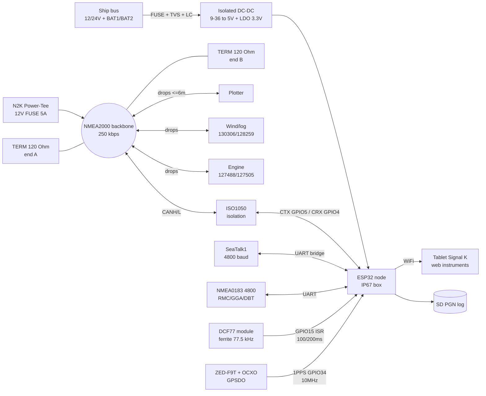

# Marine-Time - NMEA2000, SeaTalk, DCF77/WWVB/MSF, GPSDO, IP67 enclosure, 12/24V power

## Purpose

This note is an ESP32 marine and time-measurement node: **NMEA2000** network
(CAN **250 kbps**, **PGN**, **120 Ohm terminators**, **bus power**),
**SeaTalk** overview (legacy Raymarine and bridge to NMEA2000),
radio time sync **DCF77 / WWVB / MSF** (ferrite antenna,
decoding **second pulses**), **GPSDO** (disciplined
oscillator with **holdover**), marine **IP67 enclosure** and **12/24V** power
(protection, isolation, backup).

![[assets/img/marine-time-nmea-scheme.png|600]]
*Fig. ESP32 on a yacht: NMEA2000 backbone (terminators, bus power), SeaTalk bridge, DCF77 receiver with ferrite, GPSDO 10 MHz + 1PPS, IP67 enclosure, 12/24V power via isolated DC-DC.*

Links to [[EN/Home.en]], [[EN/04-Interfaces/05-CAN-TWAI-RS485.en]], [[EN/04-Interfaces/01-UART.en|UART]],
[[EN/12-Comm-Modules/19-Wired-2.en]], [[EN/12-Comm-Modules/17-GNSS-RTK.en]],
[[EN/12-Comm-Modules/22-Automotive.en]], [[EN/12-Comm-Modules/21-Motion-Control.en]],
[[EN/02-Power-Supply/01-Power-Rails.en]].

> [!warning] The sea does not forgive breadboarding
> Salt water + 12/24V + vibration = corrosion in weeks. No DuPont "snot"
> in the cockpit: only cable glands, crimp lugs, lacquer/potting,
> fuses on each branch, IP67 enclosure. Navigation data (AIS, depth,
> autopilot) via ESP32 - only as a **duplicating indicator**, certified
> instruments stay primary. Storm responsibility is on the skipper.

## Characteristics

| Node | Role | Interface to ESP32 | Power supply | Speed / limit | When to take |
| --- | --- | --- | --- | --- | --- |
| NMEA2000 (CAN 250 kbps) | Marine data backbone (PGN) | TWAI + transceiver (ISO1050 for isolation) | 12V bus (9-16V), LEN limit | 250 kbps, backbone up to 200 m (mini) / 100 m (micro) | Yacht: depth, wind, GPS, engine in one network |
| SeaTalk (1 / NG) | Legacy Raymarine network | UART 4800 (ST1) or ST-NG to N2K bridge | 12V | 4800 baud (ST1), 250 kbps (ST-NG=N2K) | Old Raymarine autopilots/displays |
| DCF77 receiver (77.5 kHz) | Exact EU time (PTB atomic reference) | Digital GPIO (1000/2000 ms pulses) | 3.3-5V | 1 bit/s, ~1 ms accuracy | European shore, RTC sync without GPS |
| WWVB receiver (60 kHz) | Exact US time (NIST) | Digital GPIO | 3.3-5V | 1 bit/s (PWM + BPSK since 2012) | America, backup to GPS |
| MSF receiver (60 kHz) | Exact UK time (NPL) | Digital GPIO | 3.3-5V | 1 bit/s | Britain/North Sea |
| GPSDO (e.g. on ZED-F9T) | 10 MHz + 1PPS tied to GPS | UART config + 1PPS input + 10 MHz output | 3.3V + clean power | holdover drift 1-10 us/day (OCXO) | Beacon, SDR base, science measurements |
| IP67 enclosure | Survive spray/rain | PG7/PG9 glands, terminals | - | IP67 (30 min under 1 m) | Any deck installation |
| Marine 12/24V power | Stable 5V/3.3V from 9-36V | Isolated DC-DC + TVS + filter | 12V (10-16V) / 24V (20-32V) | ESP32 node current 0.2-1A | Yacht with two buses, galvanics mandatory |

## 1. NMEA2000 - CAN 250 kbps, PGN, terminators, bus power

**NMEA2000** (IEC 61162-3, DeviceNet M12 5-pin connector) is CAN 2.0B
(**29-bit** ID, **250 kbps**) + upper-level protocol from SAE J1939:
data packed in **PGN** (Parameter Group Number). Physically a **backbone**
(trunk) with **drops** to instruments (up to 6 m each).

### 1.1. Bus physics - 4 iron rules

1. **Two 120 Ohm terminators** - one on each backbone end.
   In parallel they give 60 Ohm between CANH/CANL (measure with an ohmmeter on a powered-off bus!).
2. **Lengths**: Micro backbone - up to **100 m**, Mini - up to **200 m**;
   drop sum - up to 78 m, one drop - up to **6 m**.
3. **12V bus power** fed **at ONE point** via Power-Tee
   with a fuse (typically 3-8A per network, depends on Micro/Mini cable).
4. **Bus ground** (shield/drain) grounded **at one point** -
   otherwise loops and "floating" CRC errors.

M12 DeviceNet pinout (socket view):

```text
пін 1 = Shield (екран/drain)
пін 2 = NET-S (V+, +12V шини, червоний)
пін 3 = NET-C (V-, земля шини, чорний)
пін 4 = NET-H (CANH, білий)
пін 5 = NET-L (CANL, синій)
Кабель Micro (тонкий, до 3A) — малі яхти; Mini (товстий, до 8A) — бекбон великих суден.
```

### 1.2. PGN - what it is and how to read

A 29-bit CAN ID encodes priority + PGN + addresses (see J1939 breakdown),
while **PGN** tells how to interpret 8 data bytes (single-frame) or
a Fast Packet / multi-packet assembly (long: position, AIS).

| PGN | Name | Period | Content (short) |
| --- | --- | --- | --- |
| 60928 | ISO Address Claim | at startup | Who I am (address, class, manufacturer) |
| 126992 | System Time | 1 s | UTC date/time (time source!) |
| 127250 | Vessel Heading | 10 Hz | HDG heading, deviation/variation |
| 127251 | Rate of Turn | 10 Hz | Turn angular speed |
| 127258 | Magnetic Variation | 1 s | Magnetic variation (WMM) |
| 128259 | Speed (Water) | 1-10 Hz | Water-relative speed (log) |
| 128267 | Water Depth | 1-10 Hz | Depth under transducer + offset |
| 129025 | Position Rapid | 10 Hz | Latitude/longitude (fast!) |
| 129026 | COG/SOG Rapid | 10 Hz | Ground course/speed |
| 129029 | GNSS Position | 1 s | Full position + time + fix (GNSS) |
| 129033 | Time and Date | 1 s | Precise UTC date/time |
| 129540 | GNSS Sats in View | 1 s | Satellites, SNR, azimuth/elevation |
| 129794 | AIS Class A Static | on event | Vessel AIS statics (MMSI, name) |
| 129798 | AIS SAR | on event | AIS-SART (rescue!) |
| 130306 | Wind Data | 10 Hz | Wind speed/angle (apparent!) |
| 130310 | Environment | 1 s | Water/air temperature, pressure |
| 130311 | Environment (2) | 1 s | Humidity, extended parameters |
| 127488 | Engine Rapid | 10 Hz | RPM, oil pressure, temperature |
| 127505 | Fluid Level | 1 s | Fuel/water/oil (%) |
| 59904 | ISO Request | on event | PGN request to a device |
| 65240 | ISO Commanded Address | on event | Address assignment |

Engine Rapid **127488** decoding example (8 bytes):

```text
байт 0: екземпляр двигуна (0 = перший)
байт 1-2: RPM, LE, масштаб 0.25 об/хв  -> 1726 об/хв = 6904 = 0x1AF8 -> F8 1A
байт 3-4: тиск наддуву / тиск масла (за PGN-ревізією!)
байт 5-6: температура (offset -273.15 / 0.01K — читати canboat-DB!)
байт 7: статуси/резерв
Rule: do NOT guess scales from your head - check against the canboat base (see sources)!
```

### 1.3. ESP32 on NMEA2000 - roles

| ESP32 role | What it does | Complexity |
| --- | --- | --- |
| Listener (listen-only) | Logs PGNs (wind/depth/GPS) to SD, sends to WiFi tablet | Low - receive only, without Address Claim |
| Display gateway | N2K to SeaTalk/WiFi (Signal K), web dashboard | Medium - TCP/WebSocket + parsing |
| Sensor (new node) | Gives its PGN (e.g. 130310 with BME280) | High - Address Claim + Fast Packet + certification care |
| NMEA0183 to N2K bridge | Old instruments (4800 baud) into the new network | Medium - two UARTs + TWAI |

> Address Claim (60928) is a "registration" procedure: a new device claims
> an address; on conflict the younger NAME yields. An ESP32 sensor must
> implement it, otherwise two identical DIY nodes lay the network down
> with an argument. Listener/mirror - never claim at all (listen-only).

### 1.4. Isolation - ISO1050 or nothing

Marine ground is not ESP32 ground (galvanics, shore power, storm
pickup). Transceiver **only isolated** (ISO1050/ISO1042 + B0505S
DC-DC) or a ready isolated module. Non-isolated SN65HVD230 - only
for a bench rig powered from one PSU. More below -
[[EN/12-Comm-Modules/19-Wired-2.en]] and [[EN/04-Interfaces/05-CAN-TWAI-RS485.en]].

## 2. SeaTalk - overview (what is left from Raymarine)

| Version | Physics | Speed | N2K compatibility |
| --- | --- | --- | --- |
| SeaTalk 1 (classic, 3 wires: +12/GND/Data) | Single-wire UART-like, collisions | 4800 baud | None - a bridge/converter needed |
| SeaTalk 2 (rare, NMEA2000-compatible) | CAN | 250 kbps | Yes, proprietary connectors |
| SeaTalk NG (modern) | CAN = NMEA2000 under another connector | 250 kbps | Yes via ST-NG to DeviceNet adapter cable |

Practice: an old ST4000 autopilot (SeaTalk 1) + a new N2K network -
we place an **ESP32 bridge**: read ST1 frames (heading/rudder) over UART 4800
and give PGNs 127250/127251 to N2K (and back - ST8002 commands).
ST1 datagrams are open by enthusiasts (see canboat-adjacent sources);
critical autopilot commands - only via a certified gateway
(Raymarine E22158 or analog), ESP32 is indication/log, not control!

## 3. DCF77 / WWVB / MSF - time receivers (ferrite, second pulses)

Three stations - one idea: a long-wave transmitter sends **1 bit/s**,
modulating the **second-mark length**; a receiver with a **ferrite antenna**
catches it for thousands of km. ESP32 decodes marks with GPIO interrupts and sets
its RTC/NTP-independent time (valuable without GPS and without internet!).

### 3.1. Station comparison table

| Station | Country / operator | Frequency | Power | Second format | Coverage |
| --- | --- | --- | --- | --- | --- |
| DCF77 | Germany, PTB (Mainflingen) | 77.5 kHz | 50 kW | AM: 100 ms = `0`, 200 ms = `1`, 59th second - pause (minute marker) | EU + Ukraine (stable at night!) |
| WWVB | USA, NIST (Fort Collins) | 60 kHz | 70 kW ERP | AM PWM: 200 ms = `0`, 500 ms = `1`, 800 ms = marker; + BPSK since 2012 | North America |
| MSF | UK, NPL (Anthorn) | 60 kHz | 17 kW | AM: 100 ms = `0`, 200 ms = `1`, 300 ms = A/B markers; second 59 - pause | UK + North Sea |

> In Ukraine **DCF77** is really caught (especially at night, on 60-100 mm ferrite
> or ready DCF77 modules with TCO output). WWVB/MSF are for ocean
> crossings under the respective shore. Bands are close (60/77.5 kHz) -
> the loop antenna retunes, but the receiver filter is narrow: buy the module
> **for the specific frequency**.

### 3.2. Receiver hardware: ferrite + module

| Element | Requirement | Example |
| --- | --- | --- |
| Ferrite antenna | 60-100 mm rod, loop at 77.5 (or 60) kHz, high Q | Stock in DCF77 modules (Conrad/Velleman type) |
| Receiver module | AGC + detector + TCO/PON output (active LOW/HIGH by version!) | DCF77 modules with open-collector output |
| Orientation | Ferrite axis - to the transmitter (Mainflingen for DCF77), away from ESP32/WiFi! | Minimum 1-2 m from switching PSUs |
| Power supply | Clean 3.3V, ferrite dislikes buck ripple | Separate LDO + 100 uF near the module |
| Output to ESP32 | GPIO interrupt (edge + back), pull-up per module datasheet | GPIO15/34, ISR measures LOW length |

> ESP32 WiFi (2400 MHz) does not bother ferrite directly, but a **switching buck**
> at 100-500 kHz gives harmonics into the LW band! Power the time receiver from
> a **linear LDO** and separate from DC-DC by at least 30 cm, otherwise -
> solid "bad" minutes.

### 3.3. Second-pulse decoding (DCF77, in detail)

```text
Хвилина = 59 секундних міток (секунда 59 — БЕЗ спаду, маркер кінця хвилини!).
Кожна секунда 0..58: спад на початку секунди, підйом через:
  ~100 мс -> біт 0
  ~200 мс -> біт 1
Допуски ESP32: 70-130 мс = 0; 170-230 мс = 1; інакше — бита секунда (завада).
Поля DCF77 (біти секунди -> значення, BCD, парності!):
  біт 15 = R (резерв/виклик), біт 16 = A1 (анонс літній/зимовий перехід),
  біт 17 = Z1, 18 = Z2 (зона: CET/CEST), біт 19 = A2 (анонс високосної),
  біт 20 = S (start часу, завжди 1),
  біти 21-24 + P1(біт 28): хвилини BCD (одиниці 1-2-4-8, десятки 10-20-40),
  біти 29-34 + P2(біт 35): години BCD,
  біти 36-41: день місяця BCD, 42-44: день тижня, 45-49: місяць BCD,
  біти 50-57 + P3(біт 58): рік BCD (дві цифри!).
Парності P1/P2/P3 — парні (even) на свої групи. Невірна парність = хвилина в сміття!
Час DCF77 = CET/CEST (Берлін!). UTC = мінус 1 (взимку) або 2 (влітку) години.
```

ESP32 algorithm: ISR fixes fall/rise to length to bit to a 59-bit array;
marker (no fall >1500 ms) to check P1/P2/P3 to BCD to time to set RTC
(only if 2 minutes in a row match!). Then - deep sleep until the next
sync (hour/day). See MicroPython/Arduino code below.

### 3.4. WWVB / MSF - decoder differences

- **WWVB**: three lengths (200/500/800 ms) + position markers every 10 s;
  since 2012 in parallel **BPSK** (carrier phase modulation) - old AM modules
  ignore it, new ones get better sensitivity. Fields: minute/hour/day/year
  BCD + DST/Leap bits (see NIST format in sources).
- **MSF**: 4 second types (00/01/10/11 via two A/B marker bits per second);
  fast time code + slow DUT1 code. Decoder is harder than DCF77 -
  take a ready module with UART output if you need MSF exactly.

## 4. GPSDO - disciplined oscillator, holdover

**GPSDO** (GPS-Disciplined Oscillator): a 10 MHz OCXO/TCXO oscillator
that a controller constantly **pulls** by GNSS 1PPS phase
(see the **ZED-F9T** timing receiver - sources). Outputs: **10 MHz**
(reference for SDR/measurements) + **1PPS** (second mark +-20-50 ns to UTC).

| State | What happens | 10 MHz accuracy |
| --- | --- | --- |
| Lock (GPS present) | PLL to 1PPS, OCXO calibration | 1e-11..1e-12 (per day of averaging) |
| Holdover (GPS lost) | Hold last calibration, OCXO drift | OCXO: 1-10 us/day; TCXO: 10-100 us/day |
| Free-run (never had GPS) | Plain oscillator | 1e-8..1e-7 (like without GPSDO) |

ESP32 + GPSDO practice:

1. 1PPS from GPSDO to GPIO34 (timer capture, mark with <1 us accuracy).
2. 10 MHz to an outdoor counter/SDR reference (ESP32 does not clock it - only uses it as a reference to calibrate its RTC!).
3. UART from ZED-F9T to lock/holdover monitoring (UBX-TIM-TP, NAV-CLOCK).
4. GNSS antenna - with sky view (see [[EN/12-Comm-Modules/17-GNSS-RTK.en]]!);
   without sky GPSDO = an expensive OCXO.
5. OCXO power - clean (separate LDO, 5-10 min warm-up to lock!).

> Why GPSDO on a yacht: precise time for SDR reception (AIS decoder,
> NAVTEX), logger sync, UTC backup when GPS is jammed/fails
> (holdover holds time for a day with microseconds - enough to reach port).

## 5. Marine IP67 enclosure + connectors + anticorrosion

| Element | Requirement | Practice |
| --- | --- | --- |
| Enclosure | IP67 (polycarbonate/ABS with silicone seal) | Bopla/OKW/Chinese IP67 boxes 150x110x70 |
| Cable glands | PG7 (3-6.5 mm), PG9 (4-8 mm) per each cable | Cable with drip slack (U-loop DOWN!) |
| Terminals | Wago 221 spring in the box, crimp lugs on ends | No twists and "blue tape"! |
| ESP32 board | Lacquer (Plastik 70 / urethane) or silicone potting of connectors | Close the USB hole with a plug after firmware |
| Ventilation | Gore membrane (breathes, keeps water out) against condensate | without membrane - silica-gel bag + revision once a season |
| Mounting | A4 (316) stainless screws, vibration dampers | Enclosure grounding to the bus with a metal box |
| Marking | Engraving/heatshrink with lead signatures | in a year nobody remembers what the "blue wire" is for |

> Drip loop: cable enters the box **from below** with a U-loop - the drop runs
> off the loop, not inside along insulation. Top entry without a visor =
> water inside after the first storm.

## 6. Marine 12/24V power - isolation, filters, backup

Ship mains: **12V** (10-16V, starter dips down to 7V!) or **24V**
(20-32V), common ground with the engine, shore charger gives ripple,
storm - pickup in rigging. Schematic:

```text
Шина 12/24V --[запобіжник 2A]--+--[TVS SMBJ28A (12V) / SMBJ36A (24V)]--+--[синфазний дросель + LC]--+
                               |                                       |                             |
                              GND (bus)                              GND                           [ізольований DC-DC 9-36V -> 5V, напр. B0505S-стиль потужний / Traco]
                                                                                                     |
                                                                                    [5V bus вузла]--+--[LDO 3.3V]--> ESP32
                                                                                                     +--> NMEA2000 Power-Tee? НІ! (bus N2K живиться СВОЇМ запобіжником!)
РЕЗЕРВ: клема АКБ -> діодний АБО (2×SS54) -> DC-DC (безперебійність при перемиканні АКБ1/АКБ2)
СОН: key high-side по ignition/solar-контролеру, ціль <2 мА в сні (deep-sleep ESP32 + DC-DC в standby)
```

| Element | 12V grid | 24V grid |
| --- | --- | --- |
| TVS | SMBJ24A-SMBJ28A (Vrwm ≥ 18V) | SMBJ36A (Vrwm ≥ 30V) |
| DC-DC | 9-36V input (covers both!), isolated | same 9-36V (universal!) |
| Node fuse | 1-2A | 1A (less current at the same power) |
| NMEA2000 Power-Tee | Own 5A fuse (Micro cable) | Same Tee - the N2K bus is always ~12V (grid regulator!) |
| Lightning protection | Arrester on VHF/GPS antenna + TVS on each input | Same + cable spacing |

> The NMEA2000 bus is powered **separately** by its own Power-Tee with its own fuse -
> not from ESP32 5V and not from laptop USB! The ESP32 node takes from N2K only
> data (CANH/L), while power comes from its own DC-DC. Exception - tiny sensors
> with LEN <= 2 that feed straight from the bus (then count the network LEN budget!).

## 7. NMEA 0183 - old instruments are not thrown away

Most old plotters/radios speak **NMEA 0183** (IEC 61162-1):
UART **4800 8N1**, ASCII `$GPRMC,...*CHK`, one talks - all listen.
ESP32 bridge: UART1 (4800) listens to 0183 to parse RMC/GGA/DBT/MWV to
give PGNs 129029/128267/130306 to N2K (and back).
0183 checksum: XOR of bytes between `$` and `*` (see code + GNSS-RTK note).
High-speed AIS variant is **38400** (plotter HS port!).

## Module pin legend

### NMEA2000 node (TWAI + ISO1050 board)

| Pin | Label | Type | To ESP32 | Note |
| --- | --- | --- | --- | --- |
| 1 | VCC1 3.3V | Logic power | 3V3 ESP32 | ESP32 side! |
| 2 | GND1 | Logic ground | ESP32 GND | ESP32 side only! |
| 3 | CTX | Digital input | GPIO5 (CAN TX) | ESP32 TX to CTX |
| 4 | CRX | Digital output | GPIO4 (CAN RX) | CRX to ESP32 RX |
| 5 | VCC2 5V | Bus power | +5V of isolated DC-DC (B0505S) | not from ESP32! |
| 6 | GND2 | Bus ground | N2K bus GND (isolated!) | do not join with GND1! |
| 7 | CANH | Bus | White, M12 pin 4 | 120 Ohm on backbone ends! |
| 8 | CANL | Bus | Blue, M12 pin 5 | 120 Ohm on backbone ends! |
| 9 | 120R jumper | Terminator | close ONLY on ends! | Inside the network - open! |

### DCF77 / WWVB / MSF module (TCO output)

| Pin | Label | Type | To ESP32 | Note |
| --- | --- | --- | --- | --- |
| 1 | VCC 3.3V | Power supply | 3V3 via separate LDO! | Clean power, 100 uF nearby |
| 2 | GND | Ground | GND | Common, away from buck! |
| 3 | DATA/TCO | Digital output | GPIO15 (interrupt!) | Active LOW or HIGH - read the module datasheet! |
| 4 | PON | Control input | GPIO13 or VCC | Power-ON (some modules have a sleep mode) |
| ANT | 60-100 mm ferrite | RF | Built-in, axis to transmitter | 1-2 m from ESP32/PSU! |

### GPSDO node (ZED-F9T + OCXO)

| Pin | Label | Type | To | Note |
| --- | --- | --- | --- | --- |
| 1 | VCC 3.3V | Power supply | Clean 500 mA LDO | OCXO warm-up 5-10 min! |
| 2 | GND | Ground | GND | Ground star |
| 3 | TX (F9T) | UART output | GPIO16 (RX2) | UBX-TIM-TP, NAV-CLOCK |
| 4 | RX (F9T) | UART input | GPIO17 (TX2) | configuration |
| 5 | 1PPS | Digital output | GPIO34 (capture!) | +-20-50 ns, lock indicator |
| 6 | 10 MHz | RF output | SDR / frequency meter | 50 Ohm, short coax! |
| 7 | LOCK | Digital output | GPIO35 (LED) | HIGH = lock, LOW = holdover! |
| 8 | RF_IN | RF | GNSS antenna with sky | Active antenna + bias! |

### Marine power (DC-DC node)

| Pin | Label | Type | To | Note |
| --- | --- | --- | --- | --- |
| 1 | VIN 9-36V | Power input | 12/24V bus via 2A FUSE + TVS | Diode OR with two batteries |
| 2 | GND_IN | Bus ground | Vessel ground | via common-mode choke! |
| 3 | +5V_OUT | Power output | ESP32 VIN + 5V peripherals | Isolated OUT ground! |
| 4 | GND_OUT | Output ground | ESP32 GND | do not join with GND_IN! |
| 5 | EN/STBY | Control input | switch/ignition | LOW = standby (<100 uA) |

## Schematic

Overall schematic: NMEA2000 backbone (Power-Tee + 2 terminators), ESP32 node
via ISO1050, SeaTalk bridge, 0183 listener, DCF77 module with ferrite,
GPSDO (F9T + 1PPS/10 MHz), IP67 box, 12/24V power via isolated DC-DC.

### ASCII schematic

```text
NMEA2000 БЕКБОН (Micro-кабель, 250 кбіт):
  [TERM 120]---[Power-Tee: +12V(FUSE 5A)/GND/CANH/CANL]---[дроп: плоттер]---[дроп: вітер]---[дроп: GPS]---[дроп: ESP32-вузол]---[TERM 120]
     |                                                                                              |
   кінець А                                                                                      кінець Б (60 Ом між H/L на знеструмленій!)
  Дропи ≤6м кожен, сума ≤78м; живлення шини ТІЛЬКИ в одній точці (Power-Tee)!

ESP32-ВУЗОЛ (у IP67-боксі, вводи PG7 ЗНИЗУ з U-петлями):
  TWAI: GPIO5 CTX -> ISO1050 CTX | GPIO4 CRX <- CRX | VCC2/GND2 від B0505S (ізольовані!)
        ISO1050 CANH -> білий (M12 пін 4), CANL -> синій (M12 пін 5)
  SeaTalk1-міст: GPIO14 RX <- ST1 DATA (через дільник/оптопару!), 4800 бод; UART1 TX -> ST1 (опційно)
  NMEA0183: UART 4800 (GPIO21/22 через MAX3232): RMC/GGA/DBT/MWV <-> PGN-міст
  DCF77-module: VCC чистий LDO 3.3V, GND, DATA -> GPIO15 (ISR: спад/підйом, довжини 100/200мс)
        ферит 77.5 кГц віссю на Mainflingen, ≥1м від buck/WiFi-антени!
  GPSDO: F9T TX -> GPIO16, RX <- GPIO17 (115200 UBX), 1PPS -> GPIO34, LOCK -> GPIO35+LED, 10МГц -> SDR (коаксіал 50 Ом)
  ЖИВЛЕННЯ вузла: bus 12/24V --[FUSE 2A]--[TVS]--[LC-фільтр]--[ізольований DC-DC 9-36->5V]--+--[LDO 3.3V]--> ESP32
                                                                                             +--> DCF77-LDO, ISO1050-VCC1
  РЕЗЕРВ: АКБ1 --|>|--+--> DC-DC (діодне АБО SS54); АКБ2 --|>|--+
```

### Mermaid graph LR



## Code

### ESP-IDF - NMEA2000 listener (TWAI 250 kbps, PGN from 29-bit ID)

```c
// ESP-IDF v5.x (новий TWAI API): listen-only слухач NMEA2000, 250 кбіт, extended ID.
// PGN = (ID >> 8) & 0x3FFFF (J1939-спрощено для single-frame). Трансивер — ISO1050!
#include "freertos/FreeRTOS.h"
#include "freertos/task.h"
#include "esp_log.h"
#include "esp_twai.h"
#include "esp_twai_onchip.h"

#define TAG "n2k_listen"

static twai_node_handle_t hdl;

static bool rx_cb(twai_node_handle_t h, const twai_rx_done_event_data_t *e, void *c) {
    uint8_t b[8];
    twai_frame_t f = {.buffer = b, .buffer_len = 8};
    if (twai_node_receive_from_isr(h, &f) == ESP_OK && f.header.ide) {
        uint32_t pgn = (f.header.id >> 8) & 0x3FFFF;
        // ESP_LOG з ISR не можна — ставимо прапор/чергу; тут спрощено через буфер:
    }
    return false;
}

void app_main(void) {
    twai_onchip_node_config_t cfg = {
        .io_cfg.tx = 5, .io_cfg.rx = 4,
        .bit_timing.bitrate = 250000,          // NMEA2000 = 250 кбіт!
        .tx_queue_depth = 5,
        .flags.enable_listen_only = 1,         // слухач: нічого не шлемо, ACK нема
    };
    ESP_ERROR_CHECK(twai_new_node_onchip(&cfg, &hdl));
    twai_event_callbacks_t cbs = {.on_rx_done = rx_cb};
    ESP_ERROR_CHECK(twai_node_register_event_callbacks(hdl, &cbs, NULL));
    ESP_ERROR_CHECK(twai_node_enable(hdl));
    ESP_LOGI(TAG, "N2K listen-only 250k started (60 Ом на шині? термінатори?)");
    while (1) { vTaskDelay(pdMS_TO_TICKS(1000)); }
}
```

### ESP-IDF - giving own PGN 130310 (environment sensor, ESP32 node)

```c
// ESP-IDF: ESP32 як повноцінний N2K-вузол: Address Claim 60928 + PGN 130310.
// УВАГА: спочатку стенд з ОДНИМ плоттером, унікальна адреса, NAME з вашим виробником!
#include "esp_twai.h"
#include "esp_twai_onchip.h"

// PGN 130310 Environmental Parameters (приклад, 8 байт single-frame, спрощено):
// байт 0: SID, 1-2: темп. води (0.01K), 3-4: темп. повітря (0.01K), 5-6: тиск (100 Па)...,
// точні масштаби — ТІЛЬКИ з canboat-DB (не вгадувати!).
static void n2k_send_env(twai_node_handle_t h, uint16_t tWater_cK, uint16_t tAir_cK) {
    uint8_t d[8] = {0x01,
        tWater_cK & 0xFF, tWater_cK >> 8,
        tAir_cK & 0xFF, tAir_cK >> 8,
        0xFF, 0xFF, 0xFF};
    // 29-біт ID: пріоритет 5 | PGN 130310<<8 | SA (наша адреса, напр. 0x50)
    twai_frame_t f = {.header.id = (5UL << 26) | (130310UL << 8) | 0x50,
                      .header.ide = 1, .buffer = d, .buffer_len = 8};
    twai_node_transmit(h, &f, 100);
}
```

### Arduino - NMEA 0183 to PGN bridge + DCF77 bitbang (overview)

```cpp
// Arduino-ESP32: слухаємо NMEA0183 4800 (Serial1), парсимо RMC; DCF77 DATA на GPIO15 (ISR).
#include <Arduino.h>
#define N183_RX 21
#define N183_TX 22
#define DCF_PIN 15

volatile unsigned long dcfFall = 0;
volatile int dcfLen = 0;

void IRAM_ATTR dcfIsr() {
  if (digitalRead(DCF_PIN) == LOW) dcfFall = micros();
  else dcfLen = (int)(micros() - dcfFall);   // довжина LOW: ~100мс=0, ~200мс=1
}

bool nmeaCheck(const String &line) {         // XOR між $ і *
  int a = line.indexOf('*');
  if (line[0] != '$' || a < 0) return false;
  uint8_t cs = 0;
  for (int i = 1; i < a; i++) cs ^= line[i];
  return cs == strtoul(line.substring(a + 1, a + 3).c_str(), NULL, 16);
}

void setup() {
  Serial.begin(115200);
  Serial1.begin(4800, SERIAL_8N1, N183_RX, N183_TX);  // NMEA0183!
  pinMode(DCF_PIN, INPUT_PULLUP);
  attachInterrupt(DCF_PIN, dcfIsr, CHANGE);
}

void loop() {
  static String buf;
  while (Serial1.available()) {
    char c = Serial1.read();
    if (c == '\n') {
      buf.trim();
      if (buf.startsWith("$GPRMC") && nmeaCheck(buf)) Serial.println("RMC-OK " + buf);
      buf = "";
    } else if (c != '\r') buf += c;
  }
  if (dcfLen > 0) {                          // секундна мітка DCF77
    const char *bit = (dcfLen > 170000) ? "1" : (dcfLen > 70000 ? "0" : "?");
    Serial.printf("DCF bit=%s len=%dms\n", bit, dcfLen / 1000);
    dcfLen = 0;
  }
}
```

### MicroPython - DCF77 full minute decoder (BCD + P1/P2/P3 parity)

```python
"""MicroPython ESP32: DCF77-декодер. DATA-module на GPIO15 (переривання CHANGE).
Збирає 59 біт, перевіряє P1/P2/P3, ставить RTC. Час DCF77 = CET/CEST!"""
from machine import Pin, RTC
import time

dcf = Pin(15, Pin.IN, Pin.PULL_UP)
rtc = RTC()
bits, fall, cur = [], 0, 0

def bcd(bits_ls, weights):
    return sum(b * w for b, w in zip(bits_ls, weights))

def even_par(group):
    return sum(group) % 2 == 0   # DCF77 парності — парні

def decode_minute(b):
    """b: список 59 біт (0/1). Повертає (hh, mm) або None."""
    if len(b) != 59 or b[20] != 1:
        return None
    minute = bcd(b[21:25], [1, 2, 4, 8]) + bcd(b[25:28], [10, 20, 40])
    hour = bcd(b[29:33], [1, 2, 4, 8]) + bcd(b[33:35], [10, 20])
    day = bcd(b[36:40], [1, 2, 4, 8]) + bcd(b[40:42], [10, 20])
    month = bcd(b[45:49], [1, 2, 4, 8]) + b[49] * 10
    year = 2000 + bcd(b[50:54], [1, 2, 4, 8]) + bcd(b[54:58], [10, 20, 40, 80])
    ok = even_par(b[21:28] + [b[28]]) and even_par(b[29:35] + [b[35]]) \
        and even_par(b[36:58] + [b[58]])
    if not ok or not (0 <= minute < 60 and 0 <= hour < 24):
        return None
    return (year, month, day, hour, minute)

def irq(p):
    global fall, cur
    if p.value() == 0:
        fall = time.ticks_ms()
    else:
        cur = time.ticks_diff(time.ticks_ms(), fall)  # ~100=0, ~200=1

dcf.irq(trigger=Pin.IRQ_FALLING | Pin.IRQ_RISING, handler=irq)

last_mark = time.ticks_ms()
while True:
    if cur:                                   # прийшла секундна мітка
        if 70 <= cur <= 130:
            bits.append(0)
        elif 170 <= cur <= 230:
            bits.append(1)
        else:
            bits = []                         # завада — хвилину в сміття
        cur, last_mark = 0, time.ticks_ms()
    if time.ticks_diff(time.ticks_ms(), last_mark) > 1500 and bits:
        # пауза >1.5с = маркер кінця хвилини (59-та секунда без спаду)
        r = decode_minute(bits)
        if r:
            print("DCF77 CET:", r)            # UTC = -1/-2 год!
        else:
            print("DCF77 bad minute, bits:", len(bits))
        bits, last_mark = [], time.ticks_ms()
    time.sleep_ms(20)
```

### MicroPython - GPSDO monitor (1PPS + LOCK)

```python
"""1PPS-мітка + LOCK-індикація GPSDO. PPS на GPIO34, LOCK на GPIO35."""
from machine import Pin
import time

pps_count, last = 0, time.ticks_ms()

def on_pps(p):
    global pps_count, last
    now = time.ticks_ms()
    dt = time.ticks_diff(now, last)
    last = now
    pps_count += 1
    if abs(dt - 1000) > 50:
        print("PPS збій: dt =", dt, "мс (holdover/втрата GPS?)")

Pin(34, Pin.IN).irq(trigger=Pin.IRQ_RISING, handler=on_pps)
lock = Pin(35, Pin.IN)
while True:
    print("PPS:", pps_count, "LOCK:", "LOCK" if lock.value() else "HOLDOVER")
    time.sleep(5)
```

## typical errors

| # | Symptom | Cause | Fix |
| --- | --- | --- | --- |
| 1 | TWAI: silence, error-passive | Speed not 250 kbps or bus without power | 250000 baud, extended ID, verify 12V on Power-Tee |
| 2 | H/L resistance not 60 Ohm | Missing/extra terminators (0/1/3 instead of 2) | Exactly 2x120 Ohm on ends; inside - jumper open! |
| 3 | Network falls when ESP32 connects | Two identical addresses / no Address Claim | Unique SA, implement 60928, listener to listen-only |
| 4 | SN65HVD230 burnt on board | Non-isolated transceiver in marine ground | Only ISO1050 + B0505S; GND2 is not GND1! |
| 5 | PGN with foreign address overrides plotter | ESP32 sends with foreign-device SA | Own SA (e.g. 0x50+), do not touch 0-30 (factory engines/GPS) |
| 6 | Long PGNs (129029/AIS) broken | No Fast Packet assembly | Implement sequence/counter from first byte, 750 ms timeout |
| 7 | PGN scales guessed from head | Wrong gain/offset (pressure/temp) | Check ONLY against canboat-DB, not forums! |
| 8 | SeaTalk1 mush on 4800 | 12V levels straight into GPIO | Divider/optocoupler, inversion if needed, common ground |
| 9 | DCF77: solid bad minutes | Buck harmonics / ferrite near ESP32 | Module LDO power, ferrite >=1 m from DC-DC, axis to Mainflingen |
| 10 | DCF77 sets time +1/+2 h off | Forgot CET/CEST to UTC | UTC = DCF - 1 (winter) / -2 (summer); check Z1/Z2 bits! |
| 11 | P1/P2/P3 parity does not converge | Interference in one second spoils the minute | Drop the whole minute, wait for 2 matches in a row |
| 12 | GPSDO never locks | Antenna without sky / cold OCXO | 360-degree sky, 10 min warm-up, verify UBX NAV-CLOCK |
| 13 | Holdover drifts hundreds of us | TCXO instead of OCXO in a warm wheelhouse | OCXO + thermostable place, calibrate a day in lock |
| 14 | Water in IP67 box after storm | Top entry without U-loop / no membrane | Entries only from below + U-loops, Gore membrane, silica gel |
| 15 | Node drains battery in a week | DC-DC without standby + ESP32 without sleep | EN switch, deep-sleep, target <2 mA; N2K Tee - separate fuse! |

## Official sources

> All links below verified by download (webfetch, 2026-09-29). No guessed URLs.

- NMEA 2000 (CAN 250 kbps, backbone, terminators, PGN) - <https://en.wikipedia.org/wiki/NMEA_2000>
- CANboat (open N2K/PGN utilities, decoder, PGN base) - <https://github.com/canboat/canboat>
- PTB DCF77 (77.5 kHz, German legal-time emission) - <https://www.ptb.de/cms/en/ptb/fachabteilungen/abt4/fb-44/ag-442/dissemination-of-legal-time/dcf77.html>
- NIST WWVB (60 kHz, PWM + BPSK formats, Fort Collins) - <https://www.nist.gov/pml/time-and-frequency-division/time-distribution/radio-station-wwvb>
- NPL MSF (60 kHz, UK reference time, Anthorn) - <https://www.npl.co.uk/msf-signal>
- u-blox ZED-F9T (timing GNSS for GPSDO: 1PPS, 10 MHz optional) - <https://www.u-blox.com/en/product/zed-f9t-module>
- ESP-IDF TWAI (ESP32 CAN controller for NMEA2000: 250 kbps, filters) - <https://docs.espressif.com/projects/esp-idf/en/stable/esp32/api-reference/peripherals/twai.html>

## See also

- [[EN/Home.en]]
- [[EN/04-Interfaces/05-CAN-TWAI-RS485.en]] - TWAI/CAN base for the NMEA2000 node
- [[EN/04-Interfaces/01-UART.en|UART]] - UART for NMEA 0183 (4800) and SeaTalk bridge
- [[EN/12-Comm-Modules/19-Wired-2.en]] - ISO1050 isolation, CANable, Wireshark for bus debugging
- [[EN/12-Comm-Modules/17-GNSS-RTK.en]] - GNSS antennas, NMEA sentences, ZED series (GPSDO base)
- [[EN/12-Comm-Modules/22-Automotive.en]] - neighbor note (CAN transceivers, 12V buck+TVS power)
- [[EN/12-Comm-Modules/21-Motion-Control.en]] - autopilot/steering drives (heading-PGN consumers)
- [[EN/02-Power-Supply/01-Power-Rails.en]] - power rails, DC-DC, TVS, protection
