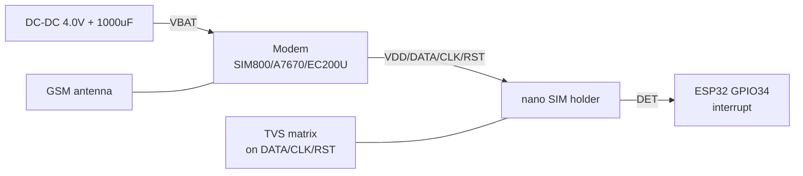
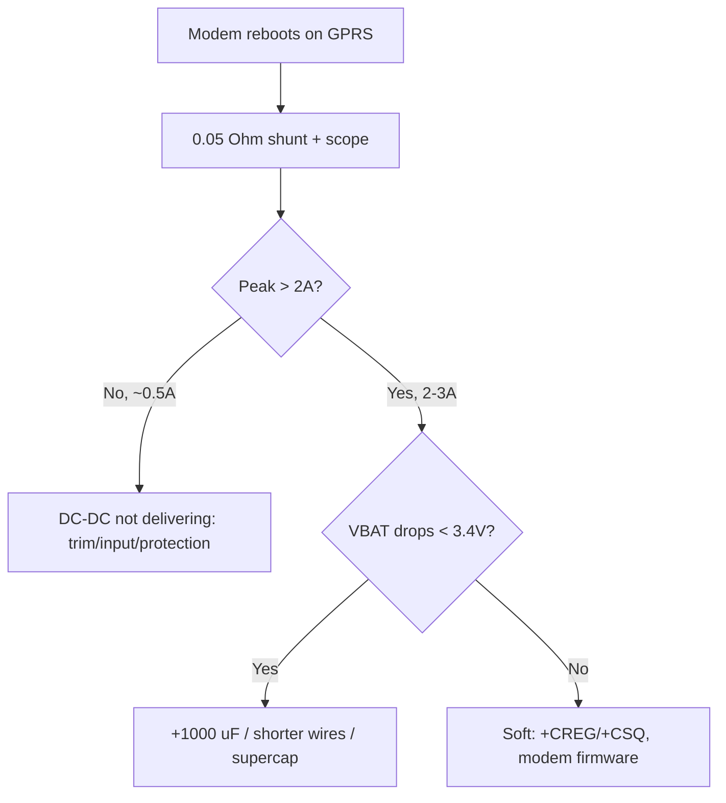
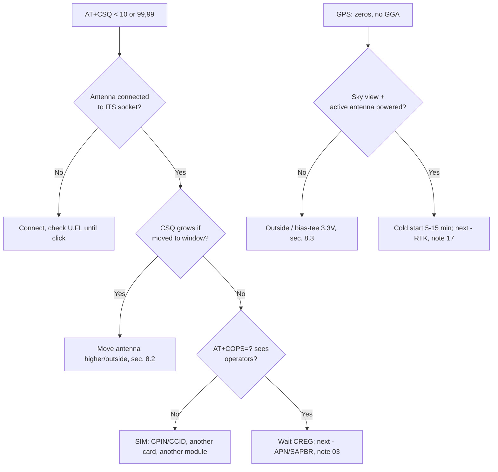

# SIM cards and cellular module power - holders, eSIM, TX bursts, supercap

## Purpose

Half of "dead" GSM projects - this is not firmware, but two hardware topics: the SIM card (format, PIN, holder, detect) and power supply (2-3A peaks in TX bursts that no DevKit-board LDO holds). Note collects both in one place as a foundation for practice.

Base: first GSM - [[EN/12-Comm-Modules/03-SIM800L-GPS.en]], 4G - [[EN/12-Comm-Modules/07-SIM7600-W5500-MCP2515.en]], Cat-1 - [[EN/12-Comm-Modules/18-Cellular-LoRa-2.en]], NB-IoT - [[EN/12-Comm-Modules/09-Cellular-NBIoT-UARTLoRa.en]], UART - [[EN/04-Interfaces/01-UART.en|UART]], power supply - [[EN/02-Power-Supply/01-Power-Rails.en]], protection - [[EN/13-Power-Modules/04-LDO-Buck-XL4015-Protect.en]], start - [[EN/Home.en]].

> [!danger] Two killers of cellular modules
>
> 1. **5V on VBAT** of the blue board (SIM800/A7670/EC200U without its own regulator) - RF amplifier breakdown in seconds. 2. **Power from 3.3V DevKit** - a 2A TX burst sags the rail, the module reboots exactly at registration (`AT+CREG` never `0,1`). Both symptoms are cured ONLY by a separate DC-DC + 1000 uF, section 5.

![[assets/img/sim-powerholder-scheme.png|600]]
*Fig. Cellular node: DC-DC 4.0V/3A + 1000 uF + TVS to VBAT, SIM holder with detect and ESD, GSM antenna separate from GNSS.*

## Characteristics

### Power supply of popular modules (bring into one table!)

| Module | VBAT range | Nominal | TX peak | Wrong-power consequence |
| --- | --- | --- | --- | --- |
| SIM800L (blue board) | 3.4-4.4V | 4.0V | up to 2A (577 us slot) | 5V = death; 3.3V = reboots at registration |
| SIM800L EVB (red, micro-USB) | 5V to board input | own buck on board | - | It CAN take 5V - own regulator; check visually! |
| A7670E/SA/G | 3.4-4.2V | 3.8-4.0V | up to 2A | Same as SIM800; plus PWRKEY pulse |
| SIM7600E-H | 3.4-4.2V | 3.8V | up to 3A | 3A - thicker wire, same 1000 uF |
| SIM7080G | 2.7-4.8V | 4.0V | up to 2A | Wider range, but same peak |
| EC200U / Air724UG | 3.4-4.3V | 3.8V | up to 2.5-3A | USB ECM/RNDIS modes do not remove VBAT requirements! |

### SIM cards: formats

| Format | Size | Where found | Comment for ESP32 projects |
| --- | --- | --- | --- |
| Mini-SIM (2FF) | 25x15 mm | Old holders, car trackers | Rare, but holders are cheap and durable |
| Micro-SIM (3FF) | 15x12 mm | SIM800 EVB, some Cat-1 boards | Transitional format |
| Nano-SIM (4FF) | 12.3x8.8 mm | A7670, EC200U, SIM7600 - de-facto standard | **Design for nano**, adapters - for the bench only |
| eSIM (MFF2, soldered) | 6x5 mm | Serial products | Profile loaded over RSP; for Ukraine - check operator support |
| SoftSIM / solderable | chip | Industrial batches | Same eSIM class, different catalog name |

> Nano-to-micro/mini adapters - ONLY for the lab: in vibration/field the adapter loosens, contact drops, the modem silently falls off the network. In a product - a holder of the card's native format.

## SIM interface pin legend

| Pin (module side) | Purpose | Where / what | Note |
| --- | --- | --- | --- |
| SIM_VDD | Card power 1.8V / 3.0V | Inside the module, automatic selection | do not pull up externally! The module negotiates with the card itself |
| SIM_DATA (I/O) | Data, open-drain | Inside the module + TVS matrix if needed | Pull-up inside; trace length minimal |
| SIM_CLK | Clock 1-5 MHz | Inside the module | No power traces nearby (coupling = ATR errors) |
| SIM_RST | Card reset | Inside the module | - |
| SIM_DET / SIM_PRESENCE | Card detect in holder | ESP32 GPIO (input with pull-up) or NC | "Card removed" interrupt → cleanly close PDP/MQTT |
| GND | SIM block ground | Common GND | - |

### ASCII schematic: SIM block

```text
Модемний module              SIM-холдер (nano, push-push)
───────────────              ────────────────────────────
SIM_VDD ───────────────────►  VCC (1.8/3.0V авто)
SIM_DATA ──[TVS]────────────►  DATA (доріжка < 30 мм!)
SIM_CLK ───────────────────►  CLK (далі від VBAT-силової!)
SIM_RST ───────────────────►  RST
GND ────────────────────────  GND
                               DET ──► GPIO34 ESP32 (переривання FALLING)
                               корпус холдера ──► GND (екран!)
```

### Mermaid: SIM block



## 1. PIN/PUK: commands and rituals

```text
AT+CPIN?              -> +CPIN: READY (карта без PIN — ідеал для IoT!)
AT+CPIN?              -> +CPIN: SIM PIN (просить PIN)
AT+CPIN="1234"        -> OK (ввести PIN; 3 спроби!)
AT+CPIN?              -> +CPIN: SIM PUK (PIN вичерпано — тільки PUK!)
AT+CPIN="87654321","0000" -> OK (PUK + новий PIN)
AT+CLCK="SC",0,"1234" -> OK (вимкнути запит PIN назавжди — ТАК для IoT)
AT+CCID               -> +CCID: 89380... (серійник карти — інвентаризація!)
AT+CIMI               -> 25501... (IMSI: MCC+MNC+абонент; 25501 = Vodafone UA)
AT+CNUM               -> +CNUM: ""," +380...",129 (свій номер, якщо записаний)
```

| Rule | Why |
| --- | --- |
| All IoT cards - with PIN DISABLED (`AT+CLCK="SC",0`) | After each reboot/sag the modem otherwise hangs on `SIM PIN` without network |
| Store PUK in the batch registry, not in firmware | 10 wrong PUKs = card dead forever, replacement in the field |
| `AT+CCID`/`AT+CIMI` - in self-test and in log | "Device serial ↔ SIM" binding catches card swaps |
| 3 PIN attempts - and stop | Firmware must not brute-force PIN: after 2 failures - stop and emergency status |

> [!warning] PUK - this is the last frontier
> 10 wrong PUK entries burn the card irreversibly. So PUK is entered only by hand from a slip/storage, never by automatic brute force in code.

## 2. Holders: types, detect, hot swap

| Holder type | How it works | Where to place | Trap |
| --- | --- | --- | --- |
| Push-push (press-click) | Pressed - ejected | Bench development, accessible enclosures | in vibration the card may shift - for car/tractor take one with a lock |
| Push-pull / tray (needle tray) | like in a phone | Sealed enclosures (tray + rubber = IP!) | Needle-clip gets lost in the field - put a spare in the enclosure |
| Hinged/lock (lid with lock) | Flip lid | Vibration, industrial zone | Most reliable contact, but bigger |
| eSIM MFF2 (soldered) | Profile over RSP | Batches 100+ | No "remove and verify" - need a bench with a test profile |

### SIM_DET - "card removed" interrupt

```cpp
// Arduino: детект карти → коректне завершення сесії
#define SIM_DET 34
volatile bool simGone = false;
void IRAM_ATTR onSimDet() { simGone = true; }
void setup() {
  pinMode(SIM_DET, INPUT_PULLUP);
  attachInterrupt(SIM_DET, onSimDet, FALLING); // холдер замикає DET на GND
}
void loop() {
  if (simGone) {
    simGone = false;
    sim.println("AT+SAPBR=0,1");   // закрити bearer
    delay(500);
    // MQTT LWT сам повідомить хмару про відвал
  }
}
```

Hot swap (remove/insert without reboot): possible ONLY if the modem supports it (`AT+QSIMDET` in the Quectel line; in SIM800 - conditionally). Safe ritual without support: `AT+CFUN=0` (radio off) → swap → `AT+CFUN=1` → wait for `+CPIN: READY` → `AT+CREG?` → raise SAPBR again.

## 3. ESD on SIM lines

The SIM holder is a hole in the enclosure poked by fingers: an 8 kV static discharge straight into `SIM_DATA`.

| Measure | How | Why |
| --- | --- | --- |
| TVS matrix (e.g. PRTR5V0U2X) on DATA/CLK/RST | Near the holder, ground - short to plane | Clips the discharge to ~10V, nowhere further to die |
| Series 22-33 Ohm on DATA/CLK | Between TVS and module | Limit discharge current + suppress ringing on 5 MHz CLK |
| Holder body - to GND | Holder metal cage soldered to ground | Shield from fingers and coupling |
| SIM traces < 30 mm, without power neighbors | Layout per RF-keepout chapter | 5 MHz CLK picks up TX bursts of nearby VBAT |

## 4. TX bursts: sag physics

GSM is TDMA: the transmitter turns on in a 577 us slot with a 2A peak (2G) / 1-3A (Cat-1/LTE depending on band and distance to the tower). The average current is funny (200-500 mA), but the peak is not.

```text
Струм VBAT у часі (реєстрація в мережі, слабкий сигнал):

 2.0A ─┤  ┌──┐    ┌──┐    ┌──┐
       │  │  │    │  │    │  │   слот 577 мкс
 0.3A ─┤──┘  └────┘  └────┘  └─── idle між слотами
       └──────────────────────────► t

 Конденсатор 1000 мкФ віддає заряд у слоті:
 ΔV = I × Δt / C = 2.0 × 577e-6 / 1000e-6 ≈ 1.15V  ← без DC-DC було б лихо!
 DC-DC з швидким transient-відгуком підхоплює — тому потрібен саме
 імпульсний buck (LM2596/MP1584/SY8113), а не лінійний LDO.
```

> Why not LDO: a linear regulator from 5V to 4V at 2A dissipates (5-4)x2 = 2 W + cannot keep up with the 577 us edge without a huge bulk. Buck - 85-90% efficiency, heats little, holds transient.

## 5. DC-DC for VBAT: choice and strapping

| Option | Current | Plus | Minus | When |
| --- | --- | --- | --- | --- |
| LM2596 (module) | up to 3A | Cheap, everywhere, screw trim | 150 kHz - big coil, heats without heatsink | Bench, first prototypes |
| MP1584 (module/chip) | up to 3A | 1.5 MHz - compact, cooler | Trim tiny, turn carefully | Mid product |
| SY8113 / TPS5632xx (own board) | 3A+ | Modern, small strapping dropout | Own layout only | Series, see [[EN/17-Lab/04-PCB-Design.en]] |
| 2x18650 → buck | 3A+ | Autonomy | BMS + charging mandatory | Field without 220V mains |

### Reference VBAT strapping (assemble literally!)

```text
Вхід 5V 2A+ (адаптер / USB-C PD-тригер / АКБ через boost)
  │
  ├─► TVS SMBJ5.0A на землю (кидки адаптера!)
  ├─► електроліт 470 мкФ на ВХОДІ buck
  │
[buck: LM2596/MP1584, виставлено 4.0V БЕЗ навантаження!]
  │
  ├─► електроліт 1000 мкФ low-ESR (ESR ≤ 100 мОм!)
  ├─► кераміка 100 нФ + 10 мкФ прямо біля VBAT-піна модуля
  └─► VBAT модуля (провід ≥0.5 мм², <10 см!)
        GND — товста зірка: buck GND = SIM GND = ESP32 GND в ОДНІЙ точці
```

Commissioning order:

1. Without the module set 4.0V with a multimeter, turn the trim, wait 5 min (drift!).
2. Connect the module via 1000 uF, `AT+CBC` should show 3900-4200.
3. `AT+CSQ` > 10, `AT+CREG?` → `0,1` (NET blinks 1 time/3 s).
4. Run 10 HTTP sessions in a row - zero reboots (`AT+CCLK?` counter must not jump).

## 6. Supercap as a peak buffer

When the DC-DC is weak, but there is no time to redo the board: a 1-10 F supercapacitor at 5.5V in parallel with the VBAT rail via a Schottky diode.

```text
buck 4.0V ──►|діод Шотткі|──┬──► VBAT модуля
                            │
                       [суперкап 4–10 Ф, 5.5V]
                            │
                           GND

 Заряд: повільно через резистор 10 Ом (обмежити пусковий струм!)
 Розряд: у TX-слоті діод закритий — кап віддає пік сам.
```

| Parameter | Value | Comment |
| --- | --- | --- |
| Capacitance | 4-10 F | 1 F holds a 577 us slot with ~0.5V sag - minimum; 10 F - with margin |
| Voltage | 5.5V | with margin over 4.0V (degradation!) |
| ESR | < 100 mOhm | High ESR = cap cannot keep up with the slot |
| Charge resistor | 10 Ohm, 1W | without it the inrush current trips the buck protection |
| Leakage | tens of uA | for battery-powered - count in the sleep budget! |

> Supercap - a crutch, not architecture. In a new board revision - a proper 3A buck instead of the cap.

## 7. Measuring peaks with an oscilloscope

Without this - guessing. Procedure with [[EN/17-Lab/01-Instruments.en|Instruments]] applied to the modem:

1. 0.05 Ohm shunt (2W!) in the VBAT break + differential probe, or clamp meter - NO, shunt only.
2. Trigger - on ESP32 GPIO marker before `AT+HTTPACTION`.
3. Expected: 577 us bursts, 1.5-2A amplitude (2G) / up to 3A (LTE, weak signal).
4. Simultaneously on the second channel - VBAT: sag no deeper than 3.4V (SIM800 lower limit). Deeper → bigger bulk / shorter wires / different buck.
5. Weak signal = maximum peaks: measure with a covered antenna (hand over - honest worst case).



## 8. GSM/LTE/GNSS antennas: connectors, placement, active GPS, lightning protection

### 8.1. Antenna types and connectors

| Antenna | Range | Connector | Where | Trap |
| --- | --- | --- | --- | --- |
| GSM whip "stick" | 900/1800 MHz (2G), 700-2700 (LTE wideband) | SMA (on board) | Bench, tests | without ground plane under the base - VSWR > 3, PA heats |
| PIFA/printed on modem board | Same | - (traced) | Compact products | Metal/battery nearby - detuning, measure `AT+CSQ` before/after enclosure |
| Outdoor on cable | per marking | U.FL (I-PEX) on module → SMA on enclosure | Outdoor enclosures | U.FL - 30 cycles max! Do not yank weekly |
| GNSS ceramic patch 25x25 | 1575 MHz (L1) | Pin/coax | NEO-6M boards | Works only with sky view + ground plane below |
| GNSS active (with LNA) | L1 (+L2/L5 in F9P) | SMA + 3.3V power over coax (bias-tee!) | Roof, mast | without bias-tee the LNA is silent - "antenna exists, no satellites" |
| Combined LTE+GNSS "puck" | Two cables inside! | 2x SMA | Cars/trackers | do not swap tails: LTE into LTE socket, GNSS into GNSS |

> An LTE antenna (700-2700 MHz) and a LoRa antenna (433/868 MHz) are not interchangeable - a foreign antenna = VSWR 5+ = output stage death in minutes. Mark connectors on the enclosure by engraving, see [[EN/12-Comm-Modules/18-Cellular-LoRa-2.en]] (bands B1/B3/B7/B20 + VSWR).

### 8.2. Placement: rules visible on `AT+CSQ`

1. GSM/LTE antenna - HIGHEST in the enclosure, away from DC-DC (chokes whistle into the receiver).
2. Distance to the ESP32-WiFi antenna - at least 10 cm (desensitization: LTE TX jams WiFi RX).
3. Metal enclosure = Faraday cage: antenna ONLY outside (SMA feedthrough in the wall + IP65 rubber).
4. GNSS patch - horizontal sky-up, under it a solid ground plane at least 70x70 mm (for F9P - 100x100, see [[EN/12-Comm-Modules/17-GNSS-RTK.en]]).
5. Do not bend coax (radius at least 5x diameter), do not lay parallel to 220V power.

### 8.3. Active GNSS antenna and bias-tee

```text
NEO-6M / F9P module                Активна антена (3.3V LNA всередині)
───────────────────                ──────────────────────────────────
ANT/RF_IN ◄─── коаксіал 50 Ом ───►  RF (живлення LNA ЇДЕ ТИМ САМИМ кабелем!)
  └─► bias-tee: котушка до 3.3V + конденсатор у тракт (на платі приймача
      або окремим модулем, якщо приймач пасивний)
Перевірка: AT/NMEA показує супутники → LNA живиться; нулі → міряти 3.3V на кабелі!
Струм LNA 5–15 мА: закорочений кабель = перегрів bias-tee, ставити PTC.
```

### 8.4. Outdoor antenna lightning protection

| Level | Measure | Comment |
| --- | --- | --- |
| Mandatory | Grounded mast + arrester (coax lightning arrestor) before building entry | Arrester is a consumable: check/replace after a close storm |
| Mandatory | Node enclosure grounding (4 mm2 wire to the loop) | Otherwise the potential difference goes via ESP32 |
| Recommended | TVS on coax (special feedthrough) | Second frontier after the arrester |
| Forbidden | "Hope it passes" with a roof antenna without grounding | Induced overvoltage kills the modem and everything behind it over UART |

### 8.5. Mermaid: "no network / no satellites" diagnostics



## Code (3 frameworks)

### Arduino - SIM + power self-test

```cpp
// Самоперевірка SIM і живлення перед роботою (розділи 1, 5)
HardwareSerial sim(2); // RX=16 TX=17
String atQuery(const char* cmd, int wait = 2000) {
  sim.println(cmd); delay(wait);
  String r; while (sim.available()) r += (char)sim.read();
  return r;
}
bool simCheck() {
  String cpin = atQuery("AT+CPIN?");
  if (cpin.indexOf("READY") < 0) { Serial.println("SIM не готова: " + cpin); return false; }
  Serial.println(atQuery("AT+CCID"));   // інвентаризація карти
  Serial.println(atQuery("AT+CIMI"));   // IMSI оператора
  String cbc = atQuery("AT+CBC");       // напруга VBAT
  Serial.println(cbc);                  // чекаємо ~4000 мВ
  String csq = atQuery("AT+CSQ");
  Serial.println(csq);                  // перше число > 10
  return atQuery("AT+CREG?").indexOf(",1") > 0 || atQuery("AT+CREG?").indexOf(",5") > 0;
}
void setup() {
  Serial.begin(115200); sim.begin(115200, SERIAL_8N1, 16, 17);
  delay(3000);
  if (!simCheck()) Serial.println("SELF-TEST FAIL: SIM/живлення/мережа");
  else Serial.println("SELF-TEST PASS");
}
```

### MicroPython - SIM + power self-test

```python
from machine import UART
import time
sim = UART(2, baudrate=115200, rx=16, tx=17)
def atq(cmd, wait=2):
    sim.write(cmd + "\r\n"); time.sleep(wait)
    return (sim.read() or b"").decode(errors="ignore")
print(atq("AT+CPIN?"))   # READY?
print(atq("AT+CCID"))    # серійник карти
print(atq("AT+CBC"))     # ~4000 мВ
print(atq("AT+CSQ"))     # > 10
print(atq("AT+CREG?"))   # 0,1 або 0,5
```

### ESP-IDF - SIM + power self-test

```c
// uart_write_bytes(UART_NUM_2, "AT+CPIN?\r\n", 9); → читати до "READY"/"SIM PIN"
// "AT+CBC" → парсити мВ, поріг 3600; "AT+CSQ" → поріг 10; "AT+CREG?" → ",1"/",5"
// Послідовність як в Arduino-прикладі; результат — в NVS selftest (див. 17-Lab/03).
```

## typical errors

| # | Error | Why it is bad | How to do it right |
| --- | --- | --- | --- |
| 1 | Modem power from 3.3V DevKit | 2A peak sags the rail, reboots at `CREG` | Separate 4.0V buck + 1000 uF, section 5 |
| 2 | 5V to the blue SIM800 board | RF amplifier breakdown | 4.0V! Exception - only the red EVB with its own regulator |
| 3 | Nano-to-micro adapter in the field | Loosening, silent network drop | Holder of the card's native format |
| 4 | PIN enabled on IoT card | After reboot the modem hangs on `SIM PIN` | `AT+CLCK="SC",0` once at commissioning |
| 5 | PIN brute force in code | 3 attempts → PUK, 10 PUK → dead card | After 2 failures - stop and emergency status |
| 6 | SIM_DATA long, near VBAT | ATR errors, `SIM not inserted` | <30 mm, TVS near holder, without power neighbors |
| 7 | Holder without DET in an accessible enclosure | Removed card noticed only by timeouts | DET to GPIO interrupt, section 2 |
| 8 | No TVS on SIM lines | 8 kV ESD from fingers into `SIM_DATA` | PRTR5V0U2X + 22 Ohm, section 3 |
| 9 | LDO instead of buck on VBAT | 2 W of heat + cannot hold the 577 us transient | LM2596/MP1584 buck, section 5 |
| 10 | Supercap without charge resistor | Inrush current trips the buck protection | 10 Ohm 1W in series, section 6 |
| 11 | APN with capital letter | Network rejects the PDP context | Literally from table 6.2 of note 03 (`kyivstar`, `internet`) |
| 12 | Measuring peaks by clamp/eye | 577 us slots not visible | 0.05 Ohm shunt + scope with trigger, section 7 |

## Common issues

| Symptom | Cause | Fix |
| --- | --- | --- |
| Reboots at CREG attach | 2 A TX burst sags 3V3 DevKit rail | Dedicated 4.0 V buck plus 1000 uF, measure with shunt and scope |
| Blue SIM800 board dead | 5 V applied to 4 V-only RF board | Feed 4.0 V only; red EVB alone has its own regulator |
| SIM PIN loop after reboot | PIN enabled on IoT card | Disable once with AT+CLCK SC,0 during commissioning |
| SIM not inserted errors | Long SIM_DATA near VBAT, no ESD guard | Route under 30 mm, TVS at holder, no power neighbours |
| Supercap trips protection | Inrush without charge resistor | 10 Ohm 1 W in series, verify charge curve |
| Peaks invisible on meter | 577 us slots need scope, not DMM | 0.05 Ohm shunt plus triggered scope capture |
## Official sources

- [SIM800 Hardware Design V1.09 (SIMCom)](https://www.simcom.com/product/SIM800.html) - VBAT 3.4-4.4V, 2A peaks, SIM interface, ESD.
- [A7670 Hardware Design (SIMCom)](https://www.simcom.com/product/A7670.html) - VBAT, PWRKEY, SIM holder.
- [EC200U Hardware Design (Quectel)](https://www.quectel.com/product/lte-ec200u-series) - VBAT 3.4-4.3V, SIM_DET (`AT+QSIMDET`), USB ECM/RNDIS.
- [Espressif - Hardware Design Guidelines](https://docs.espressif.com/projects/esp-hardware-design-guidelines/en/latest/esp32/index.html) - isolation, TVS, layout (applies to the SIM block).

## See also

- [[Home.en|Home]]
- [[EN/12-Comm-Modules/03-SIM800L-GPS.en|SIM800L + GPS]]
- [[EN/12-Comm-Modules/07-SIM7600-W5500-MCP2515.en|SIM7600E 4G]]
- [[EN/12-Comm-Modules/09-Cellular-NBIoT-UARTLoRa.en|SIM7080/A7670]]
- [[EN/12-Comm-Modules/18-Cellular-LoRa-2.en|Cat-1 + LoRa-2]]
- [[EN/12-Comm-Modules/17-GNSS-RTK.en|GNSS-RTK]]
- [[EN/16-Projects/02-GPS-Tracker.en|GPS tracker]]
- [[EN/02-Power-Supply/01-Power-Rails.en|Power rails]]
- [[EN/13-Power-Modules/04-LDO-Buck-XL4015-Protect.en|LDO/buck/protection]]
- [[EN/13-Power-Modules/01-Buck-Boost-Solar.en|Buck/Boost/Solar]]
- [[EN/17-Lab/01-Instruments.en|Instruments]]
- [[EN/17-Lab/04-PCB-Design.en|PCB-Design]]
