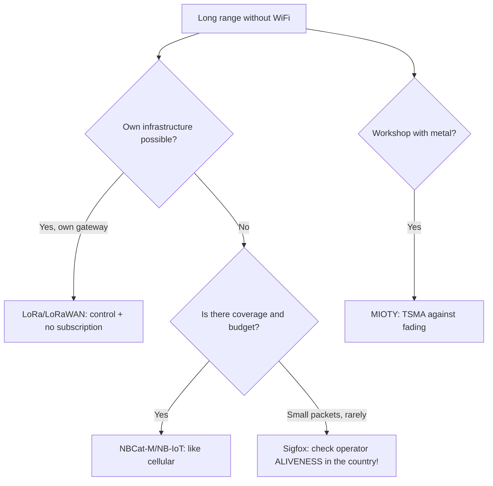

# LoRa LPWAN alternatives: Sigfox, Weightless, MIOTY, Wize

## Purpose

LoRa won, but not everywhere and not forever: Sigfox (0G operator), Weightless (open standard), MIOTY (TSMA for workshops), Wize (169 MHz, meters). Note - honest comparison for a conscious choice, not out of habit.

Base: start - [[EN/Home.en]], LoRa base - [[EN/12-Comm-Modules/02-NRF24-LoRa.en|LoRa]], Cat-1 - [[EN/12-Comm-Modules/18-Cellular-LoRa-2.en|Cat-1]], NB-IoT - [[EN/12-Comm-Modules/09-Cellular-NBIoT-UARTLoRa.en|NB-IoT]].

![[assets/img/lpwan-alt-compare-scheme.png|600]]
*Fig. LPWAN map: LoRa (own network), Sigfox (0G operator), NB-IoT (cellular), MIOTY/Wize (niches).*

## Comparison table (as of 2026!)

| Parameter | LoRa/LoRaWAN | Sigfox (0G) | NB-IoT | MIOTY | Wize (169 MHz) |
| --- | --- | --- | --- | --- | --- |
| Own network | Yes (own gateway!) | No (operator) | No (operator) | Yes | Yes |
| Payload | Up to 242 bytes | 12 bytes uplink! | ~1.6 KB | ~200 bytes | ~200 bytes |
| Downlink | Yes (classes A/B/C) | 4x8 bytes/day! | Yes | Yes | Yes |
| Range | 2-15 km | 10-50 km | like LTE | 5-15 km (workshop!) | 5-10 km |
| Status 2026 | Growing (private!) | Stagnation, operator bankruptcies | Alive (telco) | Workshop niche | Meter niche (FR) |
| Module | $5-15 (RAK/E78) | $10+subscription | $15+tariff | $20+ | $15+ |

### Mermaid: what to choose



## Why LoRa won (and when it does not matter)

1. **Own gateway**: $50-200 once - and no subscriptions/operator bankruptcies (Sigfox lesson!).
2. **Ecosystem**: RAK/E78/modules, TTN/ChirpStack, ESP32 examples - none of this exists in MIOTY/Wize for hobby.
3. **When not LoRa**: meters under key with an operator (NB-IoT), legacy Sigfox sensors (support, not new ones), workshop with harsh multipath (MIOTY).

### Helium status: check before the project

```text
Helium (LongFi, блокчейн-мережа LoRa): пік 2021–2022, далі — згасання покриття
і міграція на Solana/IoT-токени. Правило: НЕ проєктувати під Helium у 2026
без живої перевірки (карта explorer + тестовий вузол на місцевості!).
TCO-корекція: «безкоштовний» Helium з мертвим покриттям = свій шлюз все одно
потрібен → рахувати як LoRa-приватну мережу з розділу TCO вище.
```

## typical errors

| # | Error | Why it is bad | How to do it right |
| --- | --- | --- | --- |
| 1 | New project on Sigfox | Operators are winding down | LoRa or NB-IoT |
| 2 | 12 bytes is not enough | Sigfox architecture will not change | Design payload for 12 B from the start |
| 3 | Downlink like uplink | 4x8 bytes/day in Sigfox! | Commands - rarely and short |
| 4 | "Free" NB-IoT | Tariff + eSIM logistics | Calculate TCO over 5 years |
| 5 | Own LoRa without gateway | Nobody to listen | Gateway first (see 29-Gateway) |

## Official sources

- [Sigfox 0G technology](https://www.sigfox.com/en) - specification, coverage.
- [Weightless - standard history (Wikipedia)](https://en.wikipedia.org/wiki/Weightless_(wireless_communications)) - open standard.
- [MIOTY technology](https://mioty-alliance.com/miotytechnology/) - TSMA, workshop cases.
- [LoRaWAN Specification v1.0.3](https://lora-alliance.org/resource_hub/lorawan-specification-v1-0-3/) - for comparison.

## Sigfox in detail: 12 bytes and 4 downlinks

```text
Uplink: 12 байт, ≤140/добу; модуляція UNB 100 Гц (ультравузька!) — звідси дальність.
Downlink: ТІЛЬКИ після uplink, 8 байт, 4 рази на добу МАКСИМУМ.
Пристрій: ATA8520E / Wisol-модулі; мережа: оператор 0G (перевірити карту покриття країни!).
Ціна: module $10–15 + абонплата $1–3/рік/пристрій (при парку!).
Вердикт 2026: підтримка існуючого парку — так; нові проєкти — тільки якщо оператор живий і дешевший за NB-IoT.
```

## Weightless / MIOTY / Wize in short

| Technology | Trick | Module status for hobby |
| --- | --- | --- |
| Weightless-P/N | Open standard, two-way | Almost none (telco history) |
| MIOTY (TSMA) | Telegram Splitting: packet torn into pieces - resilience to fading in the workshop | Industrial (AG/Gemtek), expensive |
| Wize (169 MHz) | Penetration into buildings (low frequency!) | French meters, narrow |

### TCO example (100 sensors, 5 years)

```text
LoRa свій шлюз: 2× шлюз $150 + вузли $12×100 = $1500 РАЗОМ, далі $0/рік.
NB-IoT: вузли $20×100 + $2/рік×100×5 = $2000 + $1000 = $3000.
Sigfox: вузли $12×100 + $1.5/рік×100×5 = $1200 + $750 = $1950 (ЯКЩО оператор живий!).
Висновок: свій LoRa-шлюз окупається на 2-й рік проти будь-якої абонплати.
```

## Coverage in Ukraine/EU: where it catches (landmarks!)

| Network | City | Field/road | Comment |
| --- | --- | --- | --- |
| LoRa own | Own gateway - own coverage | 15 m mast ≈ 20 km | Control in your own hands |
| NB-IoT | Big-three operators (check coverage map!) | Along highways - yes, remote areas - no | eSIM/M2M tariff separately! |
| Sigfox | Former zones (shrinking!) | Rarely | Before the project - test device on site |
| Wize/MIOTY | Spot projects | No | Only for a specific tender |

### Choice checklist (5 questions!)

```text
[ ] Пейлоад вміщається? (12 Б Sigfox vs 242 Б LoRa)
[ ] Даунлінк потрібен часто? (Sigfox — ні!)
[ ] Своя інфраструктура можлива? (Так → LoRa)
[ ] Оператор живий у моїй країні? (Перевірити, не повірити!)
[ ] TCO на 5 років пораховано? (Розділ TCO вище)
```

## Migration from Sigfox to LoRa (plan for a live fleet!)

```text
Проблема: 500 датчиків на Sigfox, оператор гасне. План:
  1. Шлюзи: поставити 2–3 SX1302 поруч із зонами (покрити ті самі точки!).
  2. Прошивка: OTA/заміна — LoRaWAN-стек замість Sigfox (часто той самий module-носій!).
  3. Сервер: ChirpStack, мапінг device EUI 1:1 зі старою базою.
  4. Паралельний період: 1 місяць обидві мережі → звірка втрат → відключення Sigfox.
  5. Пейлоад переробити: 12 Б → повноцінний CBOR/JSON (можна більше — не стримуватись!).
Ризик: корпуси/антени 868 МГц ті самі — залізо міняти НЕ треба, тільки плати зв'язку.
```

## Sources on migrations (cases!)

```text
Шукати: "Sigfox migration LoRaWAN case study" + свій вертикаль (лічильники/логістика).
Патерн успіху: спочатку шлюзи, потім вузли, паралельний період обов'язковий.
Патерн провалу: «переключимо за вихідні» без паралельного періоду.
```

## LPWAN glossary in 30 seconds

| Term | What it means |
| --- | --- |
| UNB | Ultra-Narrow-Band (Sigfox: 100 Hz!) |
| TSMA | Telegram Splitting (MIOTY: packet in pieces) |
| 0G | Operator network without data roaming (Sigfox model) |
| Duty cycle | 1% airtime limit (EU868!) - applies to ALL technologies |

## Common issues

| Symptom | Cause | Fix |
| --- | --- | --- |
| Sigfox payload rejected | Over 12 bytes uplink or downlink limit hit | Pack to 12 B, respect 140 messages per day cap |
| No coverage at site | 0G operator absent in region | Check coverage map before hardware, keep LoRa fallback |
| Weightless gateway too costly | Gateway price kills small pilots | Start with LoRa gateway, migrate if scale demands |
| MIOTY telegram loss | Wrong sub-GHz profile or antenna | Verify 868 MHz profile, matched antenna, TSMA timing |
| Wize range too short | 169 MHz needs long whip, wrong matching | Use quarter-wave whip, check matching network |
## See also

- [[Home.en|Home]]
- [[EN/12-Comm-Modules/02-NRF24-LoRa.en|NRF24/LoRa]]
- [[EN/12-Comm-Modules/18-Cellular-LoRa-2.en|Cat-1/LoRa-2]]
- [[EN/12-Comm-Modules/09-Cellular-NBIoT-UARTLoRa.en|NB-IoT]]
- [[EN/12-Comm-Modules/29-LoRaWAN-Gateway.en|LoRaWAN gateway]]
