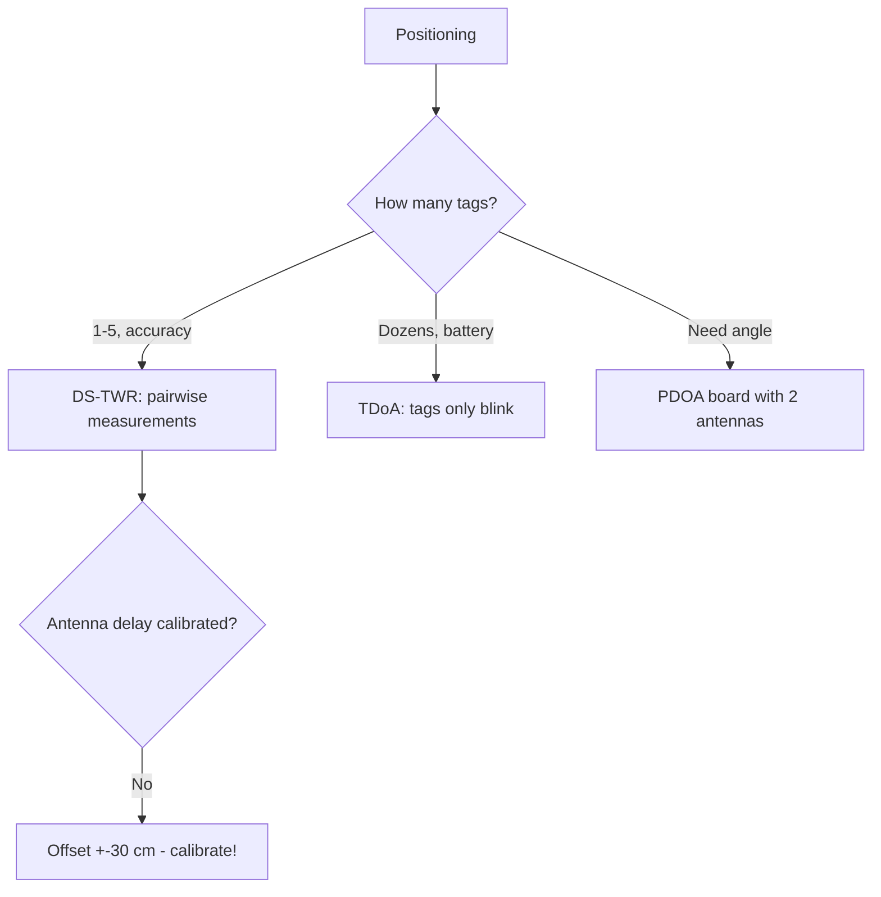

# UWB-2: DW3000 vs DWM1000 (TDoA, PDOA, antennas)

## Purpose

DWM1000 (DW1000) is the classic UWB positioning part but removed from active promotion. DW3000 is the successor: channels 5/9, better sensitivity, PDOA (angle of arrival!) with two antennas. A note on migration and practice.

Prerequisites: start - [[EN/Home.en]], first UWB - [[EN/12-Comm-Modules/08-LD2410-UWB-IR-Voice.en|UWB]], BLE positioning - [[EN/05-Radio/06-BLE-Gateway-Tracker.en]].

![[assets/img/uwb-dw3000-ranging-scheme.png|600]]
*Fig. DW3000 anchor + tags: SS-TWR measurement, TDoA sync, PDOA angle from two antennas.*

## Generation comparison

| Parameter | DWM1000 (DW1000) | DW3000 (DWM3000) |
| --- | --- | --- |
| Channels | 1-5, 7 | 5, 9 (sub-GHz removed!) |
| Sensitivity | -106 dBm | -108 dBm (longer range/more stable) |
| PDOA (angle) | None | Present (two antennas!) |
| TX consumption | ~150 mA | ~100 mA |
| Status | NRND (not for new designs!) | Active |
| Libraries | arduino-dw1000 (mature) | dw3000-arduino (younger!) |

## 1. Measurement schemes: SS-TWR vs DS-TWR vs TDoA

| Scheme | How | Accuracy | Cost |
| --- | --- | --- | --- |
| SS-TWR (single request-response) | Tag-anchor exchange, 2 packets | +-10-20 cm (clock drift!) | Simple |
| DS-TWR (double-sided) | 3 packets, drift compensation | +-5-10 cm | De facto standard |
| TDoA (arrival difference) | Tag blinks, anchors synchronized | +-10 cm, passive tags (battery!) | Anchor sync needed |

```text
Підключення DWM3000 до ESP32 (SPI):
  VCC 3.3V, GND; SCK→GPIO18, MOSI→GPIO23, MISO→GPIO19 (VSPI!);
  CS→GPIO5, IRQ→GPIO21, RST→GPIO22, WAKE→GPIO4.
  Антена: вбудована кераміка АБО U.FL; PDOA — ТІЛЬКИ плата з двома антенами!
```

### Mermaid: scheme choice



## 2. Calibration (without it - a toy!)

```text
1. Антенна затримка: відома дистанція 5.000 м → підібрати delay до 5.00±0.05.
2. PDOA-офсет: обертання на 360° → таблиця поправок кута.
3. Маска приміщення: метал/дзеркала дають мультипас — міряти карту помилок.
4. Температура: TCXO тримає, але калібрувати при робочій!
```

## typical errors

| # | Mistake | Why it is bad | How to do it right |
| --- | --- | --- | --- |
| 1 | New project on DW1000 | NRND, prices grow | DW3000 |
| 2 | Without delay calibration | Systematic +-30 cm | Section 2 above |
| 3 | SS-TWR for accuracy | Clock drift | DS-TWR |
| 4 | Single antenna for PDOA | No angle physically | Dual-antenna board |
| 5 | UWB through metal | Does not pass | Line of sight / denser anchors |
| 6 | Channels 1-4 on DW3000 | Not supported! | Only 5 and 9 |

## Official sources

- [DW3000 datasheet + User Manual (Qorvo)](https://www.qorvo.com/products/d/da008340) - channels, PDOA, calibration.
- [DWM3000 module docs](https://www.qorvo.com/products/d/da008399) - pinout, antennas.
- [Makerfabs ESP32 UWB DW3000](https://github.com/Makerfabs/Makerfabs-ESP32-UWB-DW3000) - SS/DS-TWR examples (look for a fresh fork!).

## DW3000 channels and what to do with them

| Channel | Frequency | Bandwidth | Comment |
| --- | --- | --- | --- |
| 5 | 6489.6 MHz | 500 MHz | Default for ranging, simpler antennas |
| 9 | 7987.2 MHz | 500 MHz | Less interference from 6 GHz WiFi? Check locally! |
| 1-4, 7 | - | - | DW3000 does not support (were in DW1000!) |

## Antenna delay calibration step by step

```text
1. Два пристрої на рівній дистанції рівно 5.000 м (рулетка!), пряма видимість.
2. 100 вимірів DS-TWR → середнє, напр. 5.34 м (завищення типове!).
3. Підібрати ANT_DLY регістр: зменшувати, доки середнє не стане 5.00±0.05.
4. Повторити для КОЖНОЇ пари «плата+антена» (розкид між екземплярами!),
   значення записати в NVS пристрою.
5. PDOA: на додачу — круговий тест 0–360° з кроком 15°, таблиця поправок.
```

```cpp
// Arduino (концепція dw3000-бібліотеки): ініціалізація + SS-TWR запит
// dw3000.begin(); dw3000.setChannel(5); dw3000.setAntennaDelay(calib);
// distance = dw3000.ranging(peerAddr);  // метри, float
// DS-TWR: три пакети всередині драйвера; читати статус, не блокувати loop!
```

## Hardware for start: what to buy

| Kit | What is inside | Price | When |
| --- | --- | --- | --- |
| DWM3000EVB (Qorvo) | Board + antenna + J-Link | $40+ | Development, calibration |
| Makerfabs DW3000 | ESP32 + DW3000 on one board | $30-40 | Fast start with Arduino |
| 4x anchors + 1 tag | Minimal TDoA system | $150+ | 10x10 m room |

```text
Перший вечір: два модулі → приклад DS-TWR → рулетка 5 м → калібрування delay →
карта кімнати на папері → тільки потім корпуси і монтаж!
```

## Indoor multipath: error map

```text
Процедура: тег на візку, сітка 1 м по кімнаті, 50 вимірів у точці →
теплова карта похибки. Типові плями: біля металевих шаф (±50 см!),
за колонами (тінь), під стелею з металопрофілем.
Лікування: +1 якір на пляму, маска «недовірених зон» у софті,
фільтр Калмана з вагою за SNR (слабкий сигнал — менша вага!).
```

## UWB glossary in 30 seconds

| Term | Meaning |
| --- | --- |
| TWR | Two-Way Ranging (request-response) |
| TDoA | Arrival time difference (tag only blinks!) |
| PDOA | Phase difference (angle from two antennas) |
| CIR | Channel impulse response (multipath visible!) |

## Common issues

| Symptom | Cause | Fix |
| --- | --- | --- |
| Ranging error over 30 cm | No antenna-delay calibration done | Run per-board calibration, store delay in NVS |
| No packets on channel 9 | Both sides on different UWB channels | Lock channel 5 or 9 both sides, verify preamble code |
| Indoor jumps of meters | NLOS multipath in rooms | Map error zones, fuse with IMU, prefer DS-TWR |
| DW1000 code fails on DW3000 | Register and API differences | Port to DW3000 driver, recheck SPI speed and OTP trim |
| PDOA angle garbage | Antenna spacing wrong or coupling | Keep half-wave spacing, calibrate phase offset per unit |
## See also

- [[Home.en|Home]]
- [[EN/12-Comm-Modules/08-LD2410-UWB-IR-Voice.en|Radar/UWB first]]
- [[EN/05-Radio/06-BLE-Gateway-Tracker.en|BLE positioning]]
- [[EN/04-Interfaces/02-SPI.en|SPI]]
- [[EN/10-Sensors/29-Range-Lidar-60GHz.en|Rangefinders]]
