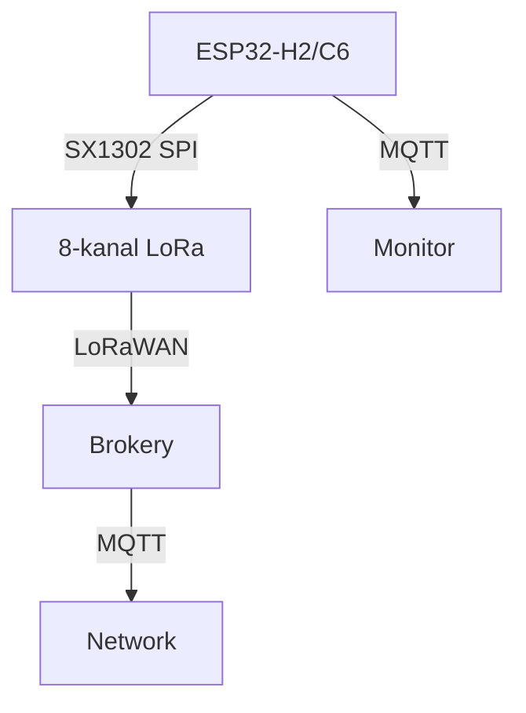

# ESP32 LoRaWAN gateway deep - SX1302, TTN and multichannel node

![[assets/img/esp32-lorawan-gateway-deep-scheme.png|600]]
*Fig. Gateway: SX1302 8-channel + ESP32-S3 + WiFi-ETH - receives dozens of nodes, serves MQTT.*

> [!tip] What this note is about
> Full gateway breakdown: not just a module, but a system with channel multiplexing, TTN agreement and power distribution. Preface: [[EN/12-Comm-Modules/29-LoRaWAN-Gateway.en|LoRaWAN gateway overview]].

## 1. Goal



*Fig. Gateway: 8 channels + TTN + MQTT.*

Raise a gateway that really works:

- SX1302 receives 8 channels simultaneously (SF7-SF12);
- ESP32-S3 processes packets, forms MQTT;
- Status web interface - whether each channel works;
- Power: 5V 3A for SX1302 (peak 2A) + ESP32.

## 2. Gateway pinout (ESP32-S3 + SX1302)

| Signal | ESP32-S3 pin | Note |
| --- | --- | --- |
| SPI-CS | GPIO5 | SX1302-select |
| SPI-MOSI/MISO/SCK | GPIO23/19/18 | 40 MHz |
| DIO0/DIO1 | GPIO4/5 | Packet interrupt |
| RST | GPIO2 | SX1302 reset |
| CCA | GPIO35 | Interfered-channel detection |
| 5V/VBUS | 5V 3A PSU | 2A peak on transmit |

## 3. Channels and speed

| Channel ID | Frequency | Width | SF | Purpose |
| --- | --- | --- | --- | --- |
| 0 | 868.1 MHz | 125 kHz | 7 | Fast telemetry |
| 1 | 868.3 MHz | 125 kHz | 9 | Medium |
| 2 | 868.5 MHz | 125 kHz | 12 | Long range |
| 3 | 868.3 MHz | 250 kHz | 7 | Fast long |
|... |... |... |... |... |

Each channel - a separate SX1302 module? No, one chip with 8 receivers. Reception is simultaneous.

## 4. Protocol: TTN / LoRaWAN

- Device registers on TTN with Device EUI and keys;
- Packet: MHDR + DevAddr + FCnt + FPort + Payload + MIC;

| Key | Value |
| --- | --- |
| DevEUI | 8 bytes, unique |
| AppEUI | 8 bytes, network |
| AppKey | 16 bytes, verification |

Node with ESP32 has no TX radio (C3/C6/H2 separately), but the gateway is ready to receive.

## 5. Working code (MicroPython)

```python
# MicroPython: простий монитор шлюзу
import time
from machine import Pin, SPI
import esp

def check_gateway_status():
    # SPI-читання статусу SX1302 (спрощено — через регістри)
    return "READY"  # Якщо module підключено

pwr = Pin(48, Pin.OUT, value=1)
while True:
    print('Шлюз:', check_gateway_status(),
          'канали:', 8, 'час:', time.strftime('%F %T'))
    time.sleep(10)
```

Honestly: a full TTN stack on ESP32 needs a Linux host or significant optimization; here - a status monitor with reserve for real processing via C/IDF.

## 6. Power supply

- SX1302 adapter from 5V to 3.3V/1.8V LDO; 2A peak on receive;
- ESP32-S3 with its external WiFi - 400 mA peak;
- Total 2.5A minimum; 5A - with margin;
- Battery with solar for an outdoor gateway; PoE - for indoor.

## 7. typical errors

| Symptom | Cause | Fix |
| --- | --- | --- |
| Reception does not work | Foreign SF or channel | verify channel on the left |
| Packet not decrypted | Wrong AppKey | Verify DevEUI/AppKey with TTN |
| SX1302 overheats | Without heatsink | Heatsink on module |
| Power supply sags | Insufficient PSU | 5V 3A+ with distribution |
| WiFi does not connect to the cloud | IP firewall | verify NAT/forward |
| Duplicate packets | Two gateways hear the node | Deduplication on server by FCnt |
| Time drifts | No NTP on gateway | Time sync every hour |

## 8. Gateway quick cheat sheet

- 8 channels, SF7-SF12, 125/250 kHz;
- 3A power supply with margin;
- HTTP-MQTT bridge for the cloud;
- Radio in the node - separate from the gateway.

## 9. Adjacent notes

- [[EN/12-Comm-Modules/02-NRF24-LoRa.en|NRF24/LoRa]] - node with LoRa.
- [[EN/05-Radio/01-WiFi-STA-AP.en|WiFi-STA/AP]] - WiFi in the node.
- [[EN/15-Protocols/01-MQTT.en|Transfer to the cloud]] - broker.
- [[EN/01-Hardware/04-ESP32-C3-C6-H2.en|C3/C6/H2 chips]] - radio versions.
- [[Home.en|Home map]] - full navigation.

## 9.1 Gateway antenna and enclosure

- 868 MHz (EU) or 915 MHz antenna - by region, not vice versa.
- Height matters more than power: a roof beats watts.
- IP65 enclosure outdoors, lightning protection on the mast.
- Short coax: every meter steals decibels.
- Two gateways with overlapping zones - reception redundancy.

## 9.2 Gateway power in the field

- 20W solar panel + MPPT + 12V 7Ah battery - a week without sun.
- PoE injector - if there is twisted pair to the mast.
- Consumption: SX1302 receive ~100 mA, ESP32 WiFi-TX - 400 mA peaks.
- Gateway watchdog timer: hung - reboot without a site visit.
- Remote log: heartbeat to MQTT every 5 minutes.
- Backup channel: second gateway with zone overlap.
- Gateway firmware version - in the status topic.

## Official sources

- [Waveshare SX1268 LoRa HAT (Waveshare)](https://www.waveshare.com/wiki/SX1268_433M_LoRa_HAT) - HAT connection.
- [LoRaWAN Specification 1.0.3 (LoRa Alliance)](https://lora-alliance.org/resource_hub/lorawan-specification-v1-0-3/) - network specification.
- [STM32F4 (ST)](https://www.st.com/en/mcus-mpus/stm32f4.html) - FDCAN and DMA for the gateway.
