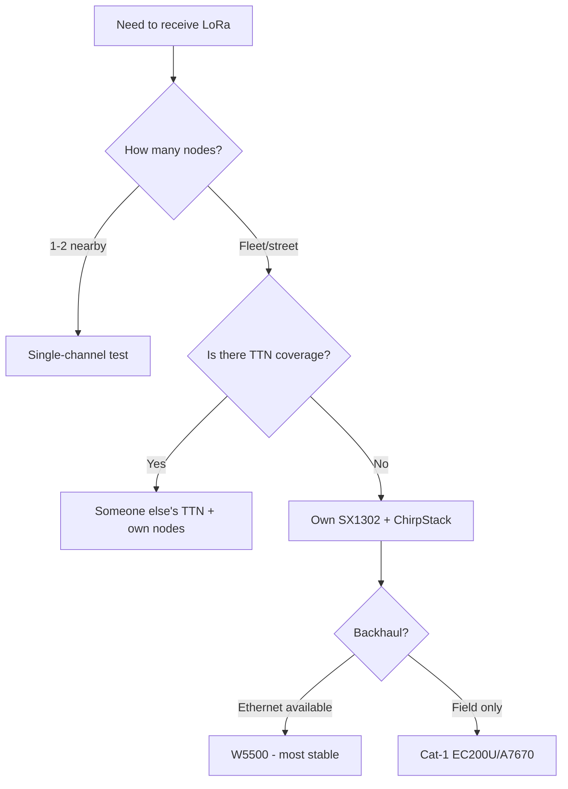

# LoRaWAN gateway: single-channel trap, SX1302, ChirpStack, TTN

## Purpose

LoRa nodes talk - someone must listen. Options: single-channel "gateway" on ESP32 ($15, but a profanation), full 8-channel on SX1302 ($80+, real), or someone else's TTN/ChirpStack. Note - so you do not buy the wrong thing.

Base: start - [[EN/Home.en]], LoRa base - [[EN/12-Comm-Modules/02-NRF24-LoRa.en|LoRa]], Cat-1 - [[EN/12-Comm-Modules/18-Cellular-LoRa-2.en|Cat-1]] (backhaul!), MQTT-SN - [[EN/15-Protocols/14-MQTT-SN.en]].

> [!danger] Single-channel "gateway" - not a gateway!
> A single-channel receiver (ESP32+SX1276) hears 1 combination (frequency+SF) of ~50 possible and does not send downlink on time. Nodes nearby "work", the rest - not, diagnostics - hell. For 1-2 sensors nearby - OK; calling this a LoRaWAN network - no.

![[assets/img/lorawan-gateway-sx1302-scheme.png|600]]
*Fig. Nodes → 8-channel gateway (SX1302) → backhaul (Ethernet/Cat-1) → ChirpStack/TTN → MQTT.*

## Gateway comparison

| Option | Hardware | Channels | Downlink | Price | When |
| --- | --- | --- | --- | --- | --- |
| Single-channel (ESP32+SX1276) | 1 demodulator | 1 | Broken | $15 | 1-2 nodes nearby, tests |
| 8-channel (SX1302+ESP32/RPi) | 8xSF in parallel | 8 | Full | $80-150 | Real network |
| Ready-made (RAK7268, Milesight) | All inside | 8 | + PoE/IP65 | $150-300 | Outdoors without hassle |
| Milesight UG65/UG67 | IP65 ready, built-in NS | 8 | Full | $200-350 | Street pole: hang and forget (PoE/solar power) |
| TTN community | Someone else's | - | - | $0 | City with coverage (check the map!) |

```text
SX1302-шлюз на ESP32 (схема):
  SX1302-плата (SPI: SCK/MOSI/MISO/CS + RST) ──► ESP32 (хост packet-forwarder!)
  Backhaul: Ethernet (W5500 — стабільно!) або Cat-1 (див. 18-Cellular-LoRa-2).
  Антена 868 МГц скловолокно 3–5 дБм ЯКОМОГА ВИЩЕ (висота = покриття!).
  GPS PPS на шлюзі — для Class-B маяків (без PPS тільки Class-A/C!).
```

### Mermaid: choice



## 1. ChirpStack vs TTN

| Parameter | ChirpStack (own) | TTN (community) |
| --- | --- | --- |
| Where it lives | Own server (RPi/VPS) | TTN cloud |
| Limits | None | Fair use (30 s airtime/day/node!) |
| Privacy | Data stays yours | Data via a foreign cloud |
| MQTT integration | Built in | Built in |
| Price | Own server | $0 (or paid TTI Cloud) |

## 2. ABP vs OTAA (nodes!)

| Mode | Join | Plus | Minus |
| --- | --- | --- | --- |
| OTAA | Over the air, session keys | Secure, rotation | Needs downlink windows (single-channel limps!) |
| ABP | Keys hard-coded | Works even with a broken gateway | Keys are eternal; frame-counter reset = rejection! |

## typical errors

| # | Error | Why it is bad | How to do it right |
| --- | --- | --- | --- |
| 1 | Single-channel as a "network" | Hears 2% of airtime | Honestly call it a test; network = SX1302 |
| 2 | Gateway in an apartment on the table | 200 m coverage | As high as possible + outdoor antenna |
| 3 | ABP with counter reset | Network drops frames | Store frame-counter in NVS! |
| 4 | Backhaul over WiFi without backup | Drop = blind network | Ethernet or Cat-1 |
| 5 | Class-B without GPS PPS | Beacons do not work | PPS on gateway or A/C only |
| 6 | TTN fair use exceeded | Device ban | Count airtime: SF12 - rarely! |

## Official sources

- [SX1302 datasheet (Semtech)](https://www.semtech.com/products/wireless-rf/lora-core/sx1302) - channels, sensitivity.
- [ChirpStack docs](https://www.chirpstack.io/docs/) - gateway bridge, integrations.
- [The Things Network docs](https://www.thethingsnetwork.org/docs/) - fair use, OTAA/ABP.

## Packet-forwarder: minimal config

```json
{
  "gateway_conf": {"gateway_ID": "AA555A0000000000", "server_address": "chirpstack.local", "serv_port_up": 1700, "serv_port_down": 1700},
  "SX130x_conf": {"lorawan_public": true, "clksrc": 0, "antenna_gain": 3},
  "station_conf": {"log_file": "stderr"}
}
```

## EU868 frequency plan (what to listen!)

| Channel | Frequency | SF | Purpose |
| --- | --- | --- | --- |
| 0-2 | 868.1 / 868.3 / 868.5 MHz | 7-12 | Default uplink (must exist!) |
| 3-7 | 867.1-867.9 | 7-12 | Extra (CFList from server) |
| RX2 | 869.525 MHz | SF9 | Default downlink! |
| 868.0 | FSK 50 kbps | - | Rarely used |

### Antenna height = coverage (horizon formula!)

```text
Радіогоризонт: d ≈ 4.12 × (√h1 + √h2) км, h у метрах.
Шлюз 15 м + вузол 2 м: 4.12 × (3.87 + 1.41) ≈ 21 км (ідеал!).
Шлюз на столі 1.5 м + вузол 1.5 м: ≈ 10 км теорії, 0.2–2 км міста (будинки!).
Кожні +6 м висоти ≈ подвоєння площі покриття. Щогла окупається першою.
```

### ChirpStack in 5 steps

```text
1. ChirpStack Gateway Bridge на хості шлюзу (MQTT-міст до сервера!).
2. Network Server + Application Server (Docker-compose з офіційного репо!).
3. Додати gateway (EUI з packet-forwarder!), профіль EU868.
4. Створити application + device (OTAA: AppEUI/AppKey згенерувати!).
5. Інтеграція MQTT/HTTP → свої топіки (див. 15-01!) → Node-RED/Grafana.
```

## Gateway diagnostics: what to look at

| Symptom | Where to look |
| --- | --- |
| Packets in the air exist, none on server | Backhaul (ping!), firewall 1700/UDP |
| RSSI -120, SNR -15 | Sensitivity limit: higher SF / higher antenna |
| Join-request without accept | AppKey keys / CFList / server time! |
| Duplicate uplinks | Two gateways hear - normal, deduplication on server |

## Gateway redundancy (so the network does not fall!)

```text
Два SX1302 з перекриттям зон: вузли чують обидва → сервер дедуплікує.
Backhaul різний: один Ethernet, другий Cat-1 (різні оператори!).
Живлення: UPS/PoE з батареєю на 4+ год (відключення світла ≠ зупинка мережі).
Моніторинг: heartbeat шлюзу в ChirpStack + алерт «мовчить 10 хв» у Telegram.
```

## See also

- [[Home.en|Home]]
- [[EN/12-Comm-Modules/02-NRF24-LoRa.en|NRF24/LoRa]]
- [[EN/12-Comm-Modules/18-Cellular-LoRa-2.en|Cat-1/LoRa-2]]
- [[EN/12-Comm-Modules/27-LPWAN-Alt.en|LPWAN alternatives]]
- [[EN/15-Protocols/14-MQTT-SN.en|MQTT-SN]]
- [[EN/12-Comm-Modules/07-SIM7600-W5500-MCP2515.en|W5500]]
