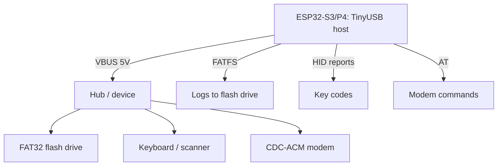

# ESP32 as USB host - flash drives, HID and CDC via TinyUSB

![[assets/img/esp32-usb-host-scheme.png|600]]
*Fig. S3/P4 as host: polls a flash drive, keyboard and modem - 5V power on VBUS mandatory.*

> [!tip] What this note is about
> The reverse side of USB: ESP32 not a device for a PC, but a host for peripherals - a logger to a flash drive without an SD slot, a barcode scanner, a modem over CDC. Works on S3 (OTG FS) and P4 (OTG HS). Base: [[EN/04-Interfaces/06-USB-OTG-JTAG.en|USB-OTG and JTAG]], [[EN/04-Interfaces/07-SD-SDIO.en|SD cards]], [[EN/09-Firmware/01-ESP-IDF-Setup.en|ESP-IDF setup]].

## 1. Goal

Master three USB device classes with ESP32:

- MSC: flash drive - FATFS read/write, logger without SD slot;
- HID: keyboard/mouse/barcode scanner - input without buttons;
- CDC: USB modems and converters - AT commands over USB;
- VBUS 5V power - the host powers the device, not vice versa.

| Class | Device | Library/example |
| --- | --- | --- |
| MSC | FAT32 flash drive | `usb/host/msc` + FATFS |
| HID | keyboard, scanner | `usb/host/hid` |
| CDC | modem, CP2102 | `usb/host/cdc_acm` |
| Hub | splitter | cascade if needed |

## 2. Architecture



Stack: TinyUSB host → class driver → application. We parse descriptors as Ready, manually - only in debugging.

## 3. Hardware part

- S3: GPIO19/20 - USB D-/D+, built-in PHY;
- P4: separate USB-OTG HS PHY - faster and more current;
- VBUS 5V to the connector - the host must power the device (up to 500 mA);
- protective power switch (TPS2051 or polyfuse) - a short on the flash drive must not kill the board;
- for tests - a powered OTG adapter, not a bare cable.

## 4. MSC: flash drive as a disk

- `usb/host/msc` example: mounting, `fopen/fwrite/fclose` via FATFS;
- logger: open the file once an hour, write line by line, close - the flash drive survives removal;
- safe removal: "unmount" button, confirmation LED;
- speed: tens of KB/s - enough for logs and configs, not for video.

## 5. Working code (IDF)

```c
#include "usb/msc_host.h"
#include "esp_log.h"

static const char *TAG = "usbmsc";

void msc_event_cb(msc_host_event_t event, void *arg) {
  if (event == MSC_DEVICE_CONNECTED) {
    ESP_LOGI(TAG, "flash connected");
    msc_host_install(NULL);
    FILE *f = fopen("/usb/log.txt", "a");
    if (f) {
      fprintf(f, "boot %lu\n", (unsigned long)esp_timer_get_time());
      fclose(f);
      ESP_LOGI(TAG, "logged to flash");
    }
  } else if (event == MSC_DEVICE_DISCONNECTED) {
    ESP_LOGI(TAG, "flash removed");
    msc_host_uninstall();
  }
}

void app_main(void) {
  msc_host_config_t cfg = {
    .event_cb = msc_event_cb,
  };
  ESP_ERROR_CHECK(msc_host_install(&cfg));
  while (1) {
    vTaskDelay(pdMS_TO_TICKS(1000));
  }
}
```

`/usb` path - mount point from the example. A real logger writes in 512-byte packets - exactly a sector, without fragmentation.

## 6. HID: keyboard and scanner

- `usb/host/hid` example: 8-byte reports, HID-table key codes;
- barcode scanner - the same keyboard: read the line until Enter;
- NKRO keyboards - longer reports, parse the length from the descriptor;
- mouse - coordinates and buttons for HMI without touch.

## 6.1 Hubs and peripheral power

- unpowered hub: maximum 2 low-power devices;
- powered hub: flash drive + scanner + modem at the same time;
- 500 mA polyfuse on VBUS - a short does not kill the board;
- long USB 2.0 cables - up to 3 m without a hub, active beyond that;
- OTG adapter with a separate power input - a must-have in the bag.

## 6.2 Host speed and limits

- FS (S3): 12 Mbps, really ~1 MB/s to a flash drive;
- HS (P4): 480 Mbps, the flash drive runs into FATFS;
- isochronous cameras (UVC video) - the limit of possibilities, take MIPI;
- one device per port without a hub - the most stable configuration;
- long transfers - double buffers, otherwise underrun.

## 7. CDC modems

- `usb/host/cdc_acm` example: VCP like a file - read/write;
- 4G modems in CDC mode - AT commands and PPP next;
- several interfaces - open each separately;
- [[EN/12-Comm-Modules/03-SIM800L-GPS.en|SIM800L modems]] - the AT part is the same.

## 8. typical errors

| Symptom | Cause | Fix |
| --- | --- | --- |
| Device not seen | no 5V on VBUS | apply host power, verify switch |
| Flash drive mounts every other time | current sag | powered hub, shorter cable |
| HID silent | complex device descriptor | read the report length, not fixed 8 |
| CDC does not open | modem in QMI mode | switch to CDC-ACM with an AT command |
| Works on P4, not on S3 | HS vs FS timings | different examples per chip, do not copy |
| Panic after removal | no disconnect handling | unmount callback + flag |

## 9. Adjacent notes

- [[EN/04-Interfaces/06-USB-OTG-JTAG.en|USB-OTG and JTAG]] - the hardware side of USB.
- [[EN/04-Interfaces/07-SD-SDIO.en|SD cards]] - flash drive alternative.
- [[EN/12-Comm-Modules/03-SIM800L-GPS.en|SIM800L modems]] - AT over CDC.
- [[EN/09-Firmware/05-JTAG-Debug.en|JTAG debugging]] - same connector, different role.
- [[EN/14-Devboards/16-P4-DevKit.en|P4 board]] - OTG HS on board.

## Official sources

- [USB Host API (Espressif)](https://docs.espressif.com/projects/esp-idf/en/latest/esp32s3/api-reference/peripherals/usb_host.html) - host stack, classes, events.
- [USB Host examples (Espressif, GitHub)](https://github.com/espressif/esp-idf/tree/master/examples/peripherals/usb/host) - MSC/HID/CDC examples.
- [TinyUSB (GitHub)](https://github.com/hathach/tinyusb) - stack under the hood, descriptors.
